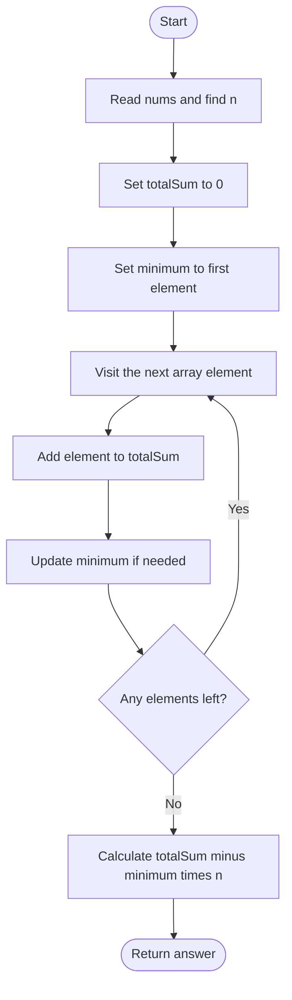
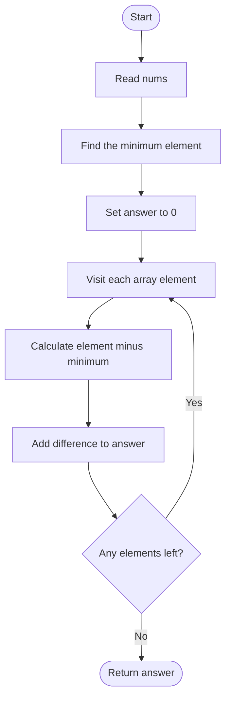

## 👨‍💻 Profiles

**GitHub:** https://github.com/Shailendra0320  
**LeetCode (Main):** https://leetcode.com/u/Shailu03/  
**LeetCode (Alternate):** https://leetcode.com/u/ShailendraLeetcode03/

# 453. Minimum Moves to Equal Array Elements

**Difficulty:** Easy  
**Topics:** Array, Math  
**Main pattern:** Mathematical transformation + minimum element  
**Official problem:** [LeetCode 453 — Minimum Moves to Equal Array Elements](https://leetcode.com/problems/minimum-moves-to-equal-array-elements/)

---

## Table of Contents

- [1. Understand the Problem](#1-understand-the-problem)
- [2. Examples](#2-examples)
- [3. The Important Observation](#3-the-important-observation)
- [4. Why the Minimum Element Is the Target](#4-why-the-minimum-element-is-the-target)
- [5. Approach 1 — One Pass: Track Sum and Minimum](#5-approach-1--one-pass-track-sum-and-minimum)
- [6. Approach 2 — Two Passes: Add Every Difference](#6-approach-2--two-passes-add-every-difference)
- [7. Approach Comparison](#7-approach-comparison)
- [8. Edge Cases](#8-edge-cases)
- [9. Common Mistakes](#9-common-mistakes)
- [10. Interview Explanation](#10-interview-explanation)
- [11. Quick Revision](#11-quick-revision)

---

## 1. Understand the Problem

You are given an integer array `nums` containing `n` elements.

In one move, you can **increase exactly `n - 1` elements by `1`**. One element is left unchanged.

Your task is to return the minimum number of moves needed to make every element equal.

### Understand one move

For example, when:

```text
nums = [1, 2, 3]
```

There are three elements, so one move increases two elements and leaves one element unchanged.

The following sequence makes all values equal:

```text
[1, 2, 3]
   ↓ increase 1 and 2
[2, 3, 3]
   ↓ increase 2 and 3
[3, 4, 3]
   ↓ increase 1 and 3
[4, 4, 4]
```

The answer is `3`.

**Important:** You do not need to actually perform these moves. A mathematical observation gives the answer directly.

### Constraints

- `1 <= nums.length <= 100000`
- `-1000000000 <= nums[i] <= 1000000000`
- The answer is guaranteed to fit in a 32-bit signed integer.

The values can be negative, and the sum of all values can exceed the 32-bit integer range. Use a 64-bit variable for intermediate calculations in Java and C++.

---

## 2. Examples

### Example 1

```text
Input:  nums = [1, 2, 3]
Output: 3
```

One valid sequence is:

```text
[1, 2, 3]
[2, 3, 3]
[3, 4, 3]
[4, 4, 4]
```

Three moves are required.

### Example 2

```text
Input:  nums = [1, 1, 1]
Output: 0
```

All elements are already equal, so no move is needed.

### Example 3 — Negative values

```text
Input:  nums = [-1, 0, 2]
Output: 4
```

The minimum value is `-1`.

```text
-1 needs 0 moves
 0 needs 1 move
 2 needs 3 moves

Total = 0 + 1 + 3 = 4
```

### Example 4 — One element

```text
Input:  nums = [7]
Output: 0
```

When the array contains one element, `n - 1` is zero. The array is already equal by itself.

---

## 3. The Important Observation

At first, the operation looks unusual because it increases almost every element. Instead of thinking about increasing `n - 1` elements, think about what happens to the **difference between elements**.

### Increasing `n - 1` elements is equivalent to decreasing one element

Suppose we have:

```text
[1, 2, 3]
```

Choose the first element to be the one that does not increase:

```text
Actual operation:        [1, 3, 4]
Subtract 1 from all:      [0, 2, 3]
```

Subtracting the same amount from every element does not change whether the elements are equal, or how far apart they are.

After this common shift, the operation looks exactly like this:

```text
[1, 2, 3]  ->  [0, 2, 3]
             decrease only the skipped element
```

So, for the purpose of making all elements equal, we can think of every move as:

> **Choose one element and decrease it by 1.**

This is the key to the problem. We should not simulate the original increment operation.

### Visual transformation

```text
Original operation:
Increase n - 1 elements by 1

             is equivalent to

Simplified operation:
Decrease the one skipped element by 1
```

This transformation is valid because adding or subtracting the same value from every array element does not change the differences between them.

---

## 4. Why the Minimum Element Is the Target

Once the operation is viewed as decreasing one selected element by `1`, the goal becomes easier.

We can decrease elements, but we cannot increase an element in this equivalent view.

That means the final common value cannot be greater than the smallest value already present in the array.

Let:

```text
minimum = smallest value in nums
```

The best final value is exactly `minimum`.

Why?

- Choosing a target smaller than `minimum` would require extra decrements for every element.
- Choosing a target greater than `minimum` is impossible because the smallest element cannot be increased in the equivalent operation.
- Therefore, choosing `minimum` gives the fewest total decrements.

### Formula

Every element `nums[i]` needs:

```text
nums[i] - minimum
```

moves to reach the minimum.

Add these differences for all elements:

\[
\text{answer} = \sum_{i=0}^{n-1}(nums[i] - minimum)
\]

Expand the sum:

\[
\boxed{\text{answer} = \text{sum(nums)} - n \times minimum}
\]

This formula is the complete solution.

---

# 5. Approach 1 — One Pass: Track Sum and Minimum

**Time:** `O(n)`  
**Auxiliary space:** `O(1)`

This is the recommended approach. We scan the array once and calculate two things:

1. The sum of all elements.
2. The smallest element.

After the scan, use:

```text
answer = totalSum - (minimum * n)
```

### Step-by-step explanation

**Step 1 — Initialize the variables**

```text
totalSum = 0
minimum = nums[0]
```

We start the minimum with the first array element. This also works when all values are negative.

**Step 2 — Visit every element**

For every value:

- Add it to `totalSum`.
- Update `minimum` if the current value is smaller.

**Step 3 — Apply the formula**

After processing all values, calculate:

```text
totalSum - minimum * n
```

No sorting, nested loop, or actual move simulation is needed.

### Approach 1 flowchart



### Dry run — Example 1

```text
nums = [1, 2, 3]
n = 3
```

| Current value | Running sum | Minimum so far |
|---:|---:|---:|
| `1` | `1` | `1` |
| `2` | `3` | `1` |
| `3` | `6` | `1` |

Now apply the formula:

\[
\text{answer} = 6 - (1 \times 3) = \boxed{3}
\]

### Dry run — Example with negative values

```text
nums = [-1, 0, 2]
n = 3
```

| Current value | Running sum | Minimum so far |
|---:|---:|---:|
| `-1` | `-1` | `-1` |
| `0` | `-1` | `-1` |
| `2` | `1` | `-1` |

\[
\text{answer} = 1 - (-1 \times 3) = \boxed{4}
\]

The element-wise view gives the same result:

| Element | Minimum | Moves needed |
|---:|---:|---:|
| `-1` | `-1` | `0` |
| `0` | `-1` | `1` |
| `2` | `-1` | `3` |
| **Total** | | **4** |

### Why Approach 1 works

Every move can be viewed as decreasing one chosen element by one. To make all values equal, every element must reach a common target.

That target cannot be larger than the original minimum, because the equivalent operation never increases an element. A target smaller than the minimum would require more decrements than necessary.

So the minimum value is the best target. The number of decrements needed by each element is its difference from that minimum. Adding these differences gives the minimum number of moves:

\[
\sum nums[i] - n \times minimum
\]

### Java — Approach 1

```java
//Approach-1 (One Pass: Track Sum and Minimum)
//T.C : O(n)
//S.C : O(1)

class Solution {
    public int minMoves(int[] nums) {
        long totalSum = 0;
        int minimum = nums[0];

        for (int num : nums) {
            totalSum += num;
            minimum = Math.min(minimum, num);
        }

        long answer = totalSum - (long) minimum * nums.length;
        return (int) answer;
    }
}
```

### C++ — Approach 1

```cpp
//Approach-1 (One Pass: Track Sum and Minimum)
//T.C : O(n)
//S.C : O(1)

#include <bits/stdc++.h>
using namespace std;

class Solution {
public:
    int minMoves(vector<int>& nums) {
        long long totalSum = 0;
        int minimum = nums[0];

        for (int num : nums) {
            totalSum += num;
            minimum = min(minimum, num);
        }

        long long answer = totalSum - 1LL * minimum * nums.size();
        return static_cast<int>(answer);
    }
};
```

### Python — Approach 1

```python
#Approach-1 (One Pass: Track Sum and Minimum)
#T.C : O(n)
#S.C : O(1)

from typing import List

class Solution:
    def minMoves(self, nums: List[int]) -> int:
        total_sum = 0
        minimum = nums[0]

        for num in nums:
            total_sum += num
            minimum = min(minimum, num)

        return total_sum - minimum * len(nums)
```

---

# 6. Approach 2 — Two Passes: Add Every Difference

**Time:** `O(n)`  
**Auxiliary space:** `O(1)`

This approach uses exactly the same observation, but writes the final calculation in a more direct way.

Instead of storing the total sum and using the formula, we:

1. Find the minimum element.
2. Visit the array again.
3. Add `num - minimum` for every element.

The result is:

\[
\boxed{\text{answer} = \sum (nums[i] - minimum)}
\]

### Step-by-step explanation

**Step 1 — Find the minimum value**

Scan the array and store its smallest element.

**Step 2 — Calculate each element's difference**

For every element, calculate how many decrements it needs to reach the minimum:

```text
movesForThisElement = nums[i] - minimum
```

**Step 3 — Add all differences**

Add these values to `answer`. The final sum is the minimum number of moves.

### Approach 2 flowchart



### Dry run — Example 1

```text
nums = [1, 2, 3]
minimum = 1
```

| Element | Calculation | Moves | Running answer |
|---:|---:|---:|---:|
| `1` | `1 - 1` | `0` | `0` |
| `2` | `2 - 1` | `1` | `1` |
| `3` | `3 - 1` | `2` | `3` |

Final answer:

\[
0 + 1 + 2 = \boxed{3}
\]

### Dry run — Example 2

```text
nums = [1, 1, 1]
minimum = 1
```

| Element | Calculation | Moves |
|---:|---:|---:|
| `1` | `1 - 1` | `0` |
| `1` | `1 - 1` | `0` |
| `1` | `1 - 1` | `0` |

Final answer is `0` because every element is already equal.

### Java — Approach 2

```java
//Approach-2 (Two Passes: Add Every Difference)
//T.C : O(n)
//S.C : O(1)

class Solution2 {
    public int minMoves(int[] nums) {
        int minimum = nums[0];

        for (int num : nums) {
            minimum = Math.min(minimum, num);
        }

        long answer = 0;

        for (int num : nums) {
            answer += (long) num - minimum;
        }

        return (int) answer;
    }
}
```

### C++ — Approach 2

```cpp
//Approach-2 (Two Passes: Add Every Difference)
//T.C : O(n)
//S.C : O(1)

#include <bits/stdc++.h>
using namespace std;

class Solution2 {
public:
    int minMoves(vector<int>& nums) {
        int minimum = *min_element(nums.begin(), nums.end());
        long long answer = 0;

        for (int num : nums) {
            answer += 1LL * num - minimum;
        }

        return static_cast<int>(answer);
    }
};
```

### Python — Approach 2

```python
#Approach-2 (Two Passes: Add Every Difference)
#T.C : O(n)
#S.C : O(1)

from typing import List

class Solution2:
    def minMoves(self, nums: List[int]) -> int:
        minimum = min(nums)
        answer = 0

        for num in nums:
            answer += num - minimum

        return answer
```

### Why Approach 2 works

The minimum value is the final target for the same reason explained earlier: the equivalent operation only decreases one element at a time, so the target cannot be higher than the minimum.

Each element needs exactly `nums[i] - minimum` decrements to reach that target. No element needs to go below the target, and no extra work is performed. Adding these differences counts all required moves.

---

## 7. Approach Comparison

| Detail | Approach 1: One pass | Approach 2: Two passes |
|---|---|---|
| Main idea | Track sum and minimum together | Find minimum, then add each difference |
| Number of scans | One | Two |
| Time complexity | `O(n)` | `O(n)` |
| Auxiliary space | `O(1)` | `O(1)` |
| Formula | `sum(nums) - n * minimum` | `sum(nums[i] - minimum)` |
| Best use | Shortest and most efficient implementation | Makes the moves for each element explicit |

**Recommendation:** Use Approach 1 for submission. It finds the sum and minimum in one traversal and then applies the formula directly.

---

## 8. Edge Cases

| Input | Minimum | Expected answer | Why |
|---|---:|---:|---|
| `[5]` | `5` | `0` | A single element is already equal to itself |
| `[2, 2, 2]` | `2` | `0` | All values are equal |
| `[1, 2, 3]` | `1` | `3` | Differences are `0, 1, 2` |
| `[-1, 0, 2]` | `-1` | `4` | Differences are `0, 1, 3` |
| `[-5, -2, -2]` | `-5` | `6` | Differences are `0, 3, 3` |
| `[4, 1, 4, 1]` | `1` | `6` | Differences are `3, 0, 3, 0` |

---

## 9. Common Mistakes

1. **Trying to simulate the original operation.** The array values can keep growing. Use the equivalent decrement view instead.
2. **Choosing the maximum as the target.** In the equivalent operation, elements can only decrease. The minimum is the correct target.
3. **Sorting the array unnecessarily.** Only the sum and minimum are needed.
4. **Forgetting negative values.** Initialize the minimum with `nums[0]`, not `0`.
5. **Using `int` for the intermediate sum in Java or C++.** The sum can exceed the 32-bit range even though the final answer is guaranteed to fit. Use `long` or `long long`.
6. **Forgetting that one element is skipped.** Incrementing `n - 1` elements is equivalent to decrementing the one skipped element after shifting every value down by one.

---

## 10. Interview Explanation

> “The operation increments all elements except one. If I subtract one from every element after an operation, the elements that were incremented return to their previous values, while the skipped element decreases by one. Since shifting every element by the same amount does not change equality, this is equivalent to decrementing one element per move. Therefore, we should reduce every element to the smallest value in the array. The total number of moves is the sum of all differences from that minimum, which simplifies to `sum(nums) - n * minimum`. I can calculate the sum and minimum in one pass, so the time complexity is O(n) and the auxiliary space is O(1).”

---

## 11. Quick Revision

- One move increases `n - 1` elements by `1`.
- Think of the operation as decreasing the one skipped element by `1`.
- The best final value is the minimum element.
- Each element contributes `nums[i] - minimum` moves.
- Final formula: `sum(nums) - minimum * n`.
- Time complexity: `O(n)`.
- Auxiliary space: `O(1)`.
- Use `long` / `long long` for intermediate arithmetic in Java / C++.

### One-line insight

**Incrementing all but one element is equivalent to decrementing the skipped element, so reduce every value to the array minimum.**

---

**Reference:** [LeetCode 453 — Minimum Moves to Equal Array Elements](https://leetcode.com/problems/minimum-moves-to-equal-array-elements/)
