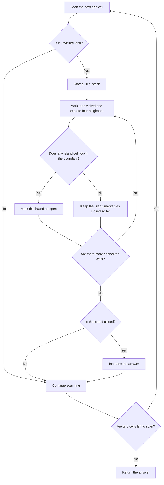
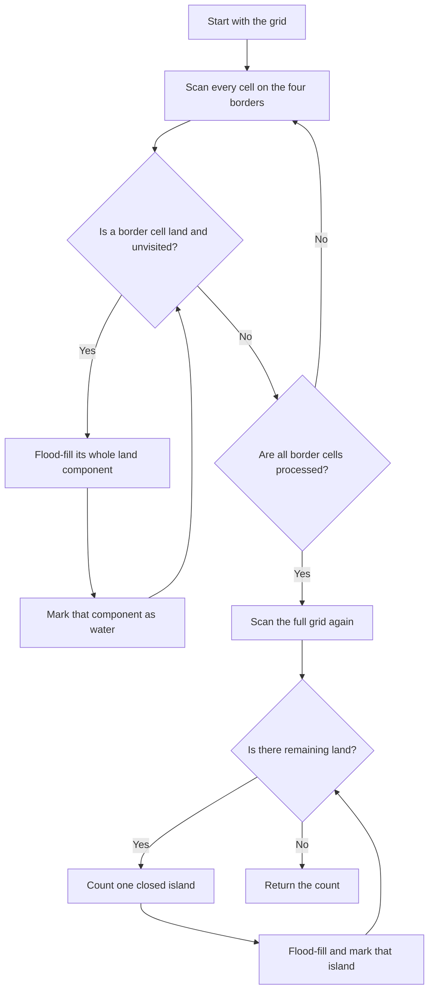

## 👨‍💻 Profiles

**GitHub:** https://github.com/Shailendra0320  
**LeetCode (Main):** https://leetcode.com/u/Shailu03/  
**LeetCode (Alternate):** https://leetcode.com/u/ShailendraLeetcode03/

# 1254. Number of Closed Islands

**Difficulty:** Medium  
**Topics:** Array, Matrix, Depth-First Search, Breadth-First Search, Flood Fill, Connected Components  
**Main pattern:** Explore each connected group of land and check whether it touches the grid boundary.

**Official problem:** [LeetCode 1254 — Number of Closed Islands](https://leetcode.com/problems/number-of-closed-islands/)

---

## Table of Contents

- [1. Understand the Problem](#1-understand-the-problem)
- [2. Examples](#2-examples)
- [3. Important Observations](#3-important-observations)
- [4. Main Idea](#4-main-idea)
- [5. Approach 1 — Explore Each Island and Check Its Boundary](#5-approach-1--explore-each-island-and-check-its-boundary)
- [6. Approach 2 — Remove Boundary Land First, Then Count What Remains](#6-approach-2--remove-boundary-land-first-then-count-what-remains)
- [7. Compare the Approaches](#7-compare-the-approaches)
- [8. Edge Cases](#8-edge-cases)
- [9. Common Mistakes](#9-common-mistakes)
- [10. Interview Explanation](#10-interview-explanation)
- [11. Quick Revision](#11-quick-revision)

---

## 1. Understand the Problem

You are given a grid containing only `0` and `1`:

| Cell value | Meaning |
|---|---|
| `0` | Land |
| `1` | Water |

An **island** is a connected group of land cells. Cells connect only in the four straight directions: up, down, left, and right. Diagonal contact does **not** connect two land cells.

A **closed island** is an island that does not touch any edge of the grid. Every cell in that island must be surrounded by water or other cells inside the grid, so the island cannot reach the outside through a boundary cell.

Your task is to return the number of closed islands.

### What does “touch the boundary” mean?

A cell is on the boundary if it is in the first row, last row, first column, or last column.

For a grid with `m` rows and `n` columns, a cell `(r, c)` is on the boundary when:

```text
r == 0  OR  r == m - 1  OR  c == 0  OR  c == n - 1
```

If even **one land cell** in a connected island touches the boundary, the whole island is not closed.

### Constraints

- `1 <= grid.length, grid[0].length <= 100`
- `grid[i][j]` is either `0` or `1`.
- Movement is allowed only up, down, left, and right.

The grid can contain up to 10,000 cells. Both approaches below visit each cell only a constant number of times, so they are efficient enough for the constraints.

---

## 2. Examples

### Example 1

```text
Input: grid = [
  [1,1,1,1,1,1,1,0],
  [1,0,0,0,0,1,1,0],
  [1,0,1,0,1,1,1,0],
  [1,0,0,0,0,1,0,1],
  [1,1,1,1,1,1,1,0]
]
Output: 2
```

There are two land components completely enclosed by water. The land components that reach the outer border are not counted.

### Example 2

```text
Input: grid = [
  [0,0,1,0,0],
  [0,1,0,1,0],
  [0,1,1,1,0]
]
Output: 1
```

The middle land cell at row `1`, column `2` is surrounded by water on all four sides. The other land groups touch the outer border, so only the middle cell forms a closed island.

### Example 3

```text
Input: grid = [
  [1,1,1,1,1,1,1],
  [1,0,0,0,0,0,1],
  [1,0,1,1,1,0,1],
  [1,0,1,0,1,0,1],
  [1,0,1,1,1,0,1],
  [1,0,0,0,0,0,1],
  [1,1,1,1,1,1,1]
]
Output: 2
```

The outer ring of water separates the land into two closed islands in the middle. The four-direction rule matters: only side-adjacent cells connect.

---

## 3. Important Observations

1. **Do not count each zero cell separately.** One island may contain many connected zero cells, but it counts as one island.
2. **A single boundary cell makes the entire island open.** You must explore the full connected group before deciding whether to count it.
3. **Diagonal contact does not connect land.** Always check exactly four neighbors.
4. **Mark cells as visited.** Otherwise, the search can revisit the same land again and again.
5. **The grid can be modified.** These solutions change visited land cells from `0` to `1` so they are not processed again. If you must preserve the input, make a copy or use a separate visited matrix.

---

## 4. Main Idea

Think of each group of side-connected zeroes as one object. We need to know whether that object touches the outer border.

There are two common ways to solve this:

- **Approach 1:** Find an island, explore all of it, and remember whether any cell touches the border. Count the island only if no cell touches the border.
- **Approach 2:** First remove every land group that touches the border. After that, every land group still left in the grid is closed, so count those groups.

Both methods use flood fill. Flood fill means starting at one cell and visiting all connected cells of the same type.

### Visual legend

```text
1 = water
0 = unvisited land
B = land connected to the border (not closed)
C = land belonging to a closed island
```

Example 2 after identifying the two kinds of land:

```text
B B 1 B B
B 1 C 1 B
B 1 1 1 B
```

The `B` cells form islands that can reach the border. The single `C` cell cannot reach the border, so the answer is `1`.

---

# 5. Approach 1 — Explore Each Island and Check Its Boundary

**Time complexity:** `O(m * n)`  
**Auxiliary space:** `O(m * n)` in the worst case for the stack.

This approach follows the definition directly: discover one island, inspect all cells in that island, and count it only if it never touches the boundary.

### Step 1 — Scan the whole grid

Visit every cell row by row. Water cells (`1`) can be skipped. When you find an unvisited land cell (`0`), you have found the beginning of a new island.

### Step 2 — Explore the full connected island

Use a stack to perform an iterative depth-first search (DFS). Add the starting cell to the stack and immediately change its value from `0` to `1`. Each time you find a neighboring land cell, mark it before pushing it onto the stack.

Marking it when it is pushed prevents the same cell from being added multiple times.

### Step 3 — Check whether the island touches the boundary

Whenever a cell is removed from the stack, check its row and column. If it is in the first/last row or first/last column, set `isClosed` to `false`.

Do not stop the search immediately after finding a boundary cell. Continue exploring so every cell in that island is marked visited. Otherwise, the remaining cells of the same island might be counted again later.

### Step 4 — Count the island if it is closed

After the stack becomes empty, the entire island has been explored. If `isClosed` is still `true`, increase the answer by one. If it became `false`, do not count it.

### Approach 1 flowchart



### Dry run — Example 2

Input grid:

```text
0 0 1 0 0
0 1 0 1 0
0 1 1 1 0
```

We scan from the top-left corner.

| Search | Cells reached | Touches boundary? | Count it? |
|---|---|---|---|
| First island | `(0,0)`, `(0,1)`, `(1,0)`, connected border land | Yes | No |
| Second island | `(0,3)`, `(0,4)`, `(1,4)`, `(2,4)` | Yes | No |
| Middle island | `(1,2)` only | No | Yes |

Once an island has been explored, its cells are changed to `1`, so the outer scan does not start a second search from those cells.

Final answer: `1`.

### Why Approach 1 works

The DFS visits every land cell connected to the starting cell by up/down/left/right moves. Therefore, it sees the whole island, not just part of it. If any visited cell is on the boundary, the island is open. If no visited cell is on the boundary, the island is closed. Since visited cells are marked, each island is processed exactly once. That means the algorithm counts all and only closed islands.

### Complexity explanation

- **Time — `O(m * n)`:** Each cell is scanned, and each land cell is marked and pushed at most once. Each visited cell checks four neighbors, which is constant work.
- **Space — `O(m * n)`:** In the worst case, the stack can hold a large portion of the grid, such as one large connected island.

### Approach 1 code

#### Java

```java
//Approach-1 (DFS Each Island and Check Boundary)
//T.C : O(m * n)
//S.C : O(m * n)

import java.util.ArrayDeque;
import java.util.Deque;

class Solution {
    public int closedIsland(int[][] grid) {
        int m = grid.length;
        int n = grid[0].length;
        int closedIslands = 0;
        int[][] dirs = {{1, 0}, {-1, 0}, {0, 1}, {0, -1}};

        for (int r = 0; r < m; r++) {
            for (int c = 0; c < n; c++) {
                if (grid[r][c] != 0) {
                    continue;
                }

                boolean isClosed = true;
                Deque<int[]> stack = new ArrayDeque<>();
                stack.push(new int[]{r, c});
                grid[r][c] = 1;

                while (!stack.isEmpty()) {
                    int[] cell = stack.pop();
                    int row = cell[0];
                    int col = cell[1];

                    if (row == 0 || row == m - 1 || col == 0 || col == n - 1) {
                        isClosed = false;
                    }

                    for (int[] dir : dirs) {
                        int nr = row + dir[0];
                        int nc = col + dir[1];

                        if (nr >= 0 && nr < m && nc >= 0 && nc < n
                                && grid[nr][nc] == 0) {
                            grid[nr][nc] = 1;
                            stack.push(new int[]{nr, nc});
                        }
                    }
                }

                if (isClosed) {
                    closedIslands++;
                }
            }
        }

        return closedIslands;
    }
}
```

#### C++

```cpp
//Approach-1 (DFS Each Island and Check Boundary)
//T.C : O(m * n)
//S.C : O(m * n)

#include <bits/stdc++.h>
using namespace std;

class Solution {
public:
    int closedIsland(vector<vector<int>>& grid) {
        int m = static_cast<int>(grid.size());
        int n = static_cast<int>(grid[0].size());
        int closedIslands = 0;
        vector<pair<int, int>> dirs = {{1, 0}, {-1, 0}, {0, 1}, {0, -1}};

        for (int r = 0; r < m; r++) {
            for (int c = 0; c < n; c++) {
                if (grid[r][c] != 0) {
                    continue;
                }

                bool isClosed = true;
                stack<pair<int, int>> st;
                st.push({r, c});
                grid[r][c] = 1;

                while (!st.empty()) {
                    auto [row, col] = st.top();
                    st.pop();

                    if (row == 0 || row == m - 1 || col == 0 || col == n - 1) {
                        isClosed = false;
                    }

                    for (auto [dr, dc] : dirs) {
                        int nr = row + dr;
                        int nc = col + dc;

                        if (nr >= 0 && nr < m && nc >= 0 && nc < n
                                && grid[nr][nc] == 0) {
                            grid[nr][nc] = 1;
                            st.push({nr, nc});
                        }
                    }
                }

                if (isClosed) {
                    closedIslands++;
                }
            }
        }

        return closedIslands;
    }
};
```

#### Python

```python
#Approach-1 (DFS Each Island and Check Boundary)
#T.C : O(m * n)
#S.C : O(m * n)

from typing import List

class Solution:
    def closedIsland(self, grid: List[List[int]]) -> int:
        m, n = len(grid), len(grid[0])
        closed_islands = 0
        directions = ((1, 0), (-1, 0), (0, 1), (0, -1))

        for r in range(m):
            for c in range(n):
                if grid[r][c] != 0:
                    continue

                is_closed = True
                stack = [(r, c)]
                grid[r][c] = 1

                while stack:
                    row, col = stack.pop()

                    if row == 0 or row == m - 1 or col == 0 or col == n - 1:
                        is_closed = False

                    for dr, dc in directions:
                        nr, nc = row + dr, col + dc

                        if 0 <= nr < m and 0 <= nc < n and grid[nr][nc] == 0:
                            grid[nr][nc] = 1
                            stack.append((nr, nc))

                if is_closed:
                    closed_islands += 1

        return closed_islands
```

---

# 6. Approach 2 — Remove Boundary Land First, Then Count What Remains

**Time complexity:** `O(m * n)`  
**Auxiliary space:** `O(m * n)` in the worst case for the stack.

This approach turns the problem around. Instead of searching for islands and checking whether each one is closed, first remove every island that is definitely **not** closed.

Why is that easier? Any island touching the boundary must contain a land cell in the first/last row or first/last column. If we start flood fill from every boundary land cell, we can mark every land group connected to the outside. Whatever land remains later cannot reach the boundary, so it must be a closed island.

### Step 1 — Visit the boundary

Check every cell in the top row and bottom row. Then check every cell in the leftmost and rightmost columns. A corner may be visited more than once; that is harmless because the flood-fill function immediately returns for water or already marked cells.

### Step 2 — Sink every border-connected island

Whenever a boundary cell contains `0`, start a stack-based DFS from it. Change every connected `0` to `1`. These cells are now treated as water because they belong to an island that is not closed.

### Step 3 — Scan the grid again

After removing all border-connected land, scan every cell. If you find a remaining `0`, it must belong to a closed island. Increase the answer, then flood-fill that entire island to mark it as visited.

### Step 4 — Return the count

Each remaining island is discovered once, counted once, and marked visited. The final counter is the number of closed islands.

### Approach 2 flowchart



### Diagram — Before and after removing border-connected land

Example 2 starts as:

```text
0 0 1 0 0
0 1 0 1 0
0 1 1 1 0
```

After flood-filling from the boundary, all border-connected land is changed to water. The only land cell left is the closed island:

```text
1 1 1 1 1
1 1 0 1 1
1 1 1 1 1
      ^
  closed island
```

The remaining zero is counted, then marked as water. The answer is `1`.

### Dry run — Example 2

| Stage | What happens | Land that remains unvisited |
|---|---|---|
| Start | Original grid is loaded | All original zeroes |
| Border pass | Flood-fill each boundary-connected zero group | Only the center cell `(1,2)` |
| Count pass | Find `(1,2)` and increase count | Center cell before its flood fill |
| Mark component | Change `(1,2)` from `0` to `1` | None |
| Finish | No zero cells remain | Answer is `1` |

### Why Approach 2 works

Every island that is not closed touches the boundary. Starting from that boundary land cell and exploring connected land will reach every cell in that island, so the first pass marks all non-closed islands.

The second pass sees only land that could not be reached from the boundary. Therefore, none of those remaining islands touches the boundary. Each one is closed. The second flood fill marks a whole island after counting it, so it cannot be counted twice.

### Complexity explanation

- **Time — `O(m * n)`:** The boundary pass explores each border-connected land cell at most once. The final scan explores every remaining land cell at most once. Each cell checks four neighbors.
- **Space — `O(m * n)`:** In the worst case, the DFS stack can grow to hold many cells in a connected component.

### Approach 2 code

#### Java

```java
//Approach-2 (Remove Border-Connected Land First)
//T.C : O(m * n)
//S.C : O(m * n)

import java.util.ArrayDeque;
import java.util.Deque;

class Solution2 {
    private final int[][] dirs = {{1, 0}, {-1, 0}, {0, 1}, {0, -1}};

    private void sink(int[][] grid, int startRow, int startCol) {
        int m = grid.length;
        int n = grid[0].length;
        Deque<int[]> stack = new ArrayDeque<>();

        if (grid[startRow][startCol] != 0) {
            return;
        }

        grid[startRow][startCol] = 1;
        stack.push(new int[]{startRow, startCol});

        while (!stack.isEmpty()) {
            int[] cell = stack.pop();
            int row = cell[0];
            int col = cell[1];

            for (int[] dir : dirs) {
                int nr = row + dir[0];
                int nc = col + dir[1];

                if (nr >= 0 && nr < m && nc >= 0 && nc < n
                        && grid[nr][nc] == 0) {
                    grid[nr][nc] = 1;
                    stack.push(new int[]{nr, nc});
                }
            }
        }
    }

    public int closedIsland(int[][] grid) {
        int m = grid.length;
        int n = grid[0].length;

        for (int c = 0; c < n; c++) {
            sink(grid, 0, c);
            sink(grid, m - 1, c);
        }

        for (int r = 0; r < m; r++) {
            sink(grid, r, 0);
            sink(grid, r, n - 1);
        }

        int closedIslands = 0;

        for (int r = 0; r < m; r++) {
            for (int c = 0; c < n; c++) {
                if (grid[r][c] == 0) {
                    closedIslands++;
                    sink(grid, r, c);
                }
            }
        }

        return closedIslands;
    }
}
```

#### C++

```cpp
//Approach-2 (Remove Border-Connected Land First)
//T.C : O(m * n)
//S.C : O(m * n)

#include <bits/stdc++.h>
using namespace std;

class Solution2 {
private:
    const vector<pair<int, int>> dirs = {{1, 0}, {-1, 0}, {0, 1}, {0, -1}};

    void sink(vector<vector<int>>& grid, int startRow, int startCol) {
        int m = static_cast<int>(grid.size());
        int n = static_cast<int>(grid[0].size());

        if (grid[startRow][startCol] != 0) {
            return;
        }

        stack<pair<int, int>> st;
        st.push({startRow, startCol});
        grid[startRow][startCol] = 1;

        while (!st.empty()) {
            auto [row, col] = st.top();
            st.pop();

            for (auto [dr, dc] : dirs) {
                int nr = row + dr;
                int nc = col + dc;

                if (nr >= 0 && nr < m && nc >= 0 && nc < n
                        && grid[nr][nc] == 0) {
                    grid[nr][nc] = 1;
                    st.push({nr, nc});
                }
            }
        }
    }

public:
    int closedIsland(vector<vector<int>>& grid) {
        int m = static_cast<int>(grid.size());
        int n = static_cast<int>(grid[0].size());

        for (int c = 0; c < n; c++) {
            sink(grid, 0, c);
            sink(grid, m - 1, c);
        }

        for (int r = 0; r < m; r++) {
            sink(grid, r, 0);
            sink(grid, r, n - 1);
        }

        int closedIslands = 0;

        for (int r = 0; r < m; r++) {
            for (int c = 0; c < n; c++) {
                if (grid[r][c] == 0) {
                    closedIslands++;
                    sink(grid, r, c);
                }
            }
        }

        return closedIslands;
    }
};
```

#### Python

```python
#Approach-2 (Remove Border-Connected Land First)
#T.C : O(m * n)
#S.C : O(m * n)

from typing import List

class Solution2:
    def _sink(self, grid: List[List[int]], start_row: int, start_col: int) -> None:
        m, n = len(grid), len(grid[0])

        if grid[start_row][start_col] != 0:
            return

        stack = [(start_row, start_col)]
        grid[start_row][start_col] = 1
        directions = ((1, 0), (-1, 0), (0, 1), (0, -1))

        while stack:
            row, col = stack.pop()

            for dr, dc in directions:
                nr, nc = row + dr, col + dc

                if 0 <= nr < m and 0 <= nc < n and grid[nr][nc] == 0:
                    grid[nr][nc] = 1
                    stack.append((nr, nc))

    def closedIsland(self, grid: List[List[int]]) -> int:
        m, n = len(grid), len(grid[0])

        for c in range(n):
            self._sink(grid, 0, c)
            self._sink(grid, m - 1, c)

        for r in range(m):
            self._sink(grid, r, 0)
            self._sink(grid, r, n - 1)

        closed_islands = 0

        for r in range(m):
            for c in range(n):
                if grid[r][c] == 0:
                    closed_islands += 1
                    self._sink(grid, r, c)

        return closed_islands
```

---

## 7. Compare the Approaches

| Detail | Approach 1: Check Each Island | Approach 2: Remove Boundary Land First |
|---|---|---|
| Main idea | Explore a component and see whether it reaches the edge | Erase every component that reaches the edge, then count the rest |
| Number of grid passes | One full scan with flood fill | Border flood fill, then a full scan with flood fill |
| Main state | `isClosed` flag for the current island | Border-connected land has already been changed to `1` |
| Time | `O(m * n)` | `O(m * n)` |
| Auxiliary space | `O(m * n)` worst case | `O(m * n)` worst case |
| Best reason to use it | Directly matches the definition | Often easier to reason about: remove all invalid islands first |

**Recommendation:** Approach 2 is a common interview-friendly solution because the first pass removes every island that cannot possibly count. Approach 1 is equally valid and is a great way to learn connected-component traversal.

---

## 8. Edge Cases

| Case | Example | Expected result | Reason |
|---|---|---:|---|
| Every cell is water | `[[1,1],[1,1]]` | `0` | No land exists |
| Every cell is land | `[[0,0],[0,0]]` | `0` | Every land cell touches the boundary |
| One-row grid | `[[0,1,0]]` | `0` | All land is on the boundary |
| One-column grid | `[[0],[1],[0]]` | `0` | All land is on the boundary |
| One enclosed land cell | `[[1,1,1],[1,0,1],[1,1,1]]` | `1` | The center cell is surrounded by water |
| Land touches a corner | `[[0,1],[1,0]]` | `0` | Both zeroes are boundary cells and do not connect diagonally |
| Several closed islands | Two separate interior land groups | Count each group once | Each component is explored once |

---

## 9. Common Mistakes

1. **Treating `1` as land.** In this problem, `0` is land and `1` is water.
2. **Checking only the starting cell.** An interior starting cell might connect to a boundary through other land cells. You must explore the entire component.
3. **Counting a boundary-connected island anyway.** If any cell in the component touches the outer edge, the island is not closed.
4. **Using diagonal neighbors.** Only up, down, left, and right are allowed.
5. **Marking visited cells too late.** Mark a zero when you push it on the stack, not after popping it, to avoid duplicate stack entries.
6. **Stopping as soon as the boundary is found.** You still need to finish the flood fill to mark the full component as visited.
7. **Counting every zero.** A closed island may have many zeroes but contributes only one to the answer.
8. **Forgetting input mutation.** These implementations sink visited land by changing `0` to `1`. Make a deep copy if you need to preserve the original grid.
9. **Using the wrong boundary check.** A cell touches the boundary if its row is `0` or `m - 1`, or its column is `0` or `n - 1`.

---

## 10. Interview Explanation

> “A closed island is a four-directionally connected component of zeroes that never touches the grid border. I can solve it in two ways. In the first, I start a flood fill from every unseen zero, record whether any visited cell is on the boundary, and count the component only if it never touches the edge. In the second, I first flood-fill from every border zero to remove all land connected to the outside. Then every zero left in the grid belongs to a closed island, so I count and remove those components. Each cell is visited only a constant number of times, giving `O(m * n)` time and `O(m * n)` worst-case auxiliary space.”

---

## 11. Quick Revision

- `0` means land; `1` means water.
- Island connectivity is four-directional; diagonals do not count.
- A closed island contains no cell on the grid boundary.
- **Approach 1:** Explore each island; count it only if no visited cell touches an edge.
- **Approach 2:** Flood-fill and remove all border-connected land first, then count remaining components.
- Mark cells as visited when pushing them onto the stack.
- Both approaches: `O(m * n)` time and `O(m * n)` worst-case stack space.
- Both approaches modify `grid` in-place.

### One-line insight

**Every land component that touches the border is open; count only the components that never reach the border.**

### Final takeaway

The important part is not the DFS itself; it is how you decide whether an island is closed. You can check the boundary while exploring each component, or remove every border-connected component first. Both methods use the same flood-fill idea and correctly count each closed island once.

**Reference:** [LeetCode 1254 — Number of Closed Islands](https://leetcode.com/problems/number-of-closed-islands/)
