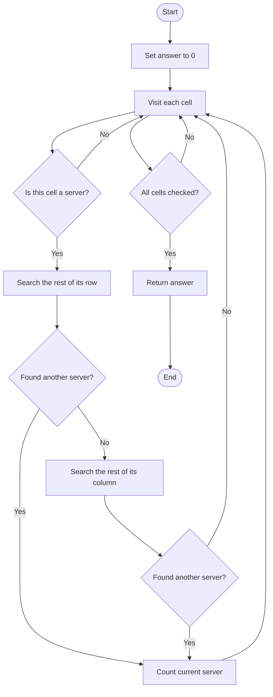
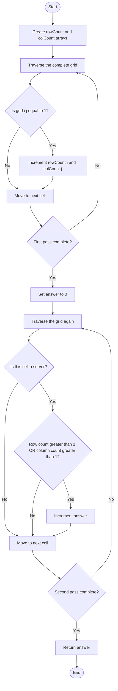
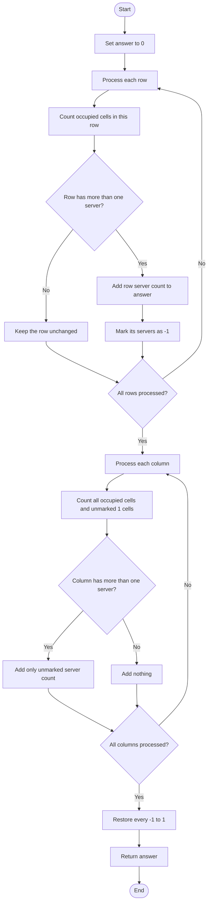

## 👨‍💻 Profiles

**GitHub:** https://github.com/Shailendra0320  
**LeetCode (Main):** https://leetcode.com/u/Shailu03/  
**LeetCode (Alternate):** https://leetcode.com/u/ShailendraLeetcode03/

# 1267. Count Servers that Communicate

> **Difficulty:** Medium  
> **Topics:** Array, Matrix, Counting, Depth-First Search, Breadth-First Search, Union Find  
> **Primary pattern:** Matrix traversal + row/column frequency counting

## Table of Contents

1. [Problem Statement](#problem-statement)
2. [Examples](#examples)
3. [Constraints](#constraints)
4. [Understand the Communication Rule](#understand-the-communication-rule)
5. [Key Observation](#key-observation)
6. [Approach 1 — Brute Force](#approach-1--brute-force)
7. [Approach 2 — Row and Column Frequency Counting](#approach-2--row-and-column-frequency-counting)
8. [Approach 3 — In-Place Marking](#approach-3--in-place-marking)
9. [Approach Comparison](#approach-comparison)
10. [Detailed Dry Run](#detailed-dry-run)
11. [Edge Cases](#edge-cases)
12. [Common Mistakes](#common-mistakes)
13. [Why the Counting Approach Works](#why-the-counting-approach-works)
14. [Interview Explanation](#interview-explanation)
15. [Complexity Summary](#complexity-summary)
16. [Quick Revision](#quick-revision)

---

## Problem Statement

You are given an `m x n` binary matrix named `grid` that represents the locations of servers in a server center.

- `grid[i][j] == 1` means a server is present at row `i`, column `j`.
- `grid[i][j] == 0` means that cell is empty.

Two different servers can communicate when they are located in the **same row or the same column**.

Return the number of servers that can communicate with **at least one other server**.

### Important Details

- A server must have another server in its row or in its column.
- The server cannot communicate with itself. A row or column containing only that server is not enough.
- A server is counted once, even when it has other servers in both its row and column.
- We count servers, not communication pairs.

For a server at `(i, j)`, the condition is:

\[
\text{grid}[i][j] = 1
\quad\text{and}\quad
(\text{rowCount}[i] > 1\;\text{or}\;\text{colCount}[j] > 1)
\]

---

## Examples

### Example 1

**Input:**

```text
grid = [[1,0],
        [0,1]]
```

**Output:**

```text
0
```

**Explanation:**

There are two servers, but they are on different rows and different columns. Neither server has another server to communicate with, so the answer is `0`.

```text
S  .
.  S
```

`S` represents a server and `.` represents an empty cell.

### Example 2

**Input:**

```text
grid = [[1,0],
        [1,1]]
```

**Output:**

```text
3
```

**Explanation:**

- The server at `(0, 0)` communicates with the server at `(1, 0)` because they share column `0`.
- The server at `(1, 0)` also communicates with the server at `(1, 1)` because they share row `1`.
- The server at `(1, 1)` communicates with the server at `(1, 0)`.

All three servers communicate with at least one other server.

```text
S  .
S  S
```

### Example 3

**Input:**

```text
grid = [[1,1,0,0],
        [0,0,1,0],
        [0,0,1,0],
        [0,0,0,1]]
```

**Output:**

```text
4
```

**Explanation:**

- The two servers in row `0` communicate with each other.
- The two servers in column `2` communicate with each other.
- The server at `(3, 3)` is alone in its row and column, so it cannot communicate.

There are four communicating servers in total.

```text
S  S  .  .
.  .  S  .
.  .  S  .
.  .  .  S
```

---

## Constraints

- `m == grid.length`
- `n == grid[i].length`
- `1 <= m <= 250`
- `1 <= n <= 250`
- `grid[i][j]` is either `0` or `1`.

The grid can contain up to:

\[
250 \times 250 = 62,500 \text{ cells}
\]

A solution that scans the entire matrix a small, fixed number of times is easily efficient enough.

---

## Understand the Communication Rule

Imagine each `1` as a server. A server does not need to communicate with every other server. It only needs **one other server** in the same row or column.

Consider this row:

```text
S  S  .  S
```

All three servers can communicate because they share the same row.

Consider this column:

```text
S
.
S
.
S
```

All three servers can communicate because they share the same column.

Now consider a single server:

```text
.  .  .
.  S  .
.  .  .
```

This server cannot communicate. Its row has one server and its column also has one server.

### A server is isolated only when both counts are one

For a server at `(i, j)`:

- If `rowCount[i] > 1`, it can communicate through its row.
- If `colCount[j] > 1`, it can communicate through its column.
- If either condition is true, count the server.
- If both counts equal `1`, the server is isolated.

The word **OR** is important. A server does not need both a row connection and a column connection.

---

## Key Observation

Instead of searching separately for another server for every `1`, count how many servers exist in each row and each column.

Create two arrays:

- `rowCount[i]`: number of servers in row `i`.
- `colCount[j]`: number of servers in column `j`.

After these counts are ready, checking a server takes constant time:

```text
if grid[i][j] == 1 and (rowCount[i] > 1 or colCount[j] > 1):
    answer++
```

This leads to a two-pass solution:

1. Traverse the grid and count servers in every row and column.
2. Traverse the grid again and count each server whose row or column contains more than one server.

<details>
<summary><strong>Why do we need two passes?</strong></summary>

When we first encounter a server, we do not yet know whether another server will appear later in its row or column. The first pass completes all row and column counts. The second pass can then make the correct decision for every server.

</details>

---

# Approach 1 — Brute Force

## Intuition

For every cell containing a server, directly search for another server in its row. If one is found, the current server can communicate.

If there is no other server in that row, search its column. If another server is found there, count the current server.

We do not need to find all communication partners. Finding just one is enough.

## Algorithm

1. Initialize `answer = 0`.
2. Visit every cell `(i, j)` in the matrix.
3. Skip the cell if `grid[i][j] == 0`.
4. For a server, scan the rest of row `i`:
   - Ignore column `j` because a server cannot communicate with itself.
   - If another `1` is found, mark the current server as communicating.
5. If no partner was found in the row, scan the rest of column `j`:
   - Ignore row `i`.
   - If another `1` is found, mark the current server as communicating.
6. Increase `answer` when a partner is found.
7. Return `answer`.

## Flowchart



## Dry Run — Example 2

Input:

```text
grid = [[1,0],
        [1,1]]
```

We examine the three servers one by one.

| Server | Row scan | Column scan | Count it? |
|---|---|---|---|
| `(0, 0)` | No other server in row `0` | Finds `(1, 0)` | Yes |
| `(1, 0)` | Finds `(1, 1)` | Not needed | Yes |
| `(1, 1)` | Finds `(1, 0)` | Not needed | Yes |

The final answer is:

\[
1 + 1 + 1 = 3
\]

## Java Code — Brute Force

```java
// Approach-1 (Brute Force: Scan the Current Row and Column)
// T.C: O(m * n * (m + n))
// S.C: O(1)

class Solution {
    public int countServers(int[][] grid) {
        int m = grid.length;
        int n = grid[0].length;
        int answer = 0;

        for (int i = 0; i < m; i++) {
            for (int j = 0; j < n; j++) {
                if (grid[i][j] == 0) {
                    continue;
                }

                boolean canCommunicate = false;

                for (int col = 0; col < n; col++) {
                    if (col != j && grid[i][col] == 1) {
                        canCommunicate = true;
                        break;
                    }
                }

                if (!canCommunicate) {
                    for (int row = 0; row < m; row++) {
                        if (row != i && grid[row][j] == 1) {
                            canCommunicate = true;
                            break;
                        }
                    }
                }

                if (canCommunicate) {
                    answer++;
                }
            }
        }

        return answer;
    }
}
```

## C++ Code — Brute Force

```cpp
// Approach-1 (Brute Force: Scan the Current Row and Column)
// T.C: O(m * n * (m + n))
// S.C: O(1)

class Solution {
public:
    int countServers(vector<vector<int>>& grid) {
        int m = grid.size();
        int n = grid[0].size();
        int answer = 0;

        for (int i = 0; i < m; i++) {
            for (int j = 0; j < n; j++) {
                if (grid[i][j] == 0) {
                    continue;
                }

                bool canCommunicate = false;

                for (int col = 0; col < n; col++) {
                    if (col != j && grid[i][col] == 1) {
                        canCommunicate = true;
                        break;
                    }
                }

                if (!canCommunicate) {
                    for (int row = 0; row < m; row++) {
                        if (row != i && grid[row][j] == 1) {
                            canCommunicate = true;
                            break;
                        }
                    }
                }

                if (canCommunicate) {
                    answer++;
                }
            }
        }

        return answer;
    }
};
```

## Python Code — Brute Force

```python
# Approach-1 (Brute Force: Scan the Current Row and Column)
# T.C: O(m * n * (m + n))
# S.C: O(1)

from typing import List

class Solution:
    def countServers(self, grid: List[List[int]]) -> int:
        m = len(grid)
        n = len(grid[0])
        answer = 0

        for i in range(m):
            for j in range(n):
                if grid[i][j] == 0:
                    continue

                can_communicate = False

                for col in range(n):
                    if col != j and grid[i][col] == 1:
                        can_communicate = True
                        break

                if not can_communicate:
                    for row in range(m):
                        if row != i and grid[row][j] == 1:
                            can_communicate = True
                            break

                if can_communicate:
                    answer += 1

        return answer
```

## Complexity Analysis

Let:

- `m` be the number of rows.
- `n` be the number of columns.

There are `m * n` cells. In the worst case, every cell contains a server. For each server, we may scan up to `n` cells in its row and up to `m` cells in its column.

Therefore:

- **Time Complexity:** `O(m * n * (m + n))`.
- **Auxiliary Space:** `O(1)` because only a few variables are used.

This approach is easy to understand, but it repeats the same row and column scans many times. We can avoid that repeated work by counting each row and column once.

---

# Approach 2 — Row and Column Frequency Counting

<sub>Recommended approach · O(m × n) time · O(m + n) extra space</sub>

## Intuition

The brute-force method repeatedly checks the same rows and columns. But the only information we need from a row or column is its number of servers.

So, instead of searching again and again, calculate these counts once.

For example:

```text
Grid:
1  1  0  0
0  0  1  0
0  0  1  0
0  0  0  1
```

The row counts are:

```text
rowCount = [2, 1, 1, 1]
```

The column counts are:

```text
colCount = [1, 1, 2, 1]
```

Now, inspect each server:

- A server in row `0` can communicate because `rowCount[0] == 2`.
- The servers in rows `1` and `2`, column `2`, can communicate because `colCount[2] == 2`.
- The server at `(3, 3)` cannot communicate because its row count and column count are both `1`.

The answer is `4`.

## Algorithm

### Pass 1 — Count servers in every row and column

1. Let `m = grid.length` and `n = grid[0].length`.
2. Create `rowCount` of size `m`, initialized with zeroes.
3. Create `colCount` of size `n`, initialized with zeroes.
4. Traverse every cell `(i, j)`.
5. When `grid[i][j] == 1`:
   - Increment `rowCount[i]`.
   - Increment `colCount[j]`.

### Pass 2 — Count communicating servers

1. Traverse every cell again.
2. Ignore empty cells (`0`).
3. For each server (`1`), check:

   ```text
   rowCount[i] > 1 OR colCount[j] > 1
   ```

4. If the condition is true, increment `answer`.
5. Return `answer`.

## Flowchart



## Visual Explanation of the Frequency Arrays

For Example 3:

```text
Grid                 Row counts       Column counts
1  1  0  0              2              1  1  2  1
0  0  1  0              1
0  0  1  0              1
0  0  0  1              1
```

A server is counted if its row count or its column count is greater than one.

| Position | Row count | Column count | Decision |
|---|---:|---:|---|
| `(0, 0)` | 2 | 1 | Count |
| `(0, 1)` | 2 | 1 | Count |
| `(1, 2)` | 1 | 2 | Count |
| `(2, 2)` | 1 | 2 | Count |
| `(3, 3)` | 1 | 1 | Do not count |

Notice that the server at `(0, 0)` does not need another server in its column. Its row already provides a communication partner.

## Detailed Dry Run — Example 3

Input:

```text
grid = [[1,1,0,0],
        [0,0,1,0],
        [0,0,1,0],
        [0,0,0,1]]
```

### Step 1: Initialize the arrays

There are four rows and four columns.

```text
rowCount = [0, 0, 0, 0]
colCount = [0, 0, 0, 0]
```

### Step 2: Count all servers

| Cell | Value | Updated row count | Updated column count |
|---|---:|---|---|
| `(0, 0)` | 1 | `rowCount[0] = 1` | `colCount[0] = 1` |
| `(0, 1)` | 1 | `rowCount[0] = 2` | `colCount[1] = 1` |
| `(1, 2)` | 1 | `rowCount[1] = 1` | `colCount[2] = 1` |
| `(2, 2)` | 1 | `rowCount[2] = 1` | `colCount[2] = 2` |
| `(3, 3)` | 1 | `rowCount[3] = 1` | `colCount[3] = 1` |

After the first pass:

```text
rowCount = [2, 1, 1, 1]
colCount = [1, 1, 2, 1]
```

### Step 3: Check every server

| Position | Check | Result | Answer so far |
|---|---|---|---:|
| `(0, 0)` | `2 > 1 OR 1 > 1` | Count | 1 |
| `(0, 1)` | `2 > 1 OR 1 > 1` | Count | 2 |
| `(1, 2)` | `1 > 1 OR 2 > 1` | Count | 3 |
| `(2, 2)` | `1 > 1 OR 2 > 1` | Count | 4 |
| `(3, 3)` | `1 > 1 OR 1 > 1` | Do not count | 4 |

Final output:

```text
4
```

## Java Code — Row and Column Frequency Counting

```java
// Approach-2 (Row and Column Frequency Counting)
// T.C: O(m * n)
// S.C: O(m + n)

class Solution2 {
    public int countServers(int[][] grid) {
        int m = grid.length;
        int n = grid[0].length;

        int[] rowCount = new int[m];
        int[] colCount = new int[n];

        for (int i = 0; i < m; i++) {
            for (int j = 0; j < n; j++) {
                if (grid[i][j] == 1) {
                    rowCount[i]++;
                    colCount[j]++;
                }
            }
        }

        int answer = 0;

        for (int i = 0; i < m; i++) {
            for (int j = 0; j < n; j++) {
                if (grid[i][j] == 1 &&
                    (rowCount[i] > 1 || colCount[j] > 1)) {
                    answer++;
                }
            }
        }

        return answer;
    }
}
```

## C++ Code — Row and Column Frequency Counting

```cpp
// Approach-2 (Row and Column Frequency Counting)
// T.C: O(m * n)
// S.C: O(m + n)

class Solution2 {
public:
    int countServers(vector<vector<int>>& grid) {
        int m = grid.size();
        int n = grid[0].size();

        vector<int> rowCount(m, 0);
        vector<int> colCount(n, 0);

        for (int i = 0; i < m; i++) {
            for (int j = 0; j < n; j++) {
                if (grid[i][j] == 1) {
                    rowCount[i]++;
                    colCount[j]++;
                }
            }
        }

        int answer = 0;

        for (int i = 0; i < m; i++) {
            for (int j = 0; j < n; j++) {
                if (grid[i][j] == 1 &&
                    (rowCount[i] > 1 || colCount[j] > 1)) {
                    answer++;
                }
            }
        }

        return answer;
    }
};
```

## Python Code — Row and Column Frequency Counting

```python
# Approach-2 (Row and Column Frequency Counting)
# T.C: O(m * n)
# S.C: O(m + n)

from typing import List

class Solution2:
    def countServers(self, grid: List[List[int]]) -> int:
        m = len(grid)
        n = len(grid[0])

        row_count = [0] * m
        col_count = [0] * n

        for i in range(m):
            for j in range(n):
                if grid[i][j] == 1:
                    row_count[i] += 1
                    col_count[j] += 1

        answer = 0

        for i in range(m):
            for j in range(n):
                if grid[i][j] == 1 and (
                    row_count[i] > 1 or col_count[j] > 1
                ):
                    answer += 1

        return answer
```

## Complexity Analysis

### Time Complexity — `O(m * n)`

- The first nested loop visits every cell once to build row and column counts: `O(m * n)`.
- The second nested loop visits every cell once to count communicating servers: `O(m * n)`.
- Adding these passes gives `O(2 * m * n)`, which simplifies to `O(m * n)`.

### Space Complexity — `O(m + n)`

- `rowCount` stores one count per row: `O(m)`.
- `colCount` stores one count per column: `O(n)`.
- The remaining variables use constant space.

Total auxiliary space:

\[
O(m+n)
\]

This is the recommended solution because it is simple, efficient, and does not modify the input grid.

---

# Approach 3 — In-Place Marking

## Intuition

The frequency-counting approach uses two extra arrays. We can avoid those arrays by temporarily using a special value in the input grid to remember which servers have already been counted.

The grid contains only `0` and `1`, so we can use `-1` as a temporary marker.

The idea is to process **rows first**, then **columns**:

1. In the row pass, every server in a row containing more than one server can communicate. Count those servers and mark them as `-1`.
2. In the column pass, count all servers in that column, including the marked servers. If the column contains more than one server, count only the servers that are still marked as `1`.
3. Restore `-1` back to `1` so the input grid has its original values when the method returns.

Why count only unmarked servers in the column pass? Servers marked `-1` have already been counted during the row pass. Counting them again would produce an incorrect answer.

## Meaning of Each Cell During the Algorithm

| Grid value | Meaning |
|---|---|
| `0` | Empty cell |
| `1` | Server not counted yet |
| `-1` | Server already counted during the row pass |

The marker is temporary. The final restoration pass changes every `-1` back to `1`.

## Algorithm

### Pass 1 — Process rows

For every row:

1. Count its servers. In this pass, both `1` and `-1` are treated as occupied, although at the beginning only `1` exists.
2. If the row contains more than one server:
   - Add the number of servers in that row to `answer`.
   - Change those servers from `1` to `-1`.

Because each row is processed once, every server in a communicating row is counted exactly once here.

### Pass 2 — Process columns

For every column:

1. Count all occupied cells (`grid[i][j] != 0`). This includes both `1` and `-1`.
2. Count separately how many cells are still equal to `1`.
3. If the total number of servers in the column is greater than one, add only the number of remaining `1` cells to `answer`.

The already-marked `-1` cells were counted in Pass 1, so they must not be added again.

### Pass 3 — Restore the grid

Traverse the grid and convert every `-1` back to `1`.

## Flowchart



## Dry Run — Example 3

Start with:

```text
1  1  0  0
0  0  1  0
0  0  1  0
0  0  0  1
```

### Pass 1: Process rows

- Row `0` has two servers. Count both, so `answer = 2`, and mark them as `-1`.
- Rows `1`, `2`, and `3` each have only one server. Leave them unchanged.

Grid after the row pass:

```text
-1  -1   0   0
 0   0   1   0
 0   0   1   0
 0   0   0   1
```

`answer = 2`

### Pass 2: Process columns

| Column | All occupied cells | Still-unmarked `1` cells | Action |
|---|---:|---:|---|
| `0` | 1 | 0 | No communication; add 0 |
| `1` | 1 | 0 | No communication; add 0 |
| `2` | 2 | 2 | Add 2 |
| `3` | 1 | 1 | No communication; add 0 |

Column `2` has two servers, so both still-unmarked servers can communicate. Add `2`.

`answer = 2 + 2 = 4`

### Pass 3: Restore the grid

Change the two `-1` values back to `1`:

```text
1  1  0  0
0  0  1  0
0  0  1  0
0  0  0  1
```

The original grid is restored, and the result is `4`.

## Java Code — In-Place Marking

```java
// Approach-3 (In-Place Marking: Rows First, Then Columns)
// T.C: O(m * n)
// S.C: O(1)

class Solution3 {
    public int countServers(int[][] grid) {
        int m = grid.length;
        int n = grid[0].length;
        int answer = 0;

        for (int i = 0; i < m; i++) {
            int count = 0;

            for (int j = 0; j < n; j++) {
                if (grid[i][j] != 0) {
                    count++;
                }
            }

            if (count > 1) {
                answer += count;

                for (int j = 0; j < n; j++) {
                    if (grid[i][j] == 1) {
                        grid[i][j] = -1;
                    }
                }
            }
        }

        for (int j = 0; j < n; j++) {
            int total = 0;
            int unmarked = 0;

            for (int i = 0; i < m; i++) {
                if (grid[i][j] != 0) {
                    total++;
                }

                if (grid[i][j] == 1) {
                    unmarked++;
                }
            }

            if (total > 1) {
                answer += unmarked;
            }
        }

        for (int i = 0; i < m; i++) {
            for (int j = 0; j < n; j++) {
                if (grid[i][j] == -1) {
                    grid[i][j] = 1;
                }
            }
        }

        return answer;
    }
}
```

## C++ Code — In-Place Marking

```cpp
// Approach-3 (In-Place Marking: Rows First, Then Columns)
// T.C: O(m * n)
// S.C: O(1)

class Solution3 {
public:
    int countServers(vector<vector<int>>& grid) {
        int m = grid.size();
        int n = grid[0].size();
        int answer = 0;

        for (int i = 0; i < m; i++) {
            int count = 0;

            for (int j = 0; j < n; j++) {
                if (grid[i][j] != 0) {
                    count++;
                }
            }

            if (count > 1) {
                answer += count;

                for (int j = 0; j < n; j++) {
                    if (grid[i][j] == 1) {
                        grid[i][j] = -1;
                    }
                }
            }
        }

        for (int j = 0; j < n; j++) {
            int total = 0;
            int unmarked = 0;

            for (int i = 0; i < m; i++) {
                if (grid[i][j] != 0) {
                    total++;
                }

                if (grid[i][j] == 1) {
                    unmarked++;
                }
            }

            if (total > 1) {
                answer += unmarked;
            }
        }

        for (int i = 0; i < m; i++) {
            for (int j = 0; j < n; j++) {
                if (grid[i][j] == -1) {
                    grid[i][j] = 1;
                }
            }
        }

        return answer;
    }
};
```

## Python Code — In-Place Marking

```python
# Approach-3 (In-Place Marking: Rows First, Then Columns)
# T.C: O(m * n)
# S.C: O(1)

from typing import List

class Solution3:
    def countServers(self, grid: List[List[int]]) -> int:
        m = len(grid)
        n = len(grid[0])
        answer = 0

        for i in range(m):
            count = 0

            for j in range(n):
                if grid[i][j] != 0:
                    count += 1

            if count > 1:
                answer += count

                for j in range(n):
                    if grid[i][j] == 1:
                        grid[i][j] = -1

        for j in range(n):
            total = 0
            unmarked = 0

            for i in range(m):
                if grid[i][j] != 0:
                    total += 1

                if grid[i][j] == 1:
                    unmarked += 1

            if total > 1:
                answer += unmarked

        for i in range(m):
            for j in range(n):
                if grid[i][j] == -1:
                    grid[i][j] = 1

        return answer
```

## Complexity Analysis

- **Time Complexity:** `O(m * n)`.
  - Row processing visits every cell once.
  - Column processing visits every cell once.
  - Restoration visits every cell once.
  - Three complete traversals are still `O(m * n)`.
- **Auxiliary Space:** `O(1)`. Only a fixed number of counters and loop variables are used.

### Important Trade-off

This method modifies the input grid temporarily. It restores all marked cells before returning, but the implementation is more complicated than Approach 2.

Use this approach when constant auxiliary space is an explicit goal and temporary input mutation is acceptable. Otherwise, prefer the row/column frequency method.

---

## Approach Comparison

| Approach | Main idea | Time Complexity | Auxiliary Space | Changes input? |
|---|---|---:|---:|---|
| 1. Brute Force | Search another server in each server's row or column | `O(m * n * (m + n))` | `O(1)` | No |
| 2. Frequency Counting | Count servers in every row and column, then check each server | `O(m * n)` | `O(m + n)` | No |
| 3. In-Place Marking | Count communicating rows, mark them, then count remaining servers in communicating columns | `O(m * n)` | `O(1)` | Temporarily; restores before return |

### Which Approach Should You Use?

- **For learning the condition:** Approach 1 makes the definition very clear.
- **For interviews and normal submissions:** Approach 2 is the best choice. It is short, easy to prove, efficient, and does not modify the grid.
- **For constant auxiliary space:** Approach 3 is a useful alternative, but its marker logic needs extra care.

---

## Detailed Dry Run — All Three Examples

### Example 1: No communication

```text
1  0
0  1
```

Counts:

```text
rowCount = [1, 1]
colCount = [1, 1]
```

Both servers have a row count of `1` and a column count of `1`. Both are isolated.

**Answer: `0`**

### Example 2: Every server communicates

```text
1  0
1  1
```

Counts:

```text
rowCount = [1, 2]
colCount = [2, 1]
```

- `(0, 0)` communicates through column `0`.
- `(1, 0)` communicates through row `1` and column `0`.
- `(1, 1)` communicates through row `1`.

Each of the three servers is counted once.

**Answer: `3`**

### Example 3: One isolated server

```text
1  1  0  0
0  0  1  0
0  0  1  0
0  0  0  1
```

Counts:

```text
rowCount = [2, 1, 1, 1]
colCount = [1, 1, 2, 1]
```

Four servers are in a row or column containing another server. The bottom-right server is isolated.

**Answer: `4`**

---

## Edge Cases

| Case | Example grid | Expected output | Reason |
|---|---|---:|---|
| One server only | `[[1]]` | 0 | No other server exists |
| No servers | `[[0,0],[0,0]]` | 0 | There is nothing to count |
| Servers on separate diagonal cells | `[[1,0],[0,1]]` | 0 | No shared row or column |
| All servers in one row | `[[1,1,1]]` | 3 | Every server shares the row with others |
| All servers in one column | `[[1],[1],[1]]` | 3 | Every server shares the column with others |
| One row pair and one column pair | `[[1,1],[0,1]]` | 3 | Every server has a partner |
| A single isolated server among communicating groups | Example 3 | 4 | Only the bottom-right server is isolated |

### Think About These Cases

1. **A server can have multiple partners.** It is still counted only once.
2. **A server can communicate through its row or its column.** One valid direction is sufficient.
3. **A row containing one server does not automatically make that server isolated.** Its column may contain another server.
4. **A column containing one server does not automatically make that server isolated.** Its row may contain another server.

---

## Common Mistakes

### 1. Using AND Instead of OR

Incorrect:

```java
if (rowCount[i] > 1 && colCount[j] > 1) {
    answer++;
}
```

This requires the server to have another server in both its row and its column. The problem requires only one of these conditions.

Correct:

```java
if (rowCount[i] > 1 || colCount[j] > 1) {
    answer++;
}
```

### 2. Counting Communication Pairs Instead of Servers

Suppose a row contains four servers. There are multiple pairs that could communicate, but the answer contribution is `4`, not the number of pairs.

Count each server cell once.

### 3. Counting Every Server in the Grid

Not every server can communicate. An isolated server must be excluded.

For each `1`, verify that its row count or column count is greater than one.

### 4. Forgetting to Exclude the Current Server in Brute Force

When scanning a server's row or column, do not treat the current cell as its own communication partner.

Use `col != j` or `row != i` in Approach 1.

### 5. Double Counting in the In-Place Method

Approach 3 counts communicating rows first. A server marked `-1` has already been counted. During the column pass, add only cells still equal to `1`, not all occupied cells.

### 6. Forgetting to Restore the Grid

The in-place approach uses `-1` temporarily. Restore every `-1` to `1` before returning so that the caller's grid is not left changed.

### 7. Assuming a Server Needs More Than One Neighbor

A server needs at least one other server in its row or column. It does not need two neighbors, and it does not need to be connected in both directions.

---

## Why the Counting Approach Works

We can prove Approach 2 in two parts.

### 1. The first pass calculates correct row and column counts

The first pass visits every cell exactly once. Whenever it finds a server at `(i, j)`, it increments the count for row `i` and column `j`.

Therefore, after the first pass:

- `rowCount[i]` equals the total number of servers in row `i`.
- `colCount[j]` equals the total number of servers in column `j`.

### 2. The second pass counts exactly the communicating servers

Consider any cell `(i, j)` that contains a server.

- If `rowCount[i] > 1`, there is at least one different server in the same row. The current server can communicate.
- If `colCount[j] > 1`, there is at least one different server in the same column. The current server can communicate.
- If both values equal `1`, there is no other server in its row or column. The server is isolated.

Thus, the condition

```text
rowCount[i] > 1 OR colCount[j] > 1
```

is both necessary and sufficient for a server to communicate with at least one other server.

The second pass visits every server cell once and increments the answer exactly when this condition is true. So every communicating server is counted once, and no isolated server is counted.

---

## Interview Explanation

You can explain the solution like this:

> A server can communicate if another server exists in its row or in its column. Checking the full row and column for every server would repeat work. Instead, I use two arrays: one stores the number of servers in each row, and the other stores the number of servers in each column. In the first traversal, I fill both arrays. In the second traversal, I visit each server and count it when its row count or column count is greater than one. Every cell is visited a constant number of times, so the time complexity is O(m × n), and the extra space is O(m + n).

### Follow-up Questions an Interviewer May Ask

**Q1. Why is the condition OR and not AND?**  
Because one other server in either the same row or the same column is enough to communicate.

**Q2. Can a server be counted twice?**  
No. The second pass visits each cell once and uses one `if` condition. Even if both its row and column have multiple servers, the answer is incremented only once.

**Q3. Can we solve it without extra arrays?**  
Yes. Approach 3 marks servers counted through rows, then counts only unmarked servers in communicating columns. It uses O(1) auxiliary space but temporarily modifies the grid.

**Q4. Why not use DFS or BFS?**  
They are possible, but unnecessary. The communication condition depends only on whether the row or column contains another server. Counting row and column frequencies solves that directly in O(m × n) time.

**Q5. What is the maximum number of cells?**  
The constraints allow `250 * 250 = 62,500` cells.

---

## Complexity Summary

| Approach | Time | Extra space | Recommended? |
|---|---:|---:|---|
| Brute Force | `O(m * n * (m + n))` | `O(1)` | For understanding |
| Row + Column Counts | `O(m * n)` | `O(m + n)` | **Yes** |
| In-Place Marking | `O(m * n)` | `O(1)` | When constant space matters |

### Best Approach

**Approach 2 — Row and Column Frequency Counting** is the best general-purpose solution.

It has linear time in the size of the grid, does not modify the input, and the condition is easy to explain:

\[
\boxed{\text{Count a server if rowCount}[i] > 1\;\;\text{OR}\;\;\text{colCount}[j] > 1}
\]

---

## Quick Revision

- `1` means a server; `0` means an empty cell.
- Two different servers communicate when they share a row or a column.
- A server is isolated only when its row and column each contain exactly one server.
- Count servers per row in `rowCount[]`.
- Count servers per column in `colCount[]`.
- Count a server when `rowCount[i] > 1 || colCount[j] > 1`.
- Do not count pairs; count each server once.
- **Best time:** `O(m * n)`.
- **Best practical extra space:** `O(m + n)`.

### One-Line Memory Trick

**Count each row, count each column, then count every `1` whose row OR column count is greater than one.**

---

## Final Takeaway

The main lesson in this problem is to avoid repeatedly searching for information that can be counted once.

The brute-force method checks every server's row and column separately. The optimized method first stores the number of servers in each row and column, then decides in constant time whether each server can communicate.

For interviews and LeetCode submissions, use **Approach 2 — Row and Column Frequency Counting** unless the interviewer specifically asks for constant auxiliary space.
