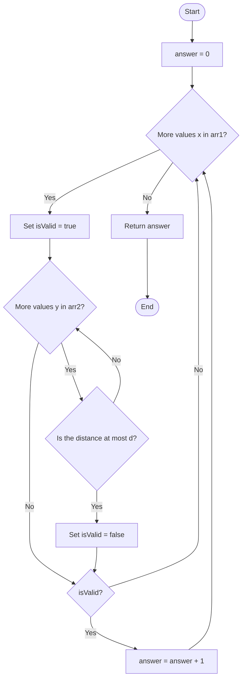
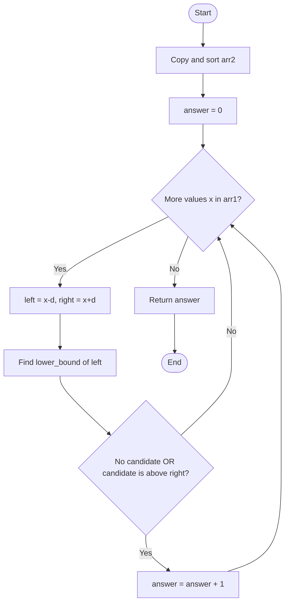
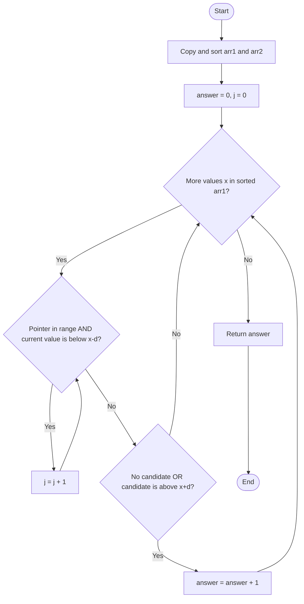

## 👨‍💻 Profiles

**GitHub:** https://github.com/Shailendra0320  
**LeetCode (Main):** https://leetcode.com/u/Shailu03/  
**LeetCode (Alternate):** https://leetcode.com/u/ShailendraLeetcode03/

# 1385. Find the Distance Value Between Two Arrays

[LeetCode Problem](https://leetcode.com/problems/find-the-distance-value-between-two-arrays/) · Difficulty: **Easy** · Topics: **Array, Sorting, Binary Search, Two Pointers**

## 📌 Table of Contents

- [Problem Statement](#-problem-statement)
- [Examples](#-examples)
- [Constraints](#-constraints)
- [Understanding the Condition](#-understanding-the-condition)
- [Approach 1: Brute Force](#-approach-1-brute-force)
  - [Idea](#idea)
  - [Algorithm](#algorithm)
  - [Flowchart](#flowchart)
  - [Dry Run](#dry-run)
  - [Why It Works](#why-it-works)
  - [Complexity](#complexity)
  - [Code](#code)
- [Approach 2: Sorting and Binary Search](#-approach-2-sorting-and-binary-search)
  - [Idea](#idea-1)
  - [Algorithm](#algorithm-1)
  - [Flowchart](#flowchart-1)
  - [Dry Run](#dry-run-1)
  - [Why It Works](#why-it-works-1)
  - [Complexity](#complexity-1)
  - [Code](#code-1)
- [Approach 3: Sorting and Two Pointers](#-approach-3-sorting-and-two-pointers)
  - [Idea](#idea-2)
  - [Algorithm](#algorithm-2)
  - [Flowchart](#flowchart-2)
  - [Dry Run](#dry-run-2)
  - [Why It Works](#why-it-works-2)
  - [Complexity](#complexity-2)
  - [Code](#code-2)
- [Approach Comparison](#-approach-comparison)
- [Important Edge Cases](#-important-edge-cases)
- [Common Mistakes](#-common-mistakes)
- [Interview Explanation](#-interview-explanation)
- [Quick Revision](#-quick-revision)
- [References](#-references)

---

## 🧩 Problem Statement

You are given two integer arrays, `arr1` and `arr2`, and an integer `d`.

The **distance value** is the number of elements `x` in `arr1` for which there is **no** element `y` in `arr2` satisfying:

\[
|x-y| \le d
\]

In simple words, count an element from `arr1` only when every element in `arr2` is more than `d` away from it.

An element is rejected as soon as we find even one element in `arr2` whose absolute difference is less than or equal to `d`.

## 🧪 Examples

### Example 1

```text
Input:  arr1 = [4,5,8], arr2 = [10,9,1,8], d = 2
Output: 2
```

**Explanation:**

- For `4`, the differences from `arr2` are `6, 5, 3, 4`. All are greater than `2`, so `4` is counted.
- For `5`, the differences are `5, 4, 4, 3`. All are greater than `2`, so `5` is counted.
- For `8`, the difference from `8` is `0`, which is not greater than `2`. So `8` is not counted.

The answer is `2`.

### Example 2

```text
Input:  arr1 = [1,4,2,3]
        arr2 = [-4,-3,6,10,20,30]
        d = 3
Output: 2
```

**Explanation:**

- `1` is valid because every value in `arr2` is more than `3` away.
- `4` is not valid because `|4 - 6| = 2`.
- `2` is valid because every value in `arr2` is more than `3` away.
- `3` is not valid because `|3 - 6| = 3`.

The answer is `2`.

### Example 3

```text
Input:  arr1 = [2,1,100,3], arr2 = [-5,-2,10,-3,7], d = 6
Output: 1
```

**Explanation:**

Only `100` is more than `6` away from every value in `arr2`. The answer is `1`.

## 📏 Constraints

- `1 <= arr1.length, arr2.length <= 500`
- `-1000 <= arr1[i], arr2[j] <= 1000`
- `0 <= d <= 100`

The arrays are not guaranteed to be sorted.

## 💡 Understanding the Condition

For a fixed value `x` from `arr1`, the condition

\[
|x-y| \le d
\]

is true exactly when `y` falls inside this closed interval:

\[
[x-d,\ x+d]
\]

Therefore, we can rephrase the task:

> Count each `x` in `arr1` for which the interval `[x-d, x+d]` contains no value from `arr2`.

For example, take `x = 5` and `d = 2`. The forbidden interval is `[3, 7]`:

```text
Number line:

        3           5           7
        |-----------x-----------|
        <------ forbidden ------>

Any arr2 value in [3, 7] makes x invalid.
```

Notice that the interval is **inclusive**. A value exactly equal to `x-d` or `x+d` makes `x` invalid because the problem uses `<= d`.

---

## 🔹 Approach 1: Brute Force

### Idea

Check every element of `arr1` against every element of `arr2`.

For each `x` in `arr1`, assume it is valid. Then scan `arr2`:

- If `|x-y| <= d` for any `y`, mark `x` as invalid and stop checking this `x`.
- If the complete scan finishes without finding such a value, add `1` to the answer.

This approach follows the problem definition directly and is easy to understand.

### Algorithm

1. Initialize `answer = 0`.
2. For every `x` in `arr1`, set `isValid = true`.
3. Visit every `y` in `arr2`.
4. If `abs(x - y) <= d`, set `isValid = false` and break the inner loop.
5. After the inner loop, increment `answer` only if `isValid` is still true.
6. Return `answer`.

### Flowchart



### Dry Run

Use Example 1:

```text
arr1 = [4, 5, 8]
arr2 = [10, 9, 1, 8]
d = 2
```

| `x` from `arr1` | Comparisons with `arr2` | Result | Count? |
|---:|---|---|---:|
| `4` | `6, 5, 3, 4` | Every difference is greater than `2` | Yes |
| `5` | `5, 4, 4, 3` | Every difference is greater than `2` | Yes |
| `8` | `2, 1, 7, 0` | Finds a difference `<= 2` immediately | No |

The valid values are `4` and `5`.

```text
answer = 2
```

### Why It Works

An element `x` is counted only after we compare it with every value in `arr2` without finding a difference less than or equal to `d`. That is exactly the definition of a valid element.

If even one nearby value is found, the inner loop stops and `x` is not counted. Therefore, every valid element is counted once, and every invalid element is skipped.

### Complexity

Let:
- `n = arr1.length`
- `m = arr2.length`

| Type | Complexity | Reason |
|---|---|---|
| Time | `O(n * m)` | In the worst case, each element of `arr1` is compared with all elements of `arr2`. |
| Extra Space | `O(1)` | Only a counter, a boolean, and loop variables are used. |

### Code

**Java**

```java
// Approach-1 (Brute Force)
// T.C: O(n * m)
// S.C: O(1)

class Solution {
    public int findTheDistanceValue(int[] arr1, int[] arr2, int d) {
        int answer = 0;

        for (int x : arr1) {
            boolean isValid = true;

            for (int y : arr2) {
                if (Math.abs(x - y) <= d) {
                    isValid = false;
                    break;
                }
            }

            if (isValid) {
                answer++;
            }
        }

        return answer;
    }
}
```

**C++**

```cpp
#include <cstdlib>
#include <vector>
using namespace std;

// Approach-1 (Brute Force)
// T.C: O(n * m)
// S.C: O(1)

class Solution {
public:
    int findTheDistanceValue(vector<int>& arr1, vector<int>& arr2, int d) {
        int answer = 0;

        for (int x : arr1) {
            bool isValid = true;

            for (int y : arr2) {
                if (abs(x - y) <= d) {
                    isValid = false;
                    break;
                }
            }

            if (isValid) {
                answer++;
            }
        }

        return answer;
    }
};
```

**Python**

```python
# Approach-1 (Brute Force)
# T.C: O(n * m)
# S.C: O(1)

from typing import List

class Solution:
    def findTheDistanceValue(self, arr1: List[int], arr2: List[int], d: int) -> int:
        answer = 0

        for x in arr1:
            is_valid = True

            for y in arr2:
                if abs(x - y) <= d:
                    is_valid = False
                    break

            if is_valid:
                answer += 1

        return answer
```

---

## 🔹 Approach 2: Sorting and Binary Search

### Idea

Instead of checking all values in `arr2`, sort a copy of `arr2` first.

For each `x` in `arr1`, we need to know whether the sorted array contains a value inside:

\[
[x-d,\ x+d]
\]

Use **binary search** to find the first value in sorted `arr2` that is greater than or equal to `x-d`. This position is called the lower bound of `x-d`.

There are two possibilities:

1. The lower-bound position is outside the array. Then no value is large enough to be in the interval, so `x` is valid.
2. A value exists at that position. If it is greater than `x+d`, it is outside the interval, so `x` is valid. Otherwise, a value lies inside the forbidden interval and `x` is invalid.

Why is checking only this one value enough? Because it is the **smallest value that is not less than `x-d`**. If this smallest possible candidate is already greater than `x+d`, every later value will also be greater than `x+d`.

### Algorithm

1. Make a copy of `arr2` and sort it.
2. Initialize `answer = 0`.
3. For each `x` in `arr1`:
   - Calculate `left = x - d` and `right = x + d`.
   - Use binary search to find the first index `idx` where `sortedArr2[idx] >= left`.
   - If `idx == m` or `sortedArr2[idx] > right`, increment `answer`.
4. Return `answer`.

### Flowchart



### Dry Run

Use Example 1. First sort a copy of `arr2`:

```text
arr1       = [4, 5, 8]
arr2       = [10, 9, 1, 8]
sortedArr2 = [1, 8, 9, 10]
d          = 2
```

| `x` | Search interval `[x-d, x+d]` | First value `>= x-d` | Check | Count? |
|---:|---:|---:|---|---:|
| `4` | `[2, 6]` | `8` | `8 > 6`, so the interval is empty | Yes |
| `5` | `[3, 7]` | `8` | `8 > 7`, so the interval is empty | Yes |
| `8` | `[6, 10]` | `8` | `8 <= 10`, so a nearby value exists | No |

```text
answer = 2
```

### Why It Works

For a value `x`, any `arr2` element that can make it invalid must be in `[x-d, x+d]`.

Binary search finds the first sorted value that is at least `x-d`. If this value is also at most `x+d`, it lies inside the interval, so `x` must be rejected. If no such value exists, or the first candidate is already greater than `x+d`, the interval contains no array value. Since all later values are at least as large as this candidate, none of them can be inside the interval either.

Thus, the binary-search check correctly decides whether each `x` should be counted.

### Complexity

Let `n = arr1.length` and `m = arr2.length`.

| Type | Complexity | Reason |
|---|---|---|
| Time | `O(m log m + n log m)` | Sort `arr2`, then perform one binary search for each element in `arr1`. |
| Extra Space | `O(m)` | A sorted copy of `arr2` is created. The binary search itself uses `O(1)` extra space. |

### Code

**Java**

```java
// Approach-2 (Sorting + Binary Search)
// T.C: O(m log m + n log m)
// S.C: O(m)

import java.util.Arrays;

class Solution2 {
    public int findTheDistanceValue(int[] arr1, int[] arr2, int d) {
        int[] sortedArr2 = arr2.clone();
        Arrays.sort(sortedArr2);

        int answer = 0;
        int m = sortedArr2.length;

        for (int x : arr1) {
            int left = x - d;
            int right = x + d;
            int low = 0;
            int high = m;

            while (low < high) {
                int mid = low + (high - low) / 2;

                if (sortedArr2[mid] < left) {
                    low = mid + 1;
                } else {
                    high = mid;
                }
            }

            if (low == m || sortedArr2[low] > right) {
                answer++;
            }
        }

        return answer;
    }
}
```

**C++**

```cpp
// Approach-2 (Sorting + Binary Search)
// T.C: O(m log m + n log m)
// S.C: O(m)

#include <algorithm>
#include <vector>
using namespace std;

class Solution2 {
public:
    int findTheDistanceValue(vector<int>& arr1, vector<int>& arr2, int d) {
        vector<int> sortedArr2 = arr2;
        sort(sortedArr2.begin(), sortedArr2.end());

        int answer = 0;
        int m = sortedArr2.size();

        for (int x : arr1) {
            int left = x - d;
            int right = x + d;
            int low = 0;
            int high = m;

            while (low < high) {
                int mid = low + (high - low) / 2;

                if (sortedArr2[mid] < left) {
                    low = mid + 1;
                } else {
                    high = mid;
                }
            }

            if (low == m || sortedArr2[low] > right) {
                answer++;
            }
        }

        return answer;
    }
};
```

**Python**

```python
# Approach-2 (Sorting + Binary Search)
# T.C: O(m log m + n log m)
# S.C: O(m)

from typing import List

class Solution2:
    def findTheDistanceValue(self, arr1: List[int], arr2: List[int], d: int) -> int:
        sorted_arr2 = sorted(arr2)
        answer = 0
        m = len(sorted_arr2)

        for x in arr1:
            left = x - d
            right = x + d
            low = 0
            high = m

            while low < high:
                mid = low + (high - low) // 2

                if sorted_arr2[mid] < left:
                    low = mid + 1
                else:
                    high = mid

            if low == m or sorted_arr2[low] > right:
                answer += 1

        return answer
```

---

## 🔹 Approach 3: Sorting and Two Pointers

### Idea

The binary-search approach performs a fresh search for every value in `arr1`. We can avoid repeating those searches by sorting copies of **both** arrays and processing them from left to right.

When `arr1` is sorted, the left boundary `x-d` of the forbidden interval never moves backward. Therefore, the first `arr2` element that is greater than or equal to `x-d` also never needs to move backward.

Maintain a pointer `j` in sorted `arr2`:

- Move `j` forward while `sortedArr2[j] < x-d`.
- Now `j` points to the first candidate that could be inside `[x-d, x+d]`.
- If `j` is past the end, or `sortedArr2[j] > x+d`, no value is inside the interval. Count `x`.
- Otherwise, `x` is invalid.

The pointer only moves forward, so the scan after sorting is linear.

### Algorithm

1. Make sorted copies of `arr1` and `arr2`.
2. Initialize `answer = 0` and `j = 0`.
3. For each `x` in sorted `arr1`:
   - While `j < m` and `sortedArr2[j] < x-d`, move `j` forward.
   - If `j == m` or `sortedArr2[j] > x+d`, increment `answer`.
4. Return `answer`.

### Flowchart



### Dry Run

Use Example 1:

```text
sortedArr1 = [4, 5, 8]
sortedArr2 = [1, 8, 9, 10]
d = 2
j = 0
```

| `x` | Left boundary `x-d` | Move `j` while `arr2[j] < x-d` | Candidate | Decision |
|---:|---:|---|---:|---|
| `4` | `2` | Skip `1`, so `j = 1` | `8` | `8 > 6`, count `4` |
| `5` | `3` | No movement; `j = 1` | `8` | `8 > 7`, count `5` |
| `8` | `6` | No movement; `j = 1` | `8` | `8 <= 10`, reject `8` |

```text
answer = 2
```

The pointer never moves backward. Once `1` is skipped for `x = 4`, it cannot become a candidate for a later, larger `x`.

### Why It Works

At the start of each iteration, the pointer is advanced until it reaches the first value in sorted `arr2` that is not smaller than `x-d`.

- If the pointer reaches the end, no value can be in the interval.
- If the pointed value is greater than `x+d`, all later values are also greater than `x+d`. The interval is empty.
- Otherwise, the pointed value is inside the interval, so `x` is invalid.

Because `arr1` is processed in increasing order, `x-d` never decreases. The pointer `j` can safely continue from its previous position. It advances at most `m` times over the entire algorithm, which makes the scan linear after sorting.

### Complexity

Let `n = arr1.length` and `m = arr2.length`.

| Type | Complexity | Reason |
|---|---|---|
| Time | `O(n log n + m log m)` | Sort both copies; the two-pointer scan takes `O(n + m)` time. |
| Extra Space | `O(n + m)` | Sorted copies of both input arrays are stored. |

### Code

**Java**

```java
// Approach-3 (Sorting + Two Pointers)
// T.C: O(n log n + m log m)
// S.C: O(n + m)

import java.util.Arrays;

class Solution3 {
    public int findTheDistanceValue(int[] arr1, int[] arr2, int d) {
        int[] sortedArr1 = arr1.clone();
        int[] sortedArr2 = arr2.clone();

        Arrays.sort(sortedArr1);
        Arrays.sort(sortedArr2);

        int answer = 0;
        int j = 0;
        int m = sortedArr2.length;

        for (int x : sortedArr1) {
            while (j < m && sortedArr2[j] < x - d) {
                j++;
            }

            if (j == m || sortedArr2[j] > x + d) {
                answer++;
            }
        }

        return answer;
    }
}
```

**C++**

```cpp
// Approach-3 (Sorting + Two Pointers)
// T.C: O(n log n + m log m)
// S.C: O(n + m)

#include <algorithm>
#include <vector>
using namespace std;

class Solution3 {
public:
    int findTheDistanceValue(vector<int>& arr1, vector<int>& arr2, int d) {
        vector<int> sortedArr1 = arr1;
        vector<int> sortedArr2 = arr2;

        sort(sortedArr1.begin(), sortedArr1.end());
        sort(sortedArr2.begin(), sortedArr2.end());

        int answer = 0;
        int j = 0;
        int m = sortedArr2.size();

        for (int x : sortedArr1) {
            while (j < m && sortedArr2[j] < x - d) {
                j++;
            }

            if (j == m || sortedArr2[j] > x + d) {
                answer++;
            }
        }

        return answer;
    }
};
```

**Python**

```python
# Approach-3 (Sorting + Two Pointers)
# T.C: O(n log n + m log m)
# S.C: O(n + m)

from typing import List

class Solution3:
    def findTheDistanceValue(self, arr1: List[int], arr2: List[int], d: int) -> int:
        sorted_arr1 = sorted(arr1)
        sorted_arr2 = sorted(arr2)

        answer = 0
        j = 0
        m = len(sorted_arr2)

        for x in sorted_arr1:
            while j < m and sorted_arr2[j] < x - d:
                j += 1

            if j == m or sorted_arr2[j] > x + d:
                answer += 1

        return answer
```

---

## 📊 Approach Comparison

| Approach | Main Technique | Time Complexity | Extra Space | When to Use |
|---|---|---|---|---|
| 1. Brute Force | Compare every pair | `O(n * m)` | `O(1)` | Best for learning the definition and smallest implementation. |
| 2. Binary Search | Sort `arr2`, search each interval | `O(m log m + n log m)` | `O(m)` | A strong optimized solution and the approach suggested by the official hint. |
| 3. Two Pointers | Sort both arrays and scan together | `O(n log n + m log m)` | `O(n + m)` | Useful when you want one linear scan after sorting. |

**Recommended learning order:** Brute Force → Binary Search → Two Pointers.

For this problem, the constraints are small, so brute force is already practical. Binary search is a clean improvement and directly follows the official hint. The two-pointer method avoids performing a separate binary search for every element.

## ⚠️ Important Edge Cases

| Case | Example | Expected result | Reason |
|---|---|---:|---|
| A nearby value is exactly `d` away | `arr1 = [5]`, `arr2 = [3]`, `d = 2` | `0` | The condition uses `<= d`, so equality makes it invalid. |
| Same value appears in both arrays | `arr1 = [4]`, `arr2 = [4]`, `d = 0` | `0` | The absolute difference is `0`. |
| No values are within distance `d` | `arr1 = [1]`, `arr2 = [10]`, `d = 2` | `1` | The only `arr1` value is valid. |
| Every value is rejected | `arr1 = [1,2]`, `arr2 = [1,2]`, `d = 0` | `0` | Each value has an exact match. |
| Negative numbers | `arr1 = [-10]`, `arr2 = [-5]`, `d = 4` | `1` | The absolute difference is `5`, which is greater than `4`. |
| Multiple values in `arr2` lie in the interval | `arr1 = [5]`, `arr2 = [4,5,6]`, `d = 1` | `0` | One nearby value is enough to reject the element. |

## ❌ Common Mistakes

1. **Using `< d` instead of `<= d`:** A difference exactly equal to `d` must make the element invalid.
2. **Checking only one arbitrary element in `arr2`:** The value is valid only when every element in `arr2` is farther than `d`.
3. **Forgetting the absolute value in brute force:** Values can be smaller or larger than `x`.
4. **Using binary search on an unsorted array:** Sort `arr2` before searching.
5. **Checking the wrong binary-search boundary:** Find the first value `>= x-d`, then verify it is `<= x+d`.
6. **Moving the two-pointer index backward:** With both arrays sorted, `x-d` only increases, so `j` must only move forward.
7. **Changing the original arrays unintentionally:** The optimized implementations here sort copies, leaving the given arrays unchanged.

## 🎤 Interview Explanation

"For every value in the first array, I need to check whether the second array contains any value within distance `d`. The condition can be written as a search for a value inside `[x-d, x+d]`. I can first solve it with two nested loops in `O(n*m)` time. To optimize it, I sort the second array and use binary search to find the first value that is at least `x-d`. If that value exists and is no greater than `x+d`, the current element is invalid; otherwise, it is counted. This takes `O(m log m + n log m)` time. If I sort both arrays, I can also use a monotonic pointer and complete the scan in `O(n+m)` after sorting."

## 📝 Quick Revision

- For each `x` in `arr1`, look for any `y` in `arr2` such that `|x-y| <= d`.
- Such a `y` must lie in the closed interval `[x-d, x+d]`.
- Count `x` only if this interval contains no value from `arr2`.
- **Brute force:** test every pair, `O(n*m)`.
- **Binary search:** sort `arr2`; find the first value `>= x-d`; check whether it is `<= x+d`.
- **Two pointers:** sort both arrays; move the `arr2` pointer forward as `x-d` increases.
- Equality at either interval boundary makes `x` invalid.

## 🔗 References

- [LeetCode 1385 — Find the Distance Value Between Two Arrays](https://leetcode.com/problems/find-the-distance-value-between-two-arrays/)
- [LeetCode Wiki — Explanation and sorting + binary search hint](https://leetcode.doocs.org/en/lc/1385/)
