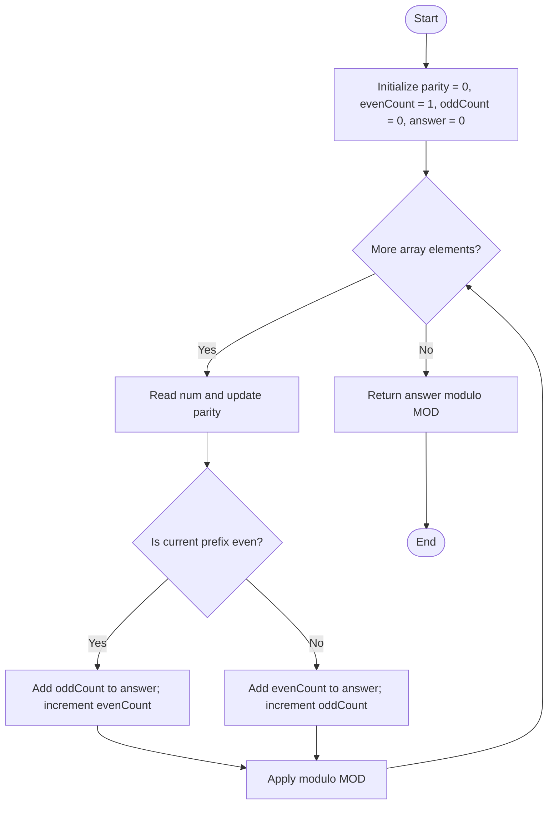
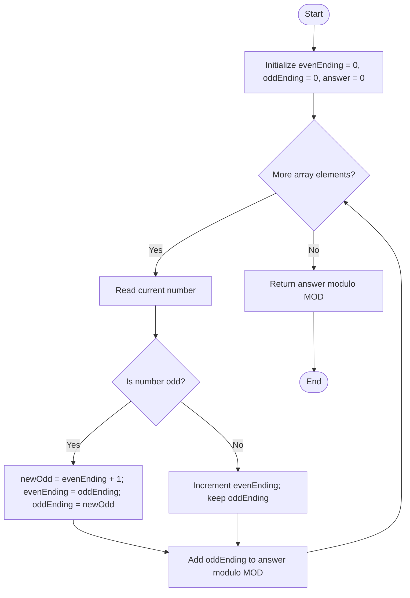

## 👨‍💻 Profiles

**GitHub:** https://github.com/Shailendra0320  
**LeetCode (Main):** https://leetcode.com/u/Shailu03/  
**LeetCode (Alternate):** https://leetcode.com/u/ShailendraLeetcode03/

# LeetCode 1524 – Number of Sub-arrays With Odd Sum

A complete guide to counting odd-sum subarrays using **prefix parity** and **dynamic programming**. Both approaches run in linear time and use constant extra space.

## Table of Contents

- [Problem Statement](#problem-statement)
- [Examples](#examples)
- [Constraints](#constraints)
- [Important Observation: Only Parity Matters](#important-observation-only-parity-matters)
- [Prefix Sum Parity Explained](#prefix-sum-parity-explained)
- [Approach 1 – Prefix Sum Parity + Frequency Counting](#approach-1--prefix-sum-parity--frequency-counting)
  - [Intuition](#approach-1-intuition)
  - [Algorithm](#approach-1-algorithm)
  - [Flowchart](#approach-1-flowchart)
  - [Dry Run](#approach-1-dry-run)
  - [Why It Works](#approach-1-why-it-works)
- [Approach 2 – Dynamic Programming](#approach-2--dynamic-programming-count-odd-even-subarrays-ending-here)
  - [Intuition](#approach-2-intuition)
  - [State and Transition](#approach-2-state-and-transition)
  - [Flowchart](#approach-2-flowchart)
  - [Dry Run](#approach-2-dry-run)
  - [Why It Works](#approach-2-why-it-works)
- [Java, C++, and Python Code](#java-c-and-python-code)
- [Approach Comparison](#approach-comparison)
- [Edge Cases](#edge-cases)
- [Common Mistakes](#common-mistakes)
- [Interview Explanation](#interview-explanation)
- [Quick Revision](#quick-revision)

---

## Problem Statement

You are given an integer array `arr`. Return the number of **non-empty contiguous subarrays** whose sum is odd.

Because the count can be very large, return the answer modulo:

\[
MOD = 10^9 + 7
\]

A subarray is a continuous part of an array. For example, for `arr = [1, 2, 3]`, `[1, 2]` and `[2, 3]` are subarrays, but `[1, 3]` is not because its elements are not next to each other.

**LeetCode method signature:**

- Java: `int numOfSubarrays(int[] arr)`
- C++: `int numOfSubarrays(vector<int>& arr)`
- Python: `def numOfSubarrays(self, arr: List[int]) -> int`

## Examples

### Example 1

```text
Input:  arr = [1, 3, 5]
Output: 4
```

All non-empty subarrays are:

| Subarray | Sum | Parity |
|---|---:|---|
| `[1]` | 1 | Odd |
| `[1, 3]` | 4 | Even |
| `[1, 3, 5]` | 9 | Odd |
| `[3]` | 3 | Odd |
| `[3, 5]` | 8 | Even |
| `[5]` | 5 | Odd |

There are four subarrays with an odd sum: `[1]`, `[1, 3, 5]`, `[3]`, and `[5]`.

### Example 2

```text
Input:  arr = [2, 4, 6]
Output: 0
```

Every element is even. Adding even numbers always produces an even sum, so no subarray has an odd sum.

### Example 3

```text
Input:  arr = [1, 2, 3, 4, 5, 6, 7]
Output: 16
```

There are 16 non-empty subarrays whose sum is odd.

## Constraints

```text
1 <= arr.length <= 100000
1 <= arr[i] <= 100
```

The answer must be returned modulo `1,000,000,007`.

---

## Important Observation: Only Parity Matters

We do not need the exact sum of a subarray. We only need to know whether the sum is **even** or **odd**.

The parity rules are:

| Operation | Result |
|---|---|
| Even + Even | Even |
| Even + Odd | Odd |
| Odd + Even | Odd |
| Odd + Odd | Even |

Therefore, we can replace every number with its parity:

- Even number → `0`
- Odd number → `1`

For example:

```text
Original array: [1, 3, 5, 2, 4]
Parity array:   [1, 1, 1, 0, 0]
```

Only the number of odd values in a subarray determines whether its sum is odd. An odd count of odd elements gives an odd sum; an even count gives an even sum.

## Prefix Sum Parity Explained

Let `prefix[i]` represent the sum of the first `i` elements. The empty prefix has sum `0`, which is even.

The sum of a subarray from index `left` through index `right` is:

\[
subarraySum = prefix[right + 1] - prefix[left]
\]

A difference is odd exactly when the two values have different parity:

| Earlier prefix | Current prefix | Subarray sum |
|---|---|---|
| Even | Even | Even |
| Odd | Odd | Even |
| Even | Odd | Odd |
| Odd | Even | Odd |

**Main rule:** A subarray has an odd sum when its starting and ending prefix sums have opposite parity.

<details>
<summary>Why do we start with one even prefix?</summary>

Before reading any array element, the prefix sum is `0`. This empty prefix is even. It must be counted so a subarray starting at index `0` can be included. Therefore, initialize `evenCount = 1` and `oddCount = 0`.
</details>

---

## Approach 1 – Prefix Sum Parity + Frequency Counting

<text></text>

### Approach 1 Intuition

We scan the array from left to right and keep only the parity of the running prefix sum.

Two counters tell us how many prefix sums of each parity have appeared so far:

- `evenCount`: number of earlier even prefix sums.
- `oddCount`: number of earlier odd prefix sums.

When the current prefix is odd, every earlier even prefix creates an odd-sum subarray ending at the current index. When the current prefix is even, every earlier odd prefix creates an odd-sum subarray.

After counting those subarrays, we add the current prefix to its corresponding counter.

### Approach 1 Algorithm

1. Set `prefixParity = 0` because the empty prefix is even.
2. Set `evenCount = 1` and `oddCount = 0`.
3. Set `answer = 0`.
4. For each number, toggle the prefix parity using `prefixParity ^= (num & 1)`.
5. If the new prefix is even, add `oddCount` to the answer and increment `evenCount`.
6. If the new prefix is odd, add `evenCount` to the answer and increment `oddCount`.
7. Keep the answer modulo `1,000,000,007`.
8. Return the answer.

### Approach 1 Flowchart



### Approach 1 Dry Run

Consider:

```text
arr = [1, 3, 5]
```

Initial state:

```text
prefixParity = 0
 evenCount = 1
  oddCount = 0
    answer = 0
```

| Number | New prefix parity | Count added | evenCount after update | oddCount after update | Answer |
|---:|---|---:|---:|---:|---:|
| 1 | Odd | `evenCount = 1` | 1 | 1 | 1 |
| 3 | Even | `oddCount = 1` | 2 | 1 | 2 |
| 5 | Odd | `evenCount = 2` | 2 | 2 | 4 |

Detailed explanation:

- After reading `1`, the current prefix is odd. The one earlier even prefix (the empty prefix) forms `[1]`, so add `1`.
- After reading `3`, the prefix sum is `4`, which is even. The earlier odd prefix forms `[3]`, so add `1`.
- After reading `5`, the prefix sum is `9`, which is odd. Both earlier even prefixes form odd-sum subarrays ending here: `[5]` and `[1, 3, 5]`. Add `2`.

Final answer:

\[
1 + 1 + 2 = 4
\]

### Approach 1 Why It Works

For a current prefix sum, every earlier prefix with opposite parity produces a subarray with an odd sum. The counters store exactly how many such earlier prefixes exist.

Each subarray has exactly one ending position and exactly one starting prefix. It is counted when its ending position is processed, so it is counted once and only once.

The empty prefix is included initially, which also accounts for subarrays beginning at index `0`.

### Approach 1 Complexity

- **Time Complexity:** `O(n)` — each array element is processed once, with constant-time parity and counter operations.
- **Space Complexity:** `O(1)` — only the prefix parity, two counters, and answer are stored.

---

## Approach 2 – Dynamic Programming: Count Odd/Even Subarrays Ending Here

### Approach 2 Intuition

Instead of counting earlier prefix sums, we can count subarrays according to where they end.

Maintain two values:

- `oddEnding`: number of subarrays ending at the previous position whose sum is odd.
- `evenEnding`: number of subarrays ending at the previous position whose sum is even.

When a new value arrives, every previous subarray ending at the last position can be extended by that value. We also create one new subarray containing only the current value.

The current number's parity determines how the two counts change.

### Approach 2 State and Transition

If the current number is **odd**:

- Extending an even-sum subarray makes its sum odd.
- Extending an odd-sum subarray makes its sum even.
- The single-element subarray is odd.

Therefore:

\[
newOddEnding = evenEnding + 1
\]

\[
newEvenEnding = oddEnding
\]

If the current number is **even**:

- Extending an odd-sum subarray keeps it odd.
- Extending an even-sum subarray keeps it even.
- The single-element subarray is even.

Therefore:

\[
newOddEnding = oddEnding
\]

\[
newEvenEnding = evenEnding + 1
\]

After updating the states, add `oddEnding` to the total answer because every odd-sum subarray is counted at its ending position.

### Approach 2 Algorithm

1. Initialize `evenEnding = 0`, `oddEnding = 0`, and `answer = 0`.
2. Traverse each value in `arr`.
3. If the value is odd, save `evenEnding + 1` as the new odd count, then swap the old odd count into the even count.
4. If the value is even, increment `evenEnding`; the odd count stays unchanged.
5. Add the updated `oddEnding` to the answer modulo `MOD`.
6. Return the answer.

### Approach 2 Flowchart



### Approach 2 Dry Run

Consider:

```text
arr = [1, 3, 5]
```

The DP states count subarrays that end exactly at the current index.

| Number | `evenEnding` after update | `oddEnding` after update | Added to answer | Total answer |
|---:|---:|---:|---:|---:|
| 1 | 0 | 1 | 1 | 1 |
| 3 | 1 | 1 | 1 | 2 |
| 5 | 1 | 2 | 2 | 4 |

Detailed explanation:

- For `1`, only `[1]` ends here, and it is odd. So `oddEnding = 1`.
- For `3`, `[3]` is odd and `[1, 3]` is even. So `oddEnding = 1` and `evenEnding = 1`.
- For `5`, `[5]` and `[1, 3, 5]` are odd, while `[3, 5]` is even. So `oddEnding = 2` and `evenEnding = 1`.

Add the odd-ending count at every position:

\[
1 + 1 + 2 = 4
\]

### Approach 2 Why It Works

Every subarray ending at the current index is either:

- A new subarray containing only the current value, or
- A previous subarray ending at the previous index extended by the current value.

Appending an odd value swaps odd and even parity. Appending an even value preserves parity. The transitions account for every possible subarray ending at the current index, without storing the full DP arrays.

Since every non-empty subarray has exactly one ending index, summing `oddEnding` over all positions counts every odd-sum subarray exactly once.

### Approach 2 Complexity

- **Time Complexity:** `O(n)` — one pass through the array.
- **Space Complexity:** `O(1)` — only two DP counters and the answer are maintained.

---

## Java, C++, and Python Code

Each language section contains both optimized approaches in one code block. The approach name, time complexity, and space complexity are written immediately before each implementation.

### Java

```java
//Approach-1 (Prefix Sum Parity + Frequency Counting)
//T.C: O(n)
//S.C: O(1)

class Solution {
    public int numOfSubarrays(int[] arr) {
        final int MOD = 1_000_000_007;

        long answer = 0;
        int prefixParity = 0;
        int evenCount = 1;
        int oddCount = 0;

        for (int num : arr) {
            prefixParity ^= (num & 1);

            if (prefixParity == 0) {
                answer += oddCount;
                evenCount++;
            } else {
                answer += evenCount;
                oddCount++;
            }

            answer %= MOD;
        }

        return (int) answer;
    }
}


//Approach-2 (Dynamic Programming: Count Odd/Even Subarrays Ending Here)
//T.C: O(n)
//S.C: O(1)

class Solution2 {
    public int numOfSubarrays(int[] arr) {
        final int MOD = 1_000_000_007;

        long answer = 0;
        int evenEnding = 0;
        int oddEnding = 0;

        for (int num : arr) {
            if ((num & 1) == 1) {
                int newOdd = evenEnding + 1;
                evenEnding = oddEnding;
                oddEnding = newOdd;
            } else {
                evenEnding++;
            }

            answer = (answer + oddEnding) % MOD;
        }

        return (int) answer;
    }
}
```

### C++

```cpp
//Approach-1 (Prefix Sum Parity + Frequency Counting)
//T.C: O(n)
//S.C: O(1)

#include <bits/stdc++.h>
using namespace std;

class Solution {
public:
    int numOfSubarrays(vector<int>& arr) {
        const int MOD = 1'000'000'007;

        long long answer = 0;
        int prefixParity = 0;
        int evenCount = 1;
        int oddCount = 0;

        for (int num : arr) {
            prefixParity ^= (num & 1);

            if (prefixParity == 0) {
                answer += oddCount;
                evenCount++;
            } else {
                answer += evenCount;
                oddCount++;
            }

            answer %= MOD;
        }

        return static_cast<int>(answer);
    }
};


//Approach-2 (Dynamic Programming: Count Odd/Even Subarrays Ending Here)
//T.C: O(n)
//S.C: O(1)

class Solution2 {
public:
    int numOfSubarrays(vector<int>& arr) {
        const int MOD = 1'000'000'007;

        long long answer = 0;
        int evenEnding = 0;
        int oddEnding = 0;

        for (int num : arr) {
            if (num & 1) {
                int newOdd = evenEnding + 1;
                evenEnding = oddEnding;
                oddEnding = newOdd;
            } else {
                evenEnding++;
            }

            answer = (answer + oddEnding) % MOD;
        }

        return static_cast<int>(answer);
    }
};
```

### Python

```python
#Approach-1 (Prefix Sum Parity + Frequency Counting)
#T.C: O(n)
#S.C: O(1)

from typing import List

class Solution:
    def numOfSubarrays(self, arr: List[int]) -> int:
        MOD = 10**9 + 7

        answer = 0
        prefix_parity = 0
        even_count = 1
        odd_count = 0

        for num in arr:
            prefix_parity ^= (num & 1)

            if prefix_parity == 0:
                answer += odd_count
                even_count += 1
            else:
                answer += even_count
                odd_count += 1

            answer %= MOD

        return answer


#Approach-2 (Dynamic Programming: Count Odd/Even Subarrays Ending Here)
#T.C: O(n)
#S.C: O(1)

class Solution2:
    def numOfSubarrays(self, arr: List[int]) -> int:
        MOD = 10**9 + 7

        answer = 0
        even_ending = 0
        odd_ending = 0

        for num in arr:
            if num & 1:
                new_odd = even_ending + 1
                even_ending = odd_ending
                odd_ending = new_odd
            else:
                even_ending += 1

            answer = (answer + odd_ending) % MOD

        return answer
```

---

## Approach Comparison

| Feature | Approach 1: Prefix Parity | Approach 2: Ending-Here DP |
|---|---|---|
| Main idea | Pair current prefix with earlier opposite-parity prefixes | Count odd/even subarrays ending at each position |
| State | `prefixParity`, `evenCount`, `oddCount` | `evenEnding`, `oddEnding` |
| Time | `O(n)` | `O(n)` |
| Extra space | `O(1)` | `O(1)` |
| Best for | Understanding prefix sums and parity | Understanding DP state transitions |

Both approaches are optimal in asymptotic time and space. Approach 1 is especially direct when you recognize the prefix-sum parity relationship. Approach 2 is useful when you prefer a DP interpretation based on subarrays ending at each index.

## Edge Cases

| Input | Expected output | Reason |
|---|---:|---|
| `[1]` | 1 | The single element is odd. |
| `[2]` | 0 | The single element is even. |
| `[2, 4, 6]` | 0 | Every possible sum is even. |
| `[1, 1]` | 2 | `[1]` at each position is odd; `[1, 1]` is even. |
| `[1, 2]` | 2 | `[1]` and `[1, 2]` are odd. |
| `[2, 1, 2]` | 4 | Odd-sum subarrays are `[2,1]`, `[1]`, `[1,2]`, and `[2,1,2]`. |
| `[1, 3, 5]` | 4 | Official Example 1. |
| `[2, 4, 6]` | 0 | Official Example 2. |

## Common Mistakes

1. **Forgetting the empty prefix:** Initialize `evenCount = 1`. Without it, subarrays starting at index `0` will be missed by Approach 1.
2. **Updating the parity counters in the wrong order:** First count subarrays using the previously seen prefixes, then add the current prefix to its counter.
3. **Counting same-parity prefixes:** Same parity produces an even difference. An odd subarray requires opposite prefix parities.
4. **Forgetting the single-element subarray in DP:** When the current value is odd, `newOdd = evenEnding + 1`; the `+1` is essential.
5. **Adding the previous odd count incorrectly for an odd value:** Appending an odd value swaps parity; the new odd count comes from the old even count plus one.
6. **Not applying modulo:** The number of subarrays can reach `n * (n + 1) / 2`, so reduce the accumulated answer modulo `1,000,000,007`.
7. **Using `int` for an unreduced running answer in languages where overflow is possible:** Use `long` in Java and `long long` in C++ for the answer accumulator.
8. **Treating a subarray as a subsequence:** A subarray must be contiguous.

## Interview Explanation

“I track only whether each prefix sum is odd or even. A subarray sum is the difference between two prefix sums, and that difference is odd only when the two prefix sums have opposite parity. I initialize the even-prefix count to one for the empty prefix. During the scan, I add the count of previously seen prefixes with opposite parity, then update the current parity count. This gives an `O(n)` time and `O(1)` space solution.”

An alternative DP explanation is:

“I maintain the number of odd-sum and even-sum subarrays ending at the current position. Appending an odd value swaps the two parity groups and creates one new odd single-element subarray. Appending an even value preserves the groups and creates one new even single-element subarray. Adding the odd-ending count at each position gives the answer in one pass.”

## Quick Revision

- Subarray sum is odd if its two prefix sums have different parity.
- Empty prefix is even, so start with `evenCount = 1`.
- Current odd prefix → add `evenCount` to answer.
- Current even prefix → add `oddCount` to answer.
- DP alternative: keep `evenEnding` and `oddEnding` counts.
- Apply modulo `1,000,000,007`.
- Both approaches: `O(n)` time and `O(1)` extra space.

**Recommended approach:** Prefix Sum Parity + Frequency Counting. It is concise, intuitive, and optimal.

---

**Problem source:** [LeetCode 1524 – Number of Sub-arrays With Odd Sum](https://leetcode.com/problems/number-of-sub-arrays-with-odd-sum/)
