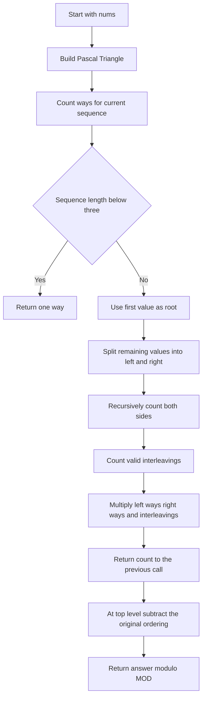
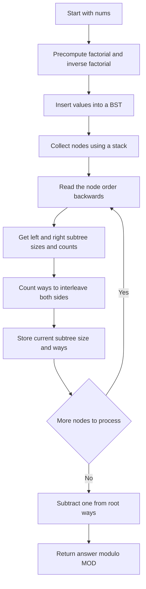

## 👨‍💻 Profiles

**GitHub:** https://github.com/Shailendra0320  
**LeetCode (Main):** https://leetcode.com/u/Shailu03/  
**LeetCode (Alternate):** https://leetcode.com/u/ShailendraLeetcode03/

# 1569. Number of Ways to Reorder Array to Get Same BST

**Difficulty:** Hard  
**Topics:** Array, Binary Search Tree, Tree, Divide and Conquer, Dynamic Programming, Combinatorics  
**Main pattern:** Count valid left/right subtree orderings, then count the ways to interleave them.  
**Official problem:** [LeetCode 1569 — Number of Ways to Reorder Array to Get Same BST](https://leetcode.com/problems/number-of-ways-to-reorder-array-to-get-same-bst/)

---

## Table of Contents

- [1. Understand the Problem](#1-understand-the-problem)
- [2. Official Examples and Constraints](#2-official-examples-and-constraints)
- [3. What a BST Tells Us](#3-what-a-bst-tells-us)
- [4. The Main Idea](#4-the-main-idea)
- [5. Approach 1 — Split the Array and Count Interleavings](#5-approach-1--split-the-array-and-count-interleavings)
- [6. Approach 2 — Build the BST and Count from the Bottom Up](#6-approach-2--build-the-bst-and-count-from-the-bottom-up)
- [7. Compare Both Approaches](#7-compare-both-approaches)
- [8. Common Mistakes](#8-common-mistakes)
- [9. Edge Cases](#9-edge-cases)
- [10. Interview Explanation](#10-interview-explanation)
- [11. Quick Revision](#11-quick-revision)

---

## 1. Understand the Problem

You are given an array `nums` containing every integer from `1` to `n` exactly once. Insert the numbers into an empty **binary search tree (BST)** in the order they appear in `nums`.

Now count the different reorderings of `nums` that build **exactly the same BST shape and values**. The original order is included in the count by the recursive math, so subtract `1` at the end because the question asks for other reorderings.

The answer can be very large, so return it modulo `1_000_000_007`.

### What makes two reorderings produce the same BST?

The first number becomes the root. Every smaller value goes into the left subtree, and every larger value goes into the right subtree. The order in which values arrive can change the tree, so we must preserve the structure at every subtree.

For example, both `[2, 1, 3]` and `[2, 3, 1]` create this tree:

```text
    2
   / \
  1   3
```

But `[3, 2, 1]` starts with `3`, so it creates a different root and therefore a different tree.

---

## 2. Official Examples and Constraints

### Example 1

```text
Input:  nums = [2, 1, 3]
Output: 1
```

The valid reorderings that build the same BST are `[2, 1, 3]` and `[2, 3, 1]`. There are two valid orders including the original one, so the answer is `2 - 1 = 1`.

### Example 2

```text
Input:  nums = [3, 4, 5, 1, 2]
Output: 5
```

These five reorderings other than the original build the same BST:

```text
[3, 1, 2, 4, 5]
[3, 1, 4, 2, 5]
[3, 1, 4, 5, 2]
[3, 4, 1, 2, 5]
[3, 4, 1, 5, 2]
```

### Example 3

```text
Input:  nums = [1, 2, 3]
Output: 0
```

The BST is a chain that goes right from `1` to `2` to `3`. Keeping that exact chain forces the same insertion order, so there is no other valid reordering.

### Constraints

- `1 <= nums.length <= 1000`
- `1 <= nums[i] <= nums.length`
- All values in `nums` are distinct.

**Why not generate every permutation?** An array of length `n` has `n!` possible permutations. Even for a few dozen values that becomes too many to test. Instead, we count the valid orders mathematically.

---

## 3. What a BST Tells Us

Consider `nums = [3, 4, 5, 1, 2]`. The first value, `3`, is the root. Values smaller than `3` form the left subtree, and values greater than `3` form the right subtree.

```text
        3
       / \
      1   4
       \   \
        2   5
```

The original insertion order splits into two sequences after the root:

| Part | Values in their original relative order | Number of values |
|---|---|---:|
| Left subtree | `[1, 2]` | 2 |
| Right subtree | `[4, 5]` | 2 |

The left values must arrive in the order `1, 2` to preserve the left subtree. The right values must arrive in the order `4, 5` to preserve the right subtree. But the two groups can be mixed together as long as each group's own order is maintained.

For example, these are both allowed:

```text
Left, Left, Right, Right  -> [3, 1, 2, 4, 5]
Left, Right, Left, Right  -> [3, 1, 4, 2, 5]
```

The interleaving `Right, Right, Left, Left` gives the original order `[3, 4, 5, 1, 2]`. It is counted by the formula and removed with the final subtraction.

---

## 4. The Main Idea

Suppose a subtree's first value is its root.

- `L` values belong to the left subtree.
- `R` values belong to the right subtree.
- The left subtree has `leftWays` valid insertion orders.
- The right subtree has `rightWays` valid insertion orders.

There are `L + R` positions after the root. Choose which `L` of those positions will be occupied by the left-subtree sequence. The right-subtree values fill the remaining positions. Therefore, the number of ways to interleave the two groups is:

$$
\binom{L+R}{L}
$$

The full count for this subtree is:

$$
\text{ways} = \binom{L+R}{L} \times \text{leftWays} \times \text{rightWays}
$$

Take the result modulo `1_000_000_007` after multiplication. At the very end, subtract one to exclude the original ordering.

### Why does a combination appear here?

Suppose the left subtree has two values and the right subtree has two values. Write `L` for a left value and `R` for a right value. We need to choose two of the four positions for the left values:

```text
LLRR   LRLR   LRRL   RLLR   RLRL   RRLL
```

There are six patterns, which is $\binom{4}{2}=6$. The actual values keep their relative order inside each group.

### Two ways to implement the same counting idea

- **Approach 1:** Work directly with array slices. Split each sequence into left and right lists, recurse, and use Pascal's Triangle to look up combinations.
- **Approach 2:** Build the BST itself. Process its nodes from the bottom up and store each node's subtree size and number of valid orders. Use factorials to calculate combinations with less combination-table memory.

---

# 5. Approach 1 — Split the Array and Count Interleavings

**Time complexity:** `O(n^2)`  
**Auxiliary space:** `O(n^2)` in the worst case, mainly for the Pascal's Triangle table and recursive array partitions.

This is the standard divide-and-conquer solution. It does not need to construct actual tree nodes. Each recursive call receives the insertion sequence for one subtree and calculates how many reorderings build that same subtree.

## Step 1 — Precompute combinations with Pascal's Triangle

We repeatedly need values such as $\binom{4}{2}$. Pascal's Triangle gives each value from two smaller values:

$$
\binom{a}{b} = \binom{a-1}{b-1} + \binom{a-1}{b}
$$

The edges are always `1`: $\binom{a}{0}=1$ and $\binom{a}{a}=1$. Precompute all needed combinations once, applying modulo at each addition. This table takes `O(n^2)` time and space.

## Step 2 — Split a sequence by its root

The first value of the current sequence is the root. Scan the remaining values in their original order:

- If a value is smaller than the root, append it to `left`.
- Otherwise, append it to `right`.

The relative order within `left` and within `right` is preserved automatically.

## Step 3 — Count each side and combine the results

Recursively find `leftWays` and `rightWays`. If `L = left.size()` and `R = right.size()`, combine them with:

$$
\text{currentWays} = \binom{L+R}{L} \times \text{leftWays} \times \text{rightWays}
$$

A sequence with fewer than three values has only one valid ordering that keeps its BST: the empty sequence, a single node, or a root with one child. Return `1` for these base cases.

## Approach 1 flowchart



## Approach 1 dry run — Example 1

Input: `nums = [2, 1, 3]`

**1. Pick the root:** `2` is the first value.

**2. Split the other values:** `[1]` goes left and `[3]` goes right.

```text
       2
      / \
     1   3
```

**3. Count the two subtrees:** Each has one node, so `leftWays = 1` and `rightWays = 1`.

**4. Count the interleavings:** `L = 1` and `R = 1`:

$$
\binom{1+1}{1} = \binom{2}{1}=2
$$

The two orders after root `2` are `[1, 3]` and `[3, 1]`. The recursive count including the original is `2 * 1 * 1 = 2`.

**5. Exclude the original order:** `2 - 1 = 1`.

**Final answer: `1`.**

## Approach 1 dry run — Example 2

Input: `nums = [3, 4, 5, 1, 2]`

The root is `3`. Its left sequence is `[1, 2]`, and its right sequence is `[4, 5]`.

| Item | Result |
|---|---:|
| Left subtree size `L` | 2 |
| Right subtree size `R` | 2 |
| Ways for `[1, 2]` to keep its subtree | 1 |
| Ways for `[4, 5]` to keep its subtree | 1 |
| Interleavings | $\binom{4}{2}=6$ |
| Total orders including original | `6 * 1 * 1 = 6` |
| Remove original order | `6 - 1 = 5` |

All six interleavings preserve the relative order within the left and right groups. Five are listed in the official example; the sixth is the original sequence.

## Why Approach 1 works

The first value must stay first, because it determines the root. After fixing the root, values smaller than it can only form the left subtree, and larger values can only form the right subtree. To keep either subtree unchanged, its own insertion order must be one of the orders counted recursively. The only extra freedom is choosing how to mix the left and right sequences together, counted by $\binom{L+R}{L}$. Multiplying those independent choices counts every valid order exactly once. Subtracting one removes the original order.

## Approach 1 code

### Java

```java
//Approach-1 (Divide and Conquer + Pascal Triangle)
//T.C : O(n^2)
//S.C : O(n^2)

import java.util.ArrayList;
import java.util.List;

class Solution {
    private static final long MOD = 1_000_000_007L;
    private long[][] comb;

    private long countWays(List<Integer> arr) {
        if (arr.size() < 3) {
            return 1L;
        }

        int root = arr.get(0);
        List<Integer> left = new ArrayList<>();
        List<Integer> right = new ArrayList<>();

        for (int i = 1; i < arr.size(); i++) {
            int value = arr.get(i);
            if (value < root) {
                left.add(value);
            } else {
                right.add(value);
            }
        }

        long leftWays = countWays(left);
        long rightWays = countWays(right);
        int leftSize = left.size();
        int rightSize = right.size();

        long ways = comb[leftSize + rightSize][leftSize];
        ways = ways * leftWays % MOD;
        ways = ways * rightWays % MOD;
        return ways;
    }

    public int numOfWays(int[] nums) {
        int n = nums.length;
        comb = new long[n + 1][n + 1];

        for (int i = 0; i <= n; i++) {
            comb[i][0] = 1;
            comb[i][i] = 1;
            for (int j = 1; j < i; j++) {
                comb[i][j] = (comb[i - 1][j - 1]
                        + comb[i - 1][j]) % MOD;
            }
        }

        List<Integer> arr = new ArrayList<>();
        for (int value : nums) {
            arr.add(value);
        }

        return (int) ((countWays(arr) - 1 + MOD) % MOD);
    }
}
```

### C++

```cpp
//Approach-1 (Divide and Conquer + Pascal Triangle)
//T.C : O(n^2)
//S.C : O(n^2)

#include <bits/stdc++.h>
using namespace std;

class Solution {
    static constexpr long long MOD = 1'000'000'007LL;
    vector<vector<long long>> comb;

    long long countWays(const vector<int>& arr) {
        if (arr.size() < 3) {
            return 1LL;
        }

        int root = arr[0];
        vector<int> left, right;

        for (int i = 1; i < static_cast<int>(arr.size()); i++) {
            if (arr[i] < root) {
                left.push_back(arr[i]);
            } else {
                right.push_back(arr[i]);
            }
        }

        long long leftWays = countWays(left);
        long long rightWays = countWays(right);
        int leftSize = static_cast<int>(left.size());
        int rightSize = static_cast<int>(right.size());

        long long ways = comb[leftSize + rightSize][leftSize];
        ways = ways * leftWays % MOD;
        ways = ways * rightWays % MOD;
        return ways;
    }

public:
    int numOfWays(vector<int>& nums) {
        int n = static_cast<int>(nums.size());
        comb.assign(n + 1, vector<long long>(n + 1, 0));

        for (int i = 0; i <= n; i++) {
            comb[i][0] = 1;
            comb[i][i] = 1;
            for (int j = 1; j < i; j++) {
                comb[i][j] = (comb[i - 1][j - 1]
                            + comb[i - 1][j]) % MOD;
            }
        }

        return static_cast<int>((countWays(nums) - 1 + MOD) % MOD);
    }
};
```

### Python

```python
#Approach-1 (Divide and Conquer + Pascal Triangle)
#T.C : O(n^2)
#S.C : O(n^2)

import sys
from typing import List, Tuple

sys.setrecursionlimit(5000)
MOD = 1_000_000_007

class Solution:
    def numOfWays(self, nums: List[int]) -> int:
        n = len(nums)
        comb = [[0] * (n + 1) for _ in range(n + 1)]

        for i in range(n + 1):
            comb[i][0] = 1
            comb[i][i] = 1
            for j in range(1, i):
                comb[i][j] = (comb[i - 1][j - 1]
                              + comb[i - 1][j]) % MOD

        def count_ways(arr: Tuple[int, ...]) -> int:
            if len(arr) < 3:
                return 1

            root = arr[0]
            left = tuple(value for value in arr[1:] if value < root)
            right = tuple(value for value in arr[1:] if value > root)

            left_ways = count_ways(left)
            right_ways = count_ways(right)
            left_size = len(left)
            right_size = len(right)

            ways = comb[left_size + right_size][left_size]
            ways = ways * left_ways % MOD
            ways = ways * right_ways % MOD
            return ways

        return (count_ways(tuple(nums)) - 1) % MOD
```

---

# 6. Approach 2 — Build the BST and Count from the Bottom Up

**Time complexity:** `O(n^2)` in the worst case because ordinary BST insertion can take linear time per value.  
**Auxiliary space:** `O(n)` for the tree, traversal order, factorial arrays, and node information.

This approach follows the actual BST instead of repeatedly making new left and right arrays. We first insert each value into a tree. Then we process the tree from the leaves toward the root so that a node's children have already been counted before we calculate the node itself.

## Step 1 — Precompute factorials

Approach 1 stores every combination in a two-dimensional table. Here we can calculate a combination using factorials:

$$
\binom{a}{b} = \frac{a!}{b!(a-b)!} \pmod{MOD}
$$

Because the answer is taken modulo the prime `MOD = 1_000_000_007`, division is performed using modular inverses:

$$
\binom{a}{b} = a! \times (b!)^{-1} \times ((a-b)!)^{-1} \bmod MOD
$$

Precompute `fact[i] = i!` and `invFact[i] = (i!)^{-1}`. This makes each combination lookup `O(1)` and uses only `O(n)` space.

## Step 2 — Build the BST

Insert `nums[0]`, then insert each next value using the BST rule: smaller goes left, larger goes right. The problem guarantees all values are distinct.

For Example 2, the tree is:

```text
        3
       / \
      1   4
       \   \
        2   5
```

## Step 3 — Process child nodes before their parent

Use a stack to create a traversal list, then read that list backwards. That ensures every child has already computed its subtree size and valid-order count when we reach its parent.

Each node stores:

- `size`: number of nodes in its subtree, including itself.
- `ways`: number of insertion orders that create the same subtree, including the original order.

For each node, let `L` and `R` be the sizes of the left and right subtrees. Then calculate:

$$
\text{size} = 1 + L + R
$$

$$
\text{ways} = \binom{L+R}{L} \times \text{leftWays} \times \text{rightWays} \bmod MOD
$$

An empty child subtree contributes `size = 0` and `ways = 1`.

## Approach 2 flowchart



## Approach 2 dry run — Example 2

Input: `nums = [3, 4, 5, 1, 2]`

The tree is:

```text
        3
       / \
      1   4
       \   \
        2   5
```

Process leaves before their parents:

| Node | Left size | Right size | Interleavings | Ways for this subtree | Subtree size |
|---:|---:|---:|---:|---:|---:|
| `2` | 0 | 0 | $\binom{0}{0}=1$ | 1 | 1 |
| `1` | 0 | 1 | $\binom{1}{0}=1$ | 1 | 2 |
| `5` | 0 | 0 | $\binom{0}{0}=1$ | 1 | 1 |
| `4` | 0 | 1 | $\binom{1}{0}=1$ | 1 | 2 |
| `3` | 2 | 2 | $\binom{4}{2}=6$ | `6 * 1 * 1 = 6` | 5 |

The root has `ways = 6`, which includes the original insertion order. Subtract one: `6 - 1 = 5`.

**Final answer: `5`.**

## Why Approach 2 works

Every node is the root of its own subtree. Once its left and right children have been processed, we know how many nodes each side contains and how many orders can keep each side unchanged. We choose positions for the left-side sequence among all child positions, multiply by the two child counts, and save the answer at the current node. Repeating this bottom-up computes the full count at the root. The final subtraction removes the original order.

## Approach 2 code

### Java

```java
//Approach-2 (BST Construction + Bottom-Up Tree DP)
//T.C : O(n^2) worst case for ordinary BST insertion
//S.C : O(n)

import java.util.ArrayDeque;
import java.util.ArrayList;
import java.util.Deque;
import java.util.List;

class Solution2 {
    private static final long MOD = 1_000_000_007L;

    private static class Node {
        int value;
        Node left;
        Node right;
        int size = 1;
        long ways = 1;

        Node(int value) {
            this.value = value;
        }
    }

    private long modPow(long base, long exponent) {
        long result = 1;
        while (exponent > 0) {
            if ((exponent & 1) == 1) {
                result = result * base % MOD;
            }
            base = base * base % MOD;
            exponent >>= 1;
        }
        return result;
    }

    public int numOfWays(int[] nums) {
        int n = nums.length;
        long[] fact = new long[n + 1];
        long[] invFact = new long[n + 1];
        fact[0] = 1;

        for (int i = 1; i <= n; i++) {
            fact[i] = fact[i - 1] * i % MOD;
        }

        invFact[n] = modPow(fact[n], MOD - 2);
        for (int i = n; i >= 1; i--) {
            invFact[i - 1] = invFact[i] * i % MOD;
        }

        Node root = new Node(nums[0]);

        for (int i = 1; i < n; i++) {
            int value = nums[i];
            Node current = root;

            while (true) {
                if (value < current.value) {
                    if (current.left == null) {
                        current.left = new Node(value);
                        break;
                    }
                    current = current.left;
                } else {
                    if (current.right == null) {
                        current.right = new Node(value);
                        break;
                    }
                    current = current.right;
                }
            }
        }

        List<Node> order = new ArrayList<>();
        Deque<Node> stack = new ArrayDeque<>();
        stack.push(root);

        while (!stack.isEmpty()) {
            Node node = stack.pop();
            order.add(node);
            if (node.left != null) stack.push(node.left);
            if (node.right != null) stack.push(node.right);
        }

        for (int i = order.size() - 1; i >= 0; i--) {
            Node node = order.get(i);
            int leftSize = node.left == null ? 0 : node.left.size;
            int rightSize = node.right == null ? 0 : node.right.size;
            long leftWays = node.left == null ? 1 : node.left.ways;
            long rightWays = node.right == null ? 1 : node.right.ways;

            node.size = 1 + leftSize + rightSize;

            int total = leftSize + rightSize;
            long choose = fact[total] * invFact[leftSize] % MOD;
            choose = choose * invFact[rightSize] % MOD;

            node.ways = choose * leftWays % MOD;
            node.ways = node.ways * rightWays % MOD;
        }

        return (int) ((root.ways - 1 + MOD) % MOD);
    }
}
```

### C++

```cpp
//Approach-2 (BST Construction + Bottom-Up Tree DP)
//T.C : O(n^2) worst case for ordinary BST insertion
//S.C : O(n)

#include <bits/stdc++.h>
using namespace std;

class Solution2 {
    static constexpr long long MOD = 1'000'000'007LL;

    struct Node {
        int value;
        int left = -1;
        int right = -1;
        int size = 1;
        long long ways = 1;

        explicit Node(int v) : value(v) {}
    };

    long long modPow(long long base, long long exponent) {
        long long result = 1;
        while (exponent > 0) {
            if (exponent & 1LL) result = result * base % MOD;
            base = base * base % MOD;
            exponent >>= 1;
        }
        return result;
    }

public:
    int numOfWays(vector<int>& nums) {
        int n = static_cast<int>(nums.size());
        vector<long long> fact(n + 1, 1), invFact(n + 1, 1);

        for (int i = 1; i <= n; i++) {
            fact[i] = fact[i - 1] * i % MOD;
        }

        invFact[n] = modPow(fact[n], MOD - 2);
        for (int i = n; i >= 1; i--) {
            invFact[i - 1] = invFact[i] * i % MOD;
        }

        vector<Node> tree;
        tree.reserve(n);
        tree.emplace_back(nums[0]);

        for (int i = 1; i < n; i++) {
            int value = nums[i];
            int current = 0;

            while (true) {
                if (value < tree[current].value) {
                    if (tree[current].left == -1) {
                        int newIndex = static_cast<int>(tree.size());
                        tree[current].left = newIndex;
                        tree.emplace_back(value);
                        break;
                    }
                    current = tree[current].left;
                } else {
                    if (tree[current].right == -1) {
                        int newIndex = static_cast<int>(tree.size());
                        tree[current].right = newIndex;
                        tree.emplace_back(value);
                        break;
                    }
                    current = tree[current].right;
                }
            }
        }

        vector<int> order;
        order.reserve(n);
        stack<int> st;
        st.push(0);

        while (!st.empty()) {
            int node = st.top();
            st.pop();
            order.push_back(node);

            if (tree[node].left != -1) st.push(tree[node].left);
            if (tree[node].right != -1) st.push(tree[node].right);
        }

        for (int i = static_cast<int>(order.size()) - 1; i >= 0; i--) {
            int index = order[i];
            int leftIndex = tree[index].left;
            int rightIndex = tree[index].right;

            int leftSize = leftIndex == -1 ? 0 : tree[leftIndex].size;
            int rightSize = rightIndex == -1 ? 0 : tree[rightIndex].size;
            long long leftWays = leftIndex == -1 ? 1 : tree[leftIndex].ways;
            long long rightWays = rightIndex == -1 ? 1 : tree[rightIndex].ways;

            tree[index].size = 1 + leftSize + rightSize;

            int total = leftSize + rightSize;
            long long choose = fact[total] * invFact[leftSize] % MOD;
            choose = choose * invFact[rightSize] % MOD;

            tree[index].ways = choose * leftWays % MOD;
            tree[index].ways = tree[index].ways * rightWays % MOD;
        }

        return static_cast<int>((tree[0].ways - 1 + MOD) % MOD);
    }
};
```

### Python

```python
#Approach-2 (BST Construction + Bottom-Up Tree DP)
#T.C : O(n^2) worst case for ordinary BST insertion
#S.C : O(n)

from typing import List

MOD = 1_000_000_007

class Node:
    __slots__ = ("value", "left", "right", "size", "ways")

    def __init__(self, value: int):
        self.value = value
        self.left = None
        self.right = None
        self.size = 1
        self.ways = 1

class Solution2:
    def numOfWays(self, nums: List[int]) -> int:
        n = len(nums)
        fact = [1] * (n + 1)
        inv_fact = [1] * (n + 1)

        for i in range(1, n + 1):
            fact[i] = fact[i - 1] * i % MOD

        inv_fact[n] = pow(fact[n], MOD - 2, MOD)
        for i in range(n, 0, -1):
            inv_fact[i - 1] = inv_fact[i] * i % MOD

        root = Node(nums[0])

        for value in nums[1:]:
            current = root
            while True:
                if value < current.value:
                    if current.left is None:
                        current.left = Node(value)
                        break
                    current = current.left
                else:
                    if current.right is None:
                        current.right = Node(value)
                        break
                    current = current.right

        order = []
        stack = [root]
        while stack:
            node = stack.pop()
            order.append(node)
            if node.left is not None:
                stack.append(node.left)
            if node.right is not None:
                stack.append(node.right)

        for node in reversed(order):
            left_size = node.left.size if node.left else 0
            right_size = node.right.size if node.right else 0
            left_ways = node.left.ways if node.left else 1
            right_ways = node.right.ways if node.right else 1

            node.size = 1 + left_size + right_size

            total = left_size + right_size
            choose = fact[total] * inv_fact[left_size] % MOD
            choose = choose * inv_fact[right_size] % MOD

            node.ways = choose * left_ways % MOD
            node.ways = node.ways * right_ways % MOD

        return (root.ways - 1) % MOD
```

---

## 7. Compare Both Approaches

| Detail | Approach 1: Split arrays | Approach 2: Build BST |
|---|---|---|
| Main idea | Recursively split insertion sequences by the first value | Build real tree nodes and count valid orders from leaves to root |
| How combinations are calculated | Pascal's Triangle table | Factorials and modular inverse factorials |
| Worst-case time | `O(n^2)` | `O(n^2)` due to ordinary BST insertion |
| Auxiliary space | `O(n^2)` | `O(n)` |
| Best reason to use it | Shorter and closest to the counting formula | Shows clearly how the result belongs to each BST node |

**Recommendation:** Use Approach 1 for the simplest interview explanation. Use Approach 2 to practice BST construction, bottom-up tree DP, and factorial-based combinations.

---

## 8. Common Mistakes

1. **Forgetting to subtract one.** The recursive count includes the original input order. Return `(totalWays - 1 + MOD) % MOD`.
2. **Multiplying only the left and right counts.** You must also multiply by $\binom{L+R}{L}$, because the two sides can be interleaved.
3. **Allowing arbitrary reordering inside a subtree.** The relative insertion order of each side must itself preserve that subtree's BST.
4. **Using the wrong combination.** Choose the left positions: $\binom{L+R}{L}$. Choosing the right positions is equivalent, but the indexes must match the table.
5. **Forgetting modulo during multiplication.** Multiply using a 64-bit type in Java and C++, and reduce the result after each multiplication.
6. **Treating an empty child as zero ways.** An empty subtree contributes exactly one way: do nothing.
7. **Generating all permutations.** The number of permutations grows factorially, so count them using combinations instead.
8. **Assuming every BST is balanced.** Sorted input forms a chain. The recursive array approach can have depth `O(n)`, and ordinary BST insertion can take `O(n^2)` time in the worst case.

---

## 9. Edge Cases

| Input | Expected answer | Why |
|---|---:|---|
| `[1]` | `0` | There is no alternative order. |
| `[2, 1]` | `0` | The root must stay first to preserve this one-child tree. |
| `[2, 1, 3]` | `1` | The left and right child can switch order after the root. |
| `[1, 2, 3]` | `0` | The tree is a right-only chain, so the order is forced. |
| `[3, 4, 5, 1, 2]` | `5` | Six interleavings including original; subtract one. |

---

## 10. Interview Explanation

> “The first value must remain the root. I split every sequence into values smaller than the root and values greater than the root. The left and right subtrees can be reordered independently, but their two insertion sequences can also be interleaved. If they contain `L` and `R` values, there are `C(L + R, L)` ways to choose the left-side positions. So I multiply that combination by the number of valid orders for each subtree. I precompute combinations with Pascal's Triangle, use divide and conquer, take the result modulo `1_000_000_007`, and subtract one to exclude the original order.”

---

## 11. Quick Revision

- The first number is the root of the BST.
- Split the remaining values into left (`value < root`) and right (`value > root`) sequences.
- If their sizes are `L` and `R`, the interleaving count is `C(L + R, L)`.
- Current count = interleavings × left count × right count, modulo `1_000_000_007`.
- Subtract one because the original order is not included in the answer.
- Approach 1 uses Pascal's Triangle and recursive array partitioning: `O(n^2)` time and `O(n^2)` space.
- Approach 2 builds a BST and processes nodes bottom-up using factorial combinations: `O(n^2)` worst-case time and `O(n)` space.

**One-line takeaway:** Keep each subtree's internal insertion order valid, then count all ways to interleave the left and right sequences.

**Reference:** [Official LeetCode 1569 problem](https://leetcode.com/problems/number-of-ways-to-reorder-array-to-get-same-bst/)
