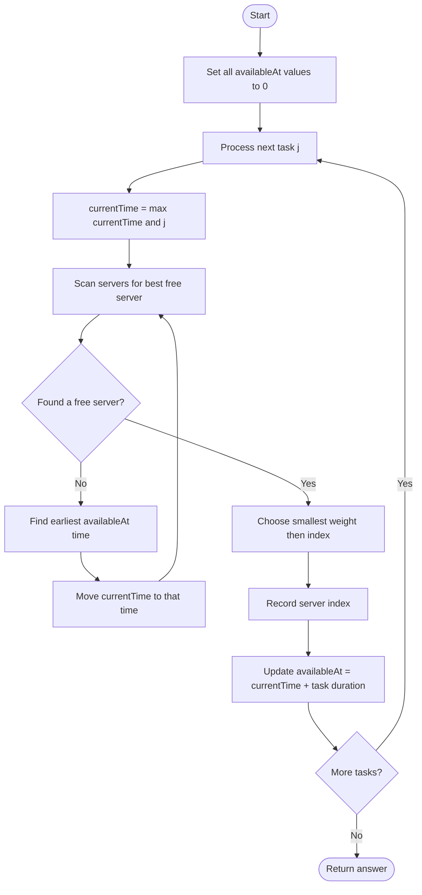
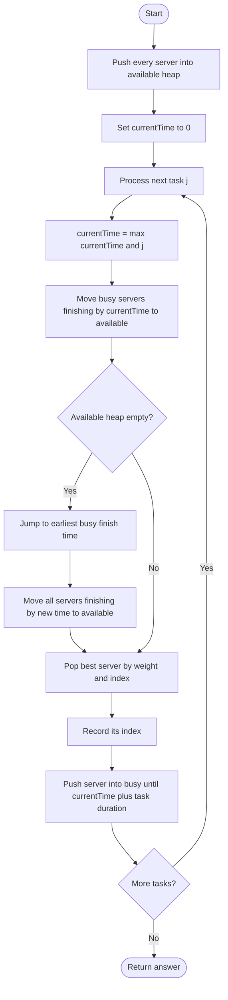

## 👨‍💻 Profiles

**GitHub:** https://github.com/Shailendra0320  
**LeetCode (Main):** https://leetcode.com/u/Shailu03/  
**LeetCode (Alternate):** https://leetcode.com/u/ShailendraLeetcode03/

# 1882. Process Tasks Using Servers

## Table of Contents

- [Problem Statement](#problem-statement)
- [Examples](#examples)
- [Constraints](#constraints)
- [Understanding the Scheduling Rules](#understanding-the-scheduling-rules)
- [Key Observation](#key-observation)
- [Approach 1: Brute Force Simulation](#approach-1-brute-force-simulation)
  - [Intuition](#approach-1-intuition)
  - [Algorithm](#approach-1-algorithm)
  - [Flowchart](#approach-1-flowchart)
  - [Dry Run](#approach-1-dry-run)
  - [Why It Works](#approach-1-why-it-works)
  - [Complexity](#approach-1-complexity)
  - [Java Code](#approach-1-java-code)
  - [C++ Code](#approach-1-c-code)
  - [Python Code](#approach-1-python-code)
- [Approach 2: Two Min Heaps](#approach-2-two-min-heaps)
  - [Intuition](#approach-2-intuition)
  - [What Each Heap Stores](#what-each-heap-stores)
  - [Algorithm](#approach-2-algorithm)
  - [Flowchart](#approach-2-flowchart)
  - [Dry Run](#approach-2-dry-run)
  - [Why It Works](#approach-2-why-it-works)
  - [Complexity](#approach-2-complexity)
  - [Java Code](#approach-2-java-code)
  - [C++ Code](#approach-2-c-code)
  - [Python Code](#approach-2-python-code)
- [Approach Comparison](#approach-comparison)
- [Important Edge Cases](#important-edge-cases)
- [Common Mistakes](#common-mistakes)
- [Interview Explanation](#interview-explanation)
- [Quick Revision](#quick-revision)
- [References](#references)

---

## Problem Statement

You are given two 0-indexed integer arrays:

- `servers`, where `servers[i]` is the weight of server `i`.
- `tasks`, where `tasks[j]` is the number of seconds needed to process task `j`.

Tasks arrive in order. Task `j` arrives at second `j`, starting with task `0` at second `0`.

When a task is ready to be assigned, choose a free server using these priorities:

1. Choose the server with the **smallest weight**.
2. If multiple free servers have the same weight, choose the one with the **smallest index**.

A server assigned a task at time `t` becomes free at time `t + tasks[j]`.

If no server is free, wait until a server becomes available. Tasks must still be assigned in their original order.

Return an array `ans` where `ans[j]` is the index of the server that processes task `j`.

## Examples

### Example 1

**Input:**

```text
servers = [3,3,2]
tasks   = [1,2,3,2,1,2]
```

**Output:**

```text
[2,2,0,2,1,2]
```

**Explanation:**

- At time `0`, task `0` goes to server `2` and finishes at time `1`.
- At time `1`, server `2` is free, so task `1` goes to server `2` and finishes at time `3`.
- At time `2`, task `2` goes to server `0` and finishes at time `5`.
- At time `3`, server `2` is free again, so task `3` goes to server `2` and finishes at time `5`.
- At time `4`, task `4` goes to server `1` and finishes at time `5`.
- At time `5`, all three servers are free. Server `2` has the smallest weight, so task `5` goes to server `2`.

### Example 2

**Input:**

```text
servers = [5,1,4,3,2]
tasks   = [2,1,2,4,5,2,1]
```

**Output:**

```text
[1,4,1,4,1,3,2]
```

**Explanation:**

At time `2`, servers `1` and `4` become free together. Both are available for task `2`, so server `1` is selected because its weight is smaller. The same weight-first and index-second rule is applied for every task.

## Constraints

- `servers.length == n`
- `tasks.length == m`
- `1 <= n, m <= 2 * 10^5`
- `1 <= servers[i], tasks[j] <= 2 * 10^5`

The limits are large, so scanning all servers for every task can be too slow. We need an efficient way to find the best free server and the next server that will finish.

---

## Understanding the Scheduling Rules

There are two separate orders in this problem:

- **Task order:** tasks are always assigned in their original order: `0, 1, 2, ...`.
- **Server priority:** among servers that are free at the assignment time, choose the smallest `(weight, index)` pair.

The server with the smallest weight is not always selected globally. It must be free when the task is assigned.

For example, suppose:

| Server index | Weight | Available at |
|---:|---:|---:|
| 0 | 1 | 8 |
| 1 | 4 | 3 |
| 2 | 2 | 5 |

At time `4`, only server `1` is free. It must be selected even though server `0` has a smaller weight, because server `0` is still busy.

Also, a task can arrive while all servers are busy. In that situation, it waits in the queue. We must not skip it and assign a later task first.

## Key Observation

For each task, we repeatedly need two operations:

1. Find the free server with the smallest `(weight, index)`.
2. When no server is free, find the server with the earliest completion time.

These operations are exactly what min-heaps handle efficiently.

We can maintain:

- An **available heap** ordered by `(weight, index)`.
- A **busy heap** ordered by `(finish time, weight, index)`.

We also maintain `currentTime`, the time when the next queued task can be assigned. It never moves backwards.

Before assigning task `j`:

1. Move every busy server whose finish time is at most `currentTime` into the available heap.
2. Make sure `currentTime` is at least `j`, because task `j` cannot start before it arrives.
3. If no server is available, jump `currentTime` to the earliest finish time and move all servers finishing at that time into the available heap.
4. Select the best available server and reserve it until `currentTime + tasks[j]`.

This jumps between meaningful events instead of simulating every second.

---

# Approach 1: Brute Force Simulation

## Approach 1 Intuition

We can simulate the scheduling rules directly without using heaps.

Keep an array `availableAt`:

- `availableAt[i]` tells us the time when server `i` becomes free.
- Initially, every server is free at time `0`.

For each task, find the best server that is already free at `currentTime`:

- A server is free when `availableAt[i] <= currentTime`.
- Among free servers, select the smallest weight.
- If weights are equal, select the smaller index.

If no server is free, move `currentTime` to the smallest value in `availableAt`. Then scan again and select the best server that has become free.

After assigning the task, update that server's next available time.

## Approach 1 Algorithm

1. Create `availableAt` of size `n`, filled with zero.
2. Set `currentTime = 0`.
3. Process tasks from left to right.
4. Set `currentTime = max(currentTime, taskIndex)` so a task never starts before its arrival.
5. Scan all servers and find the best server satisfying `availableAt[i] <= currentTime`.
6. If no server is free, find the minimum value in `availableAt`, move `currentTime` to that time, and scan again.
7. Store the selected server index in the answer.
8. Set `availableAt[server] = currentTime + tasks[taskIndex]`.
9. Return the answer array.

## Approach 1 Flowchart



## Approach 1 Dry Run

Use Example 1:

```text
servers = [3,3,2]
tasks   = [1,2,3,2,1,2]
```

Initially:

```text
availableAt = [0, 0, 0]
currentTime = 0
```

| Task | Assignment time | Free servers considered | Selected server | New finish time |
|---:|---:|---|---:|---:|
| 0 | 0 | 0, 1, 2 | 2 | 1 |
| 1 | 1 | 0, 1, 2 | 2 | 3 |
| 2 | 2 | 0, 1 | 0 | 5 |
| 3 | 3 | 1, 2 | 2 | 5 |
| 4 | 4 | 1 | 1 | 5 |
| 5 | 5 | 0, 1, 2 | 2 | 7 |

The final result is:

```text
[2, 2, 0, 2, 1, 2]
```

Notice that before task `5`, every server has `availableAt = 5`. The weight of server `2` is the smallest, so it gets the task.

## Approach 1 Why It Works

For every task, the scan checks every server and considers only servers whose `availableAt` time is not greater than `currentTime`. Therefore, it never selects a busy server.

Among the free servers, it explicitly chooses the smallest weight and then the smallest index. If there is no free server, the minimum `availableAt` value is the earliest possible time any server can become free. Moving to that time is exactly what the scheduling rules require.

After choosing a server, updating its availability to `currentTime + task duration` correctly records when it can accept another task. Since tasks are processed from left to right, their queue order is preserved.

## Approach 1 Complexity

Let:

- `n` be the number of servers.
- `m` be the number of tasks.

**Time Complexity: `O(n * m)`**

For each task, we scan all servers to find an available server. If no server is free, we scan the array to find the earliest finish time and scan again. This is still `O(n)` work per task, so total time is `O(n * m)`.

**Space Complexity: `O(n)`**

The `availableAt` array stores one value per server. The answer array is required output space and is not counted as auxiliary space.

## Approach 1 Java Code

```java
// Approach-1 (Brute Force Simulation)
// T.C: O(n * m)
// S.C: O(n)

class Solution {
    public int[] assignTasks(int[] servers, int[] tasks) {
        int n = servers.length;
        int m = tasks.length;

        long[] availableAt = new long[n];
        int[] answer = new int[m];
        long currentTime = 0;

        for (int j = 0; j < m; j++) {
            currentTime = Math.max(currentTime, j);

            int bestServer = -1;

            for (int i = 0; i < n; i++) {
                if (availableAt[i] <= currentTime) {
                    if (bestServer == -1
                            || servers[i] < servers[bestServer]
                            || (servers[i] == servers[bestServer] && i < bestServer)) {
                        bestServer = i;
                    }
                }
            }

            if (bestServer == -1) {
                long earliestTime = Long.MAX_VALUE;

                for (long time : availableAt) {
                    earliestTime = Math.min(earliestTime, time);
                }

                currentTime = earliestTime;

                for (int i = 0; i < n; i++) {
                    if (availableAt[i] <= currentTime) {
                        if (bestServer == -1
                                || servers[i] < servers[bestServer]
                                || (servers[i] == servers[bestServer] && i < bestServer)) {
                            bestServer = i;
                        }
                    }
                }
            }

            answer[j] = bestServer;
            availableAt[bestServer] = currentTime + tasks[j];
        }

        return answer;
    }
}
```

## Approach 1 C++ Code

```cpp
// Approach-1 (Brute Force Simulation)
// T.C: O(n * m)
// S.C: O(n)

#include <bits/stdc++.h>
using namespace std;

class Solution {
public:
    vector<int> assignTasks(vector<int>& servers, vector<int>& tasks) {
        int n = servers.size();
        int m = tasks.size();

        vector<long long> availableAt(n, 0);
        vector<int> answer(m);
        long long currentTime = 0;

        for (int j = 0; j < m; j++) {
            currentTime = max(currentTime, (long long)j);

            int bestServer = -1;

            for (int i = 0; i < n; i++) {
                if (availableAt[i] <= currentTime) {
                    if (bestServer == -1
                            || servers[i] < servers[bestServer]
                            || (servers[i] == servers[bestServer] && i < bestServer)) {
                        bestServer = i;
                    }
                }
            }

            if (bestServer == -1) {
                currentTime = *min_element(availableAt.begin(), availableAt.end());

                for (int i = 0; i < n; i++) {
                    if (availableAt[i] <= currentTime) {
                        if (bestServer == -1
                                || servers[i] < servers[bestServer]
                                || (servers[i] == servers[bestServer] && i < bestServer)) {
                            bestServer = i;
                        }
                    }
                }
            }

            answer[j] = bestServer;
            availableAt[bestServer] = currentTime + tasks[j];
        }

        return answer;
    }
};
```

## Approach 1 Python Code

```python
# Approach-1 (Brute Force Simulation)
# T.C: O(n * m)
# S.C: O(n)

from typing import List

class Solution:
    def assignTasks(self, servers: List[int], tasks: List[int]) -> List[int]:
        n = len(servers)
        m = len(tasks)

        available_at = [0] * n
        answer = [0] * m
        current_time = 0

        for j in range(m):
            current_time = max(current_time, j)

            best_server = -1

            for i in range(n):
                if available_at[i] <= current_time:
                    if (best_server == -1
                            or servers[i] < servers[best_server]
                            or (servers[i] == servers[best_server] and i < best_server)):
                        best_server = i

            if best_server == -1:
                current_time = min(available_at)

                for i in range(n):
                    if available_at[i] <= current_time:
                        if (best_server == -1
                                or servers[i] < servers[best_server]
                                or (servers[i] == servers[best_server] and i < best_server)):
                            best_server = i

            answer[j] = best_server
            available_at[best_server] = current_time + tasks[j]

        return answer
```

---

# Approach 2: Two Min Heaps

## Approach 2 Intuition

The brute force solution searches the entire server array again and again. With up to `200,000` servers and `200,000` tasks, that is too much work.

We need to get the best available server quickly. We also need to know which busy server will finish first.

Use two priority queues (min-heaps):

- `available`: servers that are free now. The smallest `(weight, index)` comes first.
- `busy`: servers that are processing a task. The smallest `(finishTime, weight, index)` comes first.

For each task, first release every server that has finished by `currentTime`. If no server is available, jump directly to the earliest finish time and release every server finishing at that time. Then take the best server from the available heap.

The heap makes both selection operations efficient.

## What Each Heap Stores

### 1. Available heap

Each entry is:

```text
(weight, serverIndex)
```

The heap sorts by weight first and server index second.

Example:

```text
(2, 3), (3, 0), (3, 1), (5, 2)
```

The next selected server is `(2, 3)` because it has the smallest weight.

### 2. Busy heap

Each entry is:

```text
(finishTime, weight, serverIndex)
```

The heap sorts by finish time first. The other fields provide a deterministic order when finish times are equal.

Example:

```text
(5, 2, 3), (5, 3, 0), (7, 1, 2)
```

The server at index `3` is the first one to finish. When several servers finish at the same time, we move all of them into the available heap before selecting a server. The available heap then applies the actual weight/index priority.

## Approach 2 Algorithm

1. Insert every server into the available heap as `(weight, index)`.
2. Start with an empty busy heap and `currentTime = 0`.
3. Process tasks in their original order, using index `j`.
4. Update `currentTime = max(currentTime, j)`.
5. Move all busy servers with `finishTime <= currentTime` into the available heap.
6. If the available heap is empty:
   - Set `currentTime` to the smallest finish time in the busy heap.
   - Move all servers finishing at or before this new time into the available heap.
7. Remove the best server from the available heap.
8. Store its index in `answer[j]`.
9. Insert it into the busy heap with finish time `currentTime + tasks[j]`.
10. Return the answer after all tasks have been assigned.

### Why do we move all servers that finish at the same time?

The problem says that when multiple servers become free together, multiple queued tasks are assigned in order while respecting weight and index priority. Therefore, we must make all servers that are free at the current time available before choosing the next one.

This is why the code uses a `while` loop, not a single `if` statement, to release completed servers.

## Approach 2 Flowchart



## Approach 2 Dry Run

Use Example 1:

```text
servers = [3,3,2]
tasks   = [1,2,3,2,1,2]
```

Initial available heap:

```text
[(2,2), (3,0), (3,1)]
```

The busy heap is initially empty. The table shows the time each task starts, the selected server, and the server's finish time.

| Task | Current time | Servers released before assignment | Selected server `(weight, index)` | Busy until |
|---:|---:|---|---|---:|
| 0 | 0 | None | `(2,2)` | 1 |
| 1 | 1 | Server 2 | `(2,2)` | 3 |
| 2 | 2 | None | `(3,0)` | 5 |
| 3 | 3 | Server 2 | `(2,2)` | 5 |
| 4 | 4 | None | `(3,1)` | 5 |
| 5 | 5 | Servers 0, 1, 2 | `(2,2)` | 7 |

At task `5`, all three servers finish at time `5`. They are all inserted into the available heap. The heap selects server `2` because its weight is `2`, which is smaller than the weights of servers `0` and `1`.

The final answer is:

```text
[2,2,0,2,1,2]
```

### What happens when every server is busy?

Suppose the next task arrives at time `4`, but the earliest busy server finishes at time `8` and no server is free.

- We do not scan time `5`, `6`, and `7` one by one.
- We jump directly to `currentTime = 8`.
- We release every server with `finishTime <= 8`.
- We choose the best server from the available heap.

This event-based time jump is the main optimization.

## Approach 2 Why It Works

The algorithm maintains two important conditions:

1. **Available heap correctness:** it contains exactly the servers that are free at `currentTime`, and its ordering places the smallest `(weight, index)` first.
2. **Busy heap correctness:** it contains the servers still processing tasks, ordered by their finish time.

Before assigning a task, all servers that have already finished are moved to the available heap. If no server is free, the earliest finish time is the first moment when any server can accept the waiting task. Moving all servers that finish by that moment makes the available heap complete again.

The algorithm then removes the smallest `(weight, index)` pair, exactly matching the server selection rule. It records the server for the current task and updates its finish time. Since tasks are processed in input order, the task queue order is also preserved.

Therefore, every task is assigned to the same server that the problem's scheduling rules require.

## Approach 2 Complexity

Let `n` be the number of servers and `m` be the number of tasks.

**Time Complexity: `O((n + m) log n)`**

- Building the available heap takes `O(n)` using heap construction (or `O(n log n)` if inserted one by one).
- Each server is inserted into and removed from the heaps a constant number of times per task assignment cycle.
- Each task causes one server assignment.
- Heap operations take `O(log n)` and there are `O(n + m)` heap operations overall.

So the total is `O(n + (n + m) log n)`, commonly written as `O((n + m) log n)`.

**Space Complexity: `O(n)` auxiliary space**

Every server is in exactly one of the two heaps at a time. The heaps together contain `n` servers. The answer array uses `O(m)` required output space and is not included in auxiliary space.

## Approach 2 Java Code

```java
// Approach-2 (Two Min Heaps: Available and Busy Servers)
// T.C: O((n + m) * log n)
// S.C: O(n) auxiliary space

import java.util.PriorityQueue;

class Solution {
    public int[] assignTasks(int[] servers, int[] tasks) {
        int n = servers.length;
        int m = tasks.length;

        PriorityQueue<int[]> available = new PriorityQueue<>((a, b) -> {
            if (a[0] != b[0]) {
                return Integer.compare(a[0], b[0]);
            }
            return Integer.compare(a[1], b[1]);
        });

        PriorityQueue<long[]> busy = new PriorityQueue<>((a, b) -> {
            int cmp = Long.compare(a[0], b[0]);
            if (cmp != 0) {
                return cmp;
            }
            cmp = Long.compare(a[1], b[1]);
            if (cmp != 0) {
                return cmp;
            }
            return Long.compare(a[2], b[2]);
        });

        for (int i = 0; i < n; i++) {
            available.offer(new int[]{servers[i], i});
        }

        int[] answer = new int[m];
        long currentTime = 0;

        for (int j = 0; j < m; j++) {
            currentTime = Math.max(currentTime, (long) j);

            while (!busy.isEmpty() && busy.peek()[0] <= currentTime) {
                long[] server = busy.poll();
                available.offer(new int[]{(int) server[1], (int) server[2]});
            }

            if (available.isEmpty()) {
                currentTime = busy.peek()[0];

                while (!busy.isEmpty() && busy.peek()[0] <= currentTime) {
                    long[] server = busy.poll();
                    available.offer(new int[]{(int) server[1], (int) server[2]});
                }
            }

            int[] server = available.poll();
            int weight = server[0];
            int index = server[1];

            answer[j] = index;
            busy.offer(new long[]{currentTime + tasks[j], weight, index});
        }

        return answer;
    }
}
```

## Approach 2 C++ Code

```cpp
// Approach-2 (Two Min Heaps: Available and Busy Servers)
// T.C: O((n + m) * log n)
// S.C: O(n) auxiliary space

#include <bits/stdc++.h>
using namespace std;

class Solution {
public:
    vector<int> assignTasks(vector<int>& servers, vector<int>& tasks) {
        int n = servers.size();
        int m = tasks.size();

        priority_queue<
            pair<int, int>,
            vector<pair<int, int>>,
            greater<pair<int, int>>
        > available;

        priority_queue<
            tuple<long long, int, int>,
            vector<tuple<long long, int, int>>,
            greater<tuple<long long, int, int>>
        > busy;

        for (int i = 0; i < n; i++) {
            available.push({servers[i], i});
        }

        vector<int> answer(m);
        long long currentTime = 0;

        for (int j = 0; j < m; j++) {
            currentTime = max(currentTime, (long long)j);

            while (!busy.empty() && get<0>(busy.top()) <= currentTime) {
                auto [finishTime, weight, index] = busy.top();
                busy.pop();
                available.push({weight, index});
            }

            if (available.empty()) {
                currentTime = get<0>(busy.top());

                while (!busy.empty() && get<0>(busy.top()) <= currentTime) {
                    auto [finishTime, weight, index] = busy.top();
                    busy.pop();
                    available.push({weight, index});
                }
            }

            auto [weight, index] = available.top();
            available.pop();

            answer[j] = index;
            busy.push({currentTime + tasks[j], weight, index});
        }

        return answer;
    }
};
```

## Approach 2 Python Code

```python
# Approach-2 (Two Min Heaps: Available and Busy Servers)
# T.C: O((n + m) * log n)
# S.C: O(n) auxiliary space

from typing import List
import heapq

class Solution:
    def assignTasks(self, servers: List[int], tasks: List[int]) -> List[int]:
        n = len(servers)
        m = len(tasks)

        available = [(weight, i) for i, weight in enumerate(servers)]
        heapq.heapify(available)

        busy = []
        answer = [0] * m
        current_time = 0

        for j, duration in enumerate(tasks):
            current_time = max(current_time, j)

            while busy and busy[0][0] <= current_time:
                finish_time, weight, index = heapq.heappop(busy)
                heapq.heappush(available, (weight, index))

            if not available:
                current_time = busy[0][0]

                while busy and busy[0][0] <= current_time:
                    finish_time, weight, index = heapq.heappop(busy)
                    heapq.heappush(available, (weight, index))

            weight, index = heapq.heappop(available)

            answer[j] = index
            heapq.heappush(busy, (current_time + duration, weight, index))

        return answer
```

---

## Approach Comparison

| Approach | Main Idea | Time Complexity | Auxiliary Space |
|---|---|---:|---:|
| Approach 1: Brute Force | Scan all servers to find the best free one | `O(n * m)` | `O(n)` |
| Approach 2: Two Min Heaps | Keep free and busy servers in separate priority queues | `O((n + m) log n)` | `O(n)` |

**Recommended approach: Approach 2 – Two Min Heaps.** It efficiently handles the maximum constraints and avoids scanning all servers for every task.

## Important Edge Cases

| Case | What should happen |
|---|---|
| Only one server | Every task uses server `0`; tasks wait when it is busy. |
| All server weights are equal | Always choose the smallest available server index. |
| Several servers finish together | Release all of them before selecting the next server. |
| Every server is busy | Jump to the earliest finish time. |
| More tasks than servers | Later tasks wait in the queue and are assigned in order. |
| A task arrives while a server is already free | Assign it at its arrival time or the current backlog time, whichever is later. |

## Common Mistakes

1. **Choosing the globally lightest server:** a server must be free before it can be selected.
2. **Ignoring the index tie-breaker:** equal weights must be ordered by the smaller server index.
3. **Releasing only one completed server:** every server with `finishTime <= currentTime` must be released before selection.
4. **Resetting time to the task index:** when tasks are waiting, simulated time may already be greater than `j`. Use `max(currentTime, j)`.
5. **Using 32-bit time values:** the total scheduled time can reach roughly `2 * 10^5 * 2 * 10^5 = 4 * 10^10`, which is larger than a signed 32-bit integer. Use `long` in Java and `long long` in C++.
6. **Changing task order:** always assign task `j` before task `j + 1`.
7. **Using a single heap for everything without the right ordering:** free servers are ordered by weight/index, while busy servers are ordered by finish time. They need different priorities.

## Interview Explanation

“I process tasks in their original order. I maintain two min-heaps: one contains available servers ordered by weight and index, and the other contains busy servers ordered by finish time. Before assigning a task, I move every server that has finished by the current time into the available heap. If no server is free, I jump directly to the earliest finish time and release all servers that finish then. I select the best available server, record its index, and push it into the busy heap with its new finish time. Each heap operation takes logarithmic time, giving `O((n + m) log n)` time.”

## Quick Revision

- `available` heap: `(weight, index)`.
- `busy` heap: `(finishTime, weight, index)`.
- Process tasks in input order.
- `currentTime = max(currentTime, taskIndex)`.
- Release all busy servers with `finishTime <= currentTime`.
- If no server is free, jump to the earliest finish time and release all servers finishing then.
- Choose the minimum `(weight, index)` from the available heap.
- New finish time = `currentTime + tasks[j]`.
- Use 64-bit time values in Java and C++.

## References

- [LeetCode 1882 – Process Tasks Using Servers](https://leetcode.com/problems/process-tasks-using-servers/)
- [LeetCode Wiki – Priority Queue Explanation](https://leetcode.doocs.org/en/lc/1882/)
