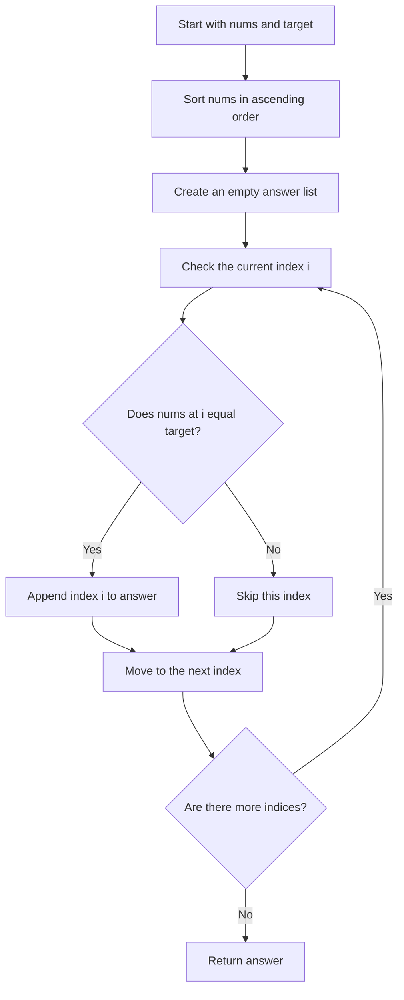
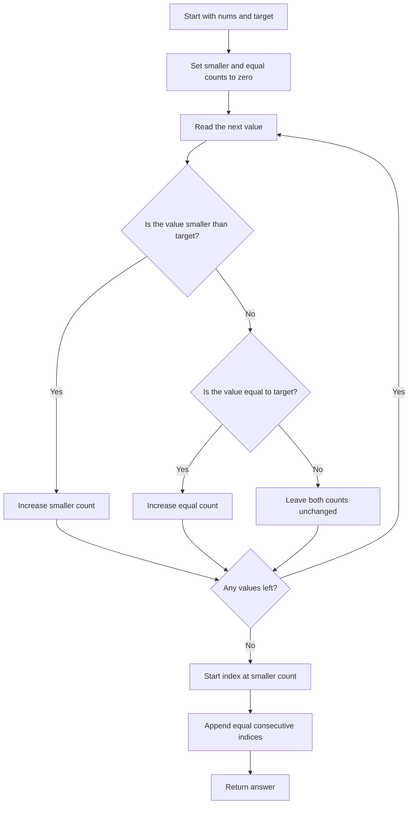

## 👨‍💻 Profiles

**GitHub:** https://github.com/Shailendra0320  
**LeetCode (Main):** https://leetcode.com/u/Shailu03/  
**LeetCode (Alternate):** https://leetcode.com/u/ShailendraLeetcode03/

# 2089. Find Target Indices After Sorting Array

**Difficulty:** Easy  
**Topics:** Array, Sorting, Counting, Binary Search  
**Main patterns:** Sort and scan; count smaller values and target occurrences  
**Official problem:** [LeetCode 2089 — Find Target Indices After Sorting Array](https://leetcode.com/problems/find-target-indices-after-sorting-array/)

---

## Table of Contents

- [1. Understand the Problem](#1-understand-the-problem)
- [2. Official Examples](#2-official-examples)
- [3. Important Observations](#3-important-observations)
- [4. Approach 1 — Sort and Scan](#4-approach-1--sort-and-scan)
- [5. Approach 2 — Count Without Sorting](#5-approach-2--count-without-sorting)
- [6. Compare the Approaches](#6-compare-the-approaches)
- [7. Edge Cases](#7-edge-cases)
- [8. Common Mistakes](#8-common-mistakes)
- [9. Interview Explanation](#9-interview-explanation)
- [10. Quick Revision](#10-quick-revision)

---

## 1. Understand the Problem

You are given an integer array `nums` and an integer `target`. First imagine sorting `nums` in ascending order. You must return **every index where the sorted array contains `target`**.

The index is **zero-based**, so the first element is at index `0`, the second is at index `1`, and so on. If the target does not appear, return an empty list.

### Example in plain English

```text
nums   = [1, 2, 5, 2, 3]
target = 2

After sorting: [1, 2, 2, 3, 5]
Indices:        0  1  2  3  4
```

The value `2` is at indices `1` and `2`, so the answer is `[1, 2]`.

### Constraints

- `1 <= nums.length <= 100`
- `1 <= nums[i] <= 100`
- `1 <= target <= 100`

These constraints are small, so sorting is already fast enough. However, we can do even better by counting values without sorting the array.

---

## 2. Official Examples

### Example 1

```text
Input:  nums = [1, 2, 5, 2, 3], target = 2
Output: [1, 2]
```

After sorting, the array is `[1, 2, 2, 3, 5]`. The two occurrences of `2` are at indices `1` and `2`.

### Example 2

```text
Input:  nums = [1, 2, 5, 2, 3], target = 3
Output: [3]
```

After sorting, the array is `[1, 2, 2, 3, 5]`. The value `3` is at index `3`.

### Example 3

```text
Input:  nums = [1, 2, 5, 2, 3], target = 5
Output: [4]
```

The value `5` is the largest value, so it appears at the final index, `4`.

### Extra example — Target is missing

```text
Input:  nums = [1, 2, 5, 2, 3], target = 4
Output: []
```

There are no values equal to `4`, so there are no target indices to return.

---

## 3. Important Observations

- Sorting places equal values next to one another.
- Every value smaller than `target` appears before every occurrence of `target` in the sorted array.
- Every occurrence of `target` forms one continuous block.
- The output indices must be increasing. Adding indices from left to right automatically keeps them sorted.

The last two observations lead to the faster solution: **we do not actually need to sort the array**. We only need to count how many values are smaller than `target` and how many equal `target`.

---

# 4. Approach 1 — Sort and Scan

**Idea:** Follow the problem statement directly: sort the array, scan its indices, and save every index whose value equals `target`.

**Time:** `O(n log n)`  
**Space:** `O(k)` for the returned answer, plus the sorting implementation's temporary space (`k` is the number of target occurrences).

### How it works

1. Sort `nums` in ascending order.
2. Create an empty answer list.
3. Visit the sorted array from index `0` to `n - 1`.
4. If `nums[i] == target`, append `i` to the answer.
5. Return the answer after the scan ends.

### Approach 1 flowchart



### Visual walkthrough

Input:

```text
nums = [1, 2, 5, 2, 3]
target = 2
```

After sorting, the positions look like this:

| Index | 0 | 1 | 2 | 3 | 4 |
|---:|---:|---:|---:|---:|---:|
| Value | 1 | 2 | 2 | 3 | 5 |
| Is it target `2`? | No | Yes | Yes | No | No |

We scan from left to right. Index `1` matches, so add `1`. Index `2` also matches, so add `2`. No other index matches.

```text
Answer after index 0: []
Answer after index 1: [1]
Answer after index 2: [1, 2]
Answer after index 3: [1, 2]
Answer after index 4: [1, 2]
```

Final answer: `[1, 2]`.

### Why this approach works

After sorting, checking each position tells us exactly whether that position is a target index. We inspect every index once and append only indices whose values equal `target`. Because we move from the first index to the last, the answer is automatically in increasing order. If no value matches, the answer list stays empty.

### Complexity

- **Time:** `O(n log n)` for sorting plus `O(n)` for scanning, which is `O(n log n)` overall.
- **Extra space:** The answer uses `O(k)` space. Sorting may use additional temporary space depending on the language's sorting implementation.

### Approach 1 code

#### Java

```java
//Approach-1 (Sort and Scan)
//T.C : O(n log n)
//S.C : O(k) for the answer, plus sorting workspace

import java.util.ArrayList;
import java.util.Arrays;
import java.util.List;

class Solution {
    public List<Integer> targetIndices(int[] nums, int target) {
        Arrays.sort(nums);

        List<Integer> answer = new ArrayList<>();

        for (int i = 0; i < nums.length; i++) {
            if (nums[i] == target) {
                answer.add(i);
            }
        }

        return answer;
    }
}
```

#### C++

```cpp
//Approach-1 (Sort and Scan)
//T.C : O(n log n)
//S.C : O(k) for the answer, plus sorting workspace

#include <bits/stdc++.h>
using namespace std;

class Solution {
public:
    vector<int> targetIndices(vector<int>& nums, int target) {
        sort(nums.begin(), nums.end());

        vector<int> answer;

        for (int i = 0; i < static_cast<int>(nums.size()); i++) {
            if (nums[i] == target) {
                answer.push_back(i);
            }
        }

        return answer;
    }
};
```

#### Python

```python
#Approach-1 (Sort and Scan)
#T.C : O(n log n)
#S.C : O(k) for the answer, plus sorting workspace

from typing import List

class Solution:
    def targetIndices(self, nums: List[int], target: int) -> List[int]:
        nums.sort()
        answer = []

        for i, value in enumerate(nums):
            if value == target:
                answer.append(i)

        return answer
```

---

# 5. Approach 2 — Count Without Sorting

**Idea:** Count how many values are smaller than `target` and how many values equal `target`. Those two counts tell us the complete answer without sorting.

**Time:** `O(n)`  
**Extra space:** `O(k)` for the returned answer and `O(1)` extra working space (`k` is the number of target occurrences).

### The key observation

Suppose:

- `smaller` = number of values in `nums` that are less than `target`.
- `equal` = number of values in `nums` that are equal to `target`.

When the array is sorted, the `smaller` values must come first. That means the first occurrence of `target` starts at index `smaller`.

Because there are `equal` copies of `target`, the answer contains these consecutive indices:

```text
smaller, smaller + 1, ..., smaller + equal - 1
```

For example, if `smaller = 1` and `equal = 2`, the target appears at indices `[1, 2]`.

If `equal = 0`, the loop adds no indices and the answer is `[]`.

### How it works

1. Set `smaller = 0` and `equal = 0`.
2. Scan the original array once.
3. If a value is less than `target`, increase `smaller`.
4. If a value equals `target`, increase `equal`.
5. Start from index `smaller` and append `equal` consecutive indices.
6. Return the answer.

### Approach 2 flowchart



### Dry run — Example 1

```text
nums = [1, 2, 5, 2, 3]
target = 2
```

Count the values without sorting:

| Value | Compare with `2` | `smaller` | `equal` |
|---:|---|---:|---:|
| `1` | Less than target | 1 | 0 |
| `2` | Equal to target | 1 | 1 |
| `5` | Greater than target | 1 | 1 |
| `2` | Equal to target | 1 | 2 |
| `3` | Greater than target | 1 | 2 |

At the end:

```text
smaller = 1
equal   = 2
```

Start at index `1` and add two consecutive indices:

```text
[1, 2]
```

No sorting was performed.

### Another dry run — Target does not exist

```text
nums = [1, 2, 5, 2, 3]
target = 4
```

There is one value smaller than `4`? Actually the values `1`, `2`, `2`, and `3` are smaller, so `smaller = 4`. No value equals `4`, so `equal = 0`. Since there are zero target occurrences, we append no indices and return `[]`.

### Why this approach works

In a sorted array, all values less than `target` must appear before `target`. The number of those values is exactly the index where the target block starts. Every copy of `target` then occupies the next consecutive position. Counting the smaller values tells us where to start; counting the equal values tells us how many indices to return. Values greater than the target do not affect either count.

### Complexity

- **Time:** `O(n)` to count values plus `O(k)` to create the answer, or `O(n + k)`. Since `k <= n`, this is `O(n)`.
- **Extra space:** `O(1)` working space apart from the returned list, which takes `O(k)` space.

### Approach 2 code

#### Java

```java
//Approach-2 (Count Smaller and Equal Values)
//T.C : O(n + k) = O(n)
//S.C : O(k) for the answer; O(1) extra working space

import java.util.ArrayList;
import java.util.List;

class Solution2 {
    public List<Integer> targetIndices(int[] nums, int target) {
        int smaller = 0;
        int equal = 0;

        for (int value : nums) {
            if (value < target) {
                smaller++;
            } else if (value == target) {
                equal++;
            }
        }

        List<Integer> answer = new ArrayList<>(equal);

        for (int index = smaller; index < smaller + equal; index++) {
            answer.add(index);
        }

        return answer;
    }
}
```

#### C++

```cpp
//Approach-2 (Count Smaller and Equal Values)
//T.C : O(n + k) = O(n)
//S.C : O(k) for the answer; O(1) extra working space

#include <bits/stdc++.h>
using namespace std;

class Solution2 {
public:
    vector<int> targetIndices(vector<int>& nums, int target) {
        int smaller = 0;
        int equal = 0;

        for (int value : nums) {
            if (value < target) {
                smaller++;
            } else if (value == target) {
                equal++;
            }
        }

        vector<int> answer;
        answer.reserve(equal);

        for (int index = smaller; index < smaller + equal; index++) {
            answer.push_back(index);
        }

        return answer;
    }
};
```

#### Python

```python
#Approach-2 (Count Smaller and Equal Values)
#T.C : O(n + k) = O(n)
#S.C : O(k) for the answer; O(1) extra working space

from typing import List

class Solution2:
    def targetIndices(self, nums: List[int], target: int) -> List[int]:
        smaller = 0
        equal = 0

        for value in nums:
            if value < target:
                smaller += 1
            elif value == target:
                equal += 1

        return list(range(smaller, smaller + equal))
```

---

## 6. Compare the Approaches

| Detail | Approach 1: Sort and scan | Approach 2: Count without sorting |
|---|---|---|
| Main idea | Sort first, then collect matching indices | Count smaller and equal values, then generate the index range |
| Sorts the array? | Yes | No |
| Time complexity | `O(n log n)` | `O(n)` |
| Extra working space | Depends on sorting implementation | `O(1)` excluding the answer |
| Output space | `O(k)` | `O(k)` |
| Main advantage | Directly follows the problem statement | Faster and avoids sorting |
| Best use | Simple, intuitive implementation | Recommended solution |

**Recommendation:** Use Approach 2 when you want the most efficient solution. It takes linear time and does not need to rearrange the input array.

---

## 7. Edge Cases

| Case | Example | Expected output for the given target |
|---|---|---|
| Target appears multiple times | `nums = [1, 2, 2, 3]`, `target = 2` | `[1, 2]` |
| Target appears once | `nums = [1, 3, 5]`, `target = 3` | `[1]` |
| Target is absent | `nums = [1, 2, 5]`, `target = 4` | `[]` |
| Every value equals target | `nums = [2, 2, 2]`, `target = 2` | `[0, 1, 2]` |
| Target is the smallest value | `nums = [3, 1, 2]`, `target = 1` | `[0]` |
| Target is the largest value | `nums = [3, 1, 2]`, `target = 3` | `[2]` |
| Single element matches | `nums = [7]`, `target = 7` | `[0]` |

---

## 8. Common Mistakes

1. **Returning original indices.** The answer is based on the array after sorting, not the original positions.
2. **Using one-based indexing.** LeetCode arrays use zero-based indexing.
3. **Forgetting duplicate targets.** Every occurrence of the target needs its own index.
4. **Returning values instead of indices.** The answer should contain positions, not copies of `target`.
5. **Returning an index when the target is absent.** If `equal` is zero, Approach 2 must return an empty list.
6. **Building indices in the wrong order.** Generate them from `smaller` upward so the output is increasing.
7. **Sorting unnecessarily in Approach 2.** The counts alone reveal the correct range of target indices.

---

## 9. Interview Explanation

> “The straightforward solution sorts the array and scans it to collect every position equal to the target. We can optimize this because the target values form one continuous block after sorting. The block begins after all values smaller than the target. I count the values smaller than the target and the values equal to it, then return that many consecutive indices starting at the smaller-value count. This reduces the time from `O(n log n)` to `O(n)` and avoids sorting.”

---

## 10. Quick Revision

- The output contains indices in the array **after sorting**.
- **Approach 1:** Sort, scan from left to right, and collect matching indices.
- **Approach 2:** Count values `< target` and `== target`; no sorting is needed.
- The first target index is `smaller`.
- If there are `equal` occurrences, the answer is `range(smaller, smaller + equal)`.
- If `equal == 0`, the result is `[]`.
- **Best approach:** Count without sorting — `O(n)` time and `O(1)` working space, excluding the output.

---

**Final takeaway:** After sorting, all target values sit together. Count how many values must come before them and how many target values exist, and you can calculate every target index without sorting at all.

**Reference:** [Official LeetCode problem 2089](https://leetcode.com/problems/find-target-indices-after-sorting-array/)
