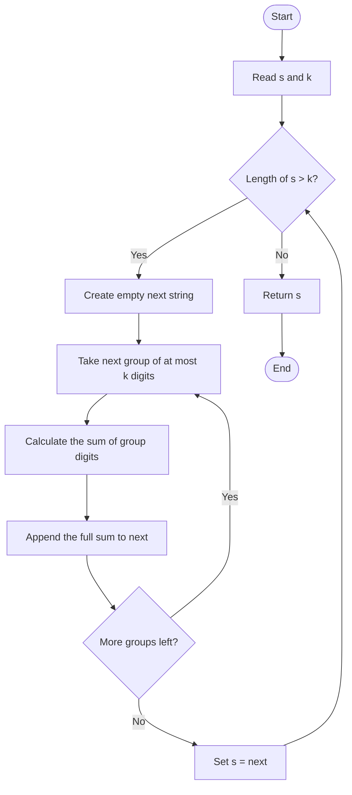
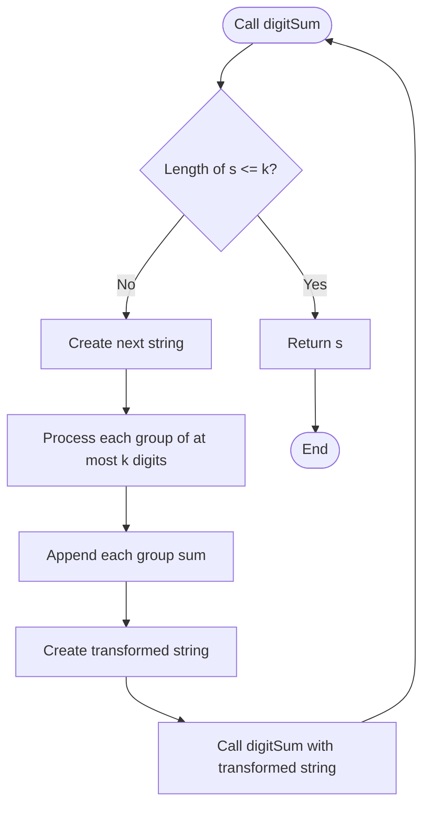

## 👨‍💻 Profiles

**GitHub:** https://github.com/Shailendra0320  
**LeetCode (Main):** https://leetcode.com/u/Shailu03/  
**LeetCode (Alternate):** https://leetcode.com/u/ShailendraLeetcode03/

---

## LeetCode 2243 – Calculate Digit Sum of a String

**Difficulty:** Easy  
**Topics:** String, Simulation  
**Recommended technique:** Repeated grouping and string construction

## Table of Contents

- [1. Problem Statement](#1-problem-statement)
- [2. Examples](#2-examples)
- [3. Constraints](#3-constraints)
- [4. Understand the Operation](#4-understand-the-operation)
- [5. Core Observation](#5-core-observation)
- [6. Approach 1 – Iterative Simulation](#6-approach-1-iterative-simulation)
  - [Idea](#approach-1-idea)
  - [Algorithm](#approach-1-algorithm)
  - [Flowchart](#approach-1-flowchart)
  - [Dry Run](#approach-1-dry-run)
  - [Correctness](#approach-1-correctness)
  - [Complexity](#approach-1-complexity)
  - [Java](#approach-1-java)
  - [C++](#approach-1-c)
  - [Python](#approach-1-python)
- [7. Approach 2 – Recursive Simulation](#7-approach-2-recursive-simulation)
  - [Idea](#approach-2-idea)
  - [Algorithm](#approach-2-algorithm)
  - [Flowchart](#approach-2-flowchart)
  - [Dry Run](#approach-2-dry-run)
  - [Correctness](#approach-2-correctness)
  - [Complexity](#approach-2-complexity)
  - [Java](#approach-2-java)
  - [C++](#approach-2-c)
  - [Python](#approach-2-python)
- [8. Approach Comparison](#8-approach-comparison)
- [9. Important Edge Cases](#9-important-edge-cases)
- [10. Common Mistakes](#10-common-mistakes)
- [11. Interview Explanation](#11-interview-explanation)
- [12. Quick Revision](#12-quick-revision)

---

## 1. Problem Statement

You are given a digit string `s` and an integer `k`.

As long as the length of `s` is greater than `k`, perform one round:

1. Split the current string into consecutive groups containing at most `k` characters. Every group except possibly the last one has exactly `k` characters.
2. Find the sum of the digits in each group.
3. Convert every group sum to its decimal string and concatenate all those strings in their original order.
4. Use the newly created string for the next round.

Return the string after its length becomes less than or equal to `k`.

**Important:** The group sum is not guaranteed to be a single digit. For example, the group `"346"` becomes `"13"`, not `"4"` or `"1"`.

## 2. Examples

### Example 1

**Input:**

```text
s = "11111222223", k = 3
```

**Output:**

```text
"135"
```

**Explanation:**

First round:

| Group | Digit calculation | Replacement |
|---|---:|---|
| `111` | 1 + 1 + 1 = 3 | `3` |
| `112` | 1 + 1 + 2 = 4 | `4` |
| `222` | 2 + 2 + 2 = 6 | `6` |
| `23` | 2 + 3 = 5 | `5` |

The new string is `"3465"`.

Second round:

| Group | Digit calculation | Replacement |
|---|---:|---|
| `346` | 3 + 4 + 6 = 13 | `13` |
| `5` | 5 | `5` |

The new string is `"135"`. Its length is 3, which is equal to `k`, so the process stops.

### Example 2

**Input:**

```text
s = "00000000", k = 3
```

**Output:**

```text
"000"
```

**Explanation:**

The groups are `"000"`, `"000"`, and `"00"`. Their sums are all zero, so the new string is `"000"`. Its length is equal to `k`, and no more round is required.

## 3. Constraints

- `1 <= s.length <= 100`
- `2 <= k <= 100`
- `s` contains digits only (`'0'` through `'9'`).

These constraints make direct simulation the natural solution. We do not need hashing, dynamic programming, or a complex data structure.

## 4. Understand the Operation

Suppose:

```text
s = "12345"
k = 2
```

We repeatedly take groups of two characters.

<pre class="text-diagram">
Round 1
12345
| | | |
12 34 5
 |  |  |
 3  7  5
     ↓
    375

Round 2
375
| |
37 5
 |  |
10  5
   ↓
  105

Round 3
105
| |
10 5
 | |
 1 5
  ↓
 15

15 has length 2, so stop.
</pre>

The transformations are:

```text
"12345" -> "375" -> "105" -> "15"
```

The answer is `"15"`.

## 5. Core Observation

The process is a direct simulation of the statement. The important details are:

- Start a new output string for every round.
- Process the current string from left to right in jumps of `k`.
- For each group, sum its digits one by one.
- Append the complete integer sum to the output. Do not append only the last digit of the sum.
- Replace the current string only after the whole round has been processed.
- Stop when `s.length() <= k`.

### Why do we use a new string for every round?

The next round must operate on the result of the previous complete round. Updating the current string while still reading groups from it can change later groups and produce an incorrect result. A separate `StringBuilder`, `string`, or list keeps the current round safe.

### Group boundaries

For a starting index `i`, the group ends at the smaller of:

```text
 i + k
 s.length()
```

In code, the inner loop condition is:

```java
j < Math.min(i + k, s.length())
```

This handles the final group even when it contains fewer than `k` characters.

---

## 6. Approach 1: Iterative Simulation

### Approach 1: Idea

Use a `while` loop to process rounds until the string becomes short enough.

Within each round, use a `for` loop to select each consecutive group. Calculate the group's digit sum and append that integer to a new output builder. At the end of the round, replace `s` with the builder's contents.

This approach follows the problem statement step by step and is the recommended implementation because its control flow is straightforward.

### Approach 1: Algorithm

1. While `s.length() > k`, create an empty output builder.
2. Move through `s` from index `0` in steps of `k`.
3. Set a group sum to zero.
4. Read characters from the current group, stopping at either `i + k` or the end of the string.
5. Convert each character to a digit with `s.charAt(j) - '0'` and add it to the group sum.
6. Append the complete group sum to the output builder.
7. After processing every group, set `s` to the builder's string.
8. Return `s` when its length is at most `k`.

### Approach 1: Flowchart



### Approach 1: Dry Run

Use:

```text
s = "11111222223"
k = 3
```

**Round 1:** Current length is 11, so another round is required.

| Start index | Group | Sum | Output so far |
|---:|---|---:|---|
| 0 | `111` | 3 | `3` |
| 3 | `112` | 4 | `34` |
| 6 | `222` | 6 | `346` |
| 9 | `23` | 5 | `3465` |

After round 1:

```text
s = "3465"
```

**Round 2:** Current length is 4, still greater than `k = 3`.

| Start index | Group | Sum | Output so far |
|---:|---|---:|---|
| 0 | `346` | 13 | `13` |
| 3 | `5` | 5 | `135` |

After round 2:

```text
s = "135"
```

Now `s.length() == k`, so the loop stops and returns `"135"`.

### Approach 1: Correctness

For one round, the outer grouping loop starts at index `0` and increases the index by exactly `k`. Therefore, it visits the groups in the same order as the statement, without skipping or overlapping any character.

For every group, the inner loop visits every character belonging to that group and adds its numeric digit value. Appending that integer sum creates exactly the required replacement for the group.

Consequently, the constructed output is exactly the string required after one round. Repeating this transformation while the length exceeds `k` performs every required round. The algorithm stops precisely when the statement says to stop, so the returned string is correct.

### Approach 1: Complexity

Let `n` be the length of the original string.

- **Time Complexity:** `O(n)` overall. Each round scans the characters it currently contains. The transformed string becomes shorter overall across rounds, so the total amount of character processing is linear in the original input size.
- **Space Complexity:** `O(n)` for the newly constructed string. The builder never needs more than a linear amount of storage relative to the input.

### Approach 1: Java

```java
//Approach-1 (Iterative Simulation: StringBuilder)
//T.C: O(n)
//S.C: O(n)

class Solution {
    public String digitSum(String s, int k) {
        while (s.length() > k) {
            StringBuilder next = new StringBuilder();

            for (int i = 0; i < s.length(); i += k) {
                int sum = 0;
                int end = Math.min(i + k, s.length());

                for (int j = i; j < end; j++) {
                    sum += s.charAt(j) - '0';
                }

                next.append(sum);
            }

            s = next.toString();
        }

        return s;
    }
}
```

### Approach 1: C++

```cpp
#include <bits/stdc++.h>
using namespace std;

//Approach-1 (Iterative Simulation: String Builder)
//T.C: O(n)
//S.C: O(n)

class Solution {
public:
    string digitSum(string s, int k) {
        while (s.size() > k) {
            string next;

            for (int i = 0; i < (int)s.size(); i += k) {
                int sum = 0;
                int end = min(i + k, (int)s.size());

                for (int j = i; j < end; j++) {
                    sum += s[j] - '0';
                }

                next += to_string(sum);
            }

            s = next;
        }

        return s;
    }
};
```

### Approach 1: Python

```python
#Approach-1 (Iterative Simulation: New String per Round)
#T.C: O(n)
#S.C: O(n)

class Solution:
    def digitSum(self, s: str, k: int) -> str:
        while len(s) > k:
            next_parts = []

            for i in range(0, len(s), k):
                group_sum = 0
                end = min(i + k, len(s))

                for j in range(i, end):
                    group_sum += int(s[j])

                next_parts.append(str(group_sum))

            s = "".join(next_parts)

        return s
```

---

## 7. Approach 2: Recursive Simulation

### Approach 2: Idea

The same transformation can be expressed recursively. One function call performs exactly one round:

- If the string is already at most `k` characters long, return it.
- Otherwise, create the string for the next round.
- Call the same function with that new string.

The recursive call represents the next round, while the base case represents the stopping condition.

This is an alternative way to organize the same simulation. It is useful for understanding recursion, but the iterative approach is generally preferable because it avoids recursive call-stack usage.

### Approach 2: Algorithm

1. Check whether `s.length() <= k`. If so, return `s`.
2. Create an empty output builder.
3. Split the current string into groups of at most `k` characters.
4. Calculate every group's digit sum and append the full sum to the builder.
5. Convert the builder into the next string.
6. Recursively process that next string with the same `k`.
7. Return the result of the recursive call.

### Approach 2: Flowchart



### Approach 2: Dry Run

Use:

```text
s = "12345"
k = 2
```

The recursive calls are:

| Call | Input | Transformation | Next call |
|---:|---|---|---|
| 1 | `12345` | `12 -> 3`, `34 -> 7`, `5 -> 5` | `digitSum("375", 2)` |
| 2 | `375` | `37 -> 10`, `5 -> 5` | `digitSum("105", 2)` |
| 3 | `105` | `10 -> 1`, `5 -> 5` | `digitSum("15", 2)` |
| 4 | `15` | Length is already 2 | Return `15` |

The recursive calls stop at the base case and the final answer is:

```text
"15"
```

### Approach 2: Correctness

The base case returns the current string exactly when its length is at most `k`, which is the required stopping condition.

When the base case does not apply, the function constructs the next string by partitioning the current string into consecutive groups of at most `k` characters and appending each group's digit sum. This is exactly one valid round of the required operation.

The recursive call then applies the same reasoning to the transformed string. Thus, every call performs one correct round until the base case is reached. The returned value is therefore the string after all required rounds.

### Approach 2: Complexity

Let `n` be the original string length.

- **Time Complexity:** `O(n)` overall, because the recursive calls perform the same sequence of linear round transformations as the iterative approach.
- **Space Complexity:** `O(n)` for the intermediate strings and recursive call stack. The iterative version is preferable when avoiding recursion overhead is important.

### Approach 2: Java

```java
//Approach-2 (Recursive Simulation)
//T.C: O(n)
//S.C: O(n)

class Solution2 {
    public String digitSum(String s, int k) {
        if (s.length() <= k) {
            return s;
        }

        StringBuilder next = new StringBuilder();

        for (int i = 0; i < s.length(); i += k) {
            int sum = 0;
            int end = Math.min(i + k, s.length());

            for (int j = i; j < end; j++) {
                sum += s.charAt(j) - '0';
            }

            next.append(sum);
        }

        return digitSum(next.toString(), k);
    }
}
```

### Approach 2: C++

```cpp
#include <bits/stdc++.h>
using namespace std;

//Approach-2 (Recursive Simulation)
//T.C: O(n)
//S.C: O(n)

class Solution2 {
public:
    string digitSum(string s, int k) {
        if (s.size() <= k) {
            return s;
        }

        string next;

        for (int i = 0; i < (int)s.size(); i += k) {
            int sum = 0;
            int end = min(i + k, (int)s.size());

            for (int j = i; j < end; j++) {
                sum += s[j] - '0';
            }

            next += to_string(sum);
        }

        return digitSum(next, k);
    }
};
```

### Approach 2: Python

```python
#Approach-2 (Recursive Simulation)
#T.C: O(n)
#S.C: O(n)

class Solution2:
    def digitSum(self, s: str, k: int) -> str:
        if len(s) <= k:
            return s

        next_parts = []

        for i in range(0, len(s), k):
            group_sum = 0
            end = min(i + k, len(s))

            for j in range(i, end):
                group_sum += int(s[j])

            next_parts.append(str(group_sum))

        next_string = "".join(next_parts)
        return self.digitSum(next_string, k)
```

---

## 8. Approach Comparison

| Feature | Approach 1: Iterative | Approach 2: Recursive |
|---|---|---|
| Main technique | `while` loop | Recursive function calls |
| One round | Build the next string in the loop | Build the next string before the recursive call |
| Time complexity | `O(n)` | `O(n)` |
| Extra space | `O(n)` | `O(n)` including call stack |
| Readability | Straightforward | Highlights the base case and repeated transformation |
| Recommendation | Best for submission | Useful for recursion practice |

Both approaches implement the same required grouping operation. The iterative version is the preferred submission because it avoids recursion overhead while remaining easy to follow.

## 9. Important Edge Cases

| Input | `k` | Output | Why it matters |
|---|---:|---|---|
| `"5"` | 2 | `"5"` | The string is already short enough |
| `"12"` | 2 | `"12"` | Length equal to `k` must not trigger a round |
| `"00000000"` | 3 | `"000"` | Zero sums must preserve zero characters |
| `"11111222223"` | 3 | `"135"` | Multiple rounds are required |
| `"99999"` | 2 | `"99"` | A group sum can contain more than one digit |
| `"12345"` | 5 | `"12345"` | No operation is needed when length equals `k` |

### Why is `"000"` not converted to `"0"`?

The operation replaces each group with its sum. It does not remove leading zeroes from the concatenated result. With `s = "00000000"` and `k = 3`, the three group sums are `0`, `0`, and `0`, so the new string is exactly `"000"`.

## 10. Common Mistakes

1. **Using `i < s.length() - k`:** This can skip the final group. Use `i < s.length()` and cap the end of the group.
2. **Assuming every group sum is one digit:** A group such as `"999"` has sum 27. Append the complete integer.
3. **Dropping the final short group:** The last group may contain fewer than `k` characters and must still be processed.
4. **Stopping at length less than `k`:** The rule says stop when the length is less than or equal to `k`.
5. **Changing the current string during a round:** Build a separate next string, then replace `s` after all groups have been processed.
6. **Parsing the entire group as an integer:** The task asks for the sum of its digits, not the numeric value of the group.
7. **Removing zeroes:** Keep the exact decimal representation of every group sum when concatenating the results.

## 11. Interview Explanation

“I simulate the rounds exactly as described. While the string length is greater than `k`, I create a new string and process the current string in consecutive groups of size `k`. For each group, I add its digit values and append the complete sum to the new string. Once all groups are processed, I replace the current string with the new one and continue. When the length becomes at most `k`, I return it. Each round scans the current characters, and the overall process takes linear time with linear extra space.”

If asked for an alternative, explain that the same one-round transformation can be placed in a recursive function with `s.length() <= k` as the base case. The iterative version is preferable for submission because it avoids recursion overhead.

## 12. Quick Revision

- **Problem type:** String Simulation
- **Main operation:** Split into groups of size `k`, sum digits in each group, concatenate the sums.
- **Repeat condition:** `s.length() > k`
- **Last group:** May contain fewer than `k` digits.
- **Do not forget:** Append the full sum, including two-digit sums such as `13` or `27`.
- **Best approach:** Iterative Simulation
- **Time complexity:** `O(n)` overall
- **Space complexity:** `O(n)`

### One-line takeaway

Build a fresh string from the digit sums of consecutive groups of size `k` until the current string contains at most `k` characters.

---

**Referevnce:** [LeetCode 2243 – Calculate Digit Sum of a String](https://leetcode.com/problems/calculate-digit-sum-of-a-string/)
