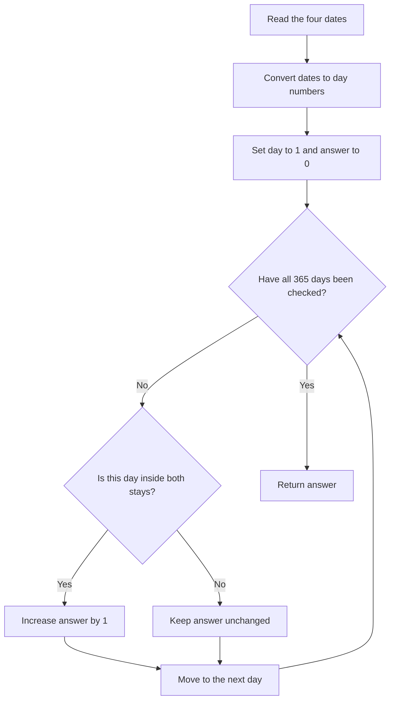
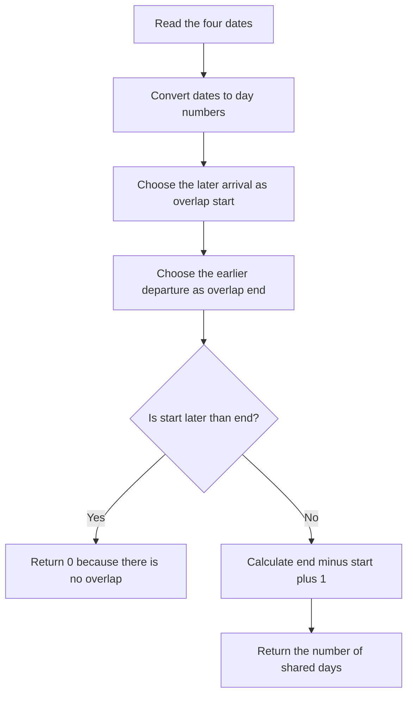

## 👨‍💻 Profiles

**GitHub:** https://github.com/Shailendra0320  
**LeetCode (Main):** [https://leetcode.com/u/Shailu03/](https://leetcode.com/u/Shailu03/)  
**LeetCode (Alternate):** [https://leetcode.com/u/ShailendraLeetcode03/](https://leetcode.com/u/ShailendraLeetcode03/)

# 2409. Count Days Spent Together

**Difficulty:** Easy  
**Topics:** Math, String, Prefix Sum, Interval Intersection  
**Main pattern:** Convert dates to a common number line, then calculate the intersection of two inclusive intervals.  
**Official problem:** [LeetCode 2409 — Count Days Spent Together](https://leetcode.com/problems/count-days-spent-together/)

---

## Table of Contents

- [Understand the Problem](#understand-the-problem)
- [Official Examples](#official-examples)
- [Important Observations](#important-observations)
- [Date Conversion: MM-DD to Day of Year](#date-conversion-mm-dd-to-day-of-year)
- [Approach 1 — Check Every Day](#approach-1--check-every-day)
- [Approach 2 — Find the Interval Intersection](#approach-2--find-the-interval-intersection)
- [Approach Comparison](#approach-comparison)
- [Edge Cases](#edge-cases)
- [Common Mistakes](#common-mistakes)
- [Interview Explanation](#interview-explanation)
- [Quick Revision](#quick-revision)

---

## Understand the Problem

Alice and Bob are visiting the same city. Each person has an arrival date and a leaving date. Both dates are **inclusive**, which means that the arrival day and the leaving day count as days spent in the city.

You are given four strings:

- `arriveAlice` — the day Alice arrives.
- `leaveAlice` — the day Alice leaves.
- `arriveBob` — the day Bob arrives.
- `leaveBob` — the day Bob leaves.

Each date has the form `"MM-DD"`. Return how many calendar days Alice and Bob are in the city at the same time.

The dates are from the same **non-leap year**, so February has 28 days.

### What does “inclusive” mean?

If a person arrives on `"08-15"` and leaves on `"08-18"`, their stay includes August 15, 16, 17, and 18 — a total of **4 days**, not 3.

### Constraints

- Every date uses the fixed format `MM-DD`.
- Each arrival date is earlier than or equal to that person's leaving date.
- Every date is valid and belongs to the same non-leap year.
- February has 28 days.

---

## Official Examples

### Example 1 — The stays overlap

```text
arriveAlice = "08-15"
leaveAlice  = "08-18"
arriveBob   = "08-16"
leaveBob    = "08-19"
Output = 3
```

Alice is there from August 15 through August 18. Bob is there from August 16 through August 19. The days they share are August 16, 17, and 18.

```text
Calendar day:  15   16   17   18   19
Alice:         [----------------]
Bob:                [----------------]
Together:           [----------]
                    16   17   18
```

Answer: `3`.

### Example 2 — The stays do not overlap

```text
arriveAlice = "10-01"
leaveAlice  = "10-31"
arriveBob   = "11-01"
leaveBob    = "12-31"
Output = 0
```

Alice leaves on October 31, but Bob arrives on November 1. The first stay ends before the second begins, so there are no shared days.

### Example 3 — One shared day

```text
arriveAlice = "06-20"
leaveAlice  = "07-01"
arriveBob   = "07-01"
leaveBob    = "07-10"
Output = 1
```

Both people are present on July 1. Since the endpoints are included, that single shared day counts.

---

## Important Observations

1. **The dates are in the same year.** We do not need to compare years.
2. **The format is fixed-width.** `MM-DD` strings can be compared lexicographically, but converting to day numbers makes the counting formula clearer.
3. **The stays are intervals.** Alice's stay is one closed interval and Bob's stay is another.
4. **Only the intersection matters.** The overlap begins when the later arrival happens and ends when the earlier departure happens.
5. **Use `+ 1`.** If the shared start and end are the same date, the answer must be 1, not 0.

---

## Date Conversion: MM-DD to Day of Year

The simplest reusable helper is `toDayOfYear(date)`. It converts a date into an integer from 1 through 365.

Month lengths in a non-leap year are:

| Month | Days | Days before this month |
|---|---:|---:|
| January | 31 | 0 |
| February | 28 | 31 |
| March | 31 | 59 |
| April | 30 | 90 |
| May | 31 | 120 |
| June | 30 | 151 |
| July | 31 | 181 |
| August | 31 | 212 |
| September | 30 | 243 |
| October | 31 | 273 |
| November | 30 | 304 |
| December | 31 | 334 |

For month `m` and day `d`:

```text
dayOfYear = daysBeforeMonth[m] + d
```

For example, August 15 is day `212 + 15 = 227` of the year.

### Date-conversion diagram

```text
"08-15"
   │
   ├── Month = 8
   ├── Day   = 15
   │
   ▼
Days before August = 212
   │
   ▼
212 + 15 = 227
   │
   ▼
Day 227 of the year
```

This is only a way to put all dates on one numeric line. The calendar date itself does not change.

---

# Approach 1 — Check Every Day

**Time:** `O(365)`, which is `O(1)` for this fixed calendar year  
**Auxiliary space:** `O(1)`

This is the most direct approach: convert the four dates to day numbers, then check each of the 365 days. A day counts only when it falls inside both people's stays.

## How it works

1. Convert Alice's arrival and departure to day numbers.
2. Convert Bob's arrival and departure to day numbers.
3. Check every day from 1 to 365.
4. A day belongs to Alice if it is between Alice's start and end, inclusive.
5. A day belongs to Bob if it is between Bob's start and end, inclusive.
6. Count the day only if both conditions are true.

Since the year always has 365 days, the loop has a fixed upper limit.

## Approach 1 flowchart



## Dry Run — Example 1

Input:

```text
Alice: 08-15 to 08-18
Bob:   08-16 to 08-19
```

Convert the endpoints:

| Date | Day of year |
|---|---:|
| Alice arrival: `08-15` | 227 |
| Alice departure: `08-18` | 230 |
| Bob arrival: `08-16` | 228 |
| Bob departure: `08-19` | 231 |

Now inspect the days around the overlap:

| Day number | Calendar date | Alice present? | Bob present? | Count it? |
|---:|---|---|---|---|
| 226 | Aug 14 | No | No | No |
| 227 | Aug 15 | Yes | No | No |
| 228 | Aug 16 | Yes | Yes | Yes |
| 229 | Aug 17 | Yes | Yes | Yes |
| 230 | Aug 18 | Yes | Yes | Yes |
| 231 | Aug 19 | No | Yes | No |

The shared days are 228, 229, and 230. The answer is `3`.

## Why Approach 1 works

The algorithm considers every possible day of the year, so it cannot skip a shared day. It increases the answer only when the day is inside Alice's inclusive interval and Bob's inclusive interval. Therefore, every day added to the count is shared, and every shared day is counted exactly once.

## Approach 1 code

### Java

```java
//Approach-1 (Check Every Day)
//T.C : O(365) = O(1) for a fixed non-leap year
//S.C : O(1)

class Solution {
    private int toDayOfYear(String date) {
        int[] daysBeforeMonth = {
            0, 31, 59, 90, 120, 151,
            181, 212, 243, 273, 304, 334
        };

        int month = Integer.parseInt(date.substring(0, 2));
        int day = Integer.parseInt(date.substring(3, 5));
        return daysBeforeMonth[month - 1] + day;
    }

    public int countDaysTogether(
        String arriveAlice,
        String leaveAlice,
        String arriveBob,
        String leaveBob
    ) {
        int aliceStart = toDayOfYear(arriveAlice);
        int aliceEnd = toDayOfYear(leaveAlice);
        int bobStart = toDayOfYear(arriveBob);
        int bobEnd = toDayOfYear(leaveBob);

        int answer = 0;

        for (int day = 1; day <= 365; day++) {
            boolean alicePresent = day >= aliceStart && day <= aliceEnd;
            boolean bobPresent = day >= bobStart && day <= bobEnd;

            if (alicePresent && bobPresent) {
                answer++;
            }
        }

        return answer;
    }
}
```

### C++

```cpp
//Approach-1 (Check Every Day)
//T.C : O(365) = O(1) for a fixed non-leap year
//S.C : O(1)

#include <bits/stdc++.h>
using namespace std;

class Solution {
private:
    int toDayOfYear(const string& date) {
        const int daysBeforeMonth[12] = {
            0, 31, 59, 90, 120, 151,
            181, 212, 243, 273, 304, 334
        };

        int month = stoi(date.substr(0, 2));
        int day = stoi(date.substr(3, 2));
        return daysBeforeMonth[month - 1] + day;
    }

public:
    int countDaysTogether(string arriveAlice, string leaveAlice,
                          string arriveBob, string leaveBob) {
        int aliceStart = toDayOfYear(arriveAlice);
        int aliceEnd = toDayOfYear(leaveAlice);
        int bobStart = toDayOfYear(arriveBob);
        int bobEnd = toDayOfYear(leaveBob);

        int answer = 0;

        for (int day = 1; day <= 365; day++) {
            bool alicePresent = day >= aliceStart && day <= aliceEnd;
            bool bobPresent = day >= bobStart && day <= bobEnd;

            if (alicePresent && bobPresent) {
                answer++;
            }
        }

        return answer;
    }
};
```

### Python

```python
#Approach-1 (Check Every Day)
#T.C : O(365) = O(1) for a fixed non-leap year
#S.C : O(1)

from typing import List

class Solution:
    def _to_day_of_year(self, date: str) -> int:
        days_before_month = [
            0, 31, 59, 90, 120, 151,
            181, 212, 243, 273, 304, 334
        ]

        month = int(date[:2])
        day = int(date[3:])
        return days_before_month[month - 1] + day

    def countDaysTogether(
        self,
        arriveAlice: str,
        leaveAlice: str,
        arriveBob: str,
        leaveBob: str
    ) -> int:
        alice_start = self._to_day_of_year(arriveAlice)
        alice_end = self._to_day_of_year(leaveAlice)
        bob_start = self._to_day_of_year(arriveBob)
        bob_end = self._to_day_of_year(leaveBob)

        answer = 0

        for day in range(1, 366):
            alice_present = alice_start <= day <= alice_end
            bob_present = bob_start <= day <= bob_end

            if alice_present and bob_present:
                answer += 1

        return answer
```

---

# Approach 2 — Find the Interval Intersection

**Time:** `O(1)`  
**Auxiliary space:** `O(1)`

This is the recommended approach. Rather than checking every day, find the first day that both people can be present and the last day that both can be present.

## The main idea

The shared stay cannot start before either person arrives, so its start is the **later of the two arrival dates**.

The shared stay cannot end after either person leaves, so its end is the **earlier of the two departure dates**.

```text
overlapStart = max(aliceStart, bobStart)
overlapEnd   = min(aliceEnd, bobEnd)
```

If `overlapStart > overlapEnd`, the intervals do not overlap and the answer is `0`.

Otherwise, both endpoints count, so:

```text
answer = overlapEnd - overlapStart + 1
```

## Interval diagram

Example 1:

```text
Day number:  227   228   229   230   231
             Aug15 Aug16 Aug17 Aug18 Aug19
Alice:       [-------------------]
Bob:               [-------------------]
Overlap:           [-----------]
                   228  229  230
```

The overlap starts at day `max(227, 228) = 228` and ends at day `min(230, 231) = 230`.

```text
230 - 228 + 1 = 3
```

## Approach 2 flowchart



## Dry Run — Example 1

```text
Alice: 08-15 to 08-18  ->  [227, 230]
Bob:   08-16 to 08-19  ->  [228, 231]
```

| Step | Calculation | Result |
|---|---|---:|
| Latest arrival | `max(227, 228)` | `228` |
| Earliest departure | `min(230, 231)` | `230` |
| Is there overlap? | `228 <= 230` | Yes |
| Shared days | `230 - 228 + 1` | `3` |

### Dry Run — Example 2

```text
Alice: 10-01 to 10-31  ->  [274, 304]
Bob:   11-01 to 12-31  ->  [305, 365]
```

- Latest arrival: `max(274, 305) = 305`.
- Earliest departure: `min(304, 365) = 304`.
- Since `305 > 304`, the intervals do not overlap.
- Return `0`.

### Dry Run — Exactly one shared day

```text
Alice: 06-20 to 07-01
Bob:   07-01 to 07-10
```

Both arrive/depart around July 1, and July 1 is included in both intervals. After conversion, the overlap start and overlap end are the same number. The formula becomes `end - start + 1 = 1`.

## Why Approach 2 works

Any shared day must be on or after both arrival dates. The first possible shared day is therefore the later arrival. Any shared day must also be on or before both departure dates. The last possible shared day is therefore the earlier departure.

If the first possible day comes after the last possible day, there is no common time. Otherwise, every day from the overlap start through the overlap end belongs to both stays. Counting that inclusive interval gives the exact answer.

## Approach 2 code

### Java

```java
//Approach-2 (Interval Intersection)
//T.C : O(1)
//S.C : O(1)

class Solution2 {
    private int toDayOfYear(String date) {
        int[] daysBeforeMonth = {
            0, 31, 59, 90, 120, 151,
            181, 212, 243, 273, 304, 334
        };

        int month = Integer.parseInt(date.substring(0, 2));
        int day = Integer.parseInt(date.substring(3, 5));
        return daysBeforeMonth[month - 1] + day;
    }

    public int countDaysTogether(
        String arriveAlice,
        String leaveAlice,
        String arriveBob,
        String leaveBob
    ) {
        int aliceStart = toDayOfYear(arriveAlice);
        int aliceEnd = toDayOfYear(leaveAlice);
        int bobStart = toDayOfYear(arriveBob);
        int bobEnd = toDayOfYear(leaveBob);

        int overlapStart = Math.max(aliceStart, bobStart);
        int overlapEnd = Math.min(aliceEnd, bobEnd);

        return Math.max(0, overlapEnd - overlapStart + 1);
    }
}
```

### C++

```cpp
//Approach-2 (Interval Intersection)
//T.C : O(1)
//S.C : O(1)

#include <bits/stdc++.h>
using namespace std;

class Solution2 {
private:
    int toDayOfYear(const string& date) {
        const int daysBeforeMonth[12] = {
            0, 31, 59, 90, 120, 151,
            181, 212, 243, 273, 304, 334
        };

        int month = stoi(date.substr(0, 2));
        int day = stoi(date.substr(3, 2));
        return daysBeforeMonth[month - 1] + day;
    }

public:
    int countDaysTogether(string arriveAlice, string leaveAlice,
                          string arriveBob, string leaveBob) {
        int aliceStart = toDayOfYear(arriveAlice);
        int aliceEnd = toDayOfYear(leaveAlice);
        int bobStart = toDayOfYear(arriveBob);
        int bobEnd = toDayOfYear(leaveBob);

        int overlapStart = max(aliceStart, bobStart);
        int overlapEnd = min(aliceEnd, bobEnd);

        return max(0, overlapEnd - overlapStart + 1);
    }
};
```

### Python

```python
#Approach-2 (Interval Intersection)
#T.C : O(1)
#S.C : O(1)

class Solution2:
    def _to_day_of_year(self, date: str) -> int:
        days_before_month = [
            0, 31, 59, 90, 120, 151,
            181, 212, 243, 273, 304, 334
        ]

        month = int(date[:2])
        day = int(date[3:])
        return days_before_month[month - 1] + day

    def countDaysTogether(
        self,
        arriveAlice: str,
        leaveAlice: str,
        arriveBob: str,
        leaveBob: str
    ) -> int:
        alice_start = self._to_day_of_year(arriveAlice)
        alice_end = self._to_day_of_year(leaveAlice)
        bob_start = self._to_day_of_year(arriveBob)
        bob_end = self._to_day_of_year(leaveBob)

        overlap_start = max(alice_start, bob_start)
        overlap_end = min(alice_end, bob_end)

        return max(0, overlap_end - overlap_start + 1)
```

---

## Approach Comparison

| Detail | Approach 1: Check every day | Approach 2: Interval intersection |
|---|---|---|
| Main idea | Check all 365 days individually | Calculate the common interval directly |
| Time | `O(365) = O(1)` for this problem | `O(1)` |
| Auxiliary space | `O(1)` | `O(1)` |
| Main advantage | Very simple and mirrors the meaning of the problem | Short, direct, and avoids scanning the calendar |
| Main drawback | Checks days that cannot possibly overlap | Requires careful handling of inclusive endpoints |
| Recommended? | Good for understanding | **Best for submission** |

## Edge Cases

| Case | Example | Expected result |
|---|---|---:|
| No overlap; Bob arrives later | Alice `10-01`–`10-31`, Bob `11-01`–`12-31` | `0` |
| Exactly one shared day | Alice ends on the day Bob arrives | `1` |
| Same interval | Both stay `03-10`–`03-20` | `11` |
| Bob's stay is inside Alice's stay | Alice `01-01`–`12-31`, Bob `04-01`–`04-30` | `30` |
| Alice's stay is inside Bob's stay | Alice `04-01`–`04-30`, Bob `01-01`–`12-31` | `30` |
| Same arrival and departure date | Both stay only on `05-12` | `1` |
| Overlap crosses a month boundary | Alice `01-30`–`02-03`, Bob `02-01`–`02-05` | `3` |
| Shared period ends on a month boundary | Alice ends `03-31`, Bob starts `03-31` | `1` |

## Common Mistakes

1. **Forgetting inclusive endpoints.** Use `overlapEnd - overlapStart + 1`, not only the difference.
2. **Returning a negative result.** When the intervals do not overlap, return `0`. `max(0, ...)` handles this cleanly.
3. **Using the earlier arrival.** The overlap cannot start until both people have arrived, so take the later arrival.
4. **Using the later departure.** The overlap ends as soon as either person leaves, so take the earlier departure.
5. **Treating February as 29 days.** The problem explicitly says the year is not a leap year.
6. **Mixing day-of-month values.** Compare full dates or convert them to day-of-year values. For example, `12-01` is later than `02-28` even though `1 < 28`.
7. **Using zero-based dates accidentally.** The helper returns day numbers starting at 1. The `+ 1` in the overlap formula is consistent with that convention.

## Interview Explanation

“I convert each `MM-DD` date to its day number in the non-leap year. Then I find the overlap start as the later arrival and the overlap end as the earlier departure. If the start is after the end, there are no shared days, so I return zero. Otherwise, I return `end - start + 1` because the first and last days are included. The solution uses constant time and constant extra space.”

## Quick Revision

- Convert `MM-DD` to day-of-year using the number of days before its month.
- `overlapStart = max(aliceStart, bobStart)`.
- `overlapEnd = min(aliceEnd, bobEnd)`.
- If `overlapStart > overlapEnd`, return `0`.
- Otherwise return `overlapEnd - overlapStart + 1`.
- Preferred solution: Approach 2, `O(1)` time and `O(1)` auxiliary space.

## Final Takeaway

Two trips are just two inclusive intervals on a calendar. Find the later start and the earlier end; their intersection is the shared stay. If the two endpoints cross, there is no intersection. This simple interval pattern also appears in meeting schedules, booking conflicts, attendance ranges, and other overlap problems.

**Reference:** [LeetCode 2409 — Count Days Spent Together](https://leetcode.com/problems/count-days-spent-together/)
