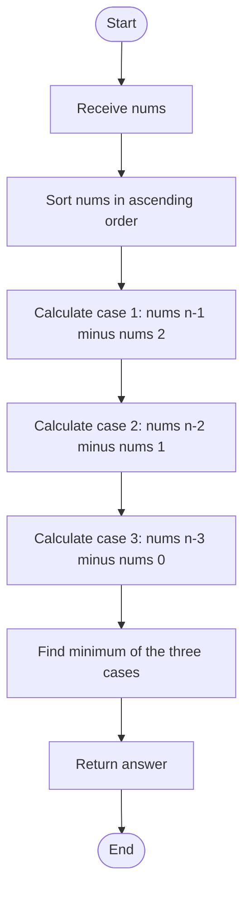
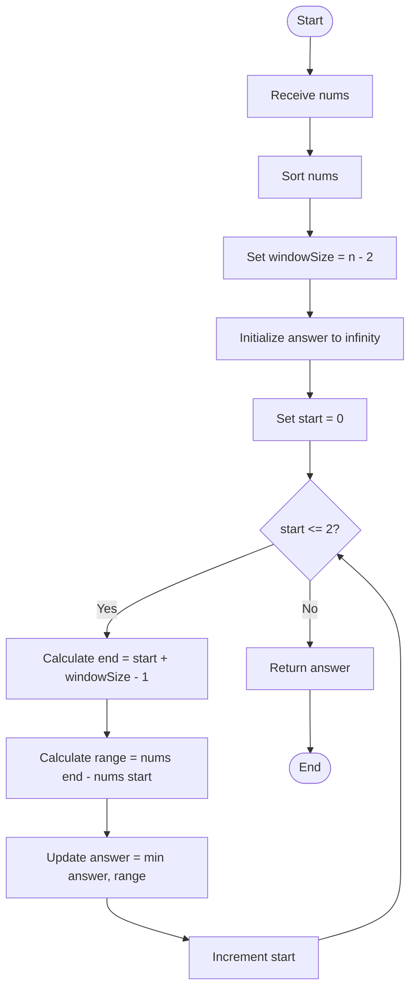

# 2567. Minimum Score by Changing Two Elements

[](https://github.com/Shailendra0320)  
[](https://leetcode.com/u/Shailu03/)  
[](https://leetcode.com/u/ShailendraLeetcode03/)

**Difficulty:** Medium  
**Topics:** Array, Sorting, Greedy  
**Problem:** [2567. Minimum Score by Changing Two Elements](https://leetcode.com/problems/minimum-score-by-changing-two-elements/)

---

## Table of Contents

1. [Problem Statement](#1-problem-statement)
2. [Examples](#2-examples)
3. [Constraints](#3-constraints)
4. [Understanding the Problem](#4-understanding-the-problem)
5. [Key Observations](#5-key-observations)
6. [Approach 1 — Sorting + Three Possible Cases](#6-approach-1--sorting--three-possible-cases)
   - [Intuition](#61-intuition)
   - [Why Use This Approach?](#62-why-use-this-approach)
   - [Algorithm](#63-algorithm)
   - [Architecture / Decision Diagram](#64-architecture--decision-diagram)
   - [Flowchart](#65-flowchart)
   - [Dry Run](#66-dry-run)
   - [Correctness Proof](#67-correctness-proof)
   - [Complexity Analysis](#68-complexity-analysis)
   - [Java Code](#69-java-code)
   - [C++ Code](#610-c-code)
   - [Python Code](#611-python-code)
7. [Approach 2 — Sorting + Sliding Window of Size n - 2](#7-approach-2--sorting--sliding-window-of-size-n---2)
   - [Intuition](#71-intuition)
   - [Why Use This Approach?](#72-why-use-this-approach)
   - [Algorithm](#73-algorithm)
   - [Architecture / Window Diagram](#74-architecture--window-diagram)
   - [Flowchart](#75-flowchart)
   - [Dry Run](#76-dry-run)
   - [Correctness Proof](#77-correctness-proof)
   - [Complexity Analysis](#78-complexity-analysis)
   - [Java Code](#79-java-code)
   - [C++ Code](#710-c-code)
   - [Python Code](#711-python-code)
8. [Additional Dry Runs](#8-additional-dry-runs)
9. [Approach Comparison](#9-approach-comparison)
10. [Edge Cases](#10-edge-cases)
11. [Common Mistakes](#11-common-mistakes)
12. [Interview Explanation](#12-interview-explanation)
13. [Quick Revision](#13-quick-revision)
14. [Final Recommendation](#14-final-recommendation)

---

## 1. Problem Statement

You are given an integer array `nums`.

The **score** of an array is the difference between its maximum and minimum elements:

\[
score(nums) = \max(nums) - \min(nums)
\]

You can change **at most two elements** of the array to any values you want.

Return the minimum possible score after performing at most two changes.

### What does “at most two changes” mean?

You may change:
- No elements.
- Exactly one element.
- Exactly two elements.

You are not required to change exactly two elements. The goal is to make the final difference between the largest and smallest values as small as possible.

---

## 2. Examples

### Example 1

**Input:**
```text
nums = [1, 4, 7, 8, 5]
```

**Output:**
```text
3
```

**Explanation:**

Sort the array:

```text
[1, 4, 5, 7, 8]
```

We can change the two smallest values, `1` and `4`, to values inside the range `[5, 7]`.

The remaining relevant values are:

```text
[5, 7, 8]
```

The final score is:

\[
8 - 5 = 3
\]

### Example 2

**Input:**
```text
nums = [1, 1, 1]
```

**Output:**
```text
0
```

**Explanation:**

All elements are already equal. The maximum and minimum are both `1`.

\[
1 - 1 = 0
\]

### Example 3

**Input:**
```text
nums = [1, 2, 3, 4, 5, 6, 7, 8]
```

**Output:**
```text
5
```

**Explanation:**

After sorting, change the two smallest values:

```text
[1, 2, 3, 4, 5, 6, 7, 8]
 ^  ^
```

The unchanged values range from `3` to `8`.

\[
8 - 3 = 5
\]

---

## 3. Constraints

```text
3 <= nums.length <= 10^5
-10^9 <= nums[i] <= 10^9
```

### Constraint observations

- The array can contain up to \(10^5\) elements.
- Negative values are allowed.
- Duplicate values are allowed.
- The answer can be as large as \(2 \times 10^9\), so use a 32-bit signed integer where supported by the problem's constraints; `int` is sufficient for the stated range.
- An \(O(n^2)\) approach is too slow for the maximum input size.
- Sorting in \(O(n\log n)\) is efficient enough.

---

## 4. Understanding the Problem

The score depends only on two values:

1. The smallest element.
2. The largest element.

All values between the minimum and maximum do not directly affect the score.

Changing an element that is neither the minimum nor the maximum usually does not improve the score. The useful operation is to remove an extreme value from consideration by changing it to a value inside the final range.

Since we can change at most two elements, we can eliminate at most two extreme values.

### Visual example

Consider:

```text
nums = [1, 4, 5, 7, 8]
```

After sorting:

```text
Index:  0  1  2  3  4
Value:  1  4  5  7  8
```

We can change two elements. To minimize the range, we should consider keeping a group of three original values and changing the other two.

Possible groups of three consecutive sorted values:

```text
[1, 4, 5]  -> score = 5 - 1 = 4
[4, 5, 7]  -> score = 7 - 4 = 3
[5, 7, 8]  -> score = 8 - 5 = 3
```

The minimum possible score is:

```text
min(4, 3, 3) = 3
```

---

## 5. Key Observations

### Observation 1: Sorting makes the extremes easy to handle

Sort the array in ascending order:

\[
a_0 \le a_1 \le a_2 \le \dots \le a_{n-1}
\]

Now the minimum is at index `0` and the maximum is at index `n - 1`.

### Observation 2: We only need to keep n - 2 elements

Because we can change at most two elements, at least \(n-2\) original elements remain unchanged.

To obtain the smallest possible range, choose the \(n-2\) original values that have the smallest difference between their maximum and minimum.

### Observation 3: The best retained group is consecutive after sorting

Suppose we choose some \(n-2\) values from a sorted array. If there is a skipped value between two selected values, replacing an outer selected value with that skipped value cannot increase the range.

Therefore, an optimal set of \(n-2\) retained values can always be represented by a consecutive window in the sorted array.

### Observation 4: There are exactly three windows

The sorted array has `n` elements. A window of size `n - 2` can start only at:

```text
0, 1, 2
```

So only three candidate ranges need to be checked:

\[
a_{n-1}-a_2
\]

\[
a_{n-2}-a_1
\]

\[
a_{n-3}-a_0
\]

The answer is the minimum of these three values.

---

# 6. Approach 1 — Sorting + Three Possible Cases

## 6.1 Intuition

The main idea is to sort the array and think about which two elements should be changed.

After sorting:

```text
a[0] <= a[1] <= ... <= a[n-1]
```

The minimum score is obtained by removing the influence of two extreme values.

There are only three useful ways to distribute the two changes:

### Case 1: Change the two smallest elements

```text
Before:
[a0, a1, a2, a3, ..., a(n-1)]

Change:
 ^   ^

Remaining range:
[a2, ..., a(n-1)]
```

The smallest remaining value is `a[2]`, and the largest is `a[n-1]`.

\[
case_1 = a[n-1] - a[2]
\]

### Case 2: Change the smallest and the largest elements

```text
Before:
[a0, a1, a2, ..., a(n-2), a(n-1)]

Change:
 ^                         ^

Remaining range:
[a1, ..., a(n-2)]
```

The smallest remaining value is `a[1]`, and the largest is `a[n-2]`.

\[
case_2 = a[n-2] - a[1]
\]

### Case 3: Change the two largest elements

```text
Before:
[a0, a1, ..., a(n-3), a(n-2), a(n-1)]

Change:
                    ^       ^

Remaining range:
[a0, ..., a(n-3)]
```

The smallest remaining value is `a[0]`, and the largest is `a[n-3]`.

\[
case_3 = a[n-3] - a[0]
\]

Finally:

\[
\boxed{answer = \min(case_1, case_2, case_3)}
\]

## 6.2 Why Use This Approach?

- It is the most direct implementation of the mathematical observation.
- It checks all possible useful distributions of two changes.
- It requires only three comparisons after sorting.
- It uses constant extra space apart from the sorting implementation.
- It is short, easy to explain, and ideal for coding interviews.

## 6.3 Algorithm

1. Sort `nums` in ascending order.
2. Calculate the score after changing the two smallest elements.
3. Calculate the score after changing the smallest and largest elements.
4. Calculate the score after changing the two largest elements.
5. Return the minimum of these three scores.

## 6.4 Architecture / Decision Diagram

```text
                 Original Array
                       |
                       v
              Sort in Ascending Order
                       |
                       v
          a[0] <= a[1] <= ... <= a[n-1]
                       |
          +------------+------------+
          |            |            |
          v            v            v
      Case 1        Case 2        Case 3
    Change 2       Change 1      Change 2
    smallest       smallest      largest
                   + largest
          |            |            |
          v            v            v
   a[n-1]-a[2]  a[n-2]-a[1]  a[n-3]-a[0]
          |            |            |
          +------------+------------+
                       |
                       v
                Take Minimum
                       |
                       v
                 Final Answer
```

## 6.5 Flowchart



## 6.6 Dry Run

**Input:**

```text
nums = [1, 4, 7, 8, 5]
```

### Step 1: Sort the array

```text
Original: [1, 4, 7, 8, 5]
Sorted:   [1, 4, 5, 7, 8]
```

### Step 2: Identify indexes

```text
Index:  0  1  2  3  4
Value:  1  4  5  7  8
```

### Step 3: Calculate all three cases

| Case | Changed elements | Remaining range | Score |
|---|---|---|---:|
| 1 | `1, 4` | `5` to `8` | `8 - 5 = 3` |
| 2 | `1, 8` | `4` to `7` | `7 - 4 = 3` |
| 3 | `7, 8` | `1` to `5` | `5 - 1 = 4` |

### Step 4: Take the minimum

\[
answer = \min(3,3,4)
\]

\[
\boxed{answer = 3}
\]

**Output:**

```text
3
```

## 6.7 Correctness Proof

Let the sorted array be:

\[
a_0 \le a_1 \le \dots \le a_{n-1}
\]

At most two elements can be changed. Therefore, at least \(n-2\) original elements must remain unchanged.

The range of any selected set of unchanged elements is determined by its smallest and largest selected values.

For a fixed number of selected elements, an optimal selection in a sorted array can be made consecutive: if a selected group skips an element inside its range, replacing an outer selected element with the skipped element does not increase the range.

Thus, an optimal set of \(n-2\) unchanged elements is one of these three consecutive windows:

- `a[0 ... n-3]`
- `a[1 ... n-2]`
- `a[2 ... n-1]`

Their ranges are exactly:

\[
a_{n-3}-a_0,\quad a_{n-2}-a_1,\quad a_{n-1}-a_2
\]

The algorithm checks all three possible optimal windows and returns the smallest range. Hence, it returns the minimum achievable score.

## 6.8 Complexity Analysis

Let `n` be the number of elements.

| Operation | Time |
|---|---:|
| Sorting | \(O(n\log n)\) |
| Calculate three cases | \(O(1)\) |
| Find minimum | \(O(1)\) |

**Total Time Complexity:**

\[
\boxed{O(n\log n)}
\]

**Auxiliary Space Complexity:**

\[
\boxed{O(1)}
\]

The constant auxiliary-space claim excludes the internal stack or temporary memory used by the language's sorting implementation.

## 6.9 Java Code

```java
//Approach-1 (Sorting + Three Possible Cases)
//T.C: O(n log n)
//S.C: O(1) auxiliary space, excluding sorting internals

import java.util.Arrays;

class Solution {
    public int minDifference(int[] nums) {
        int n = nums.length;

        Arrays.sort(nums);

        int case1 = nums[n - 1] - nums[2];
        int case2 = nums[n - 2] - nums[1];
        int case3 = nums[n - 3] - nums[0];

        return Math.min(case1, Math.min(case2, case3));
    }
}
```

## 6.10 C++ Code

```cpp
//Approach-1 (Sorting + Three Possible Cases)
//T.C: O(n log n)
//S.C: O(1) auxiliary space, excluding sorting internals

class Solution {
public:
    int minDifference(vector<int>& nums) {
        int n = nums.size();

        sort(nums.begin(), nums.end());

        int case1 = nums[n - 1] - nums[2];
        int case2 = nums[n - 2] - nums[1];
        int case3 = nums[n - 3] - nums[0];

        return min(case1, min(case2, case3));
    }
};
```

## 6.11 Python Code

```python
# Approach-1 (Sorting + Three Possible Cases)
# T.C: O(n log n)
# S.C: O(1) auxiliary space, excluding sorting internals

class Solution:
    def minDifference(self, nums: List[int]) -> int:
        nums.sort()
        n = len(nums)

        case1 = nums[n - 1] - nums[2]
        case2 = nums[n - 2] - nums[1]
        case3 = nums[n - 3] - nums[0]

        return min(case1, case2, case3)
```

---

# 7. Approach 2 — Sorting + Sliding Window of Size n - 2

## 7.1 Intuition

Approach 1 uses three formulas directly. We can understand the same problem from another angle: **keep the best group of `n - 2` sorted elements**.

Since we can change two elements, we can ignore two values when calculating the final range.

After sorting, every possible optimal group of `n - 2` values is a consecutive window.

For an array of length `n`, the window size is:

\[
windowSize = n - 2
\]

The possible starting positions are `0`, `1`, and `2`.

For each window:

\[
score = nums[start + windowSize - 1] - nums[start]
\]

We calculate the range of each window and return the minimum.

### Window visualization

Sorted array:

```text
[1, 4, 5, 7, 8]
```

Window size:

```text
n - 2 = 5 - 2 = 3
```

Possible windows:

```text
Window 1: [1, 4, 5] | 7, 8
           score = 5 - 1 = 4

Window 2: 1 | [4, 5, 7] | 8
              score = 7 - 4 = 3

Window 3: 1, 4 | [5, 7, 8]
                 score = 8 - 5 = 3
```

Therefore:

\[
answer = \min(4,3,3) = 3
\]

## 7.2 Why Use This Approach?

- It expresses the problem as a fixed-size window problem.
- It makes the idea of retaining `n - 2` values very clear.
- It is easy to generalize conceptually to problems where a limited number of elements may be ignored.
- It avoids memorizing three separate formulas.
- It is useful when explaining why only three candidate groups need to be checked.

**Important:** This approach has the same asymptotic complexity as Approach 1. It is an alternative way to express the same optimal strategy, not a faster algorithm.

## 7.3 Algorithm

1. Sort the array in ascending order.
2. Set `windowSize = n - 2`.
3. Initialize `answer` to the largest possible integer.
4. Iterate over each valid window starting at index `0`, `1`, and `2`.
5. For each window:
   - Its first element is `nums[start]`.
   - Its last element is `nums[start + windowSize - 1]`.
   - Calculate the range by subtracting the first from the last.
6. Update `answer` with the smallest window range.
7. Return `answer`.

## 7.4 Architecture / Window Diagram

```text
                    Input Array
                         |
                         v
                Sort in Ascending Order
                         |
                         v
                  Calculate n - 2
                    Window Size
                         |
                         v
             Check Every Valid Window
                         |
          +--------------+--------------+
          |              |              |
          v              v              v
       Start 0         Start 1         Start 2
          |              |              |
          v              v              v
      [0 ... n-3]    [1 ... n-2]    [2 ... n-1]
          |              |              |
          v              v              v
     Last - First   Last - First   Last - First
          |              |              |
          +--------------+--------------+
                         |
                         v
                  Keep Minimum Range
                         |
                         v
                    Return Answer
```

## 7.5 Flowchart



## 7.6 Dry Run

**Input:**

```text
nums = [1, 2, 3, 4, 5, 6, 7, 8]
```

### Step 1: Sort the array

```text
[1, 2, 3, 4, 5, 6, 7, 8]
```

### Step 2: Calculate the window size

```text
n = 8
windowSize = n - 2 = 6
```

### Step 3: Check all windows

| Start | Window | Calculation | Score |
|---:|---|---|---:|
| 0 | `[1, 2, 3, 4, 5, 6]` | `6 - 1` | 5 |
| 1 | `[2, 3, 4, 5, 6, 7]` | `7 - 2` | 5 |
| 2 | `[3, 4, 5, 6, 7, 8]` | `8 - 3` | 5 |

### Step 4: Find the minimum

\[
answer = \min(5,5,5)
\]

\[
\boxed{answer = 5}
\]

**Output:**

```text
5
```

## 7.7 Correctness Proof

After sorting, consider any choice of \(n-2\) elements that remain unchanged.

If the selected elements are not consecutive, there is at least one unselected value between the first and last selected positions. Replacing an outer selected value with an unselected value lying inside the range cannot increase the range.

Repeating this replacement gives a consecutive group of \(n-2\) elements whose range is no larger than the original group's range.

Therefore, at least one optimal solution is a consecutive window of size \(n-2\).

There are exactly three such windows in an array of size \(n\), starting at indices `0`, `1`, and `2`.

The algorithm checks every one of these windows and returns the smallest range. Hence, the algorithm returns the minimum possible score.

## 7.8 Complexity Analysis

Let `n` be the length of the array.

| Operation | Time |
|---|---:|
| Sorting | \(O(n\log n)\) |
| Check three windows | \(O(1)\) |
| Update minimum | \(O(1)\) |

**Total Time Complexity:**

\[
\boxed{O(n\log n)}
\]

**Auxiliary Space Complexity:**

\[
\boxed{O(1)}
\]

The space analysis excludes implementation-dependent memory used internally by sorting.

## 7.9 Java Code

```java
//Approach-2 (Sorting + Sliding Window of Size n - 2)
//T.C: O(n log n)
//S.C: O(1) auxiliary space, excluding sorting internals

import java.util.Arrays;

class Solution {
    public int minDifference(int[] nums) {
        Arrays.sort(nums);

        int n = nums.length;
        int windowSize = n - 2;
        int answer = Integer.MAX_VALUE;

        for (int start = 0; start <= 2; start++) {
            int end = start + windowSize - 1;
            int currentScore = nums[end] - nums[start];

            answer = Math.min(answer, currentScore);
        }

        return answer;
    }
}
```

## 7.10 C++ Code

```cpp
//Approach-2 (Sorting + Sliding Window of Size n - 2)
//T.C: O(n log n)
//S.C: O(1) auxiliary space, excluding sorting internals

class Solution {
public:
    int minDifference(vector<int>& nums) {
        sort(nums.begin(), nums.end());

        int n = nums.size();
        int windowSize = n - 2;
        int answer = INT_MAX;

        for (int start = 0; start <= 2; start++) {
            int end = start + windowSize - 1;
            int currentScore = nums[end] - nums[start];

            answer = min(answer, currentScore);
        }

        return answer;
    }
};
```

## 7.11 Python Code

```python
# Approach-2 (Sorting + Sliding Window of Size n - 2)
# T.C: O(n log n)
# S.C: O(1) auxiliary space, excluding sorting internals

class Solution:
    def minDifference(self, nums: List[int]) -> int:
        nums.sort()

        n = len(nums)
        windowSize = n - 2
        answer = float('inf')

        for start in range(3):
            end = start + windowSize - 1
            currentScore = nums[end] - nums[start]

            answer = min(answer, currentScore)

        return answer
```

---

## 8. Additional Dry Runs

### Dry Run 1 — Minimum array length

**Input:**

```text
nums = [5, 10, 15]
```

Sorted:

```text
[5, 10, 15]
```

We can change two elements and keep one original element. Set the other two values equal to that retained value.

The final score can be:

\[
0
\]

**Output:**

```text
0
```

### Dry Run 2 — All values are equal

**Input:**

```text
nums = [4, 4, 4, 4, 4]
```

Every candidate window has range:

\[
4 - 4 = 0
\]

**Output:**

```text
0
```

### Dry Run 3 — Negative values

**Input:**

```text
nums = [-10, -3, 0, 5, 9]
```

Sorted array:

```text
[-10, -3, 0, 5, 9]
```

Candidate scores:

```text
Case 1: 9 - 0   = 9
Case 2: 5 - (-3) = 8
Case 3: 0 - (-10) = 10
```

\[
answer = \min(9,8,10) = 8
\]

**Output:**

```text
8
```

---

## 9. Approach Comparison

| Feature | Approach 1: Three Cases | Approach 2: Window |
|---|---|---|
| Main idea | Evaluate three formulas | Evaluate three windows |
| Sorting | Required | Required |
| Candidate count | 3 | 3 |
| Time complexity | \(O(n\log n)\) | \(O(n\log n)\) |
| Auxiliary space | \(O(1)\), excluding sort internals | \(O(1)\), excluding sort internals |
| Readability | Very concise | More descriptive |
| Best use | Direct interview solution | Understanding retained groups |

### Which approach should you choose?

- Choose **Approach 1** when you want the shortest and most direct solution.
- Choose **Approach 2** when you want to explain the problem through fixed-size windows.

Both approaches are optimal in asymptotic time complexity.

---

## 10. Edge Cases

| Input | Expected Output | Reason |
|---|---:|---|
| `[1, 2, 3]` | `0` | Two elements can be changed to match the remaining value |
| `[1, 1, 1]` | `0` | All values are already equal |
| `[1, 2, 3, 4]` | `1` | Keep the closest possible pair of original values |
| `[1, 4, 7, 8, 5]` | `3` | Best retained range is 3 |
| `[-10, -3, 0, 5, 9]` | `8` | Negative values are handled by normal subtraction |
| `[100, 100, 100, 100]` | `0` | All values are equal |

---

## 11. Common Mistakes

### Mistake 1: Changing only one side

Do not check only the case where the two smallest values are changed. The best result may come from changing one smallest and one largest value.

### Mistake 2: Forgetting the middle case

All three possibilities must be checked:

```text
Change two smallest
Change one smallest and one largest
Change two largest
```

### Mistake 3: Using the wrong indexes

Correct expressions after sorting:

```java
nums[n - 1] - nums[2]
nums[n - 2] - nums[1]
nums[n - 3] - nums[0]
```

### Mistake 4: Using an O(n²) solution

The array can contain \(10^5\) elements. Sorting followed by constant work is efficient.

### Mistake 5: Forgetting the minimum length

The constraints guarantee at least three elements, so indexes `0`, `1`, and `2` are valid.

### Mistake 6: Claiming sorting is always constant-space

The algorithm itself uses constant extra variables, but the sorting implementation may use internal stack or temporary memory. State the auxiliary-space convention clearly.

---

## 12. Interview Explanation

You can explain the solution like this:

> First, I sort the array so that the smallest and largest values are at the two ends. Since I can change at most two elements, I only need to decide which two extremes to remove from consideration. There are three possibilities: change the two smallest elements, change one smallest and one largest element, or change the two largest elements. I calculate the remaining range for each case and return the minimum. Sorting takes O(n log n), and checking the three cases takes O(1), so the overall time complexity is O(n log n).

---

## 13. Quick Revision

### Main formula

After sorting:

\[
\boxed{
answer = \min
\begin{cases}
nums[n-1] - nums[2]\\
nums[n-2] - nums[1]\\
nums[n-3] - nums[0]
\end{cases}
}
\]

### Remember

- Sort the array.
- At most two elements can be changed.
- Keep the best `n - 2` consecutive values.
- There are only three possible windows.
- Return the minimum range.

### Complexity

```text
Time:  O(n log n)
Space: O(1) auxiliary, excluding sorting internals
```

---

## 14. Final Recommendation

**Approach 1 — Sorting + Three Possible Cases** is the recommended solution for interviews and LeetCode submissions.

It is concise, optimal, and directly represents the three possible ways to use the two allowed changes.

Approach 2 reaches the same result using the fixed-size-window interpretation and is useful for understanding why the three candidate ranges are sufficient.

**Official Problem:** [LeetCode 2567 — Minimum Score by Changing Two Elements](https://leetcode.com/problems/minimum-score-by-changing-two-elements/)
