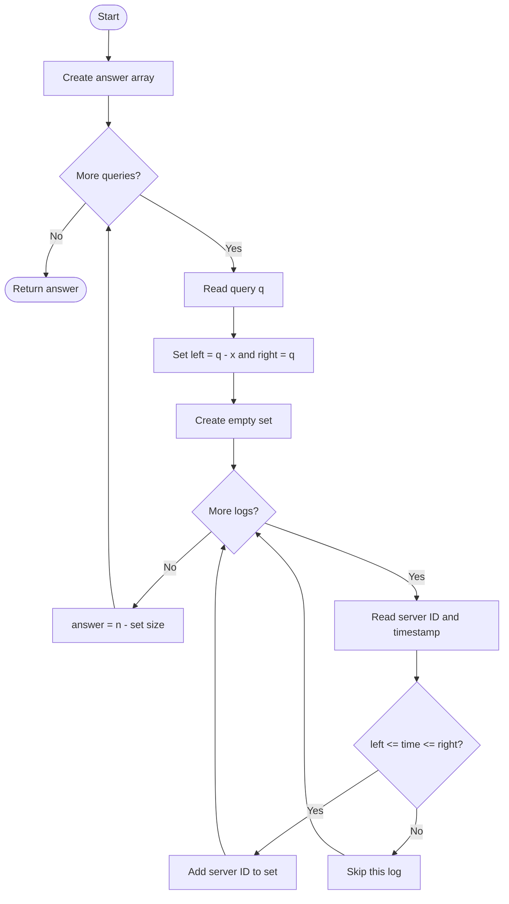
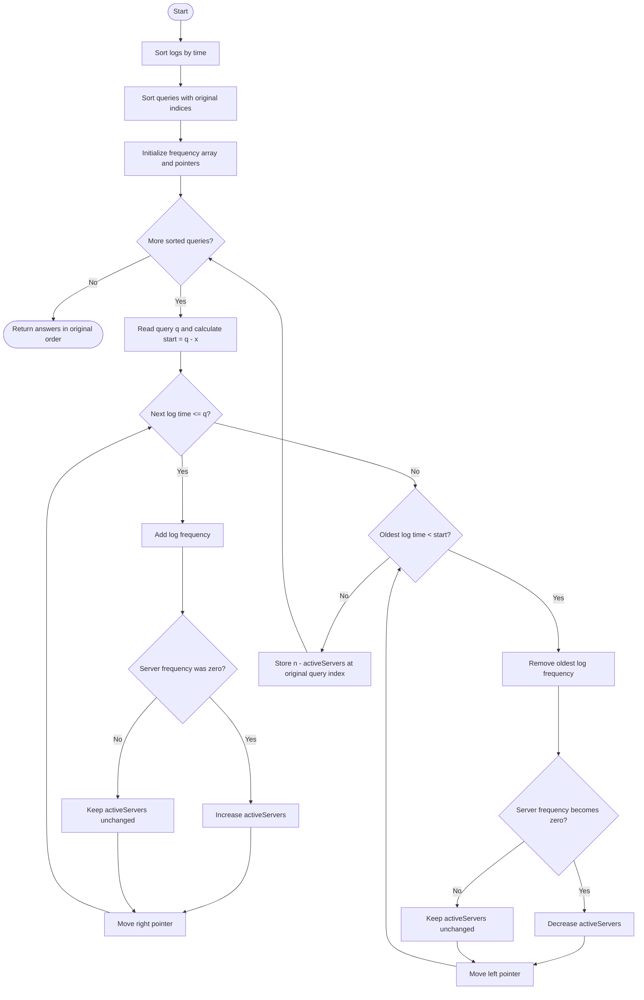

# 2747. Count Zero Request Servers

## 👨‍💻 Profiles

**GitHub:** https://github.com/Shailendra0320  
**LeetCode (Main):** https://leetcode.com/u/Shailu03/  
**LeetCode (Alternate):** https://leetcode.com/u/ShailendraLeetcode03/

---

## Table of Contents

- [Problem Statement](#problem-statement)
- [Examples](#examples)
- [Constraints](#constraints)
- [Understanding the Problem](#understanding-the-problem)
- [Important Observation](#important-observation)
- [Approach 1: Brute Force](#approach-1-brute-force)
  - [Idea](#idea)
  - [Algorithm](#algorithm)
  - [Flowchart](#approach-1-flowchart)
  - [Dry Run](#approach-1-dry-run)
  - [Why Does It Work?](#why-does-approach-1-work)
  - [Complexity](#approach-1-complexity)
  - [Code](#approach-1-code)
- [Approach 2: Offline Queries + Sorting + Sliding Window](#approach-2-offline-queries--sorting--sliding-window)
  - [Idea](#optimized-idea)
  - [Algorithm](#optimized-algorithm)
  - [Flowchart](#approach-2-flowchart)
  - [Dry Run](#approach-2-dry-run)
  - [Why Does It Work?](#why-does-approach-2-work)
  - [Complexity](#approach-2-complexity)
  - [Code](#approach-2-code)
- [Approach Comparison](#approach-comparison)
- [Edge Cases](#edge-cases)
- [Common Mistakes](#common-mistakes)
- [Interview Explanation](#interview-explanation)
- [Quick Revision](#quick-revision)

---

## Problem Statement

You are given:

- An integer `n`, representing servers with IDs from `1` to `n`.
- A 2D array `logs`, where `logs[i] = [server_id, time]` means that the server received a request at that time.
- An integer `x`, representing the length of the time window.
- An array `queries`, containing the time at which each query is made.

For each query `q`, consider the **inclusive** time interval:

\[
[q-x,\ q]
\]

Return an array where each answer is the number of servers that received **zero requests** during that interval.

A server counts as active for a query if it has at least one log whose timestamp is inside the query's interval. Multiple requests from the same server still count as only one active server.

**LeetCode method signature:** `int[] countServers(int n, int[][] logs, int x, int[] queries)` (Java).

## Examples

### Example 1

```text
Input: n = 3
logs = [[1,3],[2,6],[1,5]]
x = 5
queries = [10,11]
Output: [1,2]
```

**Explanation:**

- Query `10` checks `[5, 10]`. Servers `1` and `2` have requests in this interval, so server `3` has zero requests. Answer: `1`.
- Query `11` checks `[6, 11]`. Only server `2` has a request in this interval. Servers `1` and `3` have zero requests. Answer: `2`.

### Example 2

```text
Input: n = 3
logs = [[2,4],[2,1],[1,2],[3,1]]
x = 2
queries = [3,4]
Output: [0,1]
```

**Explanation:**

- Query `3` checks `[1, 3]`. All three servers received a request. Answer: `0`.
- Query `4` checks `[2, 4]`. Servers `1` and `2` received requests, while server `3` did not. Answer: `1`.

## Constraints

- `1 <= n <= 10^5`
- `1 <= logs.length <= 10^5`
- `1 <= queries.length <= 10^5`
- `logs[i].length == 2`
- `1 <= logs[i][0] <= n`
- `1 <= logs[i][1] <= 10^6`
- `1 <= x <= 10^5`
- `x < queries[i] <= 10^6`

---

## Understanding the Problem

The important part is that we are counting **servers**, not log entries.

Suppose server `4` received three requests during a query window. It must still be counted as just **one active server**. So, for every query, we need the number of distinct server IDs that appear in the window.

Instead of directly counting servers with zero requests, count the servers that received at least one request and subtract that number from `n`:

\[
\boxed{\text{answer} = n - \text{activeServers}}
\]

## Important Observation

The interval `[q - x, q]` is inclusive on both sides.

For a query time `q`:

- A log at time `q - x` **belongs** to the window.
- A log at time `q` **belongs** to the window.
- A log with time smaller than `q - x` must be removed.
- A log with time greater than `q` must not be added yet.

This boundary detail is essential in the optimized solution.

---

# Approach 1: Brute Force

## Idea

Process every query independently.

For each query, calculate its start and end times. Scan all logs and add the server ID to a `HashSet` if its timestamp falls inside the interval. Since a set stores each ID once, duplicate requests from the same server do not increase the active server count.

Finally, subtract the number of IDs in the set from `n`.

This approach is easy to understand, but it repeats the full log scan for every query.

## Algorithm

1. Create an answer array of size `queries.length`.
2. For each query `q`, calculate `left = q - x` and `right = q`.
3. Create an empty set of active server IDs.
4. Scan every log `[serverId, time]`.
5. If `left <= time <= right`, add `serverId` to the set.
6. Store `n - set.size()` as the answer for this query.
7. Return the answer array.

## Approach 1 Flowchart



## Approach 1 Dry Run

Use Example 1:

```text
n = 3
logs = [[1,3], [2,6], [1,5]]
x = 5
queries = [10,11]
```

**Query 1: `q = 10`**

The time window is `[10 - 5, 10] = [5, 10]`.

| Log | Is its time in [5, 10]? | Active server set |
|---|---|---|
| `[1,3]` | No | `{}` |
| `[2,6]` | Yes | `{2}` |
| `[1,5]` | Yes | `{1,2}` |

There are 2 active servers, so `3 - 2 = 1` server received zero requests.

**Query 2: `q = 11`**

The time window is `[11 - 5, 11] = [6, 11]`.

| Log | Is its time in [6, 11]? | Active server set |
|---|---|---|
| `[1,3]` | No | `{}` |
| `[2,6]` | Yes | `{2}` |
| `[1,5]` | No | `{2}` |

There is 1 active server, so `3 - 1 = 2` servers received zero requests.

Final answer: `[1, 2]`.

## Why Does Approach 1 Work?

A server has at least one request in the query window exactly when at least one of its logs satisfies `q - x <= time <= q`. The set collects precisely those server IDs and removes duplicates. Every server is either in this set or has no request in the window, so subtracting the set size from `n` gives the required count.

## Approach 1 Complexity

Let:

- `L` = number of logs.
- `Q` = number of queries.
- `n` = number of servers.

| Complexity | Value | Reason |
|---|---|---|
| Time | `O(Q * L)` average | Every query scans all logs; set insertion is average `O(1)`. |
| Extra space | `O(n)` | The set can contain at most `n` server IDs, plus the answer array. |

This is too slow for the maximum constraints because both `L` and `Q` can be `10^5`.

## Approach 1 Code

### Java

```java
import java.util.HashSet;
import java.util.Set;

class Solution {
    public int[] countServers(int n, int[][] logs, int x, int[] queries) {
        int[] answer = new int[queries.length];

        for (int i = 0; i < queries.length; i++) {
            int left = queries[i] - x;
            int right = queries[i];
            Set<Integer> activeServers = new HashSet<>();

            for (int[] log : logs) {
                int serverId = log[0];
                int time = log[1];

                if (time >= left && time <= right) {
                    activeServers.add(serverId);
                }
            }

            answer[i] = n - activeServers.size();
        }

        return answer;
    }
}
```

### C++

```cpp
#include <bits/stdc++.h>
using namespace std;

class Solution {
public:
    vector<int> countServers(int n, vector<vector<int>>& logs, int x, vector<int>& queries) {
        vector<int> answer(queries.size());

        for (int i = 0; i < (int)queries.size(); i++) {
            int left = queries[i] - x;
            int right = queries[i];
            unordered_set<int> activeServers;

            for (const auto& log : logs) {
                int serverId = log[0];
                int time = log[1];

                if (time >= left && time <= right) {
                    activeServers.insert(serverId);
                }
            }

            answer[i] = n - (int)activeServers.size();
        }

        return answer;
    }
};
```

### Python

```python
from typing import List

class Solution:
    def countServers(
        self, n: int, logs: List[List[int]], x: int, queries: List[int]
    ) -> List[int]:
        answer = []

        for q in queries:
            left = q - x
            right = q
            active_servers = set()

            for server_id, time in logs:
                if left <= time <= right:
                    active_servers.add(server_id)

            answer.append(n - len(active_servers))

        return answer
```

---

# Approach 2: Offline Queries + Sorting + Sliding Window

## Optimized Idea

The brute-force method scans every log again for every query. We can avoid this repeated work by processing queries in increasing order of time.

The query array may not be sorted, so create pairs containing:

```text
(query time, original index)
```

Sort these pairs by query time. Also sort the logs by timestamp.

Now maintain a sliding window of logs using two pointers:

- `right` adds every log whose time is `<= query`.
- `left` removes every log whose time is `< query - x`.

A frequency array `freq[serverId]` stores how many logs of that server are currently inside the window.

Maintain `activeServers`, the number of server IDs whose frequency is greater than zero:

- When adding a log, increase `activeServers` only if that server's frequency was `0` before the addition.
- When removing a log, decrease `activeServers` only if that server's frequency becomes `0` after the removal.

The answer for the current query is `n - activeServers`. Store it at the query's original index so the returned array follows the original query order.

### Why Do We Need Frequencies?

Consider a server with two logs inside the current window. When the older log leaves, that server still has another request inside the window. It must remain active.

A simple set cannot safely handle this removal. The frequency array keeps track of how many logs each server currently has in the window, and tells us exactly when a server enters or leaves the active group.

## Optimized Algorithm

1. Sort `logs` by timestamp in ascending order.
2. Store every query as `(queryTime, originalIndex)` and sort these pairs by query time.
3. Create `freq` of size `n + 1`, initialized to zero.
4. Initialize `left = 0`, `right = 0`, and `activeServers = 0`.
5. For each sorted query `q`:
   - Set `windowStart = q - x`.
   - While `right` is inside the logs array and `logs[right].time <= q`, add that log:
     - If `freq[serverId] == 0`, increment `activeServers`.
     - Increment `freq[serverId]` and move `right` forward.
   - While `left < right` and `logs[left].time < windowStart`, remove that log:
     - Decrement `freq[serverId]`.
     - If its frequency becomes zero, decrement `activeServers`.
     - Move `left` forward.
   - Store `n - activeServers` at the query's original index.
6. Return the answer array.

**Boundary reminder:** remove logs with `time < windowStart`, not `time <= windowStart`, because the left endpoint is included in the interval.

## Approach 2 Flowchart



## Approach 2 Dry Run

Use Example 1:

```text
n = 3
logs = [[1,3], [2,6], [1,5]]
x = 5
queries = [10,11]
```

After sorting logs by time:

```text
[[1,3], [1,5], [2,6]]
```

Queries are already sorted: `(10, index 0)`, `(11, index 1)`.

`freq[id]` is the number of logs for that server currently in the window.

| Query | Window | Logs added | Logs removed | Active servers | Answer |
|---|---|---|---|---:|---:|
| `10` | `[5,10]` | `[1,3]`, `[1,5]`, `[2,6]` | `[1,3]` | `{1,2}` = 2 | `3 - 2 = 1` |
| `11` | `[6,11]` | None | `[1,5]` | `{2}` = 1 | `3 - 1 = 2` |

Notice that during query `10`, log `[1,3]` is temporarily added because its timestamp is at most `10`, but it is then removed because `3 < 5`. At the time the answer is recorded, only logs inside `[5,10]` remain active.

The final answer is `[1, 2]`.

### A Duplicate-Log Example: Why Frequency Matters

Suppose server `1` has logs at times `2` and `4`, and a query window moves from `[1,4]` to `[3,6]`.

- In `[1,4]`, server `1` has frequency `2`, so it is active.
- In `[3,6]`, the log at time `2` leaves, but the log at time `4` remains. Its frequency changes from `2` to `1`, so it must still be active.
- Only when the frequency becomes `0` should `activeServers` decrease.

This is why the optimized method uses a frequency array instead of only a set.

## Why Does Approach 2 Work?

For each query processed in sorted order, the right pointer has added every log with timestamp at most `q`. The left pointer has removed every added log with timestamp smaller than `q - x`. Therefore, the logs between the pointers are exactly the logs whose timestamps satisfy:

\[
q-x \le time \le q
\]

The frequency array counts the number of such logs for each server. A server is active exactly when its frequency is positive. Thus, `activeServers` is the number of distinct servers with at least one request in the query window, and `n - activeServers` is the number with no requests.

Because the queries are sorted by time, both pointers only move forward. Every log is added once and removed at most once, so the window-maintenance work across all queries is linear after sorting.

## Approach 2 Complexity

Let `L = logs.length` and `Q = queries.length`.

| Operation | Complexity |
|---|---:|
| Sort logs | `O(L log L)` |
| Sort queries with their original indices | `O(Q log Q)` |
| Move the two log pointers | `O(L)` total |
| Write all answers | `O(Q)` |
| **Total time** | **`O(L log L + Q log Q)`** |
| **Extra space** | **`O(L + Q + n)`** |

The extra space includes the sorted log copy, query/index pairs, answer array, and server frequency array. The two pointers themselves use `O(1)` space.

## Approach 2 Code

### Java

```java
import java.util.Arrays;

class Solution {
    public int[] countServers(int n, int[][] logs, int x, int[] queries) {
        int[][] sortedLogs = logs.clone();
        Arrays.sort(sortedLogs, (a, b) -> Integer.compare(a[1], b[1]));

        int m = queries.length;
        int[][] sortedQueries = new int[m][2];

        for (int i = 0; i < m; i++) {
            sortedQueries[i][0] = queries[i];
            sortedQueries[i][1] = i;
        }

        Arrays.sort(sortedQueries, (a, b) -> Integer.compare(a[0], b[0]));

        int[] freq = new int[n + 1];
        int[] answer = new int[m];
        int left = 0;
        int right = 0;
        int activeServers = 0;

        for (int[] query : sortedQueries) {
            int q = query[0];
            int originalIndex = query[1];
            int windowStart = q - x;

            while (right < sortedLogs.length && sortedLogs[right][1] <= q) {
                int serverId = sortedLogs[right][0];

                if (freq[serverId] == 0) {
                    activeServers++;
                }

                freq[serverId]++;
                right++;
            }

            while (left < right && sortedLogs[left][1] < windowStart) {
                int serverId = sortedLogs[left][0];
                freq[serverId]--;

                if (freq[serverId] == 0) {
                    activeServers--;
                }

                left++;
            }

            answer[originalIndex] = n - activeServers;
        }

        return answer;
    }
}
```

### C++

```cpp
#include <bits/stdc++.h>
using namespace std;

class Solution {
public:
    vector<int> countServers(int n, vector<vector<int>>& logs, int x, vector<int>& queries) {
        vector<vector<int>> sortedLogs = logs;
        sort(sortedLogs.begin(), sortedLogs.end(),
             [](const vector<int>& a, const vector<int>& b) {
                 return a[1] < b[1];
             });

        int m = queries.size();
        vector<pair<int, int>> sortedQueries;

        for (int i = 0; i < m; i++) {
            sortedQueries.push_back({queries[i], i});
        }

        sort(sortedQueries.begin(), sortedQueries.end());

        vector<int> freq(n + 1, 0);
        vector<int> answer(m);
        int left = 0;
        int right = 0;
        int activeServers = 0;

        for (auto [q, originalIndex] : sortedQueries) {
            int windowStart = q - x;

            while (right < (int)sortedLogs.size() && sortedLogs[right][1] <= q) {
                int serverId = sortedLogs[right][0];

                if (freq[serverId] == 0) {
                    activeServers++;
                }

                freq[serverId]++;
                right++;
            }

            while (left < right && sortedLogs[left][1] < windowStart) {
                int serverId = sortedLogs[left][0];
                freq[serverId]--;

                if (freq[serverId] == 0) {
                    activeServers--;
                }

                left++;
            }

            answer[originalIndex] = n - activeServers;
        }

        return answer;
    }
};
```

### Python

```python
from typing import List

class Solution:
    def countServers(
        self, n: int, logs: List[List[int]], x: int, queries: List[int]
    ) -> List[int]:
        sorted_logs = sorted(logs, key=lambda log: log[1])
        sorted_queries = sorted((q, i) for i, q in enumerate(queries))

        freq = [0] * (n + 1)
        answer = [0] * len(queries)
        left = 0
        right = 0
        active_servers = 0

        for q, original_index in sorted_queries:
            window_start = q - x

            while right < len(sorted_logs) and sorted_logs[right][1] <= q:
                server_id = sorted_logs[right][0]

                if freq[server_id] == 0:
                    active_servers += 1

                freq[server_id] += 1
                right += 1

            while left < right and sorted_logs[left][1] < window_start:
                server_id = sorted_logs[left][0]
                freq[server_id] -= 1

                if freq[server_id] == 0:
                    active_servers -= 1

                left += 1

            answer[original_index] = n - active_servers

        return answer
```

---

## Approach Comparison

| Feature | Brute Force | Offline Sorting + Sliding Window |
|---|---|---|
| Main idea | Scan all logs for every query | Sort once and move two pointers |
| Time complexity | `O(Q * L)` average | `O(L log L + Q log Q)` |
| Extra space | `O(n)` | `O(L + Q + n)` |
| Handles duplicate logs | Yes, with a set | Yes, with server frequencies |
| Suitable for maximum constraints | No | Yes |

**Recommended approach:** Offline Queries + Sorting + Sliding Window. It avoids scanning all logs repeatedly and comfortably handles the constraints of up to `10^5` logs and `10^5` queries.

## Edge Cases

| Case | What should happen? |
|---|---|
| No logs fall inside a query window | All `n` servers are counted. |
| Every server has at least one request in the window | Answer is `0`. |
| One server has multiple requests in the window | Count that server only once. |
| A log occurs exactly at `q - x` | Include it. |
| A log occurs exactly at `q` | Include it. |
| Queries are not in sorted order | Sort with original indices and restore answer positions. |
| Several queries have the same time | Each receives the same answer for that query time. |

## Common Mistakes

1. **Counting logs instead of distinct servers.** A server with five requests still counts as one active server. Use a frequency array and count only zero-to-one and one-to-zero transitions.
2. **Removing the left boundary by mistake.** The interval is inclusive, so remove only timestamps `< q - x`, not timestamps `<= q - x`.
3. **Forgetting to sort the queries.** The two-pointer method depends on queries being processed in non-decreasing time order.
4. **Losing the original query order.** Store each query's original index before sorting and write the answer back to that index.
5. **Decreasing the active count for every removed log.** Decrease it only when that server's frequency becomes zero.
6. **Using a set without handling repeated requests.** When one request expires, another request from the same server may still be inside the window. Frequencies handle this correctly.

## Interview Explanation

“I need to find how many servers have no request in each inclusive time window `[q - x, q]`. For a query, the answer is the total number of servers minus the number of distinct servers that have at least one request in that window.

A direct solution scans all logs for every query, but that can take `O(Q * L)` time. To optimize it, I sort the logs by timestamp and sort the queries while keeping their original indices. I then process queries from earliest to latest and maintain the current time window with two pointers.

A frequency array tracks how many logs each server has inside the window. I increase the active server count when a frequency changes from zero to one, and decrease it when the frequency changes back to zero. After adjusting the window, the answer is `n - activeServers`. Finally, I place each result at its original query index.

The total time complexity is `O(L log L + Q log Q)`, because sorting dominates and each log enters and leaves the window at most once.”

## Quick Revision

- For query `q`, the interval is `[q - x, q]` and both endpoints are included.
- Count distinct servers in that interval, not the number of logs.
- Required answer: `n - activeServers`.
- Sort logs by time.
- Sort `(queryTime, originalIndex)` pairs.
- Add logs while `time <= q`.
- Remove logs while `time < q - x`.
- Track each server's current log count with `freq[serverId]`.
- Increment active count on `0 -> 1`; decrement on `1 -> 0`.
- Store results using the original query index.
- Optimized time: `O(L log L + Q log Q)`.
