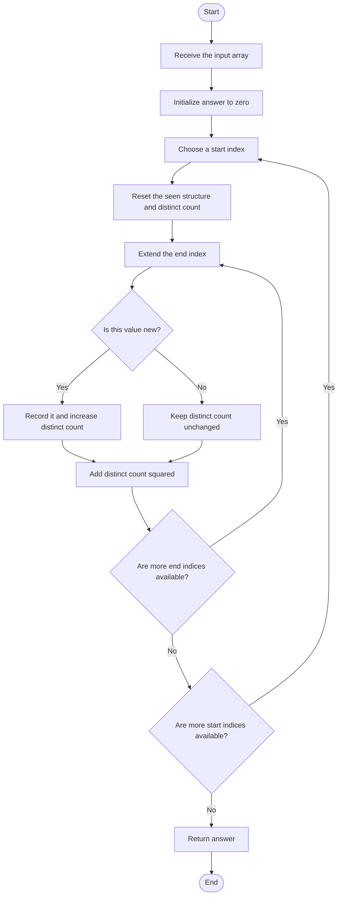
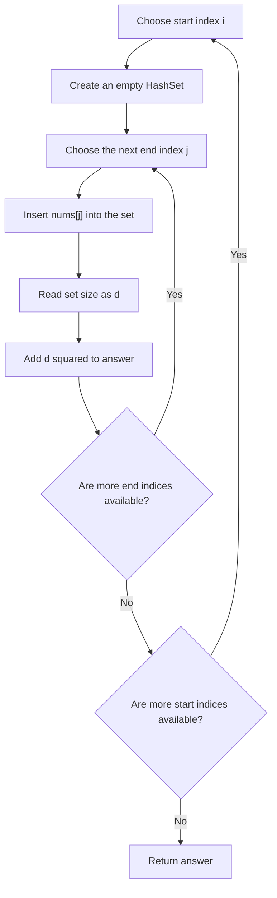
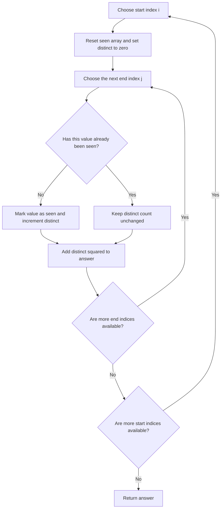

## 👨‍💻 Profiles

**GitHub:** https://github.com/Shailendra0320  
**LeetCode (Main):** [https://leetcode.com/u/Shailu03/](https://leetcode.com/u/Shailu03/)  
**LeetCode (Alternate):** [https://leetcode.com/u/ShailendraLeetcode03/](https://leetcode.com/u/ShailendraLeetcode03/)

---

# 2913. Subarrays Distinct Element Sum of Squares I

<p align="center">
  <strong>Pattern:</strong> Array · Hash Set · Frequency Array · Enumerating Subarrays
</p>

> **Core idea:** Fix a starting index, extend the ending index one element at a time, maintain the number of distinct values seen so far, and add the square of that count for every subarray formed.

## Table of Contents

- [Problem Statement](#problem-statement)
- [Examples](#examples)
- [Constraints](#constraints)
- [Understand the Terminology](#understand-the-terminology)
- [Core Observation](#core-observation)
- [Why Every Subarray Is Considered Once](#why-every-subarray-is-considered-once)
- [Algorithm Architecture](#algorithm-architecture)
- [Data-Flow Diagram](#data-flow-diagram)
- [Approach 1 — Hash Set](#approach-1--hash-set)
- [Approach 1 Walkthrough](#approach-1-walkthrough)
- [Approach 1 Correctness Proof](#approach-1-correctness-proof)
- [Approach 2 — Frequency/Seen Array](#approach-2--frequencyseen-array)
- [Approach 2 Walkthrough](#approach-2-walkthrough)
- [Approach 2 Correctness Proof](#approach-2-correctness-proof)
- [Java, C++, and Python Solutions](#java-c-and-python-solutions)
- [Complexity Comparison](#complexity-comparison)
- [Edge Cases](#edge-cases)
- [Common Mistakes](#common-mistakes)
- [How to Recognize This Pattern](#how-to-recognize-this-pattern)
- [Interview Explanation](#interview-explanation)
- [Quick Revision](#quick-revision)

---

## Problem Statement

You are given a **0-indexed integer array** `nums`.

The **distinct count** of a subarray `nums[i..j]` is the number of different values that appear in that contiguous range. A subarray must be **contiguous and non-empty**.

Return the **sum of the squares of the distinct counts of all subarrays** of `nums`.

For each possible subarray:

1. Count how many different values it contains.
2. Square that count.
3. Add the square to the final answer.

In mathematical form, if `D(i, j)` denotes the number of distinct values in `nums[i..j]`, then:

\[
\text{answer} = \sum*{i=0}^{n-1}\sum*{j=i}^{n-1} D(i,j)^2
\]

Here, `n = nums.length`.

## Examples

### Example 1

**Input**

```text
nums = [1, 2, 1]
```

**Output**

```text
15
```

**Explanation**

| Subarray    | Distinct values | Distinct count | Square | Running total |
| ----------- | --------------- | -------------: | -----: | ------------: |
| `[1]`       | `{1}`           |              1 |      1 |             1 |
| `[1, 2]`    | `{1, 2}`        |              2 |      4 |             5 |
| `[1, 2, 1]` | `{1, 2}`        |              2 |      4 |             9 |
| `[2]`       | `{2}`           |              1 |      1 |            10 |
| `[2, 1]`    | `{2, 1}`        |              2 |      4 |            14 |
| `[1]`       | `{1}`           |              1 |      1 |            15 |

Therefore:

\[
1^2 + 2^2 + 2^2 + 1^2 + 2^2 + 1^2 = 15
\]

### Example 2

**Input**

```text
nums = [1, 1]
```

**Output**

```text
3
```

**Explanation**

| Subarray        | Distinct values | Distinct count | Square |
| --------------- | --------------- | -------------: | -----: |
| `[1]` (index 0) | `{1}`           |              1 |      1 |
| `[1, 1]`        | `{1}`           |              1 |      1 |
| `[1]` (index 1) | `{1}`           |              1 |      1 |

The total is `1 + 1 + 1 = 3`.

## Constraints

- `1 <= nums.length <= 100`
- `1 <= nums[i] <= 100`

The constraints are small enough that enumerating all subarrays in **O(n²)** time is sufficient.

---

## Understand the Terminology

### What is a subarray?

A subarray is a **contiguous** section of an array. For `nums = [1, 2, 1]`, `[1, 2]` and `[2, 1]` are subarrays, but `[1, 1]` is not because the elements are not adjacent in the original array.

### What is a distinct count?

The distinct count is the number of unique values in a subarray, not the total number of elements.

| Subarray    | Length | Distinct count |
| ----------- | -----: | -------------: |
| `[4]`       |      1 |              1 |
| `[4, 4]`    |      2 |              1 |
| `[4, 7]`    |      2 |              2 |
| `[4, 7, 4]` |      3 |              2 |
| `[4, 7, 9]` |      3 |              3 |

Repeated occurrences do not increase the distinct count. A value increases the count only when it appears for the **first time in the current subarray**.

---

## Core Observation

A subarray is uniquely identified by its start index `i` and end index `j`. We can enumerate every subarray by:

- Choosing a start index `i`.
- Initializing an empty collection of values seen in this subarray.
- Moving `j` from `i` to `n - 1`.
- Updating the distinct count when `nums[j]` has not appeared in the current range.
- Adding `distinctCount * distinctCount` to the answer immediately.

The important optimization is that we **do not recalculate the distinct count from scratch for each subarray**. When the right endpoint moves one step to the right, only the newly added element needs to be checked.

### Why can we add the contribution immediately?

Once a subarray ending at `j` has been formed, its distinct count is final for that particular pair `(i, j)`. Later extensions create different, longer subarrays; they do not change the contribution of the one already counted.

---

## Why Every Subarray Is Considered Once

The outer loop selects the starting index, while the inner loop selects every valid ending index from that start onward.

For an array of length `n`, the total number of non-empty subarrays is:

\[
n + (n-1) + (n-2) + \cdots + 1 = \frac{n(n+1)}{2}
\]

For `nums = [1, 2, 1]`, the enumeration is grouped by start index:

```text
Start at index 0: [1]  [1,2]  [1,2,1]
Start at index 1:       [2]   [2,1]
Start at index 2:              [1]
```

There are six non-empty subarrays, and the algorithm processes exactly six of them.

---

## Algorithm Architecture



## Data-Flow Diagram

```text
                 nums
                  │
                  ▼
        Select a starting index i
                  │
                  ▼
       Reset the seen collection
                  │
                  ▼
     Extend the end index j one step
                  │
                  ▼
       Is nums[j] seen for this i?
             ┌────┴────┐
             │         │
            Yes       No
             │         │
             │    Record nums[j]
             │    distinctCount++
             └────┬────┘
                  ▼
       answer += distinctCount²
                  │
                  ▼
       Continue extending the range
                  │
                  ▼
         All subarrays processed?
                  │
                  ▼
            Return answer
```

---

## Approach 1 — Hash Set

**Idea:** Keep a fresh `HashSet` for each starting index. As the end index advances, insert the new element into the set. The set automatically ignores duplicates, so its size is the distinct count of the current subarray.

### Algorithm

1. Initialize `answer = 0`.
2. For each start index `i`, create an empty set.
3. For each end index `j` from `i` through `n - 1`:
   - Insert `nums[j]` into the set.
   - Let `d` be the set size.
   - Add `d * d` to `answer`.
4. Return `answer` after all starts have been processed.

### Pseudocode

```text
answer = 0

for i from 0 to n - 1:
    seen = empty set

    for j from i to n - 1:
        insert nums[j] into seen
        distinct = size(seen)
        answer += distinct * distinct

return answer
```

### How the set evolves

For `nums = [1, 2, 1]`, fixing `i = 0`:

| End index `j` | Added value | Set after insertion | Distinct count | Contribution |
| ------------: | ----------: | ------------------- | -------------: | -----------: |
|             0 |           1 | `{1}`               |              1 |            1 |
|             1 |           2 | `{1, 2}`            |              2 |            4 |
|             2 |           1 | `{1, 2}`            |              2 |            4 |

When the last `1` is inserted, the set remains `{1, 2}`. Therefore, the distinct count stays `2`, not `3`.

### Approach 1 flowchart



### Correctness Proof — Approach 1

**Lemma 1: The set contains exactly the distinct values in the current subarray `nums[i..j]`.**

For a fixed `i`, the set starts empty. At each step, the algorithm inserts `nums[j]`. A set stores each value at most once, so after processing index `j`, it contains every value encountered in `nums[i..j]`, with duplicates represented only once.

**Lemma 2: The algorithm adds the correct contribution for every subarray.**

By Lemma 1, the set size equals the distinct count `d` of `nums[i..j]`. The algorithm adds `d²`, which is exactly the required contribution of that subarray.

**Theorem: The returned answer is correct.**

The nested loops visit every valid pair `(i, j)` exactly once, so every non-empty subarray is counted exactly once. By Lemma 2, each contribution is correct. Their sum is therefore the required answer.

### Complexity — Approach 1

Let `n = nums.length`.

- **Time:** `O(n²)` expected. There are `n(n + 1) / 2` subarrays, and each set insertion takes expected `O(1)` time.
- **Auxiliary space:** `O(n)` for the set, which can contain up to `n` distinct values for one start index.

---

## Approach 1 Walkthrough

Use `nums = [1, 2, 1]`.

**Start index `i = 0`** — reset the set to `{}`.

| `j` | Current subarray | Set      | `d` | `d²` | Answer |
| --: | ---------------- | -------- | --: | ---: | -----: |
|   0 | `[1]`            | `{1}`    |   1 |    1 |      1 |
|   1 | `[1, 2]`         | `{1, 2}` |   2 |    4 |      5 |
|   2 | `[1, 2, 1]`      | `{1, 2}` |   2 |    4 |      9 |

**Start index `i = 1`** — reset the set to `{}`.

| `j` | Current subarray | Set      | `d` | `d²` | Answer |
| --: | ---------------- | -------- | --: | ---: | -----: |
|   1 | `[2]`            | `{2}`    |   1 |    1 |     10 |
|   2 | `[2, 1]`         | `{2, 1}` |   2 |    4 |     14 |

**Start index `i = 2`** — reset the set to `{}`.

| `j` | Current subarray | Set   | `d` | `d²` | Answer |
| --: | ---------------- | ----- | --: | ---: | -----: |
|   2 | `[1]`            | `{1}` |   1 |    1 |     15 |

Final answer: **15**.

---

## Approach 2 — Frequency/Seen Array

**Idea:** The constraints guarantee `1 <= nums[i] <= 100`. Instead of using a hash set, use a boolean array `seen` of length `101`. The index of the array represents a value from `1` to `100`.

For each start index, clear/reset `seen`. While extending the subarray:

- If `seen[nums[j]]` is `false`, this is the first occurrence in the current subarray. Mark it and increment `distinct`.
- If it is already `true`, the value is a duplicate, so `distinct` does not change.
- Add `distinct * distinct` to the answer.

This approach uses the bounded value range to reduce auxiliary space to **O(1)** with respect to `n`.

### Algorithm

1. Set `answer = 0`.
2. For every starting index `i`, create/reset `seen[0..100]` and set `distinct = 0`.
3. Extend `j` from `i` to `n - 1`.
4. If `nums[j]` has not been seen for this start, mark it and increment `distinct`.
5. Add `distinct * distinct` to `answer`.
6. Return `answer`.

### Pseudocode

```text
answer = 0

for i from 0 to n - 1:
    seen = boolean array of length 101, initially false
    distinct = 0

    for j from i to n - 1:
        value = nums[j]

        if seen[value] is false:
            seen[value] = true
            distinct++

        answer += distinct * distinct

return answer
```

### Approach 2 flowchart



### Why is the seen array safe?

A value `v` is used directly as an array index `seen[v]`. The constraint `nums[i] <= 100` guarantees that every such index lies between `1` and `100`, within a length-`101` array. Index `0` is simply unused.

The `seen` array must be reset for **each new start index**. It describes values encountered in one particular subarray family beginning at that start—not the whole input array.

### Correctness Proof — Approach 2

**Lemma 1: `distinct` equals the number of unique values in `nums[i..j]`.**

For a fixed start `i`, `seen` is reset and `distinct` is zero. When a value appears for the first time in the current range, its seen flag changes from false to true and `distinct` increases once. Every later occurrence has a true flag and does not increase the count. Thus, after processing `j`, `distinct` equals the number of unique values in `nums[i..j]`.

**Lemma 2: The contribution added for each subarray is correct.**

By Lemma 1, `distinct` is exactly that subarray's distinct count. Adding `distinct * distinct` therefore adds the required squared count.

**Theorem: The returned answer is correct.**

The two loops visit every non-empty subarray once, and Lemma 2 shows that the correct contribution is added for each one. Therefore, their total is the required sum.

### Complexity — Approach 2

- **Time:** `O(n² + 101n)`, which simplifies to **`O(n²)`** because `101` is a fixed bound. Every subarray is processed once, with constant-time seen-array access.
- **Auxiliary space:** **`O(1)`** with respect to `n`, because `seen` always has exactly `101` entries.

---

## Approach 2 Walkthrough

For `nums = [1, 2, 1]`, start at `i = 0` with every seen flag set to `false` and `distinct = 0`.

| `j` | Value | Seen before? | Action                    | Distinct count | Contribution | Answer |
| --: | ----: | ------------ | ------------------------- | -------------: | -----------: | -----: |
|   0 |     1 | No           | Mark `seen[1]`; increment |              1 |            1 |      1 |
|   1 |     2 | No           | Mark `seen[2]`; increment |              2 |            4 |      5 |
|   2 |     1 | Yes          | No change                 |              2 |            4 |      9 |

At the next starting index, reset `seen` and `distinct`; do not carry state over from the previous start. Processing the remaining subarrays adds `1 + 4 + 1`, so the final answer is `9 + 1 + 4 + 1 = 15`.

---

## Java, C++, and Python Solutions

Each language below contains both approaches in one code block. The approach name and time/space complexity appear immediately before the corresponding implementation.

### Java

```java
//Approach-1 (Hash Set + Enumerate All Subarrays)
//T.C : O(n^2) expected
//S.C : O(n)

import java.util.HashSet;
import java.util.Set;

class Solution {
    public int sumCounts(int[] nums) {
        int n = nums.length;
        int answer = 0;

        for (int i = 0; i < n; i++) {
            Set<Integer> seen = new HashSet<>();

            for (int j = i; j < n; j++) {
                seen.add(nums[j]);
                int distinct = seen.size();
                answer += distinct * distinct;
            }
        }

        return answer;
    }
}

//Approach-2 (Seen Array + Incremental Distinct Count)
//T.C : O(n^2)
//S.C : O(1)

class Solution2 {
    public int sumCounts(int[] nums) {
        int n = nums.length;
        int answer = 0;

        for (int i = 0; i < n; i++) {
            boolean[] seen = new boolean[101];
            int distinct = 0;

            for (int j = i; j < n; j++) {
                if (!seen[nums[j]]) {
                    seen[nums[j]] = true;
                    distinct++;
                }

                answer += distinct * distinct;
            }
        }

        return answer;
    }
}
```

### C++

```cpp
//Approach-1 (Hash Set + Enumerate All Subarrays)
//T.C : O(n^2) expected
//S.C : O(n)

#include <bits/stdc++.h>
using namespace std;

class Solution {
public:
    int sumCounts(vector<int>& nums) {
        int n = static_cast<int>(nums.size());
        int answer = 0;

        for (int i = 0; i < n; i++) {
            unordered_set<int> seen;

            for (int j = i; j < n; j++) {
                seen.insert(nums[j]);
                int distinct = static_cast<int>(seen.size());
                answer += distinct * distinct;
            }
        }

        return answer;
    }
};

//Approach-2 (Seen Array + Incremental Distinct Count)
//T.C : O(n^2)
//S.C : O(1)

class Solution2 {
public:
    int sumCounts(vector<int>& nums) {
        int n = static_cast<int>(nums.size());
        int answer = 0;

        for (int i = 0; i < n; i++) {
            bool seen[101] = {};
            int distinct = 0;

            for (int j = i; j < n; j++) {
                if (!seen[nums[j]]) {
                    seen[nums[j]] = true;
                    distinct++;
                }

                answer += distinct * distinct;
            }
        }

        return answer;
    }
};
```

### Python

```python
#Approach-1 (Hash Set + Enumerate All Subarrays)
#T.C : O(n^2) expected
#S.C : O(n)

from typing import List

class Solution:
    def sumCounts(self, nums: List[int]) -> int:
        n = len(nums)
        answer = 0

        for i in range(n):
            seen = set()

            for j in range(i, n):
                seen.add(nums[j])
                distinct = len(seen)
                answer += distinct * distinct

        return answer


#Approach-2 (Seen Array + Incremental Distinct Count)
#T.C : O(n^2)
#S.C : O(1)

class Solution2:
    def sumCounts(self, nums: List[int]) -> int:
        n = len(nums)
        answer = 0

        for i in range(n):
            seen = [False] * 101
            distinct = 0

            for j in range(i, n):
                if not seen[nums[j]]:
                    seen[nums[j]] = True
                    distinct += 1

                answer += distinct * distinct

        return answer
```

> **LeetCode note:** Submit the `Solution` implementation for the language you choose. The `Solution2` class is included as the second approach for learning and comparison.

---

## Complexity Comparison

| Feature                    | Approach 1: Hash Set   | Approach 2: Seen Array                  |
| -------------------------- | ---------------------- | --------------------------------------- |
| Main structure             | Hash set               | Fixed boolean array of size 101         |
| Time complexity            | `O(n²)` expected       | `O(n²)`                                 |
| Auxiliary space            | `O(n)`                 | `O(1)` with the stated value constraint |
| Duplicate detection        | `seen.add(value)`      | Check `seen[value]`                     |
| Depends on bounded values? | No                     | Yes, values must be in `[1, 100]`       |
| Best use                   | General integer values | Best fit for this problem's constraints |

**Recommendation:** Use **Approach 2** for this exact problem. The value range is capped at `100`, so a small seen array provides deterministic constant-time membership checks and constant auxiliary space. Approach 1 is more general and expresses the distinct-count idea clearly.

---

## Edge Cases

| Input                 | Expected output | Why it matters                                        |
| --------------------- | --------------: | ----------------------------------------------------- |
| `nums = [5]`          |             `1` | One single-element subarray; distinct count is 1      |
| `nums = [1, 1]`       |             `3` | Duplicates must not increase the distinct count       |
| `nums = [1, 2]`       |             `6` | Contributions are `1 + 1 + 4`                         |
| `nums = [1, 2, 3]`    |            `20` | Every extension introduces a new value for each start |
| `nums = [7, 7, 7]`    |             `6` | All six total subarrays have distinct count 1         |
| `nums = [1, 2, 1, 3]` |            `38` | Mixed repeated and new values exercise both cases     |

For `n = 1`, exactly one subarray exists, so the answer is always `1`.

---

## Common Mistakes

- **Counting subarray length instead of distinct count.** `[1, 1, 1]` has length 3 but only 1 distinct value.
- **Rebuilding the distinct set for every `(i, j)` pair.** Reset once per start index, then update incrementally while moving `j`.
- **Forgetting to reset the set or seen array for each new start.** The state belongs to the current start index only.
- **Adding the distinct count instead of its square.** The required contribution is `distinct * distinct`.
- **Counting duplicate values again.** Increment the distinct count only when the value is first encountered in the current subarray.
- **Enumerating only subarrays of a particular length.** Every non-empty contiguous subarray must contribute.
- **Using the fixed seen array without checking the value constraints.** The direct-indexed array is safe here because every number is between `1` and `100`.

---

## How to Recognize This Pattern

This problem is a strong match for **enumerating subarrays while maintaining a running property** when:

- The task asks about all contiguous ranges.
- The constraint on `n` is small enough for quadratic enumeration.
- A property of `nums[i..j]` can be updated when one new element is appended.
- Each subarray contributes a value to an aggregate such as a sum.

The reusable template is:

```text
for each start i:
    reset state
    for each end j >= i:
        update state using nums[j]
        add contribution based on state
```

This template appears in problems involving distinct values, frequencies, sums, maxima, and other incremental subarray properties.

---

## Interview Explanation

> “I enumerate every subarray by fixing its left endpoint and expanding the right endpoint. I maintain the distinct values seen in the current range, so I can update the distinct count without rescanning the subarray. For every right endpoint, I add the square of that count to the answer. This visits all `n(n + 1) / 2` subarrays, giving `O(n²)` time. A hash set uses `O(n)` extra space. Because this problem restricts values to `1..100`, I can also use a fixed boolean array and a running distinct counter, reducing auxiliary space to `O(1)`.”

---

## Quick Revision

- **Enumerate:** Every start index `i`, then every end index `j >= i`.
- **Maintain:** Distinct values for the current start.
- **Contribution:** `distinctCount * distinctCount` for each subarray.
- **Approach 1:** Hash set; `O(n²)` expected time and `O(n)` auxiliary space.
- **Approach 2:** Fixed `seen[101]` array; `O(n²)` time and `O(1)` auxiliary space.
- **Most important detail:** Reset state whenever the starting index changes.

### One-Line Insight

**Fix the left endpoint, grow the right endpoint, update the distinct count incrementally, and add its square for every subarray.**

---

## Final Takeaway

The main challenge is not generating subarrays—it is maintaining each subarray's distinct count correctly as the range grows. A set provides the most direct solution; a frequency/seen array takes advantage of the small value range to save space. Both approaches enumerate all non-empty subarrays exactly once and add the square of each subarray's distinct count.

**Official problem:** [LeetCode 2913 — Subarrays Distinct Element Sum of Squares I](https://leetcode.com/problems/subarrays-distinct-element-sum-of-squares-i/)
