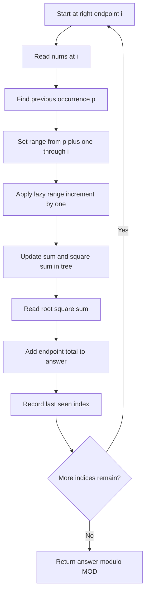
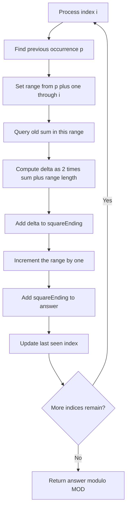

## 👨‍💻 Profiles

**GitHub:** https://github.com/Shailendra0320  
**LeetCode (Main):** https://leetcode.com/u/Shailu03/  
**LeetCode (Alternate):** https://leetcode.com/u/ShailendraLeetcode03/

# 2916. Subarrays Distinct Element Sum of Squares II

<p align="left">
  
  
  
  
</p>

**Core pattern:** Last occurrence + range increment + lazy segment tree.

**One-line insight:** When a new value is appended, only subarrays that start after its previous occurrence gain one new distinct value. Update exactly those starts, then add the square-count total for the new right endpoint.

---

## Table of Contents

- [Problem Statement](#problem-statement)
- [Examples](#examples)
- [Constraints](#constraints)
- [Why Brute Force Is Too Slow](#why-brute-force-is-too-slow)
- [Core Insight](#core-insight)
- [How the State Is Stored](#how-the-state-is-stored)
- [Approach 1: Lazy Segment Tree With Sum and Sum of Squares](#approach-1-lazy-segment-tree-with-sum-and-sum-of-squares)
- [Approach 1 Flowchart](#approach-1-flowchart)
- [Detailed Dry Run](#detailed-dry-run)
- [Correctness Proof for Approach 1](#correctness-proof-for-approach-1)
- [Approach 2: Range-Sum Segment Tree With a Running Square Total](#approach-2-range-sum-segment-tree-with-a-running-square-total)
- [Approach 2 Flowchart](#approach-2-flowchart)
- [Correctness Proof for Approach 2](#correctness-proof-for-approach-2)
- [Java, C++, and Python Solutions](#java-c-and-python-solutions)
- [Approach Comparison](#approach-comparison)
- [Complexity Analysis](#complexity-analysis)
- [Edge Cases](#edge-cases)
- [Common Mistakes](#common-mistakes)
- [Interview Explanation](#interview-explanation)
- [Quick Revision](#quick-revision)

---

## Problem Statement

You are given a zero-indexed integer array `nums`.

For every non-empty contiguous subarray `nums[l..r]`, count how many **distinct values** it contains. Square that count, then add the result over **all** non-empty subarrays.

Return the final sum modulo `1_000_000_007`.

In other words, if `distinct(l, r)` is the number of unique values in `nums[l..r]`, calculate:

```text
answer = sum(distinct(l, r) * distinct(l, r))
         over every 0 <= l <= r < n
```

A subarray is contiguous. For example, `[3, 1, 3]` has two distinct values, so its contribution is `2 * 2 = 4`.

## Examples

### Example 1

```text
Input:  nums = [1, 2, 1]
Output: 15
```

All non-empty subarrays and their contributions:

| Subarray | Distinct count | Squared contribution |
|---|---:|---:|
| `[1]` | 1 | 1 |
| `[2]` | 1 | 1 |
| `[1]` | 1 | 1 |
| `[1, 2]` | 2 | 4 |
| `[2, 1]` | 2 | 4 |
| `[1, 2, 1]` | 2 | 4 |
| **Total** | | **15** |

### Example 2

```text
Input:  nums = [2, 2]
Output: 3
```

The subarrays are `[2]`, `[2]`, and `[2, 2]`. Each has one distinct value, so the total is `1 + 1 + 1 = 3`.

## Constraints

- `1 <= nums.length <= 100_000`
- `1 <= nums[i] <= 100_000`
- Return the answer modulo `1_000_000_007`.

The number of subarrays is `n * (n + 1) / 2`. At `n = 100_000`, this is about five billion, so explicitly processing every subarray is too slow.

---

## Why Brute Force Is Too Slow

A straightforward method fixes a left endpoint `l`, extends the right endpoint `r`, and tracks a set of values seen so far. It can calculate every subarray in `O(n^2)` expected time.

That is reasonable for Part I with small input, but not for Part II: `n` can be `100_000`, so quadratic enumeration is too expensive.

The important change is to process subarrays by their **right endpoint**, while representing all possible left endpoints together in a segment tree.

---

## Core Insight

Suppose we are processing index `i`, and the current value is `x = nums[i]`.

Let `p` be the previous index where `x` appeared. If `x` has not appeared before, use `p = -1`.

Consider every subarray that ends at `i`:

- If its left endpoint `l` is at or before `p`, the subarray already contained `x`. Its distinct count does not change when `x` is appended.
- If its left endpoint `l` is after `p`, the earlier occurrence is outside the subarray. The new `x` adds one distinct value.

Therefore, when the right endpoint moves to `i`, only the left endpoints in this range change:

```text
[p + 1, i]
```

For every start index in that range, increase its current distinct count by one.

### Example: `nums = [1, 2, 1]`

At index `i = 2`, the current value is `1`. Its previous occurrence is `p = 0`.

```text
Index:       0   1   2
nums:        1   2   1
Previous:    0
Update:          [1, 2]
```

The subarray starting at index `0` already contains `1`, so its distinct count stays at `2`. Starts `1` and `2` do not contain the previous `1`, so their counts increase by one:

| Start index | Old distinct count | New distinct count | Contribution now |
|---:|---:|---:|---:|
| 0 | 2 | 2 | 4 |
| 1 | 1 | 2 | 4 |
| 2 | 0 | 1 | 1 |
| **Total for subarrays ending at index 2** | | | **9** |

The answer accumulates the endpoint totals: `1 + 5 + 9 = 15`.

---

## How the State Is Stored

Imagine a leaf for each possible subarray start index `l`.

After processing right endpoint `i`, leaf `l` stores:

```text
value[l] = distinct count of nums[l..i], if l <= i
value[l] = 0,                              if l > i
```

Appending `nums[i]` changes every value in the range `[lastSeen[nums[i]] + 1, i]` by exactly `+1`.

That gives us a **range increment**. A lazy segment tree can apply that increment to an entire interval without visiting each leaf individually.

For each right endpoint `i`, the sum of squared leaf values is exactly the sum of squared distinct counts for all subarrays that end at `i`. Add it to the final answer.

### The whole idea at a glance

```text
Read nums[i]
    |
    v
Find previous occurrence p
    |
    v
Range to update = [p + 1, i]
    |
    v
Increase distinct counts in that range by 1
    |
    v
Calculate the square-sum of all active starts
    |
    v
Add it to the answer
```

---

## Approach 1: Lazy Segment Tree With Sum and Sum of Squares

This is the most direct implementation of the core idea. Each segment-tree node stores two aggregates for all leaves in its interval:

- `sum[node]`: sum of the distinct counts in the interval.
- `squareSum[node]`: sum of the squared distinct counts in the interval.
- `lazy[node]`: pending increment that still needs to be propagated to the children.

The root's `squareSum` is the sum of squares for all subarrays ending at the current right endpoint, because inactive starts have value zero and contribute nothing.

### Lazy propagation formula

Suppose every value in a segment increases by `d`. For a single value `x`:

```text
new value       = x + d
new square      = (x + d)^2
                  = x^2 + 2*d*x + d^2
```

For a segment containing `len` values, summing this identity gives:

```text
newSum       = oldSum + len * d
newSquareSum = oldSquareSum + 2 * d * oldSum + len * d * d
```

Take each result modulo `MOD`. In this problem, updates use `d = 1`, so the square-sum formula becomes:

```text
newSquareSum = oldSquareSum + 2 * oldSum + len
newSum       = oldSum + len
```

**Important:** calculate `newSquareSum` using the **old** sum, then update `sum`. Otherwise the formula uses the wrong state.

### Algorithm

1. Create a lazy segment tree with `n` zero-valued leaves.
2. Store the most recent index of each value in a hash map, initially absent.
3. For each index `i`, let `p` be the previous occurrence of `nums[i]`, or `-1` if none exists.
4. Apply `+1` to the inclusive range `[p + 1, i]`.
5. Add the root's `squareSum` to the answer modulo `MOD`.
6. Update the last-seen index of `nums[i]` to `i`.
7. Return the accumulated answer.

### Approach 1 Flowchart



### Segment-tree node update diagram

```text
A segment contains values x1, x2, ..., xLen
                       |
                       | add 1 to every value
                       v
sum'       = sum + len
squareSum' = squareSum + 2 * sum + len
                       |
                       v
Save lazy increment for children
                       |
                       v
The entire segment is updated in O(1)
```

The segment tree visits only `O(log n)` nodes for one range update, which makes processing all right endpoints `O(n log n)`.

---

## Detailed Dry Run

Use `nums = [1, 2, 1]`.

At each step, a leaf represents a left endpoint. The leaf value is the number of distinct elements in the subarray that starts there and ends at the current index. The state shown for starts to the right of the current index is zero.

### Step 1 — `i = 0`, value `1`

The value `1` has not appeared before, so `p = -1` and we update `[0, 0]`.

```text
Before: [0, 0, 0]
Update: [0, 0]
After:  [1, 0, 0]
```

The square-sum is `1^2 = 1`. Add `1` to the answer.

### Step 2 — `i = 1`, value `2`

The value `2` has not appeared before, so `p = -1` and we update `[0, 1]`.

```text
Before: [1, 0, 0]
Update: [0, 1]
After:  [2, 1, 0]
```

The active subarrays are `[1, 2]` with two distinct values and `[2]` with one distinct value.

```text
Square-sum = 2^2 + 1^2 = 5
Answer     = 1 + 5 = 6
```

### Step 3 — `i = 2`, value `1`

The last occurrence of `1` is at index `0`, so `p = 0` and we update `[1, 2]`.

```text
Before: [2, 1, 0]
Update: [1, 2]
After:  [2, 2, 1]
```

The start at index `0` does not change because that subarray already contained `1`. The other two starts gain a distinct value.

```text
Square-sum = 2^2 + 2^2 + 1^2 = 9
Answer     = 6 + 9 = 15
```

### Dry-run summary

| Right endpoint `i` | Value | Previous occurrence `p` | Updated range | Leaf values after update | Endpoint square-sum | Cumulative answer |
|---:|---:|---:|---|---|---:|---:|
| 0 | 1 | -1 | `[0, 0]` | `[1, 0, 0]` | 1 | 1 |
| 1 | 2 | -1 | `[0, 1]` | `[2, 1, 0]` | 5 | 6 |
| 2 | 1 | 0 | `[1, 2]` | `[2, 2, 1]` | 9 | 15 |

The final result is **15**.

---

## Correctness Proof for Approach 1

### Lemma 1 — The update range is correct

When processing index `i`, let `p` be the previous occurrence of `nums[i]`. For any left endpoint `l <= p`, the subarray `nums[l..i-1]` already includes `nums[i]`, so appending it does not change the distinct count. For any left endpoint `p < l <= i`, that value is absent from `nums[l..i-1]`, so appending it increases the distinct count by exactly one. Therefore, precisely the leaves in `[p + 1, i]` require an increment.

### Lemma 2 — Each segment-tree node stores correct aggregates

A leaf stores a distinct count. For a segment increment of one, each old value `x` changes to `x + 1`, so its square changes by `2x + 1`. Across `len` values, the sum increases by `len` and the square-sum increases by `2 * oldSum + len`. The lazy update formulas perform exactly these changes. Pushing pending increments to the children and recombining child aggregates preserves the node invariants.

### Lemma 3 — The root square-sum is correct for the current endpoint

By Lemma 1, after the range update every active leaf `l <= i` contains the distinct count of `nums[l..i]`. Inactive leaves contain zero. By Lemma 2, the root's `squareSum` is the sum of the squared values of all its leaves. The zero-valued inactive leaves contribute nothing, so the root equals the sum of squared distinct counts of all subarrays ending at `i`.

### Theorem

The algorithm adds the correct contribution for every possible right endpoint `i`. Every non-empty subarray has exactly one right endpoint, so every subarray contributes exactly once. Therefore, the accumulated answer is the required sum modulo `1_000_000_007`.

---

## Approach 2: Range-Sum Segment Tree With a Running Square Total

Approach 2 uses the same last-occurrence range, but the segment tree stores only the **sum** of distinct counts and the lazy increments. It maintains the sum of squares separately in a variable called `squareEnding`.

This follows directly from the identity:

```text
(x + 1)^2 - x^2 = 2*x + 1
```

Suppose the previous occurrence is `p`, and the updated range is `[p + 1, i]`. Before the update, let `rangeSum` be the sum of the existing distinct counts over that range. The range length is:

```text
length = i - p
```

Every value in the range increases by one, so the total square-sum changes by:

```text
deltaSquare = 2 * rangeSum + length
squareEnding = squareEnding + deltaSquare
```

All operations are modulo `MOD`. `rangeSum` must be queried **before** applying the range increment, because it must represent the old values `x` in `(x + 1)^2 - x^2`.

After that, add `squareEnding` to the final answer. Then continue to the next right endpoint.

### What the second tree stores

| Component | Meaning |
|---|---|
| `sum[node]` | Sum of distinct counts represented by the node |
| `lazy[node]` | Pending range increment for the node's children |
| `squareEnding` | Sum of squares across all starts for the current right endpoint |
| `answer` | Sum of `squareEnding` over all right endpoints already processed |

### Approach 2 Flowchart



### Approach 2 data flow

```text
Previous occurrence p
        |
        v
Range [p + 1, i] -----> Query old range sum
        |                          |
        v                          v
Range increment by one     delta = 2 * old sum + length
        |                          |
        +------------+-------------+
                     v
         Update global squareEnding
                     |
                     v
             Add to final answer
```

---

## Correctness Proof for Approach 2

### Lemma 1 — The segment tree contains the correct distinct counts

The tree begins with zero at every start index. At index `i`, the algorithm increments `[p + 1, i]`, exactly the range of subarrays that gain a new distinct value, as established in Lemma 1 for Approach 1. Thus, after each update, each active start stores the correct distinct count for the current right endpoint.

### Lemma 2 — `squareEnding` is updated correctly

For every count `x` in the updated range, increasing it to `x + 1` changes its square by `2x + 1`. Summing over the range gives `2 * rangeSum + length`, where `rangeSum` is queried before the update. All other counts remain unchanged. Therefore, adding this delta to `squareEnding` maintains the sum of squares of the current distinct counts.

### Theorem

By Lemma 1, each endpoint's count array is correct. By Lemma 2, `squareEnding` is the correct sum of squared distinct counts for all subarrays ending at the current index. The algorithm adds this endpoint total to `answer` once per index. Since every non-empty subarray has one unique right endpoint, the final result is correct modulo `MOD`.

---

## Java, C++, and Python Solutions

Each language block contains both approaches in one file-style code block. The approach name and complexity comments appear before each corresponding implementation, following the preferred format.

### Java

```java
//Approach-1 (Lazy Segment Tree: Sum and Sum of Squares)
//T.C : O(n log n)
//S.C : O(n)

import java.util.*;

class Solution {
    private static final long MOD = 1_000_000_007L;

    private static final class SegmentTree {
        private final int n;
        private final long[] sum;
        private final long[] squareSum;
        private final int[] lazy;

        SegmentTree(int n) {
            this.n = n;
            this.sum = new long[4 * n];
            this.squareSum = new long[4 * n];
            this.lazy = new int[4 * n];
        }

        private void apply(int node, int left, int right, int delta) {
            long length = right - left + 1L;
            long oldSum = sum[node];

            squareSum[node] = (squareSum[node]
                    + 2L * delta * oldSum
                    + length * delta * delta) % MOD;
            sum[node] = (oldSum + length * delta) % MOD;
            lazy[node] += delta;
        }

        private void push(int node, int left, int right) {
            if (lazy[node] == 0 || left == right) {
                return;
            }

            int mid = left + (right - left) / 2;
            int pending = lazy[node];
            apply(node * 2, left, mid, pending);
            apply(node * 2 + 1, mid + 1, right, pending);
            lazy[node] = 0;
        }

        private void update(int node, int left, int right, int ql, int qr) {
            if (ql <= left && right <= qr) {
                apply(node, left, right, 1);
                return;
            }

            push(node, left, right);
            int mid = left + (right - left) / 2;

            if (ql <= mid) {
                update(node * 2, left, mid, ql, qr);
            }
            if (qr > mid) {
                update(node * 2 + 1, mid + 1, right, ql, qr);
            }

            sum[node] = (sum[node * 2] + sum[node * 2 + 1]) % MOD;
            squareSum[node] = (squareSum[node * 2]
                    + squareSum[node * 2 + 1]) % MOD;
        }

        void addOne(int left, int right) {
            if (left <= right) {
                update(1, 0, n - 1, left, right);
            }
        }

        long getSquareSum() {
            return squareSum[1];
        }
    }

    public int sumCounts(List<Integer> nums) {
        int n = nums.size();
        Map<Integer, Integer> lastSeen = new HashMap<>();
        SegmentTree tree = new SegmentTree(n);
        long answer = 0;

        for (int i = 0; i < n; i++) {
            int value = nums.get(i);
            int previous = lastSeen.getOrDefault(value, -1);
            tree.addOne(previous + 1, i);
            answer = (answer + tree.getSquareSum()) % MOD;
            lastSeen.put(value, i);
        }

        return (int) answer;
    }
}

//Approach-2 (Range Sum Tree + Running Square Total)
//T.C : O(n log n)
//S.C : O(n)

class Solution2 {
    private static final long MOD = 1_000_000_007L;

    private static final class SegmentTree {
        private final int n;
        private final long[] sum;
        private final int[] lazy;

        SegmentTree(int n) {
            this.n = n;
            this.sum = new long[4 * n];
            this.lazy = new int[4 * n];
        }

        private void apply(int node, int left, int right, int delta) {
            long length = right - left + 1L;
            sum[node] = (sum[node] + length * delta) % MOD;
            lazy[node] += delta;
        }

        private void push(int node, int left, int right) {
            if (lazy[node] == 0 || left == right) {
                return;
            }

            int mid = left + (right - left) / 2;
            int pending = lazy[node];
            apply(node * 2, left, mid, pending);
            apply(node * 2 + 1, mid + 1, right, pending);
            lazy[node] = 0;
        }

        private void update(int node, int left, int right, int ql, int qr) {
            if (ql <= left && right <= qr) {
                apply(node, left, right, 1);
                return;
            }

            push(node, left, right);
            int mid = left + (right - left) / 2;

            if (ql <= mid) {
                update(node * 2, left, mid, ql, qr);
            }
            if (qr > mid) {
                update(node * 2 + 1, mid + 1, right, ql, qr);
            }

            sum[node] = (sum[node * 2] + sum[node * 2 + 1]) % MOD;
        }

        private long query(int node, int left, int right, int ql, int qr) {
            if (ql <= left && right <= qr) {
                return sum[node];
            }

            push(node, left, right);
            int mid = left + (right - left) / 2;
            long result = 0;

            if (ql <= mid) {
                result += query(node * 2, left, mid, ql, qr);
            }
            if (qr > mid) {
                result += query(node * 2 + 1, mid + 1, right, ql, qr);
            }

            return result % MOD;
        }

        void addOne(int left, int right) {
            update(1, 0, n - 1, left, right);
        }

        long rangeSum(int left, int right) {
            return query(1, 0, n - 1, left, right);
        }
    }

    public int sumCounts(List<Integer> nums) {
        int n = nums.size();
        Map<Integer, Integer> lastSeen = new HashMap<>();
        SegmentTree tree = new SegmentTree(n);
        long squareEnding = 0;
        long answer = 0;

        for (int i = 0; i < n; i++) {
            int value = nums.get(i);
            int previous = lastSeen.getOrDefault(value, -1);
            int left = previous + 1;

            long oldRangeSum = tree.rangeSum(left, i);
            long length = i - left + 1L;
            squareEnding = (squareEnding + 2L * oldRangeSum + length) % MOD;

            tree.addOne(left, i);
            answer = (answer + squareEnding) % MOD;
            lastSeen.put(value, i);
        }

        return (int) answer;
    }
}
```

### C++

```cpp
//Approach-1 (Lazy Segment Tree: Sum and Sum of Squares)
//T.C : O(n log n)
//S.C : O(n)

#include <bits/stdc++.h>
using namespace std;

class Solution {
    static constexpr long long MOD = 1'000'000'007LL;

    struct SegmentTree {
        int n;
        vector<long long> sum, squareSum;
        vector<int> lazy;

        explicit SegmentTree(int size)
            : n(size), sum(4 * size, 0), squareSum(4 * size, 0), lazy(4 * size, 0) {}

        void apply(int node, int left, int right, int delta) {
            long long length = right - left + 1LL;
            long long oldSum = sum[node];

            squareSum[node] = (squareSum[node]
                    + 2LL * delta * oldSum
                    + length * delta * delta) % MOD;
            sum[node] = (oldSum + length * delta) % MOD;
            lazy[node] += delta;
        }

        void push(int node, int left, int right) {
            if (lazy[node] == 0 || left == right) return;

            int mid = left + (right - left) / 2;
            int pending = lazy[node];
            apply(node * 2, left, mid, pending);
            apply(node * 2 + 1, mid + 1, right, pending);
            lazy[node] = 0;
        }

        void update(int node, int left, int right, int ql, int qr) {
            if (ql <= left && right <= qr) {
                apply(node, left, right, 1);
                return;
            }

            push(node, left, right);
            int mid = left + (right - left) / 2;

            if (ql <= mid) update(node * 2, left, mid, ql, qr);
            if (qr > mid) update(node * 2 + 1, mid + 1, right, ql, qr);

            sum[node] = (sum[node * 2] + sum[node * 2 + 1]) % MOD;
            squareSum[node] = (squareSum[node * 2] + squareSum[node * 2 + 1]) % MOD;
        }

        void addOne(int left, int right) {
            if (left <= right) update(1, 0, n - 1, left, right);
        }

        long long getSquareSum() const {
            return squareSum[1];
        }
    };

public:
    int sumCounts(vector<int>& nums) {
        int n = static_cast<int>(nums.size());
        unordered_map<int, int> lastSeen;
        lastSeen.reserve(n * 2);
        SegmentTree tree(n);
        long long answer = 0;

        for (int i = 0; i < n; i++) {
            int value = nums[i];
            auto it = lastSeen.find(value);
            int previous = (it == lastSeen.end() ? -1 : it->second);

            tree.addOne(previous + 1, i);
            answer = (answer + tree.getSquareSum()) % MOD;
            lastSeen[value] = i;
        }

        return static_cast<int>(answer);
    }
};

//Approach-2 (Range Sum Tree + Running Square Total)
//T.C : O(n log n)
//S.C : O(n)

class Solution2 {
    static constexpr long long MOD = 1'000'000'007LL;

    struct SegmentTree {
        int n;
        vector<long long> sum;
        vector<int> lazy;

        explicit SegmentTree(int size) : n(size), sum(4 * size, 0), lazy(4 * size, 0) {}

        void apply(int node, int left, int right, int delta) {
            long long length = right - left + 1LL;
            sum[node] = (sum[node] + length * delta) % MOD;
            lazy[node] += delta;
        }

        void push(int node, int left, int right) {
            if (lazy[node] == 0 || left == right) return;

            int mid = left + (right - left) / 2;
            int pending = lazy[node];
            apply(node * 2, left, mid, pending);
            apply(node * 2 + 1, mid + 1, right, pending);
            lazy[node] = 0;
        }

        void update(int node, int left, int right, int ql, int qr) {
            if (ql <= left && right <= qr) {
                apply(node, left, right, 1);
                return;
            }

            push(node, left, right);
            int mid = left + (right - left) / 2;

            if (ql <= mid) update(node * 2, left, mid, ql, qr);
            if (qr > mid) update(node * 2 + 1, mid + 1, right, ql, qr);

            sum[node] = (sum[node * 2] + sum[node * 2 + 1]) % MOD;
        }

        long long query(int node, int left, int right, int ql, int qr) {
            if (ql <= left && right <= qr) return sum[node];

            push(node, left, right);
            int mid = left + (right - left) / 2;
            long long result = 0;

            if (ql <= mid) result += query(node * 2, left, mid, ql, qr);
            if (qr > mid) result += query(node * 2 + 1, mid + 1, right, ql, qr);

            return result % MOD;
        }

        void addOne(int left, int right) {
            update(1, 0, n - 1, left, right);
        }

        long long rangeSum(int left, int right) {
            return query(1, 0, n - 1, left, right);
        }
    };

public:
    int sumCounts(vector<int>& nums) {
        int n = static_cast<int>(nums.size());
        unordered_map<int, int> lastSeen;
        lastSeen.reserve(n * 2);
        SegmentTree tree(n);
        long long squareEnding = 0;
        long long answer = 0;

        for (int i = 0; i < n; i++) {
            int value = nums[i];
            auto it = lastSeen.find(value);
            int previous = (it == lastSeen.end() ? -1 : it->second);
            int left = previous + 1;

            long long oldRangeSum = tree.rangeSum(left, i);
            long long length = i - left + 1LL;
            squareEnding = (squareEnding + 2LL * oldRangeSum + length) % MOD;

            tree.addOne(left, i);
            answer = (answer + squareEnding) % MOD;
            lastSeen[value] = i;
        }

        return static_cast<int>(answer);
    }
};
```

### Python

```python
#Approach-1 (Lazy Segment Tree: Sum and Sum of Squares)
#T.C : O(n log n)
#S.C : O(n)

from typing import List

MOD = 1_000_000_007

class Solution:
    class SegmentTree:
        def __init__(self, n: int):
            self.n = n
            size = 4 * n
            self.sum = [0] * size
            self.square_sum = [0] * size
            self.lazy = [0] * size

        def _apply(self, node: int, left: int, right: int, delta: int) -> None:
            length = right - left + 1
            old_sum = self.sum[node]

            self.square_sum[node] = (
                self.square_sum[node] + 2 * delta * old_sum + length * delta * delta
            ) % MOD
            self.sum[node] = (old_sum + length * delta) % MOD
            self.lazy[node] += delta

        def _push(self, node: int, left: int, right: int) -> None:
            if self.lazy[node] == 0 or left == right:
                return

            mid = (left + right) // 2
            pending = self.lazy[node]
            self._apply(node * 2, left, mid, pending)
            self._apply(node * 2 + 1, mid + 1, right, pending)
            self.lazy[node] = 0

        def _update(self, node: int, left: int, right: int, ql: int, qr: int) -> None:
            if ql <= left and right <= qr:
                self._apply(node, left, right, 1)
                return

            self._push(node, left, right)
            mid = (left + right) // 2

            if ql <= mid:
                self._update(node * 2, left, mid, ql, qr)
            if qr > mid:
                self._update(node * 2 + 1, mid + 1, right, ql, qr)

            self.sum[node] = (self.sum[node * 2] + self.sum[node * 2 + 1]) % MOD
            self.square_sum[node] = (
                self.square_sum[node * 2] + self.square_sum[node * 2 + 1]
            ) % MOD

        def add_one(self, left: int, right: int) -> None:
            if left <= right:
                self._update(1, 0, self.n - 1, left, right)

        def get_square_sum(self) -> int:
            return self.square_sum[1]

    def sumCounts(self, nums: List[int]) -> int:
        n = len(nums)
        last_seen = {}
        tree = self.SegmentTree(n)
        answer = 0

        for i, value in enumerate(nums):
            previous = last_seen.get(value, -1)
            tree.add_one(previous + 1, i)
            answer = (answer + tree.get_square_sum()) % MOD
            last_seen[value] = i

        return answer


#Approach-2 (Range Sum Tree + Running Square Total)
#T.C : O(n log n)
#S.C : O(n)

class Solution2:
    class SegmentTree:
        def __init__(self, n: int):
            self.n = n
            self.sum = [0] * (4 * n)
            self.lazy = [0] * (4 * n)

        def _apply(self, node: int, left: int, right: int, delta: int) -> None:
            length = right - left + 1
            self.sum[node] = (self.sum[node] + length * delta) % MOD
            self.lazy[node] += delta

        def _push(self, node: int, left: int, right: int) -> None:
            if self.lazy[node] == 0 or left == right:
                return

            mid = (left + right) // 2
            pending = self.lazy[node]
            self._apply(node * 2, left, mid, pending)
            self._apply(node * 2 + 1, mid + 1, right, pending)
            self.lazy[node] = 0

        def _update(self, node: int, left: int, right: int, ql: int, qr: int) -> None:
            if ql <= left and right <= qr:
                self._apply(node, left, right, 1)
                return

            self._push(node, left, right)
            mid = (left + right) // 2

            if ql <= mid:
                self._update(node * 2, left, mid, ql, qr)
            if qr > mid:
                self._update(node * 2 + 1, mid + 1, right, ql, qr)

            self.sum[node] = (self.sum[node * 2] + self.sum[node * 2 + 1]) % MOD

        def _query(self, node: int, left: int, right: int, ql: int, qr: int) -> int:
            if ql <= left and right <= qr:
                return self.sum[node]

            self._push(node, left, right)
            mid = (left + right) // 2
            result = 0

            if ql <= mid:
                result += self._query(node * 2, left, mid, ql, qr)
            if qr > mid:
                result += self._query(node * 2 + 1, mid + 1, right, ql, qr)

            return result % MOD

        def add_one(self, left: int, right: int) -> None:
            self._update(1, 0, self.n - 1, left, right)

        def range_sum(self, left: int, right: int) -> int:
            return self._query(1, 0, self.n - 1, left, right)

    def sumCounts(self, nums: List[int]) -> int:
        n = len(nums)
        last_seen = {}
        tree = self.SegmentTree(n)
        square_ending = 0
        answer = 0

        for i, value in enumerate(nums):
            previous = last_seen.get(value, -1)
            left = previous + 1

            old_range_sum = tree.range_sum(left, i)
            length = i - left + 1
            square_ending = (square_ending + 2 * old_range_sum + length) % MOD

            tree.add_one(left, i)
            answer = (answer + square_ending) % MOD
            last_seen[value] = i

        return answer
```

---

## Approach Comparison

| Feature | Approach 1: Sum and Square-Sum Tree | Approach 2: Sum Tree + Formula |
|---|---|---|
| Segment-tree aggregates | `sum`, `squareSum`, `lazy` | `sum`, `lazy` |
| Range operation | Add one | Query sum, then add one |
| Square-sum maintenance | Stored directly in each node | Maintained globally using `2 * rangeSum + length` |
| Time | `O(n log n)` | `O(n log n)` |
| Auxiliary space | `O(n)` | `O(n)` |
| Main advantage | Direct and easy to reason about | Fewer aggregate arrays in the tree |
| Main risk | Update square-sum before changing old sum | Query the range sum before applying the increment |

**Recommendation:** Use Approach 1 when learning lazy propagation over multiple aggregates. Use Approach 2 when you are comfortable with the square-difference identity and want a segment tree that stores only sums.

## Complexity Analysis

Let `n` be the array length.

| Operation | Cost per index | Total cost |
|---|---:|---:|
| Find the previous occurrence | Expected `O(1)` with a hash map | Expected `O(n)` |
| Lazy range update | `O(log n)` | `O(n log n)` |
| Range-sum query in Approach 2 | `O(log n)` | `O(n log n)` |
| **Overall time** | | **`O(n log n)`** |
| **Auxiliary space** | | **`O(n)`** |

Approach 1 performs one range update per index. Approach 2 performs one range-sum query and one range update per index. Both are suitable for `n <= 100_000`.

## Edge Cases

| Input | Expected output | Why it matters |
|---|---:|---|
| `[1]` | `1` | One single-element subarray |
| `[2, 2]` | `3` | Repeated value; no new distinct value for the full subarray |
| `[1, 2, 1]` | `15` | Previous occurrence limits the update range |
| `[1, 2, 3]` | `20` | Every extension introduces a new value: `1 + 1 + 1 + 4 + 4 + 9` |
| `[7, 7, 7, 7]` | `10` | Every subarray has exactly one distinct value; there are `n(n+1)/2 = 10` subarrays |

## Common Mistakes

- **Updating `[previous, i]` instead of `[previous + 1, i]`.** Starts at or before the previous occurrence already contain the current value and must not increase.
- **Forgetting the new singleton subarray.** When a value is new, `previous = -1`, so the update range begins at index `0` and includes the newly active start `i`.
- **Using an ordinary segment tree without lazy propagation.** Updating every leaf in a range separately can take linear time per index and degrade to `O(n^2)`.
- **Using the updated sum in the square formula.** The formula `newSquareSum = oldSquareSum + 2 * oldSum + len` requires the old sum.
- **Querying after updating in Approach 2.** `rangeSum` must represent the old counts for `deltaSquare = 2 * rangeSum + length`.
- **Adding only one endpoint's square.** Add the square-sum of every subarray ending at the current `i`, not just `nums[i]`.
- **Forgetting modulo arithmetic.** Reduce aggregate sums and the final answer modulo `1_000_000_007` consistently.
- **Using a 32-bit accumulator for intermediate arithmetic.** Use `long` in Java, `long long` in C++, and Python integers for products and sums.

## Interview Explanation

> I process the array by its right endpoint. For the current value, I find its previous occurrence. Only subarrays starting after that previous occurrence gain a new distinct element, so I apply a range increment from `previous + 1` through the current index. A lazy segment tree handles this range update in logarithmic time. In the first solution, every tree node tracks both the sum and the sum of squares of its distinct-count values; in the second, I store only the sum and update a running square total using `(x + 1)^2 - x^2 = 2x + 1`. Every index contributes the square-sum of all subarrays ending there, so the final result is accumulated in `O(n log n)` time and `O(n)` space.

## Quick Revision

- **Invariant:** After processing right endpoint `i`, leaf `l` stores the number of distinct values in `nums[l..i]`; leaves with `l > i` remain zero.
- **Last occurrence:** If `p` is the previous occurrence of `nums[i]`, only starts in `[p + 1, i]` gain one distinct value.
- **Approach 1 formula:** `newSquareSum = oldSquareSum + 2 * oldSum + length` for a range increment by one.
- **Approach 2 formula:** Global square total changes by `2 * oldRangeSum + length`.
- **Answer:** Add the current endpoint's square total once per index.
- **Time:** `O(n log n)`.
- **Space:** `O(n)`.
- **Modulo:** `1_000_000_007`.

## Final Takeaway

The challenge is not counting distinct values in one subarray; it is updating the distinct counts of many subarrays efficiently. Last-occurrence positions reveal exactly which left endpoints change, and lazy propagation updates all of them at once. Maintaining square sums with the identity `(x + 1)^2 = x^2 + 2x + 1` turns the hard problem into `O(n log n)` work.

---

**Problem link:** [LeetCode 2916 — Subarrays Distinct Element Sum of Squares II](https://leetcode.com/problems/subarrays-distinct-element-sum-of-squares-ii/)  
**Repository:** https://github.com/Shailendra0320/Leetcode-Solutions
