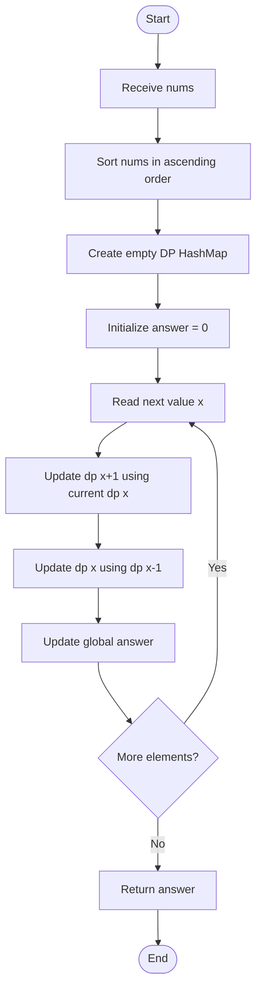
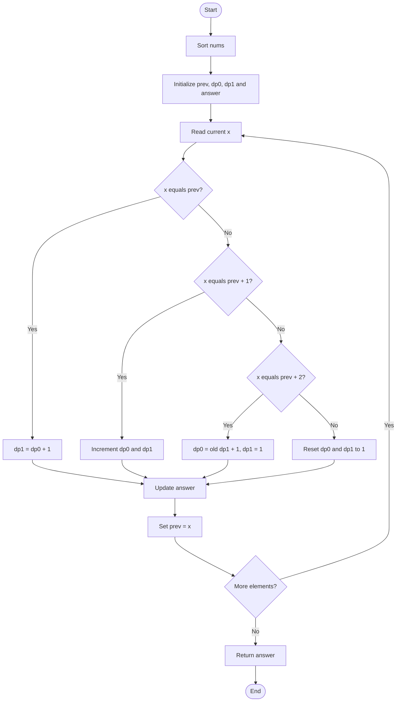

# 3041. Maximize Consecutive Elements in an Array After Modification

[](https://github.com/Shailendra0320)  
[](https://leetcode.com/u/Shailu03/)  
[](https://leetcode.com/u/ShailendraLeetcode03/)

**Difficulty:** Hard  
**Topics:** Array, Dynamic Programming, Sorting  
**Problem:** [3041. Maximize Consecutive Elements in an Array After Modification](https://leetcode.com/problems/maximize-consecutive-elements-in-an-array-after-modification/)

---

## Table of Contents

1. [Problem Statement](#1-problem-statement)
2. [Examples](#2-examples)
3. [Constraints](#3-constraints)
4. [Understanding the Problem](#4-understanding-the-problem)
5. [Key Observations](#5-key-observations)
6. [Approach 1 — Sorting + HashMap Dynamic Programming](#6-approach-1--sorting--hashmap-dynamic-programming)
   - [Intuition](#61-intuition)
   - [Why Use This Approach?](#62-why-use-this-approach)
   - [DP State and Transitions](#63-dp-state-and-transitions)
   - [Architecture Diagram](#64-architecture-diagram)
   - [Flowchart](#65-flowchart)
   - [Algorithm](#66-algorithm)
   - [Detailed Dry Run](#67-detailed-dry-run)
   - [Correctness Proof](#68-correctness-proof)
   - [Complexity Analysis](#69-complexity-analysis)
   - [Java Code](#610-java-code)
   - [C++ Code](#611-c-code)
   - [Python Code](#612-python-code)
7. [Approach 2 — Sorting + Two-State DP (O(1) Extra Space)](#7-approach-2--sorting--two-state-dp-o1-extra-space)
   - [Intuition](#71-intuition)
   - [Why Use This Approach?](#72-why-use-this-approach)
   - [DP States](#73-dp-states)
   - [Transition Diagram](#74-transition-diagram)
   - [Flowchart](#75-flowchart)
   - [Algorithm](#76-algorithm)
   - [Detailed Dry Run](#77-detailed-dry-run)
   - [Correctness Proof](#78-correctness-proof)
   - [Complexity Analysis](#79-complexity-analysis)
   - [Java Code](#710-java-code)
   - [C++ Code](#711-c-code)
   - [Python Code](#712-python-code)
8. [Additional Dry Runs](#8-additional-dry-runs)
9. [Approach Comparison](#9-approach-comparison)
10. [Edge Cases](#10-edge-cases)
11. [Common Mistakes](#11-common-mistakes)
12. [Interview Explanation](#12-interview-explanation)
13. [Quick Revision](#13-quick-revision)
14. [Final Recommendation](#14-final-recommendation)

---

## 1. Problem Statement

You are given a 0-indexed array `nums` consisting of positive integers.

Initially, you may increase the value of any element by **at most 1**. This means each element can either:

- Remain equal to `x`.
- Become `x + 1`.

After making these modifications, select one or more elements such that their values are consecutive when sorted in increasing order.

For example:

```text
[3, 4, 5]       -> consecutive
[3, 4, 6]       -> not consecutive
[1, 1, 2, 3]    -> not consecutive
```

Return the maximum number of elements that can be selected.

**Important:** The selected elements are considered after sorting their final values. Their original positions do not need to be adjacent.

---

## 2. Examples

### Example 1

**Input:**
```text
nums = [2, 1, 5, 1, 1]
```

**Output:**
```text
3
```

**Explanation:**

Increase the elements at indices `0` and `3`:

```text
Before: [2, 1, 5, 1, 1]
After:  [3, 1, 5, 2, 1]
```

Select values that form a consecutive sequence and sort them:

```text
[1, 2, 3]
```

The maximum possible length is `3`.

### Example 2

**Input:**
```text
nums = [1, 4, 7, 10]
```

**Output:**
```text
1
```

**Explanation:**

Even after increasing any element by one, no two values can be made consecutive. Therefore, we can select only one element.

---

## 3. Constraints

```text
1 <= nums.length <= 10^5
1 <= nums[i] <= 10^6
```

### Constraint observations

- The array can contain up to \(10^5\) elements.
- Values can be as large as \(10^6\).
- Duplicate values are allowed and can be useful.
- A direct DP array indexed by every possible value is possible under these constraints, but a HashMap is more general.
- Sorting plus DP gives \(O(n\log n)\) time.

---

## 4. Understanding the Problem

For every original value `x`, we have only two choices:

```text
Choice 1: Keep x
Choice 2: Increase x to x + 1
```

We cannot decrease a value, and we cannot increase it by more than one.

The final selected values must be distinct consecutive integers. For example, if we select four elements, after sorting their final values they must look like:

```text
k, k+1, k+2, k+3
```

The original order is not important after selecting the elements. This is why sorting the input is useful.

### Example: Why duplicates matter

```text
nums = [1, 1, 2]
```

We can make the values:

```text
1 -> 1
1 -> 2
2 -> 3
```

After sorting:

```text
[1, 2, 3]
```

All three elements can be selected.

### Why a simple greedy choice is not enough

When a value appears multiple times, some occurrences may need to remain unchanged while another occurrence is increased. We must preserve the best possible sequence ending at different values.

Dynamic programming naturally keeps these possibilities.

---

## 5. Key Observations

### Observation 1: Sort the array

After sorting:

\[
nums[0] \le nums[1] \le \dots \le nums[n-1]
\]

Processing values in ascending order lets us build consecutive sequences from smaller values to larger values.

### Observation 2: A current number has two final values

For each `x`:

```text
x     -> keep unchanged
x + 1 -> increase by one
```

Therefore, we need to track the best sequence ending at these possible final values.

### Observation 3: HashMap DP

Define:

\[
dp[v] = \text{maximum length of a consecutive selection ending at value }v
\]

For a sorted input value `x`, there are two transitions:

**Keep `x`:** extend a sequence ending at `x - 1`.

\[
dp[x] = dp[x-1] + 1
\]

**Increase `x` to `x + 1`:** extend a sequence ending at `x`.

\[
dp[x+1] = dp[x] + 1
\]

The update for `x + 1` must be performed before the update for `x`, so the same input occurrence is not used twice.

### Observation 4: We only need two active DP states

After sorting, we can avoid storing every DP value.

For the previously processed value, maintain:

- `dp0`: best sequence ending at the previous original value.
- `dp1`: best sequence ending at the previous original value plus one.

The relationship between the current value and previous value determines how these two states change.

This leads to Approach 2 with \(O(1)\) auxiliary space.

---

# 6. Approach 1 — Sorting + HashMap Dynamic Programming

## 6.1 Intuition

We want to build the longest sequence of consecutive final values.

Suppose the current original value is `x`.

It can be used in two ways:

1. Keep it as `x`. It can extend a sequence ending at `x - 1`.
2. Increase it to `x + 1`. It can extend a sequence ending at `x`.

We store the best sequence length for each ending value in a HashMap.

For every sorted `x`:

```text
dp[x + 1] = dp[x] + 1
dp[x]     = dp[x - 1] + 1
```

The order is important: update `dp[x + 1]` first, then update `dp[x]`.

The answer is the maximum state reached during processing.

## 6.2 Why Use This Approach?

- The DP definition is simple and intuitive.
- It directly represents the ending value of a consecutive sequence.
- It handles large values without allocating a huge array.
- It is easy to dry-run and explain in interviews.
- It is a useful foundation for understanding the optimized two-state DP.

## 6.3 DP State and Transitions

**State:**

\[
dp[v] = \text{longest valid selection ending at final value }v
\]

**Transition 1 — Keep current value:**

\[
dp[x] = dp[x-1] + 1
\]

**Transition 2 — Increase current value:**

\[
dp[x+1] = dp[x] + 1
\]

The implementation uses the previous DP values and updates the states in this order:

```text
1. Calculate/update dp[x + 1] from dp[x].
2. Calculate/update dp[x] from dp[x - 1].
3. Update the global answer.
```

Because every input element is processed once, it contributes at most one selected value.

## 6.4 Architecture Diagram

```text
                   Input nums
                       |
                       v
             Sort in Ascending Order
                       |
                       v
                Initialize DP Map
                       |
                       v
             Process Current Value x
                       |
              +--------+--------+
              |                 |
              v                 v
          Keep x           Increase to x+1
              |                 |
              v                 v
       Previous state       Previous state
          dp[x-1]               dp[x]
              |                 |
              v                 v
       dp[x] = dp[x-1]+1  dp[x+1] = dp[x]+1
              |                 |
              +--------+--------+
                       |
                       v
               Update Maximum
                       |
                       v
                 Return Answer
```

## 6.5 Flowchart



## 6.6 Algorithm

1. Sort `nums`.
2. Create an empty HashMap `dp`.
3. Initialize `answer = 0`.
4. For each value `x` in sorted order:
   - Set `dp[x + 1] = dp[x] + 1`.
   - Set `dp[x] = dp[x - 1] + 1`.
   - Update the maximum answer using `dp[x]` and `dp[x + 1]`.
5. Return `answer`.

The default value of a missing DP state is zero.

## 6.7 Detailed Dry Run

**Input:**

```text
nums = [2, 1, 5, 1, 1]
```

### Step 1: Sort the input

```text
Original: [2, 1, 5, 1, 1]
Sorted:   [1, 1, 1, 2, 5]
```

Initially:

```text
dp = {}
answer = 0
```

### Step 2: Process the first `1`

- Increase it to `2`: `dp[2] = dp[1] + 1 = 1`
- Keep it as `1`: `dp[1] = dp[0] + 1 = 1`

```text
dp[1] = 1
dp[2] = 1
answer = 1
```

### Step 3: Process the second `1`

- Increase it to `2`: `dp[2] = dp[1] + 1 = 2`
- Keep it as `1`: `dp[1] = dp[0] + 1 = 1`

```text
dp[1] = 1
dp[2] = 2
answer = 2
```

### Step 4: Process the third `1`

- Increase it to `2`: `dp[2] = dp[1] + 1 = 2`
- Keep it as `1`: `dp[1] = dp[0] + 1 = 1`

```text
dp[1] = 1
dp[2] = 2
answer = 2
```

### Step 5: Process `2`

- Increase it to `3`: `dp[3] = dp[2] + 1 = 3`
- Keep it as `2`: `dp[2] = dp[1] + 1 = 2`

```text
dp[1] = 1
dp[2] = 2
dp[3] = 3
answer = 3
```

### Step 6: Process `5`

- Increase it to `6`: `dp[6] = dp[5] + 1 = 1`
- Keep it as `5`: `dp[5] = dp[4] + 1 = 1`

The maximum remains `3`.

**Final output:**

```text
3
```

### Dry-run summary

| Current value | `dp[x+1]` after update | `dp[x]` after update | Answer |
|---:|---:|---:|---:|
| 1 | 1 | 1 | 1 |
| 1 | 2 | 1 | 2 |
| 1 | 2 | 1 | 2 |
| 2 | 3 | 2 | 3 |
| 5 | 1 | 1 | 3 |

## 6.8 Correctness Proof

We prove that the HashMap DP computes the maximum possible number of selected elements.

For every processed original value `x`, there are exactly two possible final values: `x` and `x + 1`.

- If we keep `x`, the selected sequence must previously end at `x - 1`. Therefore, the best new sequence length is `dp[x - 1] + 1`.
- If we increase `x` to `x + 1`, the selected sequence must previously end at `x`. Therefore, the best new sequence length is `dp[x] + 1`.

Since the input is sorted, all previously processed elements are available to form these predecessor sequences. Updating `dp[x + 1]` before `dp[x]` ensures the current element cannot be used in both transitions.

Thus, each transition considers every valid way to include the current element. By induction over the sorted input, the DP states represent the best achievable sequence lengths for their ending values.

The maximum value among all DP states is therefore the maximum number of elements that can form consecutive values.

## 6.9 Complexity Analysis

Let `n` be the number of elements.

| Operation | Time Complexity |
|---|---:|
| Sorting | \(O(n\log n)\) |
| HashMap updates | Expected \(O(n)\) |
| Updating answer | \(O(n)\) |

**Total Time Complexity:**

\[
\boxed{O(n\log n)}
\]

**Space Complexity:**

\[
\boxed{O(n)}
\]

The HashMap stores at most a linear number of ending-value states. Sorting may also use implementation-dependent internal memory.

## 6.10 Java Code

```java
//Approach-1 (Sorting + HashMap Dynamic Programming)
//T.C: O(n log n)
//S.C: O(n)

import java.util.Arrays;
import java.util.HashMap;
import java.util.Map;

class Solution {
    public int maxSelectedElements(int[] nums) {
        Arrays.sort(nums);

        Map<Integer, Integer> dp = new HashMap<>();
        int answer = 0;

        for (int x : nums) {
            dp.put(x + 1, dp.getOrDefault(x, 0) + 1);
            dp.put(x, dp.getOrDefault(x - 1, 0) + 1);

            answer = Math.max(
                answer,
                Math.max(dp.get(x), dp.get(x + 1))
            );
        }

        return answer;
    }
}
```

## 6.11 C++ Code

```cpp
//Approach-1 (Sorting + HashMap Dynamic Programming)
//T.C: O(n log n) expected
//S.C: O(n)

#include <bits/stdc++.h>
using namespace std;

class Solution {
public:
    int maxSelectedElements(vector<int>& nums) {
        sort(nums.begin(), nums.end());

        unordered_map<int, int> dp;
        int answer = 0;

        for (int x : nums) {
            dp[x + 1] = dp[x] + 1;
            dp[x] = dp[x - 1] + 1;

            answer = max(answer, max(dp[x], dp[x + 1]));
        }

        return answer;
    }
};
```

## 6.12 Python Code

```python
# Approach-1 (Sorting + HashMap Dynamic Programming)
# T.C: O(n log n)
# S.C: O(n)

class Solution:
    def maxSelectedElements(self, nums: List[int]) -> int:
        nums.sort()

        dp = {}
        answer = 0

        for x in nums:
            dp[x + 1] = dp.get(x, 0) + 1
            dp[x] = dp.get(x - 1, 0) + 1

            answer = max(answer, dp[x], dp[x + 1])

        return answer
```

---

# 7. Approach 2 — Sorting + Two-State DP (O(1) Extra Space)

## 7.1 Intuition

Approach 1 stores a DP state for every possible ending value. But after sorting, we do not need the complete map.

We only need to know how the best sequences ending around the **previous original value** can be extended by the current value.

Maintain two states:

- `dp0`: longest consecutive sequence ending at the previous original value.
- `dp1`: longest consecutive sequence ending at the previous original value plus one.

Let:

- `prev` be the previous sorted input value.
- `x` be the current sorted input value.

There are four possible relationships:

1. `x == prev`
2. `x == prev + 1`
3. `x == prev + 2`
4. `x > prev + 2`

Each relationship has a specific state transition.

## 7.2 Why Use This Approach?

- It removes the HashMap completely.
- It keeps only two DP states and the previous value.
- It uses \(O(1)\) auxiliary space apart from sorting.
- It is an optimized solution with the same \(O(n\log n)\) time complexity.
- It is an excellent interview solution once the state transitions are understood.

## 7.3 DP States

After processing the previous sorted value `prev`:

\[
dp0 = \text{best sequence ending at }prev
\]

\[
dp1 = \text{best sequence ending at }prev+1
\]

Initialize:

```text
dp0 = 1
dp1 = 1
answer = 1
```

The first processed value can form a sequence of length one either by staying unchanged or by being increased by one.

### Case 1: Current value equals previous value

```text
x == prev
```

We have another occurrence of the same original number.

It can be increased to `prev + 1`, extending the sequence represented by `dp0`.

```text
dp1 = dp0 + 1
dp0 remains unchanged
```

### Case 2: Current value is previous + 1

```text
x == prev + 1
```

The current value can extend the sequence ending at `prev`.

It can also be increased to `prev + 2`, extending the sequence represented by `dp1`.

```text
dp0 = dp0 + 1
dp1 = dp1 + 1
```

Both states grow by one.

### Case 3: Current value is previous + 2

```text
x == prev + 2
```

The current value cannot extend `dp0` directly, but it can extend `dp1`, because `dp1` ends at:

```text
prev + 1
```

So:

```text
dp0 = old dp1 + 1
dp1 = 1
```

The new `dp1` starts a separate sequence using `x + 1`.

### Case 4: Gap is greater than 2

```text
x > prev + 2
```

Neither previous state can be extended.

Start new sequences:

```text
dp0 = 1
dp1 = 1
```

## 7.4 Transition Diagram

```text
                 Compare x with prev
                         |
       +-----------------+------------------+
       |                 |                  |
       v                 v                  v
    x == prev        x == prev+1        x == prev+2
       |                 |                  |
       v                 v                  v
 dp1 = dp0 + 1     dp0 = dp0 + 1      dp0 = old dp1 + 1
 dp0 unchanged     dp1 = dp1 + 1      dp1 = 1
       |                 |                  |
       +-----------------+------------------+
                         |
                         v
                  Update answer
                         |
                         v
                    prev = x

       If x > prev + 2:
       dp0 = 1, dp1 = 1
```

## 7.5 Flowchart



## 7.6 Algorithm

1. Sort `nums`.
2. Initialize:
   - `prev` to a value smaller than every possible input.
   - `dp0 = 1`.
   - `dp1 = 1`.
   - `answer = 1`.
3. Iterate through each sorted value `x`.
4. Compare `x` with `prev`:
   - If equal, set `dp1 = dp0 + 1`.
   - If `x == prev + 1`, increment both states.
   - If `x == prev + 2`, set `dp0 = old dp1 + 1` and `dp1 = 1`.
   - Otherwise, reset both states to `1`.
5. Update `answer` with `dp0` and `dp1`.
6. Set `prev = x`.
7. Return `answer`.

**Implementation detail:** In the `prev + 2` case, use the old `dp1` value before replacing it.

## 7.7 Detailed Dry Run

**Input:**

```text
nums = [2, 1, 5, 1, 1]
```

### Step 1: Sort

```text
[1, 1, 1, 2, 5]
```

Initialize:

```text
prev = very small value
dp0 = 1
dp1 = 1
answer = 1
```

### Step 2: Process the first `1`

This is the first value, so both states represent a sequence of length one.

```text
dp0 = 1
dp1 = 1
answer = 1
prev = 1
```

### Step 3: Process the second `1`

Here:

```text
x == prev
```

So:

```text
dp1 = dp0 + 1 = 2
dp0 = 1
answer = 2
```

### Step 4: Process the third `1`

Again:

```text
x == prev
```

So:

```text
dp1 = dp0 + 1 = 2
dp0 = 1
answer = 2
```

### Step 5: Process `2`

Here:

```text
x == prev + 1
```

So increment both states:

```text
dp0 = 2
dp1 = 3
answer = 3
```

### Step 6: Process `5`

Here:

```text
5 > 2 + 2
```

There is a gap, so reset:

```text
dp0 = 1
dp1 = 1
answer = 3
```

**Final output:**

```text
3
```

### Dry-run summary

| Current `x` | Relationship | `dp0` | `dp1` | Answer |
|---:|---|---:|---:|---:|
| 1 | First value | 1 | 1 | 1 |
| 1 | Equal to previous | 1 | 2 | 2 |
| 1 | Equal to previous | 1 | 2 | 2 |
| 2 | Previous + 1 | 2 | 3 | 3 |
| 5 | Gap greater than 2 | 1 | 1 | 3 |

## 7.8 Correctness Proof

After processing a sorted prefix ending in `prev`, maintain two optimal states:

- `dp0` is the longest consecutive selection ending at `prev`.
- `dp1` is the longest consecutive selection ending at `prev + 1`.

For the next value `x`, the sorted order guarantees `x >= prev`.

There are four cases:

1. **`x == prev`:** The new occurrence can be increased to `prev + 1`, extending the sequence represented by `dp0`. It cannot create a longer sequence ending at `prev` because it cannot be decreased. Therefore, `dp1 = dp0 + 1`.
2. **`x == prev + 1`:** Keeping `x` extends the sequence ending at `prev`, while increasing it to `prev + 2` extends the sequence ending at `prev + 1`. Thus both states increase by one.
3. **`x == prev + 2`:** Keeping `x` extends the old sequence ending at `prev + 1`, so the new `dp0` is old `dp1 + 1`. Increasing `x` creates a new sequence ending at `x + 1`, of length one.
4. **`x > prev + 2`:** Neither previous ending value can be extended. Both new states start at length one.

These cases cover every possible relationship between consecutive sorted input values. The transitions preserve the optimal meaning of both states. By induction, the maximum of `dp0` and `dp1` over all processed values is the maximum achievable selection length.

Therefore, the algorithm returns the correct answer.

## 7.9 Complexity Analysis

Let `n` be the length of `nums`.

| Operation | Time Complexity |
|---|---:|
| Sorting | \(O(n\log n)\) |
| One pass through array | \(O(n)\) |
| State updates | \(O(1)\) per element |

**Total Time Complexity:**

\[
\boxed{O(n\log n)}
\]

**Auxiliary Space Complexity:**

\[
\boxed{O(1)}
\]

The \(O(1)\) auxiliary-space claim excludes any internal memory used by the sorting implementation.

## 7.10 Java Code

```java
//Approach-2 (Sorting + Two-State DP)
//T.C: O(n log n)
//S.C: O(1) auxiliary space, excluding sorting internals

import java.util.Arrays;

class Solution2 {
    public int maxSelectedElements(int[] nums) {
        Arrays.sort(nums);

        int answer = 1;
        int prev = Integer.MIN_VALUE;

        int dp0 = 1;
        int dp1 = 1;

        for (int x : nums) {
            if (x == prev) {
                dp1 = dp0 + 1;
            } else if (x == prev + 1) {
                dp0++;
                dp1++;
            } else if (x == prev + 2) {
                dp0 = dp1 + 1;
                dp1 = 1;
            } else {
                dp0 = 1;
                dp1 = 1;
            }

            answer = Math.max(answer, Math.max(dp0, dp1));
            prev = x;
        }

        return answer;
    }
}
```

## 7.11 C++ Code

```cpp
//Approach-2 (Sorting + Two-State DP)
//T.C: O(n log n)
//S.C: O(1) auxiliary space, excluding sorting internals

#include <bits/stdc++.h>
using namespace std;

class Solution2 {
public:
    int maxSelectedElements(vector<int>& nums) {
        sort(nums.begin(), nums.end());

        int answer = 1;
        int prev = INT_MIN;

        int dp0 = 1;
        int dp1 = 1;

        for (int x : nums) {
            if (x == prev) {
                dp1 = dp0 + 1;
            } else if (x == prev + 1) {
                dp0++;
                dp1++;
            } else if (x == prev + 2) {
                dp0 = dp1 + 1;
                dp1 = 1;
            } else {
                dp0 = 1;
                dp1 = 1;
            }

            answer = max(answer, max(dp0, dp1));
            prev = x;
        }

        return answer;
    }
};
```

## 7.12 Python Code

```python
# Approach-2 (Sorting + Two-State DP)
# T.C: O(n log n)
# S.C: O(1) auxiliary space, excluding sorting internals

class Solution2:
    def maxSelectedElements(self, nums: List[int]) -> int:
        nums.sort()

        answer = 1
        prev = float('-inf')

        dp0 = 1
        dp1 = 1

        for x in nums:
            if x == prev:
                dp1 = dp0 + 1
            elif x == prev + 1:
                dp0 += 1
                dp1 += 1
            elif x == prev + 2:
                dp0 = dp1 + 1
                dp1 = 1
            else:
                dp0 = 1
                dp1 = 1

            answer = max(answer, dp0, dp1)
            prev = x

        return answer
```

---

## 8. Additional Dry Runs

### Dry Run 1 — Single element

**Input:**

```text
nums = [7]
```

Only one element can be selected.

**Output:**

```text
1
```

### Dry Run 2 — Two equal values

**Input:**

```text
nums = [5, 5]
```

Modify one occurrence:

```text
[5, 6]
```

The two values are consecutive.

**Output:**

```text
2
```

### Dry Run 3 — Already consecutive values

**Input:**

```text
nums = [1, 2, 3, 4]
```

All four elements can be selected without modification.

**Output:**

```text
4
```

### Dry Run 4 — Many duplicates

**Input:**

```text
nums = [1, 1, 1, 1]
```

At most two distinct consecutive values can be formed:

```text
[1, 2]
```

Only one occurrence can become `1` and another can become `2`; the remaining occurrences cannot create additional distinct consecutive values.

**Output:**

```text
2
```

### Dry Run 5 — A gap of two

**Input:**

```text
nums = [1, 3]
```

Increase `1` to `2`, or keep `1` and increase `3` to `4`. The best consecutive selection has length `2` only if values can be made adjacent. Here `1` and `3` can become `1` and `4`, or `2` and `3`, so the best is:

```text
[2, 3]
```

**Output:**

```text
2
```

---

## 9. Approach Comparison

| Feature | Approach 1: HashMap DP | Approach 2: Two-State DP |
|---|---|---|
| Main idea | Store best length for each ending value | Keep only two active states |
| Sorting | Required | Required |
| DP storage | HashMap | Two integers |
| Time complexity | \(O(n\log n)\) | \(O(n\log n)\) |
| Auxiliary space | \(O(n)\) | \(O(1)\), excluding sorting internals |
| Ease of understanding | Easier DP definition | More careful transitions |
| Best use | Learning and explaining DP | Optimized interview solution |

### Which approach is better?

- **Approach 1** is easier to understand because every DP state has a clear ending value.
- **Approach 2** is more space-efficient because it keeps only the two states needed for the next transition.

Both approaches are optimal in time complexity because sorting dominates the runtime.

---

## 10. Edge Cases

| Input | Expected Output | Reason |
|---|---:|---|
| `[7]` | `1` | Only one element |
| `[5, 5]` | `2` | One can remain 5 and one can become 6 |
| `[1, 2, 3, 4]` | `4` | Already consecutive |
| `[1, 1, 1]` | `2` | Only final values 1 and 2 can be selected |
| `[1, 1, 1, 1]` | `2` | Duplicate values cannot all become distinct consecutive values |
| `[1, 3]` | `2` | Increase 1 to 2 |
| `[1, 4, 7, 10]` | `1` | No pair can become consecutive |

---

## 11. Common Mistakes

### Mistake 1: Assuming elements can be decreased

The problem only allows an increase by at most one. The choices are `x` and `x + 1`, not `x - 1`, `x`, and `x + 1`.

### Mistake 2: Treating the answer as a contiguous subarray

We select elements and then consider their values in sorted order. Their original positions do not need to be adjacent.

### Mistake 3: Removing duplicate values

Every occurrence is a separate element and may contribute to the answer after modification.

### Mistake 4: Updating the HashMap in the wrong order

For Approach 1, update `dp[x + 1]` before `dp[x]`. Otherwise, the current element might be used twice.

### Mistake 5: Forgetting the gap-of-two case

In Approach 2, if `x == prev + 2`, the current value can extend the sequence represented by the old `dp1`. Do not reset both states to one.

### Mistake 6: Updating `dp1` before using its old value

When `x == prev + 2`, calculate:

```text
new dp0 = old dp1 + 1
```

before resetting `dp1`.

### Mistake 7: Using only one DP state

The current number may be kept or increased. Both possible ending values must be represented.

---

## 12. Interview Explanation

You can explain the optimized solution like this:

> First, I sort the array because the selected values are checked in sorted order. Each number can either remain unchanged or be increased by one. I use dynamic programming to track the longest consecutive sequence ending at the previous value and at the previous value plus one. Based on whether the current number is equal to the previous number, one greater, two greater, or separated by a larger gap, I update these two states. This reduces the DP space to O(1). Sorting takes O(n log n), and the DP scan takes O(n), so the total time complexity is O(n log n).

---

## 13. Quick Revision

### Approach 1 — HashMap DP

```text
Sort nums

For each x:
    dp[x + 1] = dp[x] + 1
    dp[x]     = dp[x - 1] + 1

    Update answer
```

- Time: \(O(n\log n)\)
- Space: \(O(n)\)

### Approach 2 — Two-State DP

```text
if x == prev:
    dp1 = dp0 + 1

else if x == prev + 1:
    dp0++
    dp1++

else if x == prev + 2:
    dp0 = old dp1 + 1
    dp1 = 1

else:
    dp0 = 1
    dp1 = 1
```

- Time: \(O(n\log n)\)
- Auxiliary space: \(O(1)\), excluding sorting internals.

### Key concept

Each element can become only:

\[
x \quad \text{or} \quad x+1
\]

Sort first, then build the longest possible consecutive sequence.

---

## 14. Final Recommendation

**Approach 2 — Sorting + Two-State DP** is the recommended optimized solution.

It achieves the same \(O(n\log n)\) time complexity as the HashMap solution while using only \(O(1)\) auxiliary DP space (excluding sorting internals).

However, Approach 1 is an excellent starting point because its HashMap state makes the DP transitions easier to understand.

**Official Problem:** [LeetCode 3041 — Maximize Consecutive Elements in an Array After Modification](https://leetcode.com/problems/maximize-consecutive-elements-in-an-array-after-modification/)
