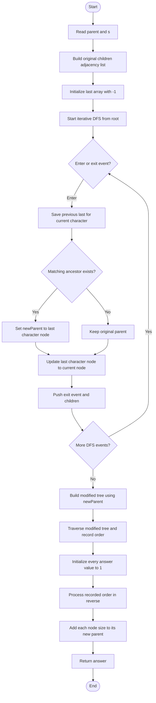
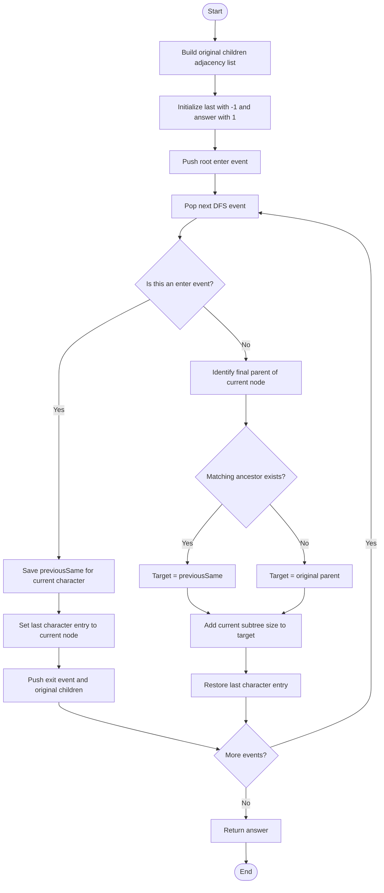

# 3331. Find Subtree Sizes After Changes

[](https://github.com/Shailendra0320)  
[](https://leetcode.com/u/Shailu03/)  
[](https://leetcode.com/u/ShailendraLeetcode03/)

**Difficulty:** Medium  
**Topics:** Tree, Depth-First Search, Hash Table, String, Stack  
**Problem:** [3331. Find Subtree Sizes After Changes](https://leetcode.com/problems/find-subtree-sizes-after-changes/)

---

## Table of Contents

1. [Problem Statement](#1-problem-statement)
2. [Examples](#2-examples)
3. [Constraints](#3-constraints)
4. [Understanding the Problem](#4-understanding-the-problem)
5. [Key Observations](#5-key-observations)
6. [Approach 1 — Build the Modified Tree + Reverse Traversal](#6-approach-1--build-the-modified-tree--reverse-traversal)
   - [Intuition](#61-intuition)
   - [Why This Approach?](#62-why-this-approach)
   - [Algorithm](#63-algorithm)
   - [Architecture Diagram](#64-architecture-diagram)
   - [Flowchart](#65-flowchart)
   - [Detailed Dry Run](#66-detailed-dry-run)
   - [Correctness Proof](#67-correctness-proof)
   - [Complexity Analysis](#68-complexity-analysis)
   - [Java Code](#69-java-code)
   - [C++ Code](#610-c-code)
   - [Python Code](#611-python-code)
7. [Approach 2 — Single DFS + Direct Subtree Accumulation](#7-approach-2--single-dfs--direct-subtree-accumulation)
   - [Intuition](#71-intuition)
   - [Why This Approach?](#72-why-this-approach)
   - [Path State](#73-path-state)
   - [Architecture Diagram](#74-architecture-diagram)
   - [Flowchart](#75-flowchart)
   - [Detailed Dry Run](#76-detailed-dry-run)
   - [Correctness Proof](#77-correctness-proof)
   - [Complexity Analysis](#78-complexity-analysis)
   - [Java Code](#79-java-code)
   - [C++ Code](#710-c-code)
   - [Python Code](#711-python-code)
8. [Approach Comparison](#8-approach-comparison)
9. [Additional Example](#9-additional-example)
10. [Edge Cases](#10-edge-cases)
11. [Common Mistakes](#11-common-mistakes)
12. [Interview Explanation](#12-interview-explanation)
13. [Quick Revision](#13-quick-revision)
14. [Final Recommendation](#14-final-recommendation)

---

## 1. Problem Statement

You are given a tree rooted at node `0` containing `n` nodes numbered from `0` to `n - 1`.

The tree is represented by an integer array `parent`, where:

- `parent[i]` is the parent of node `i`.
- `parent[0] = -1`, because node `0` is the root.

You are also given a string `s` of length `n`, where `s[i]` is the character assigned to node `i`.

We perform one simultaneous change for every node `x` from `1` to `n - 1`:

1. Find the **closest ancestor** `y` of node `x` such that `s[x] == s[y]`.
2. If such an ancestor exists, remove the edge between `x` and its current parent.
3. Connect `x` directly to `y`, making `y` its new parent.
4. If no matching ancestor exists, leave the parent of `x` unchanged.

Return an array `answer` where `answer[i]` is the size of the subtree rooted at node `i` in the final modified tree.

**Important:** Every node chooses its new parent using the ancestors in the **original tree**. All parent changes happen simultaneously; one node's new parent must not affect the ancestor search of another node.

---

## 2. Examples

### Example 1

**Input:**

```text
parent = [-1, 0, 0, 1, 1, 1]
s = "abaabc"
```

**Output:**

```text
[6, 3, 1, 1, 1, 1]
```

**Original tree:**

```text
             0(a)
            /    \
         1(b)    2(a)
        / | \
     3(a) 4(b) 5(c)
```

For node `3`, its ancestors are:

```text
Node 3(a) -> Node 1(b) -> Node 0(a)
```

Node `1` does not have the same character as node `3`, but node `0` does. Therefore, the new parent of node `3` becomes node `0`.

The other nodes keep their original parents.

**Modified tree:**

```text
             0(a)
          /   |   \
       1(b)  2(a)  3(a)
       /  \
    4(b)  5(c)
```

Subtree sizes:

| Node | Nodes in its final subtree | Size |
|---:|---|---:|
| 0 | 0, 1, 2, 3, 4, 5 | 6 |
| 1 | 1, 4, 5 | 3 |
| 2 | 2 | 1 |
| 3 | 3 | 1 |
| 4 | 4 | 1 |
| 5 | 5 | 1 |

### Example 2

**Input:**

```text
parent = [-1, 0, 4, 0, 1]
s = "abbba"
```

**Output:**

```text
[5, 2, 1, 1, 1]
```

**Original tree:**

```text
          0(a)
         /    \
      1(b)    3(b)
      |
      4(a)
      |
      2(b)
```

Two parent changes happen:

- Node `4(a)` finds node `0(a)` as its closest matching ancestor, so its new parent becomes `0`.
- Node `2(b)` finds node `1(b)` as its closest matching ancestor, so its new parent becomes `1`.

Notice that node `2` searches the original ancestor chain `2 -> 4 -> 1 -> 0`. It does not use the already-changed parent of node `4`.

**Modified tree:**

```text
          0(a)
        /  |  \
     1(b) 3(b) 4(a)
      |
     2(b)
```

The final subtree sizes are:

```text
[5, 2, 1, 1, 1]
```

### Example 3

**Input:**

```text
parent = [-1]
s = "a"
```

**Output:**

```text
[1]
```

There is only one node, so no parent change is possible. Its subtree contains only itself.

---

## 3. Constraints

```text
1 <= n <= 10^5
n == parent.length == s.length
parent[0] == -1
0 <= parent[i] <= n - 1, for i >= 1
parent represents a valid tree
s consists of lowercase English letters
```

### Constraint observations

- The tree can contain up to `100,000` nodes.
- The tree may be a chain, so its height can also be `100,000`.
- Searching all ancestors independently for every node can take `O(n^2)` time.
- A recursive DFS may exceed the language's recursion-stack limit on a highly skewed tree.
- Since `s` contains only lowercase English letters, there are only 26 possible character groups.
- An iterative DFS avoids recursion-depth problems.

---

## 4. Understanding the Problem

The task has two separate parts:

1. Determine the final parent of every node.
2. Calculate subtree sizes in the resulting tree.

A subtree of node `u` contains:

- Node `u` itself.
- Every node that can reach `u` by repeatedly following its final parent relationship upward.

The size is therefore:

\[
size[u] = 1 + \sum_{v \in children(u)} size[v]
\]

The challenge is finding the correct final parent efficiently.

### 4.1 What does the closest matching ancestor mean?

Suppose the original tree contains this path:

```text
       0(a)
        |
       1(b)
        |
       2(c)
        |
       3(b)
```

For node `3`, we move upward:

- Node `2` has character `c`: not a match.
- Node `1` has character `b`: match found.

We stop immediately. Node `1` is the closest ancestor with the same character.

Therefore:

```text
Original parent of 3 = 2
New parent of 3      = 1
```

### 4.2 Why do we need the original tree?

Consider Example 2:

```text
parent = [-1, 0, 4, 0, 1]
s = "abbba"
```

Node `4` moves from parent `1` to parent `0`. Node `2` also moves, but its matching ancestor must be found in the original tree.

Its original path is:

```text
2(b) -> 4(a) -> 1(b) -> 0(a)
```

The closest matching ancestor is node `1`, not a node selected by following the modified edges.

So we must determine all new parents while traversing the original tree.

### 4.3 Why is a normal upward search inefficient?

A direct solution could do this for every node:

```text
current = parent[node]

while current != -1:
    if s[current] == s[node]:
        return current
    current = parent[current]
```

For a chain-shaped tree, node `n - 1` may inspect `n - 1` ancestors, node `n - 2` may inspect `n - 2` ancestors, and so on.

The total work can become:

\[
(n-1) + (n-2) + \dots + 1 = O(n^2)
\]

We need to reuse information about the current root-to-node path instead.

---

## 5. Key Observations

### Observation 1: DFS gives us the current ancestor path

When DFS enters a node, all its ancestors are already on the active traversal path.

When DFS leaves the node, it must be removed from that active path before another sibling is processed.

This makes DFS the natural way to solve the nearest-ancestor requirement.

### Observation 2: Keep the most recent node for each character

Maintain an array:

```text
last[26]
```

`last[c]` stores the most recently visited node with character `c` that is still an ancestor of the current DFS node.

For a node `u`:

```text
character = s[u] - 'a'
closestMatchingAncestor = last[character]
```

If `last[character] == -1`, no matching ancestor exists.

Otherwise, `last[character]` is exactly the closest matching ancestor because it is the deepest node with that character on the current path.

### Observation 3: DFS state must be restored when leaving a node

Suppose the current path is:

```text
0(a) -> 1(b) -> 3(a)
```

While processing node `3`, the most recent active `a` is node `3` itself, and the previous active `a` is node `0`.

After finishing node `3`, we must restore the previous `a` entry so that sibling subtrees do not incorrectly treat node `3` as their ancestor.

We can save the previous value:

```text
previousSame[u] = last[s[u]]
last[s[u]] = u
```

When leaving `u`:

```text
last[s[u]] = previousSame[u]
```

### Observation 4: A node's final parent is either a matching ancestor or its original parent

For every node `u > 0`:

\[
newParent[u] =
\begin{cases}
last[s[u]], & \text{if a matching ancestor exists}\\
parent[u], & \text{otherwise}
\end{cases}
\]

The root always has parent `-1`.

### Observation 5: Subtree sizes are computed bottom-up

A parent can receive the subtree size of a child only after the child's descendants have already been processed.

Therefore, use postorder processing or reverse traversal order:

```text
answer[u] = 1

for each child v:
    answer[u] += answer[v]
```

Both approaches below use iterative traversal so a chain of `10^5` nodes does not cause recursive stack overflow.

---

# 6. Approach 1 — Build the Modified Tree + Reverse Traversal

## 6.1 Intuition

This approach follows the problem statement directly in two phases.

**Phase 1: Find every new parent.**

- Build the original children adjacency list from `parent`.
- Run an iterative DFS on the original tree.
- Maintain `last[26]` to track the closest active ancestor for each character.
- Save the new parent of every node in `newParent`.

**Phase 2: Build the modified tree and count subtree sizes.**

- Use `newParent` to construct the final children adjacency list.
- Start a traversal from root `0` and record the visited order.
- Process that order in reverse.
- Initialize every subtree size to `1`.
- Add each node's size to its final parent.

Because every final parent is an ancestor in the original tree, the modified parent-child relationships still form a rooted tree.

### Why does reverse traversal work?

A parent always appears before its child in a traversal that starts from the root.

Therefore, reversing that traversal processes children before parents.

When node `u` is processed, all its final children have already contributed their subtree sizes.

So:

```text
answer[newParent[u]] += answer[u]
```

correctly propagates the complete subtree size upward.

## 6.2 Why Use This Approach?

- It separates parent reassignment from subtree-size calculation.
- The modified tree is explicitly constructed, making the result easy to inspect.
- It is straightforward to debug with a printed `newParent` array.
- It follows the two logical operations described in the problem.
- It uses iterative traversal and safely handles a tree with depth `10^5`.

## 6.3 Algorithm

### Phase 1 — Build the original tree

1. Let `n = parent.length`.
2. Create `children`, an adjacency list of size `n`.
3. For every node `u` from `1` to `n - 1`, add `u` to `children[parent[u]]`.
4. Initialize `last[26]` with `-1`.
5. Initialize `previousSame[n]` and `newParent[n]`.

### Phase 2 — Determine the new parent of each node

Use an explicit stack. A non-negative stack entry means **enter node**; a negative entry `~u` means **exit node**.

When entering node `u`:

1. Find `c = s[u] - 'a'`.
2. Save `previousSame[u] = last[c]`.
3. If `last[c] != -1`, set `newParent[u] = last[c]`.
4. Otherwise, keep `newParent[u] = parent[u]`.
5. Set `last[c] = u`.
6. Push the exit event for `u`.
7. Push its children in reverse order.

When exiting node `u`:

1. Restore `last[s[u] - 'a'] = previousSame[u]`.

This restoration ensures that the active character information always represents the current ancestor path.

### Phase 3 — Build the modified tree

For every node `u > 0`:

```text
modifiedChildren[newParent[u]].add(u)
```

### Phase 4 — Calculate subtree sizes

1. Traverse the modified tree from node `0`, storing nodes in `order`.
2. Initialize `answer[u] = 1` for every node.
3. Iterate through `order` backward.
4. For every non-root node `u`, add `answer[u]` to `answer[newParent[u]]`.
5. Return `answer`.

## 6.4 Architecture Diagram

```text
                      parent[] and s
                             |
                             v
                  Build Original Tree
                             |
                             v
                 Iterative DFS on Original
                             |
                             v
                   Maintain last[26]
                             |
                             v
              Find Closest Matching Ancestor
                             |
                             v
                    Store newParent[]
                             |
                             v
                 Build Modified Children
                             |
                             v
                 Traverse Modified Tree
                             |
                             v
                    Store Traversal Order
                             |
                             v
                   Process Order Backward
                             |
                             v
             Add Child Subtree into Final Parent
                             |
                             v
                    Return answer[]
```

## 6.5 Flowchart



## 6.6 Detailed Dry Run

Use Example 1:

```text
parent = [-1, 0, 0, 1, 1, 1]
s      = "abaabc"
```

### Step 1 — Original tree

```text
             0(a)
            /    \
         1(b)    2(a)
        / | \
     3(a) 4(b) 5(c)
```

The original children adjacency list is:

```text
0 -> [1, 2]
1 -> [3, 4, 5]
2 -> []
3 -> []
4 -> []
5 -> []
```

### Step 2 — Track the closest matching ancestor

The DFS visits the tree while maintaining `last[26]`.

| Node | Character | Previous active node with same character | New parent |
|---:|:---:|---:|---:|
| 0 | a | -1 | -1 |
| 1 | b | -1 | 0 |
| 3 | a | 0 | 0 |
| 4 | b | 1 | 1 |
| 5 | c | -1 | 1 |
| 2 | a | 0 | 0 |

For node `3`, the closest matching ancestor is `0`.

For node `4`, the closest matching ancestor is `1`.

For node `5`, no ancestor has character `c`, so its original parent `1` remains unchanged.

For node `2`, the closest matching ancestor is `0`.

Thus:

```text
newParent = [-1, 0, 0, 0, 1, 1]
```

### Step 3 — Build the modified tree

```text
             0(a)
          /   |   \
       1(b)  2(a)  3(a)
       /  \
    4(b)  5(c)
```

Modified adjacency list:

```text
0 -> [1, 2, 3]
1 -> [4, 5]
2 -> []
3 -> []
4 -> []
5 -> []
```

### Step 4 — Initialize subtree sizes

Every node initially contributes itself:

```text
answer = [1, 1, 1, 1, 1, 1]
```

One valid traversal order is:

```text
[0, 1, 4, 5, 2, 3]
```

Reverse order:

```text
[3, 2, 5, 4, 1, 0]
```

### Step 5 — Accumulate from children to parents

| Processed node | Final parent | Node's current size | Updated parent size |
|---:|---:|---:|---:|
| 3 | 0 | 1 | `answer[0] = 2` |
| 2 | 0 | 1 | `answer[0] = 3` |
| 5 | 1 | 1 | `answer[1] = 2` |
| 4 | 1 | 1 | `answer[1] = 3` |
| 1 | 0 | 3 | `answer[0] = 6` |
| 0 | -1 | 6 | No parent |

Final result:

```text
answer = [6, 3, 1, 1, 1, 1]
```

## 6.7 Correctness Proof

We prove that Approach 1 returns the subtree sizes of the final modified tree.

**Lemma 1: `last[c]` identifies the closest active ancestor with character `c`.**

During DFS, a node is entered only after its ancestors have been entered. The `last` array stores the most recently entered node of each character on the current path. Since the most recently entered matching node is deeper than every earlier matching node, it is the closest matching ancestor. On exit, restoring the previous value removes the node from the active path. Therefore, the invariant is maintained.

**Lemma 2: `newParent[u]` is the correct final parent of every node.**

When node `u` is entered, `last[s[u]]` is the closest ancestor with the same character by Lemma 1. If such an ancestor exists, the algorithm selects it. Otherwise, the algorithm retains `parent[u]`. This is exactly the rule in the problem statement.

**Lemma 3: The modified adjacency list represents the final tree.**

For every non-root node, the algorithm adds exactly one edge from `newParent[u]` to `u`. The selected parent is either the original parent or an ancestor in the original tree. Thus, every edge points from an ancestor to a descendant in the original tree; cycles cannot be introduced, and every node remains connected to root `0`. Hence the constructed structure is the required modified rooted tree.

**Lemma 4: Reverse traversal accumulates correct subtree sizes.**

In a root-first traversal, every parent appears before its descendants. Reversing the order therefore processes every descendant before its parent. Each node starts with size `1`, and its complete size is added exactly once to its final parent. By induction from leaves toward the root, every `answer[u]` equals the number of nodes in the final subtree rooted at `u`.

By Lemmas 2–4, the algorithm constructs the required final tree and computes every subtree size correctly.

## 6.8 Complexity Analysis

Let `n` be the number of nodes.

| Operation | Time Complexity |
|---|---:|
| Build original adjacency list | `O(n)` |
| DFS to determine new parents | `O(n)` |
| Build modified adjacency list | `O(n)` |
| Traverse modified tree | `O(n)` |
| Reverse accumulation | `O(n)` |

**Total Time Complexity:**

\[
\boxed{O(n)}
\]

**Space Complexity:**

\[
\boxed{O(n)}
\]

The adjacency lists, traversal stack, `newParent`, `previousSame`, traversal order, and answer array all require linear space. The `last` array itself has fixed size 26.

## 6.9 Java Code

```java
// Approach-1: Build Modified Tree + Reverse Traversal
// T.C: O(n)
// S.C: O(n)

import java.util.*;

class Solution {
    public int[] findSubtreeSizes(int[] parent, String s) {
        int n = parent.length;

        List<Integer>[] children = new ArrayList[n];
        for (int i = 0; i < n; i++) {
            children[i] = new ArrayList<>();
        }

        for (int i = 1; i < n; i++) {
            children[parent[i]].add(i);
        }

        int[] last = new int[26];
        Arrays.fill(last, -1);

        int[] previousSame = new int[n];
        int[] newParent = parent.clone();

        Deque<Integer> stack = new ArrayDeque<>();
        stack.push(0);

        while (!stack.isEmpty()) {
            int event = stack.pop();

            if (event >= 0) {
                int u = event;
                int c = s.charAt(u) - 'a';

                previousSame[u] = last[c];

                if (last[c] != -1) {
                    newParent[u] = last[c];
                }

                last[c] = u;

                stack.push(~u);

                for (int i = children[u].size() - 1; i >= 0; i--) {
                    stack.push(children[u].get(i));
                }
            } else {
                int u = ~event;
                int c = s.charAt(u) - 'a';
                last[c] = previousSame[u];
            }
        }

        List<Integer>[] modified = new ArrayList[n];
        for (int i = 0; i < n; i++) {
            modified[i] = new ArrayList<>();
        }

        for (int i = 1; i < n; i++) {
            modified[newParent[i]].add(i);
        }

        int[] order = new int[n];
        int index = 0;

        stack.push(0);

        while (!stack.isEmpty()) {
            int u = stack.pop();
            order[index++] = u;

            for (int v : modified[u]) {
                stack.push(v);
            }
        }

        int[] answer = new int[n];
        Arrays.fill(answer, 1);

        for (int i = n - 1; i > 0; i--) {
            int u = order[i];
            answer[newParent[u]] += answer[u];
        }

        return answer;
    }
}
```

## 6.10 C++ Code

```cpp
// Approach-1: Build Modified Tree + Reverse Traversal
// T.C: O(n)
// S.C: O(n)

#include <bits/stdc++.h>
using namespace std;

class Solution {
public:
    vector<int> findSubtreeSizes(vector<int>& parent, string s) {
        int n = parent.size();

        vector<vector<int>> children(n);

        for (int i = 1; i < n; i++) {
            children[parent[i]].push_back(i);
        }

        vector<int> last(26, -1);
        vector<int> previousSame(n, -1);
        vector<int> newParent = parent;

        vector<int> st;
        st.push_back(0);

        while (!st.empty()) {
            int event = st.back();
            st.pop_back();

            if (event >= 0) {
                int u = event;
                int c = s[u] - 'a';

                previousSame[u] = last[c];

                if (last[c] != -1) {
                    newParent[u] = last[c];
                }

                last[c] = u;

                st.push_back(~u);

                for (int i = (int)children[u].size() - 1; i >= 0; i--) {
                    st.push_back(children[u][i]);
                }
            } else {
                int u = ~event;
                int c = s[u] - 'a';
                last[c] = previousSame[u];
            }
        }

        vector<vector<int>> modified(n);

        for (int i = 1; i < n; i++) {
            modified[newParent[i]].push_back(i);
        }

        vector<int> order;
        order.reserve(n);

        st.push_back(0);

        while (!st.empty()) {
            int u = st.back();
            st.pop_back();

            order.push_back(u);

            for (int v : modified[u]) {
                st.push_back(v);
            }
        }

        vector<int> answer(n, 1);

        for (int i = n - 1; i > 0; i--) {
            int u = order[i];
            answer[newParent[u]] += answer[u];
        }

        return answer;
    }
};
```

## 6.11 Python Code

```python
# Approach-1: Build Modified Tree + Reverse Traversal
# T.C: O(n)
# S.C: O(n)

from typing import List

class Solution:
    def findSubtreeSizes(self, parent: List[int], s: str) -> List[int]:
        n = len(parent)

        children = [[] for _ in range(n)]

        for i in range(1, n):
            children[parent[i]].append(i)

        last = [-1] * 26
        previous_same = [-1] * n
        new_parent = parent[:]

        stack = [0]

        while stack:
            event = stack.pop()

            if event >= 0:
                u = event
                c = ord(s[u]) - ord('a')

                previous_same[u] = last[c]

                if last[c] != -1:
                    new_parent[u] = last[c]

                last[c] = u

                stack.append(~u)

                for v in reversed(children[u]):
                    stack.append(v)

            else:
                u = ~event
                c = ord(s[u]) - ord('a')
                last[c] = previous_same[u]

        modified = [[] for _ in range(n)]

        for i in range(1, n):
            modified[new_parent[i]].append(i)

        order = []
        stack = [0]

        while stack:
            u = stack.pop()
            order.append(u)

            for v in modified[u]:
                stack.append(v)

        answer = [1] * n

        for i in range(n - 1, 0, -1):
            u = order[i]
            answer[new_parent[u]] += answer[u]

        return answer
```

---

# 7. Approach 2 — Single DFS + Direct Subtree Accumulation

## 7.1 Intuition

Approach 1 explicitly builds the modified tree. However, we do not actually need to construct that tree to calculate subtree sizes.

The key idea is:

**When DFS finishes a node, its complete final subtree size is already known. We can immediately add that size to its final parent.**

The final parent is either:

- The closest active ancestor with the same character, or
- The original parent if no matching ancestor exists.

We already maintain this information through `last[26]` and `previousSame`.

So we can combine parent selection and subtree-size accumulation into one traversal of the original tree.

### The important postorder rule

A node must be processed after all its original children have been processed.

At the exit event of node `u`:

1. `answer[u]` already contains all contributions that belong to its final subtree.
2. Find its final parent:
   - Use `previousSame[u]` if a same-character ancestor exists.
   - Otherwise, use `parent[u]`.
3. Add `answer[u]` to that final parent.
4. Restore the previous character state.

No modified adjacency list is needed.

## 7.2 Why Use This Approach?

- It avoids building a second adjacency list.
- It combines final-parent selection with subtree-size calculation.
- It processes each node a constant number of times.
- It uses an iterative enter/exit DFS, avoiding recursion-depth problems.
- It is a compact and efficient way to solve the problem in linear time.

## 7.3 Path State

Maintain these arrays:

| Variable | Meaning |
|---|---|
| `last[c]` | Most recently entered node with character `c` on the current DFS path |
| `previousSame[u]` | Previous value of `last[s[u]]` before entering `u` |
| `answer[u]` | Current accumulated size of the final subtree rooted at `u` |

Initially:

```text
last = [-1, -1, ..., -1]
answer = [1, 1, ..., 1]
```

When entering node `u`:

```text
c = s[u] - 'a'

previousSame[u] = last[c]
last[c] = u
```

When leaving node `u`:

```text
if previousSame[u] != -1:
    target = previousSame[u]
else:
    target = parent[u]

if target != -1:
    answer[target] += answer[u]

last[c] = previousSame[u]
```

### Why does this produce the final subtree sizes?

Imagine a node `u` whose nearest matching ancestor is node `a`.

Every descendant contribution that belongs in `u` is accumulated into `answer[u]` before `u` exits.

When `u` exits, its complete size is added directly to `a`, because `a` is its final parent.

If a descendant is reattached to an ancestor above `u`, that descendant's size is added to that ancestor directly and is not incorrectly included in `answer[u]`.

This is exactly the behavior required by the final modified tree.

## 7.4 Architecture Diagram

```text
                    Original Tree
                          |
                          v
                 Start Iterative DFS
                          |
                          v
                  Enter Current Node
                          |
                          v
                Save Previous last[c]
                          |
                          v
                    Set last[c] = u
                          |
                          v
                Process All Original Children
                          |
                          v
                   Exit Current Node
                          |
                          v
                Is previousSame[u] Valid?
                     /          \
                   Yes           No
                    |             |
                    v             v
             Target = Same    Target = Original
             Character Anc.      Parent
                    \             /
                     \           /
                      v         v
                  Add answer[u] to Target
                          |
                          v
                 Restore Previous last[c]
                          |
                          v
                  Continue DFS / Finish
                          |
                          v
                    Return answer[]
```

## 7.5 Flowchart



## 7.6 Detailed Dry Run

Use Example 2 because it demonstrates two simultaneous parent changes:

```text
parent = [-1, 0, 4, 0, 1]
s      = "abbba"
```

### Step 1 — Original tree

```text
          0(a)
         /    \
      1(b)    3(b)
      |
      4(a)
      |
      2(b)
```

Original children:

```text
0 -> [1, 3]
1 -> [4]
4 -> [2]
2 -> []
3 -> []
```

Initialize:

```text
answer = [1, 1, 1, 1, 1]
last   = all -1
```

### Step 2 — Enter node 0

Node `0` has character `a`.

```text
previousSame[0] = -1
last[a] = 0
```

There is no parent for the root, so no accumulation happens when it exits.

### Step 3 — Enter node 1

Node `1` has character `b`.

```text
previousSame[1] = -1
last[b] = 1
```

Its original parent is node `0`.

### Step 4 — Enter node 4

Node `4` has character `a`.

```text
previousSame[4] = 0
last[a] = 4
```

Node `4` has a matching ancestor: node `0`.

Its final parent is therefore `0`, not its original parent `1`.

### Step 5 — Enter and exit node 2

Node `2` has character `b`.

```text
previousSame[2] = 1
last[b] = 2
```

Its closest matching ancestor is node `1`.

Node `2` is a leaf, so:

```text
answer[2] = 1
```

On exit, add its size to node `1`:

```text
answer[1] = 1 + 1 = 2
```

Restore:

```text
last[b] = 1
```

### Step 6 — Exit node 4

Node `4` has no descendants that remain in its final subtree:

```text
answer[4] = 1
```

Its final parent is node `0`, saved in `previousSame[4]`.

Add its size to node `0`:

```text
answer[0] = 1 + 1 = 2
```

Restore:

```text
last[a] = 0
```

### Step 7 — Exit node 1

Node `1` now has its own contribution plus node `2`:

```text
answer[1] = 2
```

No matching `b` ancestor existed above node `1`, so its final parent is its original parent `0`.

Add:

```text
answer[0] = 2 + 2 = 4
```

Restore:

```text
last[b] = -1
```

### Step 8 — Process node 3

Node `3` has character `b`. There is no active ancestor with character `b`.

It remains attached to node `0`.

On exit:

```text
answer[0] = 4 + 1 = 5
```

### Final result

```text
answer = [5, 2, 1, 1, 1]
```

This matches the expected output.

### Dry-run summary

| Node | Character | Previous same-character ancestor | Final parent | Accumulation |
|---:|:---:|---:|---:|---|
| 0 | a | -1 | -1 | Root |
| 1 | b | -1 | 0 | Add 2 to node 0 |
| 4 | a | 0 | 0 | Add 1 to node 0 |
| 2 | b | 1 | 1 | Add 1 to node 1 |
| 3 | b | -1 | 0 | Add 1 to node 0 |

Final:

```text
[5, 2, 1, 1, 1]
```

## 7.7 Correctness Proof

We prove that Approach 2 directly calculates the correct final subtree sizes.

**Lemma 1: `previousSame[u]` is the closest original ancestor of `u` with the same character, if one exists.**

When DFS enters `u`, `last[s[u]]` stores the most recently entered node with that character on the current root-to-`u` path. This is the deepest matching ancestor. The algorithm saves this value in `previousSame[u]` before replacing it with `u`. Therefore, the saved value is the required closest matching ancestor.

**Lemma 2: At the exit event of `u`, `answer[u]` is the complete size of the final subtree rooted at `u`.**

All original descendants of `u` are processed before its exit event. Each descendant contributes its accumulated size to its own final parent. If that final parent is `u` or a node inside `u`'s final subtree, the contribution is included through the appropriate chain of additions. If the descendant is reattached to an ancestor above `u`, its contribution bypasses `u`, as it should. Thus, at exit, `answer[u]` contains exactly the nodes belonging to `u`'s final subtree.

**Lemma 3: Adding `answer[u]` to its selected target correctly updates the target's subtree size.**

By Lemma 1, the target is the closest matching ancestor when it exists; otherwise, it is the original parent. This is precisely the final parent of `u`. Since `answer[u]` is complete by Lemma 2, adding it to the target transfers the entire final subtree of `u` to its final parent.

**Theorem: The returned array contains the correct subtree size for every node.**

Every non-root node is processed once at exit and contributes its complete subtree size exactly once to its final parent. The root has no parent and receives all contributions that belong to the whole tree. Therefore, after the traversal, every answer entry is the size of the corresponding subtree in the final tree.

## 7.8 Complexity Analysis

Let `n` be the number of nodes.

| Operation | Time Complexity |
|---|---:|
| Build original adjacency list | `O(n)` |
| Enter each node once | `O(n)` |
| Exit each node once | `O(n)` |
| Update subtree sizes | `O(n)` |

**Total Time Complexity:**

\[
\boxed{O(n)}
\]

**Space Complexity:**

\[
\boxed{O(n)}
\]

The original adjacency list, explicit DFS event stack, `previousSame`, and `answer` require linear space. The character tracking array has fixed size 26.

## 7.9 Java Code

```java
// Approach-2: Single DFS + Direct Subtree Accumulation
// T.C: O(n)
// S.C: O(n)

import java.util.*;

class Solution {
    public int[] findSubtreeSizes(int[] parent, String s) {
        int n = parent.length;

        List<Integer>[] children = new ArrayList[n];
        for (int i = 0; i < n; i++) {
            children[i] = new ArrayList<>();
        }

        for (int i = 1; i < n; i++) {
            children[parent[i]].add(i);
        }

        int[] last = new int[26];
        Arrays.fill(last, -1);

        int[] previousSame = new int[n];
        int[] answer = new int[n];
        Arrays.fill(answer, 1);

        Deque<Integer> stack = new ArrayDeque<>();
        stack.push(0);

        while (!stack.isEmpty()) {
            int event = stack.pop();

            if (event >= 0) {
                int u = event;
                int c = s.charAt(u) - 'a';

                previousSame[u] = last[c];
                last[c] = u;

                stack.push(~u);

                for (int i = children[u].size() - 1; i >= 0; i--) {
                    stack.push(children[u].get(i));
                }
            } else {
                int u = ~event;
                int c = s.charAt(u) - 'a';

                int target = previousSame[u] != -1
                    ? previousSame[u]
                    : parent[u];

                if (target != -1) {
                    answer[target] += answer[u];
                }

                last[c] = previousSame[u];
            }
        }

        return answer;
    }
}
```

## 7.10 C++ Code

```cpp
// Approach-2: Single DFS + Direct Subtree Accumulation
// T.C: O(n)
// S.C: O(n)

#include <bits/stdc++.h>
using namespace std;

class Solution {
public:
    vector<int> findSubtreeSizes(vector<int>& parent, string s) {
        int n = parent.size();

        vector<vector<int>> children(n);

        for (int i = 1; i < n; i++) {
            children[parent[i]].push_back(i);
        }

        vector<int> last(26, -1);
        vector<int> previousSame(n, -1);
        vector<int> answer(n, 1);

        vector<int> st;
        st.push_back(0);

        while (!st.empty()) {
            int event = st.back();
            st.pop_back();

            if (event >= 0) {
                int u = event;
                int c = s[u] - 'a';

                previousSame[u] = last[c];
                last[c] = u;

                st.push_back(~u);

                for (int i = (int)children[u].size() - 1; i >= 0; i--) {
                    st.push_back(children[u][i]);
                }
            } else {
                int u = ~event;
                int c = s[u] - 'a';

                int target = previousSame[u] != -1
                    ? previousSame[u]
                    : parent[u];

                if (target != -1) {
                    answer[target] += answer[u];
                }

                last[c] = previousSame[u];
            }
        }

        return answer;
    }
};
```

## 7.11 Python Code

```python
# Approach-2: Single DFS + Direct Subtree Accumulation
# T.C: O(n)
# S.C: O(n)

from typing import List

class Solution:
    def findSubtreeSizes(self, parent: List[int], s: str) -> List[int]:
        n = len(parent)

        children = [[] for _ in range(n)]

        for i in range(1, n):
            children[parent[i]].append(i)

        last = [-1] * 26
        previous_same = [-1] * n
        answer = [1] * n

        stack = [0]

        while stack:
            event = stack.pop()

            if event >= 0:
                u = event
                c = ord(s[u]) - ord('a')

                previous_same[u] = last[c]
                last[c] = u

                stack.append(~u)

                for v in reversed(children[u]):
                    stack.append(v)

            else:
                u = ~event
                c = ord(s[u]) - ord('a')

                target = (
                    previous_same[u]
                    if previous_same[u] != -1
                    else parent[u]
                )

                if target != -1:
                    answer[target] += answer[u]

                last[c] = previous_same[u]

        return answer
```

---

## 8. Approach Comparison

| Feature | Approach 1: Build Modified Tree | Approach 2: Direct Accumulation |
|---|---|---|
| Finds closest matching ancestor | Yes | Yes |
| Builds `newParent` array | Yes | No |
| Builds modified adjacency list | Yes | No |
| Uses original adjacency list | Yes | Yes |
| Computes sizes | Reverse traversal | DFS exit event |
| Time complexity | `O(n)` | `O(n)` |
| Space complexity | `O(n)` | `O(n)` |
| Iterative / recursion-safe | Yes | Yes |
| Ease of understanding | Very straightforward | Requires understanding postorder |
| Main advantage | Explicit final tree | Avoids constructing final tree |

### Which one should you use?

- **Approach 1** is excellent when you want to see and verify the modified tree explicitly.
- **Approach 2** is more compact because it accumulates subtree sizes directly during the original DFS.

Both approaches run in linear time and are suitable for the maximum constraint.

---

## 9. Additional Example

Consider a chain where every node has the same character:

```text
parent = [-1, 0, 1, 2, 3]
s      = "aaaaa"
```

Original tree:

```text
0(a)
 |
1(a)
 |
2(a)
 |
3(a)
 |
4(a)
```

Every non-root node has its direct parent as the closest ancestor with the same character.

Therefore, no edge changes.

The final subtree sizes are:

| Node | Subtree | Size |
|---:|---|---:|
| 0 | 0, 1, 2, 3, 4 | 5 |
| 1 | 1, 2, 3, 4 | 4 |
| 2 | 2, 3, 4 | 3 |
| 3 | 3, 4 | 2 |
| 4 | 4 | 1 |

Output:

```text
[5, 4, 3, 2, 1]
```

This example also demonstrates why the iterative enter/exit stack is useful: a chain can have depth `n`.

---

## 10. Edge Cases

| Case | Input `parent` | Input `s` | Expected output | Reason |
|---|---|---|---|---|
| Single node | `[-1]` | `"a"` | `[1]` | Root only |
| All characters different | `[-1,0,1]` | `"abc"` | `[3,2,1]` | No matching ancestor |
| All characters same | `[-1,0,1]` | `"aaa"` | `[3,2,1]` | Direct parent already matches |
| Matching root ancestor | `[-1,0,1]` | `"aba"` | `[3,1,1]` | Node 2 moves directly under root |
| Matching nearest ancestor | `[-1,0,1,2]` | `"abba"` | `[4,2,1,1]` | Node 3 moves to node 0 |
| Multiple branches | `[-1,0,0,1,1]` | `"ababa"` | `[5,2,1,1,1]` | Active path must be restored between siblings |

---

## 11. Common Mistakes

1. **Searching through the modified parent array.**  
   Every node must find its matching ancestor using the original tree. Parent changes are simultaneous.

2. **Using the first matching ancestor instead of the closest one.**  
   The closest matching ancestor is the deepest matching node on the current root-to-node path. `last[character]` provides that node.

3. **Not restoring `last[character]` after leaving a node.**  
   This can cause one sibling branch to incorrectly use a node from another sibling branch as an ancestor.

4. **Updating subtree sizes during DFS entry.**  
   A node's descendants have not been processed yet. Accumulate at the exit event, after all children are complete.

5. **Adding every descendant to its original parent.**  
   The contribution must go to the node's final parent, which may be a higher matching ancestor.

6. **Building the modified tree before determining every new parent.**  
   This can accidentally make parent selection depend on earlier changes. Determine parent changes from the original tree.

7. **Using recursive DFS without considering the maximum depth.**  
   A valid tree can be a chain of `100,000` nodes. Iterative DFS avoids recursion-stack overflow.

8. **Forgetting to initialize every subtree size to one.**  
   Each node is part of its own subtree, so `answer[i]` must start at `1`.

9. **Not handling the root separately.**  
   The root has parent `-1`, so its size must never be added to another node.

10. **Using a global visited character array instead of path state.**  
    A character may appear in separate branches. Only nodes on the current ancestor path are relevant.

---

## 12. Interview Explanation

"I will first build the original tree from the parent array. Then I will run an iterative DFS and maintain an array of size 26. For each character, it stores the most recent node with that character on the current root-to-node path. When I enter a node, I save the previous value for its character. That value gives the closest matching ancestor, if one exists. I restore the saved value when I exit the node so sibling branches remain independent.

For subtree sizes, I can either build the modified tree and process it in reverse traversal order, or avoid building it. In the optimized version, when a node exits DFS, all contributions to its final subtree are already known. I add its accumulated size directly to its final parent: the saved matching ancestor if available, otherwise its original parent. Each node is entered and exited once, so the solution takes `O(n)` time and `O(n)` space."

---

## 13. Quick Revision

- Build the original children adjacency list from `parent`.
- Run DFS on the **original** tree.
- Maintain `last[26]` for the most recent active ancestor of each character.
- Save `previousSame[u]` when entering node `u`.
- The final parent is `previousSame[u]` if it exists; otherwise it is `parent[u]`.
- Restore `last` on the exit event.
- Subtree sizes must be accumulated bottom-up.
- Approach 1 builds the modified tree and uses reverse traversal.
- Approach 2 accumulates directly into the final parent at DFS exit.
- Use iterative DFS to handle a chain of up to `10^5` nodes.

**Optimal complexity:**

\[
\boxed{\text{Time: } O(n), \quad \text{Space: } O(n)}
\]

---

## 14. Final Recommendation

Both implementations are linear and avoid repeatedly walking up the parent chain.

**Recommended for interviews:** Approach 2 — Single DFS + Direct Subtree Accumulation.

It uses the same nearest-ancestor tracking as Approach 1 but avoids constructing the modified tree. The key insight is to add a node's completed subtree size to its final parent only when the node exits DFS.

Approach 1 is still valuable for understanding and debugging because it explicitly creates the final tree.

---

## References

- [LeetCode 3331 — Find Subtree Sizes After Changes](https://leetcode.com/problems/find-subtree-sizes-after-changes/)
- [LeetCode official problem hints](https://leetcode.com/problems/find-subtree-sizes-after-changes/)
