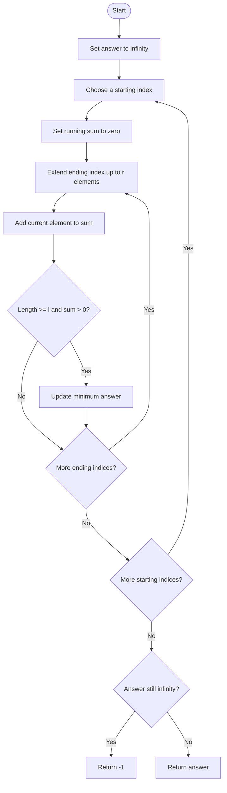
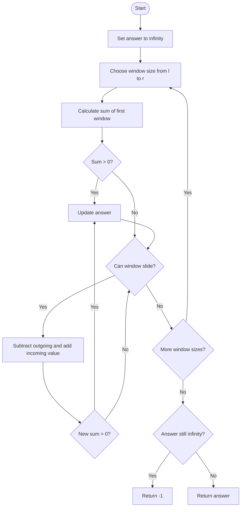

## 👨‍💻 Profiles

**GitHub:** https://github.com/Shailendra0320  
**LeetCode (Main):** https://leetcode.com/u/Shailu03/  
**LeetCode (Alternate):** https://leetcode.com/u/ShailendraLeetcode03/

# LeetCode 3364 – Minimum Positive Sum Subarray | Brute Force + Sliding Window

## Table of Contents

- [Problem Statement](#problem-statement)
- [Examples](#examples)
- [Constraints](#constraints)
- [Understanding the Problem](#understanding-the-problem)
- [Core Observation](#core-observation)
- [Approach 1 – Brute Force with Running Sum](#approach-1--brute-force-with-running-sum)
- [Approach 2 – Fixed-Size Sliding Window](#approach-2--fixed-size-sliding-window)
- [Approach Comparison](#approach-comparison)
- [Correctness Proof](#correctness-proof)
- [Edge Cases](#edge-cases)
- [Common Mistakes](#common-mistakes)
- [Interview Explanation](#interview-explanation)
- [Quick Revision](#quick-revision)

---

## Problem Statement

You are given an integer array `nums` and two integers `l` and `r`.

Find the **minimum positive sum** among all contiguous subarrays whose length is between `l` and `r`, inclusive.

A valid subarray must satisfy both conditions:

1. Its length is in the range `[l, r]`.
2. Its sum is strictly greater than `0`.

Return the smallest sum that satisfies these conditions. If no valid positive sum exists, return `-1`.

A subarray is a contiguous, non-empty part of an array. We cannot skip elements or rearrange them.

## Examples

### Example 1

```text
Input:  nums = [3, -2, 1, 4], l = 2, r = 3
Output: 1
```

Valid positive subarrays include:

| Subarray | Length | Sum |
|---|---:|---:|
| `[3, -2]` | 2 | 1 |
| `[1, 4]` | 2 | 5 |
| `[3, -2, 1]` | 3 | 2 |
| `[-2, 1, 4]` | 3 | 3 |

The smallest positive sum is `1`, from `[3, -2]`.

### Example 2

```text
Input:  nums = [-2, 2, -3, 1], l = 2, r = 3
Output: -1
```

Every subarray with a permitted length has a sum less than or equal to zero. Therefore, no qualifying subarray exists.

### Example 3

```text
Input:  nums = [1, 2, 3, 4], l = 2, r = 4
Output: 3
```

The subarray `[1, 2]` has length `2` and sum `3`. It is the smallest positive sum among all permitted subarrays.

## Constraints

- `1 <= nums.length <= 100`
- `1 <= l <= r <= nums.length`
- `-1000 <= nums[i] <= 1000`

These constraints are small. An `O(n²)` solution is fully suitable, and a fixed-size sliding window makes repeated sum calculations cheaper.

---

## Understanding the Problem

We are not looking for the shortest subarray or the largest sum. We need the **smallest sum that is still positive**, while the length must remain between `l` and `r`.

For example:

```text
nums = [3, -2, 1, 4]
l = 2, r = 3
```

Possible subarray lengths are only `2` and `3`:

```text
Length 2: [3, -2]  -> 1
          [-2, 1]  -> -1
          [1, 4]   -> 5

Length 3: [3, -2, 1] -> 2
          [-2, 1, 4] -> 3
```

Ignore zero and negative sums. Among the positive sums `1, 5, 2, 3`, the minimum is `1`.

### What does “positive” mean?

A positive sum must be greater than zero:

- `5` is valid.
- `1` is valid.
- `0` is invalid.
- `-2` is invalid.

If every permitted subarray has a non-positive sum, return `-1`.

## Core Observation

The sum of a subarray can be computed by adding its elements. Because `n` is at most `100`, we can examine all allowed lengths or all starting positions directly.

The important improvement is to avoid recalculating a whole window after it moves by one position.

For a fixed window length `size`:

```text
Old window: [a, b, c]
New window:    [b, c, d]
```

The new sum is:

```text
newSum = oldSum - a + d
```

Only one value leaves and one value enters. This is the fixed-size sliding-window idea used in Approach 2.

---

## Approach 1 – Brute Force with Running Sum

### Intuition

Choose every possible starting index. From that start, extend the subarray one element at a time and maintain its running sum.

Once the current length reaches `l`, the subarray length is valid. If its sum is positive, compare it with the current minimum answer.

We do not need to store the subarray itself. We only need its running sum and its current length.

### Algorithm

1. Initialize `answer` to a very large value.
2. Iterate over every possible starting index `start`.
3. Set `sum = 0`.
4. Extend the ending index from `start` up to at most `start + r - 1`.
5. Add the new element to `sum`.
6. When the length is at least `l`, check whether `sum > 0`.
7. If it is positive, update the minimum answer.
8. If no positive sum was found, return `-1`.

### Flowchart



### Dry Run

Input:

```text
nums = [3, -2, 1, 4]
l = 2, r = 3
```

Start at index `0`:

| End index | Current subarray | Length | Running sum | Action |
|---:|---|---:|---:|---|
| 0 | `[3]` | 1 | 3 | Length too small |
| 1 | `[3, -2]` | 2 | 1 | Positive; answer = 1 |
| 2 | `[3, -2, 1]` | 3 | 2 | Positive; answer stays 1 |

Start at index `1`:

| End index | Current subarray | Length | Running sum | Action |
|---:|---|---:|---:|---|
| 1 | `[-2]` | 1 | -2 | Length too small |
| 2 | `[-2, 1]` | 2 | -1 | Not positive |
| 3 | `[-2, 1, 4]` | 3 | 3 | Positive; answer stays 1 |

Start at index `2`:

| End index | Current subarray | Length | Running sum | Action |
|---:|---|---:|---:|---|
| 2 | `[1]` | 1 | 1 | Length too small |
| 3 | `[1, 4]` | 2 | 5 | Positive; answer stays 1 |

The minimum positive sum found is `1`.

### Why This Approach Works

Every subarray has exactly one starting index and one ending index. By selecting each start and extending the end through all permitted lengths, we inspect every subarray whose length is in `[l, r]`.

We update the answer only when a candidate has a valid length and a strictly positive sum. Therefore, the smallest value retained is exactly the required answer.

### Complexity Analysis

Let `n` be the length of `nums`.

- **Time Complexity:** `O(n * r)`, which is `O(n²)` in the worst case. For each starting index, we extend through at most `r` elements.
- **Space Complexity:** `O(1)`. Only a few variables are used; no additional array is created.

### Java Code – Approach 1

```java
//Approach-1 (Brute Force: Running Sum from Every Starting Index)
//T.C: O(n * r) - O(n^2) in the worst case
//S.C: O(1)

import java.util.*;

class Solution {
    public int minimumSumSubarray(List<Integer> nums, int l, int r) {
        int n = nums.size();
        int answer = Integer.MAX_VALUE;

        for (int start = 0; start < n; start++) {
            int sum = 0;
            int limit = Math.min(n, start + r);

            for (int end = start; end < limit; end++) {
                sum += nums.get(end);
                int length = end - start + 1;

                if (length >= l && sum > 0) {
                    answer = Math.min(answer, sum);
                }
            }
        }

        return answer == Integer.MAX_VALUE ? -1 : answer;
    }
}
```

### C++ Code – Approach 1

```cpp
//Approach-1 (Brute Force: Running Sum from Every Starting Index)
//T.C: O(n * r) - O(n^2) in the worst case
//S.C: O(1)

#include <bits/stdc++.h>
using namespace std;

class Solution {
public:
    int minimumSumSubarray(vector<int>& nums, int l, int r) {
        int n = nums.size();
        int answer = INT_MAX;

        for (int start = 0; start < n; start++) {
            int sum = 0;
            int limit = min(n, start + r);

            for (int end = start; end < limit; end++) {
                sum += nums[end];
                int length = end - start + 1;

                if (length >= l && sum > 0) {
                    answer = min(answer, sum);
                }
            }
        }

        return answer == INT_MAX ? -1 : answer;
    }
};
```

### Python Code – Approach 1

```python
#Approach-1 (Brute Force: Running Sum from Every Starting Index)
#T.C: O(n * r) - O(n^2) in the worst case
#S.C: O(1)

from typing import List

class Solution:
    def minimumSumSubarray(self, nums: List[int], l: int, r: int) -> int:
        n = len(nums)
        answer = float('inf')

        for start in range(n):
            current_sum = 0
            limit = min(n, start + r)

            for end in range(start, limit):
                current_sum += nums[end]
                length = end - start + 1

                if length >= l and current_sum > 0:
                    answer = min(answer, current_sum)

        return -1 if answer == float('inf') else answer
```

---

## Approach 2 – Fixed-Size Sliding Window

### Intuition

Instead of extending every start through different lengths, fix one allowed window length at a time.

For each `size` from `l` through `r`:

1. Calculate the sum of the first window of that size.
2. Check whether it is positive.
3. Slide the window one position to the right.
4. Subtract the element that leaves and add the element that enters.
5. Keep the smallest positive sum found across all window sizes.

This is useful because when a fixed-size window moves, most of its elements remain the same.

### Sliding Window Formula

If the current window covers indices `[right - size, right - 1]`, the next window adds `nums[right]` and removes `nums[right - size]`.

```text
nextSum = currentSum - nums[right - size] + nums[right]
```

### Flowchart



### Dry Run

Input:

```text
nums = [3, -2, 1, 4]
l = 2, r = 3
```

**Window size = 2**

Initial window:

```text
[3, -2] -> sum = 1
```

Slide once:

```text
newSum = 1 - 3 + 1 = -1
window = [-2, 1]
```

Slide again:

```text
newSum = -1 - (-2) + 4 = 5
window = [1, 4]
```

Positive sums for length `2`: `1` and `5`. Current answer = `1`.

**Window size = 3**

Initial window:

```text
[3, -2, 1] -> sum = 2
```

Slide once:

```text
newSum = 2 - 3 + 4 = 3
window = [-2, 1, 4]
```

Positive sums for length `3`: `2` and `3`. The answer remains `1`.

Final answer:

```text
1
```

### Why This Approach Works

For any fixed length, the first window is calculated directly. Every later window of that same length is obtained by removing exactly the outgoing element and adding exactly the incoming element. Thus, every contiguous subarray of that length is checked exactly once.

The outer loop covers every allowed length from `l` through `r`. We therefore examine every valid subarray and keep the smallest sum that is strictly positive.

### Complexity Analysis

Let `n` be the array length.

- **Time Complexity:** `O(n * (r - l + 1))`. For each allowed window size, we calculate the initial sum and slide through the array. In the worst case, this is `O(n²)`.
- **Space Complexity:** `O(1)`. The window sum and answer are the only extra variables.

### Java Code – Approach 2

```java
//Approach-2 (Fixed-Size Sliding Window)
//T.C: O(n * (r - l + 1)) - O(n^2) in the worst case
//S.C: O(1)

import java.util.*;

class Solution2 {
    public int minimumSumSubarray(List<Integer> nums, int l, int r) {
        int n = nums.size();
        int answer = Integer.MAX_VALUE;

        for (int size = l; size <= r; size++) {
            int sum = 0;

            for (int i = 0; i < size; i++) {
                sum += nums.get(i);
            }

            if (sum > 0) {
                answer = Math.min(answer, sum);
            }

            for (int right = size; right < n; right++) {
                sum += nums.get(right) - nums.get(right - size);

                if (sum > 0) {
                    answer = Math.min(answer, sum);
                }
            }
        }

        return answer == Integer.MAX_VALUE ? -1 : answer;
    }
}
```

### C++ Code – Approach 2

```cpp
//Approach-2 (Fixed-Size Sliding Window)
//T.C: O(n * (r - l + 1)) - O(n^2) in the worst case
//S.C: O(1)

#include <bits/stdc++.h>
using namespace std;

class Solution2 {
public:
    int minimumSumSubarray(vector<int>& nums, int l, int r) {
        int n = nums.size();
        int answer = INT_MAX;

        for (int size = l; size <= r; size++) {
            int sum = 0;

            for (int i = 0; i < size; i++) {
                sum += nums[i];
            }

            if (sum > 0) {
                answer = min(answer, sum);
            }

            for (int right = size; right < n; right++) {
                sum += nums[right] - nums[right - size];

                if (sum > 0) {
                    answer = min(answer, sum);
                }
            }
        }

        return answer == INT_MAX ? -1 : answer;
    }
};
```

### Python Code – Approach 2

```python
#Approach-2 (Fixed-Size Sliding Window)
#T.C: O(n * (r - l + 1)) - O(n^2) in the worst case
#S.C: O(1)

from typing import List

class Solution2:
    def minimumSumSubarray(self, nums: List[int], l: int, r: int) -> int:
        n = len(nums)
        answer = float('inf')

        for size in range(l, r + 1):
            current_sum = sum(nums[:size])

            if current_sum > 0:
                answer = min(answer, current_sum)

            for right in range(size, n):
                current_sum += nums[right] - nums[right - size]

                if current_sum > 0:
                    answer = min(answer, current_sum)

        return -1 if answer == float('inf') else answer
```

---

## Approach Comparison

| Feature | Approach 1: Running Sum | Approach 2: Fixed-Size Sliding Window |
|---|---|---|
| Main idea | Extend every starting position | Process one permitted length at a time |
| Time complexity | `O(n * r)` | `O(n * (r - l + 1))` |
| Worst-case time | `O(n²)` | `O(n²)` |
| Extra space | `O(1)` | `O(1)` |
| Strength | Very direct and easy to reason about | Avoids recalculating each window sum |
| Best use | General enumeration | When the allowed length range is narrow |

Both are fully suitable for the official constraints (`n <= 100`). Approach 2 is usually the cleaner choice when explaining the sliding-window pattern.

## Correctness Proof

### Approach 1

Every possible start index is considered. For each start, the ending index advances through all lengths up to `r`, and a candidate is evaluated whenever its length is at least `l`. Therefore, every subarray whose length is in `[l, r]` is considered. Since the algorithm updates the answer only for positive sums and always keeps the minimum such sum, it returns the required result. If no candidate is positive, the sentinel remains unchanged and the algorithm returns `-1`.

### Approach 2

The outer loop considers every valid length. For a fixed length, the algorithm first evaluates the leftmost window and then slides across all remaining positions. The update removes the element leaving the window and adds the element entering it, so each computed sum is exactly the sum of the corresponding window. Thus every allowed subarray is examined. The minimum positive sum is returned, or `-1` when none exists.

## Edge Cases

| Case | Example | Expected result | Reason |
|---|---|---:|---|
| Single element allowed | `nums = [5], l = 1, r = 1` | 5 | The only subarray is positive |
| Only negative values | `nums = [-4, -2], l = 1, r = 2` | -1 | No positive sum exists |
| Only zero values | `nums = [0, 0], l = 1, r = 2` | -1 | Zero is not positive |
| Exact lower and upper length | `nums = [2, -1], l = 2, r = 2` | 1 | Only length 2 is allowed |
| Best answer is one | `nums = [3, -2], l = 2, r = 2` | 1 | Smallest possible positive integer sum |
| Negative values mixed with positives | `nums = [5, -4, 2], l = 2, r = 3` | 1 | `[5, -4]` has sum 1 |
| Entire array only | `nums = [1, 2, -1], l = 3, r = 3` | 2 | Only the whole array is permitted |

## Common Mistakes

1. **Accepting a zero sum.** The problem requires `sum > 0`, not `sum >= 0`.
2. **Ignoring the allowed length.** A positive subarray shorter than `l` or longer than `r` is invalid.
3. **Returning zero when no answer exists.** The required result is `-1` if no positive sum is found.
4. **Forgetting contiguity.** A subarray must contain consecutive elements in their original order.
5. **Recalculating every fixed window from scratch.** In Approach 2, use the outgoing/incoming update instead.
6. **Using an incorrect Java parameter type.** The LeetCode Java signature uses `List<Integer> nums`, not `int[] nums`.
7. **Starting the sliding loop at the wrong index.** For a window of length `size`, the first new incoming index is `size` and the outgoing index is `0`.

## Interview Explanation

“I need the smallest sum greater than zero among all contiguous subarrays whose lengths are between `l` and `r`. Since the array length is at most 100, I can enumerate all allowed subarrays in quadratic time. One solution fixes a start index and extends the end while maintaining a running sum. Another solution fixes each allowed window length and uses a sliding window: after computing the first window sum, each next sum is obtained by subtracting the outgoing value and adding the incoming value. I update the answer only for strictly positive sums and return `-1` if no such sum exists. Both approaches use constant extra space.”

## Quick Revision

- Need the **minimum sum greater than zero**.
- Subarray length must satisfy `l <= length <= r`.
- A subarray must be contiguous.
- Approach 1: enumerate starts and extend a running sum.
- Approach 2: fix each length and slide the window.
- Update the answer only when `sum > 0`.
- Return `-1` if the answer was never updated.
- `n <= 100`, so both `O(n²)` approaches are acceptable.

## Final Recommendation

Use **Approach 2 – Fixed-Size Sliding Window** as the primary solution when discussing the pattern. It clearly demonstrates how to reuse the previous window sum and avoids recalculating each window from scratch. Approach 1 is an excellent baseline and is the most direct way to prove that all permitted subarrays are checked.

---

**Problem:** [LeetCode 3364 – Minimum Positive Sum Subarray](https://leetcode.com/problems/minimum-positive-sum-subarray/)  
**Topics:** Array, Sliding Window, Enumeration
