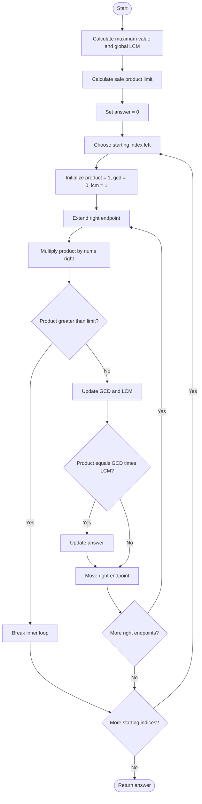
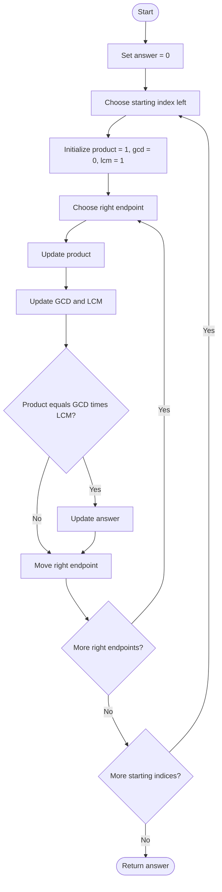

# 3411. Maximum Subarray With Equal Products

<p align="center">
  <a href="https://github.com/Shailendra0320">
    
  </a>
  <a href="https://leetcode.com/u/Shailu03/">
    
  </a>
  <a href="https://leetcode.com/u/ShailendraLeetcode03/">
    
  </a>
  <a href="https://shailendra0320.github.io/shailendra-portfolio/">
    
  </a>
</p>

[](https://leetcode.com/problems/maximum-subarray-with-equal-products/)
[](https://leetcode.com/problems/maximum-subarray-with-equal-products/)

> **Best Title:** 3411. Maximum Subarray With Equal Products — Subarray Enumeration, GCD, LCM and Mathematical Optimization

## Tags

`Array` · `Math` · `Number Theory` · `Enumeration` · `Subarray` · `Sliding Window` · `GCD` · `LCM`
---

## Table of Contents

1. [Problem Statement](#1-problem-statement)
2. [Examples](#2-examples)
3. [Constraints](#3-constraints)
4. [Understanding the Problem](#4-understanding-the-problem)
5. [Mathematical Foundation](#5-mathematical-foundation)
6. [Key Observations](#6-key-observations)
7. [Approach 1 — Incremental Enumeration With Safe Pruning](#7-approach-1--incremental-enumeration-with-safe-pruning)
8. [Approach 1 — Java, C++ and Python](#8-approach-1--java-c-and-python)
9. [Approach 2 — Incremental Enumeration Without Pruning](#9-approach-2--incremental-enumeration-without-pruning)
10. [Approach 2 — Java, C++ and Python](#10-approach-2--java-c-and-python)
11. [Dry Run](#11-dry-run)
12. [Correctness Proof](#12-correctness-proof)
13. [Complexity Analysis](#13-complexity-analysis)
14. [Approach Comparison](#14-approach-comparison)
15. [Edge Cases](#15-edge-cases)
16. [Common Mistakes](#16-common-mistakes)
17. [Interview Explanation](#17-interview-explanation)
18. [Quick Revision](#18-quick-revision)

---

# 1. Problem Statement

You are given an array of positive integers `nums`.

An array `arr` is called **product equivalent** if:

\[
\operatorname{prod}(arr)=\operatorname{lcm}(arr)\times\operatorname{gcd}(arr)
\]

Where:

- `prod(arr)` is the product of all elements.
- `gcd(arr)` is the greatest common divisor of all elements.
- `lcm(arr)` is the least common multiple of all elements.

Return the **length of the longest product equivalent subarray** of `nums`.

A subarray must be contiguous. We only need its maximum length, not the actual subarray.

**Problem:** [LeetCode 3411 — Maximum Subarray With Equal Products](https://leetcode.com/problems/maximum-subarray-with-equal-products/)

---

# 2. Examples

## Example 1

**Input:**
```text
nums = [1,2,1,2,1,1,1]
```

**Output:**
```text
5
```

**Explanation:**

One longest valid subarray is `[1,2,1,1,1]`.

```text
Product = 1 × 2 × 1 × 1 × 1 = 2
GCD     = 1
LCM     = 2
```

Therefore, `2 = 1 × 2`, and the subarray length is `5`.

## Example 2

**Input:**
```text
nums = [2,3,4,5,6]
```

**Output:**
```text
3
```

**Explanation:**

The subarray `[3,4,5]` has:

```text
Product = 3 × 4 × 5 = 60
GCD     = 1
LCM     = 60
```

Therefore, `60 = 1 × 60`. Its length is `3`.

## Example 3

**Input:**
```text
nums = [1,2,3,1,4,5,1]
```

**Output:**
```text
5
```

**Explanation:**

One longest valid subarray is `[3,1,4,5,1]`.

```text
Product = 3 × 1 × 4 × 5 × 1 = 60
GCD     = 1
LCM     = 60
```

Therefore, `60 = 1 × 60`. Its length is `5`.

---

# 3. Constraints

```text
2 <= nums.length <= 100
1 <= nums[i] <= 10
```

### Why do these constraints matter?

- There are at most `100` elements.
- Each value is a small positive integer.
- Enumerating all subarrays in \(O(n^2)\) is efficient.
- Product, GCD and LCM can be updated incrementally.
- The product can grow quickly, so fixed-width integer overflow must be considered.

---

# 4. Understanding the Problem

We need to examine contiguous subarrays and check:

\[
\boxed{Product=GCD\times LCM}
\]

Consider:

```text
[2, 3, 4]
```

```text
Product = 2 × 3 × 4 = 24
GCD     = 1
LCM     = 12
```

The check is `24 == 1 × 12`, which is false.

Now consider:

```text
[3, 4, 5]
```

```text
Product = 3 × 4 × 5 = 60
GCD     = 1
LCM     = 60
```

The check is `60 == 1 × 60`, which is true.

We are not maximizing the product, GCD or LCM. We are maximizing the length of a contiguous subarray that satisfies the equality.

---

# 5. Mathematical Foundation

## 5.1 Product

The product is the multiplication of every element.

For `[2,3,5]`:

\[
Product=2\times3\times5=30
\]

## 5.2 GCD — Greatest Common Divisor

GCD is the largest positive integer that divides every element.

For `[12,18,24]`:

```text
GCD = 6
```

When a new value `x` is appended:

\[
newGCD=\gcd(oldGCD,x)
\]

We initialize the running GCD to `0`, because:

\[
\gcd(0,x)=x
\]

## 5.3 LCM — Least Common Multiple

LCM is the smallest positive integer divisible by every element.

For `[4,6]`:

```text
LCM = 12
```

For two positive integers:

\[
\operatorname{lcm}(a,b)=\frac{a}{\gcd(a,b)}\times b
\]

When appending `x`:

\[
newLCM=\operatorname{lcm}(oldLCM,x)
\]

We initialize the running LCM to `1`.

## 5.4 Product-equivalent condition

For the current subarray:

\[
\boxed{Product=GCD\times LCM}
\]

If true:

\[
answer=\max(answer,\ right-left+1)
\]

---

# 6. Key Observations

## Observation 1 — Every subarray is defined by two indices

A subarray is identified by its starting index `left` and ending index `right`.

The number of non-empty subarrays is:

\[
\frac{n(n+1)}{2}
\]

Therefore, checking all subarrays is \(O(n^2)\).

## Observation 2 — Maintain values incrementally

For a fixed `left`, extend `right` one position at a time.

```text
product *= nums[right]
g = gcd(g, nums[right])
l = lcm(l, nums[right])
```

This avoids recalculating the properties from scratch for each subarray.

## Observation 3 — Product never decreases

All values are positive integers, so:

\[
newProduct=oldProduct\times nums[right]
\]

The product either remains unchanged (when the new value is `1`) or increases.

This allows safe early termination.

## Observation 4 — A safe upper bound exists

For every subarray:

\[
GCD(subarray)\leq\max(nums)
\]

Also, the LCM of a subarray divides the LCM of the entire array:

\[
LCM(subarray)\leq LCM(nums)
\]

Thus:

\[
GCD(subarray)\times LCM(subarray)
\leq \max(nums)\times LCM(nums)
\]

Define:

\[
\boxed{limit=\max(nums)\times LCM(nums)}
\]

If `product > limit`, the equality is impossible for the current subarray and every longer extension from the same starting index.

## Observation 5 — Prevent product overflow

- Approach 1 uses the safe upper bound and breaks before the product can grow excessively.
- Approach 2 uses arbitrary-precision arithmetic: Java `BigInteger`, C++ `cpp_int`, and Python's built-in integers.

---

# 7. Approach 1 — Incremental Enumeration With Safe Pruning

<badge color="success">Recommended</badge>

## Intuition

Enumerate each starting index and extend the subarray to the right.

Maintain three values:

```text
product
g
l
```

Before enumeration, calculate:

\[
limit=\max(nums)\times LCM(nums)
\]

No subarray can have `GCD × LCM` greater than this limit. Therefore, if the running product exceeds the limit, stop extending that starting index.

## Algorithm

1. Find the maximum value in `nums`.
2. Calculate the LCM of the entire array.
3. Compute `limit = maximum × globalLCM`.
4. Initialize `answer = 0`.
5. Iterate through every starting index `left`.
6. Initialize `product = 1`, `g = 0`, and `l = 1`.
7. Extend `right` from `left` to the end.
8. Multiply `product` by the newly included element.
9. If `product > limit`, break the inner loop.
10. Update GCD and LCM.
11. If `product == g × l`, update the answer.
12. Return the answer.

## Flowchart



## Pseudocode

```text
maxLength(nums):

    maximum = maximum element in nums
    globalLCM = LCM of all elements
    limit = maximum * globalLCM

    answer = 0

    for left from 0 to n - 1:
        product = 1
        g = 0
        l = 1

        for right from left to n - 1:
            product *= nums[right]

            if product > limit:
                break

            g = gcd(g, nums[right])
            l = lcm(l, nums[right])

            if product == g * l:
                answer = max(answer, right - left + 1)

    return answer
```

## Complexity

- **Time:** \(O(n^2)\) worst case. There are \(O(n^2)\) extensions, with GCD/LCM operations on small bounded integers.
- **Space:** \(O(1)\) auxiliary space.

---

# 8. Approach 1 — Java, C++ and Python

## Java

```java
//Approach-1 (Incremental Enumeration + Safe Pruning)
//T.C: O(n^2)
//S.C: O(1)

class Solution {
    public int maxLength(int[] nums) {
        int n = nums.length;

        int maxValue = 0;
        int globalLCM = 1;

        for (int x : nums) {
            maxValue = Math.max(maxValue, x);
            globalLCM = lcm(globalLCM, x);
        }

        int limit = maxValue * globalLCM;
        int ans = 0;

        for (int i = 0; i < n; i++) {
            int product = 1;
            int g = 0;
            int l = 1;

            for (int j = i; j < n; j++) {
                product *= nums[j];

                if (product > limit) {
                    break;
                }

                g = gcd(g, nums[j]);
                l = lcm(l, nums[j]);

                if (product == g * l) {
                    ans = Math.max(ans, j - i + 1);
                }
            }
        }

        return ans;
    }

    private int gcd(int a, int b) {
        while (b != 0) {
            int temp = b;
            b = a % b;
            a = temp;
        }
        return a;
    }

    private int lcm(int a, int b) {
        return a / gcd(a, b) * b;
    }
}
```

## C++

```cpp
//Approach-1 (Incremental Enumeration + Safe Pruning)
//T.C: O(n^2)
//S.C: O(1)

class Solution {
public:
    int maxLength(vector<int>& nums) {
        int n = nums.size();

        int maxValue = 0;
        int globalLCM = 1;

        for (int x : nums) {
            maxValue = max(maxValue, x);
            globalLCM = lcm(globalLCM, x);
        }

        long long limit = 1LL * maxValue * globalLCM;
        int ans = 0;

        for (int i = 0; i < n; i++) {
            long long product = 1;
            int g = 0;
            int l = 1;

            for (int j = i; j < n; j++) {
                product *= nums[j];

                if (product > limit) {
                    break;
                }

                g = gcd(g, nums[j]);
                l = lcm(l, nums[j]);

                if (product == 1LL * g * l) {
                    ans = max(ans, j - i + 1);
                }
            }
        }

        return ans;
    }
};
```

## Python

```python
#Approach-1 (Incremental Enumeration + Safe Pruning)
#T.C: O(n^2)
#S.C: O(1)

from math import gcd, lcm
from typing import List

class Solution:
    def maxLength(self, nums: List[int]) -> int:
        n = len(nums)

        max_value = max(nums)
        global_lcm = lcm(*nums)
        limit = max_value * global_lcm

        ans = 0

        for i in range(n):
            product = 1
            g = 0
            l = 1

            for j in range(i, n):
                product *= nums[j]

                if product > limit:
                    break

                g = gcd(g, nums[j])
                l = lcm(l, nums[j])

                if product == g * l:
                    ans = max(ans, j - i + 1)

        return ans
```

---

# 9. Approach 2 — Incremental Enumeration Without Pruning

## Intuition

This approach uses the same incremental enumeration but does not calculate a global product limit or stop early.

For every starting index:

1. Initialize `product = 1`.
2. Initialize `g = 0`.
3. Initialize `l = 1`.
4. Extend the right endpoint through the remaining array.
5. Update product, GCD and LCM.
6. Check the product-equivalent condition.
7. Update the maximum length when valid.

The product can exceed the range of fixed-width integer types. Therefore, this approach uses arbitrary-precision arithmetic.

- Java: `BigInteger`
- C++: `boost::multiprecision::cpp_int`
- Python: built-in `int`

## Algorithm

1. Initialize `answer = 0`.
2. Iterate over every starting index.
3. Initialize product, GCD and LCM.
4. Extend the right endpoint to the end of the array.
5. Update the product using arbitrary-precision multiplication.
6. Update GCD and LCM incrementally.
7. Check whether `product == g × l`.
8. Update the answer if the condition is satisfied.
9. Return the answer.

## Flowchart



## Pseudocode

```text
maxLength(nums):

    answer = 0

    for left from 0 to n - 1:
        product = 1
        g = 0
        l = 1

        for right from left to n - 1:
            product *= nums[right]
            g = gcd(g, nums[right])
            l = lcm(l, nums[right])

            if product == g * l:
                answer = max(answer, right - left + 1)

    return answer
```

## Complexity

- **Time:** \(O(n^2)\) arithmetic updates. The bit cost of arbitrary-precision multiplication depends on the number of digits in the product.
- **Space:** \(O(n)\) bits for the growing product in the worst case, plus a fixed number of variables.

---

# 10. Approach 2 — Java, C++ and Python

## Java

```java
//Approach-2 (Incremental Enumeration Without Pruning)
//T.C: O(n^2) arithmetic updates
//S.C: O(n) bits for BigInteger

import java.math.BigInteger;

class Solution {
    public int maxLength(int[] nums) {
        int n = nums.length;
        int ans = 0;

        for (int i = 0; i < n; i++) {
            BigInteger product = BigInteger.ONE;
            int g = 0;
            int l = 1;

            for (int j = i; j < n; j++) {
                product = product.multiply(BigInteger.valueOf(nums[j]));

                g = gcd(g, nums[j]);
                l = lcm(l, nums[j]);

                BigInteger target = BigInteger.valueOf((long) g * l);

                if (product.equals(target)) {
                    ans = Math.max(ans, j - i + 1);
                }
            }
        }

        return ans;
    }

    private int gcd(int a, int b) {
        while (b != 0) {
            int temp = b;
            b = a % b;
            a = temp;
        }
        return a;
    }

    private int lcm(int a, int b) {
        return a / gcd(a, b) * b;
    }
}
```

## C++

```cpp
//Approach-2 (Incremental Enumeration Without Pruning)
//T.C: O(n^2) arithmetic updates
//S.C: O(n) bits for cpp_int

#include <bits/stdc++.h>
#include <boost/multiprecision/cpp_int.hpp>
using namespace std;
using boost::multiprecision::cpp_int;

class Solution {
public:
    int maxLength(vector<int>& nums) {
        int n = nums.size();
        int ans = 0;

        for (int i = 0; i < n; i++) {
            cpp_int product = 1;
            int g = 0;
            int l = 1;

            for (int j = i; j < n; j++) {
                product *= nums[j];

                g = gcd(g, nums[j]);
                l = lcm(l, nums[j]);

                long long target = 1LL * g * l;

                if (product == target) {
                    ans = max(ans, j - i + 1);
                }
            }
        }

        return ans;
    }
};
```

## Python

```python
#Approach-2 (Incremental Enumeration Without Pruning)
#T.C: O(n^2) arithmetic updates
#S.C: O(n) bits for the growing integer

from math import gcd, lcm
from typing import List

class Solution:
    def maxLength(self, nums: List[int]) -> int:
        n = len(nums)
        ans = 0

        for i in range(n):
            product = 1
            g = 0
            l = 1

            for j in range(i, n):
                product *= nums[j]

                g = gcd(g, nums[j])
                l = lcm(l, nums[j])

                if product == g * l:
                    ans = max(ans, j - i + 1)

        return ans
```

---

# 11. Dry Run

Consider:

```text
nums = [2, 3, 4, 5, 6]
```

We need:

\[
Product=GCD\times LCM
\]

## Starting index 0

Initialize:

```text
product = 1
g = 0
l = 1
```

| Right | Added | Product | GCD | LCM | GCD × LCM | Valid? |
|---:|---:|---:|---:|---:|---:|---|
| 0 | 2 | 2 | 2 | 2 | 4 | No |
| 1 | 3 | 6 | 1 | 6 | 6 | Yes |
| 2 | 4 | 24 | 1 | 12 | 12 | No |
| 3 | 5 | 120 | 1 | 60 | 60 | No |
| 4 | 6 | 720 | 1 | 60 | 60 | No |

The valid subarray `[2,3]` has length `2`.

## Starting index 1

Reset:

```text
product = 1
g = 0
l = 1
```

| Right | Added | Product | GCD | LCM | GCD × LCM | Valid? |
|---:|---:|---:|---:|---:|---:|---|
| 1 | 3 | 3 | 3 | 3 | 9 | No |
| 2 | 4 | 12 | 1 | 12 | 12 | Yes |
| 3 | 5 | 60 | 1 | 60 | 60 | Yes |
| 4 | 6 | 360 | 1 | 60 | 60 | No |

The subarray `[3,4,5]` has length `3`.

```text
answer = 3
```

## Starting index 2

| Right | Added | Product | GCD | LCM | GCD × LCM | Valid? |
|---:|---:|---:|---:|---:|---:|---|
| 2 | 4 | 4 | 4 | 4 | 16 | No |
| 3 | 5 | 20 | 1 | 20 | 20 | Yes |
| 4 | 6 | 120 | 1 | 60 | 60 | No |

Best length: `2`.

## Starting index 3

| Right | Added | Product | GCD | LCM | GCD × LCM | Valid? |
|---:|---:|---:|---:|---:|---:|---|
| 3 | 5 | 5 | 5 | 5 | 25 | No |
| 4 | 6 | 30 | 1 | 30 | 30 | Yes |

Best length: `2`.

## Starting index 4

For `[6]`:

```text
Product = 6
GCD = 6
LCM = 6
GCD × LCM = 36
```

It is not valid.

## Final Result

The longest valid subarray is:

```text
[3, 4, 5]
```

Its length is:

```text
Output = 3
```

---

# 12. Correctness Proof

## Approach 1 — Incremental Enumeration With Safe Pruning

### Lemma 1 — Running values are correct

For a fixed starting index, the initial values are:

```text
product = 1
g = 0
l = 1
```

Whenever `nums[right]` is appended, the algorithm updates the product, GCD and LCM using their mathematical definitions.

Therefore, after each extension, the maintained values exactly represent the current subarray.

### Lemma 2 — The pruning condition is safe

Let:

\[
limit=\max(nums)\times LCM(nums)
\]

For any subarray:

\[
GCD(subarray)\leq\max(nums)
\]

and:

\[
LCM(subarray)\leq LCM(nums)
\]

Thus:

\[
GCD(subarray)\times LCM(subarray)\leq limit
\]

If the product exceeds `limit`, it cannot equal `GCD × LCM`.

Since all elements are positive, extending the subarray cannot decrease its product. Therefore, every longer extension from that starting index is also invalid.

### Theorem

For each starting index, the algorithm checks every ending index that could possibly produce a valid subarray. The maintained values are correct by Lemma 1, and skipped extensions are invalid by Lemma 2.

Every valid subarray is therefore considered. The algorithm updates the answer with the length of every valid subarray it finds, so it returns the maximum valid length.

## Approach 2 — Incremental Enumeration Without Pruning

For each starting index, the algorithm visits every possible ending index. The running product, GCD and LCM are updated according to their definitions. Arbitrary-precision arithmetic preserves the exact product.

Thus every contiguous subarray is checked exactly once. Whenever the equality holds, its length is considered for the answer. Therefore, the maximum valid length is returned.

---

# 13. Complexity Analysis

## Approach 1

| Operation | Complexity |
|---|---:|
| Find maximum value | \(O(n)\) |
| Calculate global LCM | \(O(n)\) GCD/LCM updates |
| Enumerate subarrays | \(O(n^2)\) |
| Auxiliary space | \(O(1)\) |

**Time Complexity:**

\[
\boxed{O(n^2)}
\]

**Space Complexity:**

\[
\boxed{O(1)}
\]

Pruning may reduce iterations in practice, but the worst-case time remains \(O(n^2)\).

## Approach 2

| Operation | Complexity |
|---|---:|
| Enumerate subarrays | \(O(n^2)\) |
| Arithmetic updates | \(O(n^2)\) |
| Growing arbitrary-precision product | Up to \(O(n)\) bits |
| Auxiliary space | \(O(n)\) bits for product |

The \(O(n^2)\) time count refers to arithmetic updates. Strict bit complexity of arbitrary-precision multiplication depends on the product's size.

---

# 14. Approach Comparison

| Feature | Approach 1 | Approach 2 |
|---|---|---|
| Strategy | Incremental enumeration + pruning | Incremental enumeration |
| Early break | Yes | No |
| Product representation | Bounded fixed-width integer | Arbitrary precision |
| Worst-case time | \(O(n^2)\) | \(O(n^2)\) arithmetic updates |
| Auxiliary space | \(O(1)\) | \(O(n)\) bits for product |
| Overflow handling | Safe mathematical bound | BigInteger / cpp_int / Python int |
| Recommendation | Best for submission | Useful reference implementation |

## Which approach is better?

**Approach 1 is recommended.**

It uses the problem constraints and a mathematically justified upper bound to avoid unnecessary work. It also maintains constant auxiliary space.

Approach 2 is a direct reference implementation without pruning, but needs arbitrary-precision arithmetic in Java and C++.

---

# 15. Edge Cases

| Test Case | Expected Output | Explanation |
|---|---:|---|
| `[1,1]` | `2` | Product, GCD and LCM are all `1` |
| `[2,2]` | `2` | Product = 4, GCD × LCM = 2 × 2 = 4 |
| `[2,3]` | `2` | Product and LCM are `6`, GCD is `1` |
| `[3,4,5]` | `3` | Entire array is valid |
| `[1,1,1,1]` | `4` | Every subarray is valid |
| `[10,10,10]` | `2` | Any adjacent pair `[10,10]` is valid; the triple is not |
| `[2,6,3]` | `2` | A valid subarray of length two exists |
| `[1,2,1,2,1,1,1]` | `5` | Official example 1 |
| `[2,3,4,5,6]` | `3` | Official example 2 |
| `[1,2,3,1,4,5,1]` | `5` | Official example 3 |

## Case 1 — All ones

```text
nums = [1,1,1,1]

Product = 1
GCD = 1
LCM = 1

1 == 1 × 1
```

Answer: `4`.

## Case 2 — Repeated values

```text
nums = [10,10,10]
```

For a pair `[10,10]`:

```text
Product = 100
GCD = 10
LCM = 10
GCD × LCM = 100
```

The pair is valid. The triple has product `1000`, while GCD × LCM remains `100`.

Answer: `2`.

## Case 3 — Pairwise coprime values

```text
nums = [2,3,5,7]
```

For the entire array:

```text
Product = 210
GCD = 1
LCM = 210
```

The equality holds.

Answer: `4`.

---

# 16. Common Mistakes

## Mistake 1 — Recomputing all values from scratch

Scanning the complete subarray for every pair of endpoints can lead to \(O(n^3)\) time.

**Fix:** Update product, GCD and LCM incrementally.

## Mistake 2 — Incorrect GCD initialization

Do not initialize the running GCD to `1`.

```java
int g = 0;
```

Because:

\[
gcd(0,x)=x
\]

## Mistake 3 — Incorrect LCM initialization

Initialize LCM to `1`.

```java
int l = 1;
```

## Mistake 4 — Unsafe LCM formula

Prefer:

```text
a / gcd(a, b) * b
```

instead of multiplying first, to reduce intermediate overflow risk.

## Mistake 5 — Using an unproven pruning condition

The safe bound is:

\[
Product>\max(nums)\times LCM(nums)
\]

Do not break based on an arbitrary comparison with the current GCD or LCM.

## Mistake 6 — Ignoring product overflow

The product can become extremely large.

- Approach 1 uses a proven bound before the product grows too far.
- Approach 2 uses arbitrary-precision integer types.

## Mistake 7 — Confusing subarray with subsequence

A subarray must be contiguous. Do not skip elements.

---

# 17. Interview Explanation

> I enumerate all possible starting positions and extend each subarray to the right. Instead of recomputing product, GCD and LCM for every subarray, I maintain them incrementally whenever a new element is added.
>
> After each extension, I check whether the product equals the GCD multiplied by the LCM. If it does, I update the maximum length.
>
> For optimization, I calculate an upper bound for `GCD × LCM`: the maximum array value multiplied by the LCM of the entire array. Since the product never decreases, once it exceeds this bound, no further extension from that starting index can be valid, so I break early.
>
> The worst-case time complexity is \(O(n^2)\), and the auxiliary space complexity is \(O(1)\).

## Important Interview Questions

**Q1. Why use two nested loops?**

Every contiguous subarray is represented by a starting and ending index.

**Q2. Why can GCD be updated incrementally?**

\[
gcd(a_1,\ldots,a_k,x)=gcd(gcd(a_1,\ldots,a_k),x)
\]

**Q3. Why can LCM be updated incrementally?**

\[
lcm(a_1,\ldots,a_k,x)=lcm(lcm(a_1,\ldots,a_k),x)
\]

**Q4. Why is pruning safe?**

Every subarray's GCD is at most the maximum input value, and its LCM is at most the LCM of the entire input.

**Q5. Why does the product never decrease?**

Every element is positive and at least `1`.

**Q6. Why is Approach 1 constant space?**

It uses a fixed number of variables and no data structure proportional to `n`.

**Q7. Why does Approach 2 need BigInteger in Java?**

The product of up to 100 values, each as large as 10, can exceed the range of `long`.

---

# 18. Quick Revision

## Core Formula

\[
\boxed{Product=GCD\times LCM}
\]

## Incremental Updates

```text
product *= nums[right]
g = gcd(g, nums[right])
l = lcm(l, nums[right])
```

## LCM Formula

\[
\boxed{LCM(a,b)=\frac{a}{GCD(a,b)}\times b}
\]

## Safe Pruning Bound

\[
\boxed{limit=\max(nums)\times LCM(nums)}
\]

Break when:

```text
product > limit
```

## Final Complexity

| Approach | Time | Space |
|---|---|---|
| Incremental Enumeration + Safe Pruning | \(O(n^2)\) | \(O(1)\) |
| Incremental Enumeration Without Pruning | \(O(n^2)\) arithmetic updates | \(O(n)\) bits for product |

## Final Recommendation

Use **Approach 1 — Incremental Enumeration With Safe Pruning** for the LeetCode submission.

It is efficient, uses a proven mathematical bound, handles product growth safely under the given constraints, and requires constant auxiliary space.

---

## References

- [LeetCode 3411 — Maximum Subarray With Equal Products](https://leetcode.com/problems/maximum-subarray-with-equal-products/)
- [Doocs — LeetCode 3411 Explanation](https://github.com/doocs/leetcode/tree/main/solution/3400-3499/3411.Maximum%20Subarray%20With%20Equal%20Products)
- [WalkCCC — LeetCode 3411 Solution](https://walkccc.me/LeetCode/problems/3411/)
- [Euclidean Algorithm](https://en.wikipedia.org/wiki/Euclidean_algorithm)
- [Least Common Multiple](https://en.wikipedia.org/wiki/Least_common_multiple)
