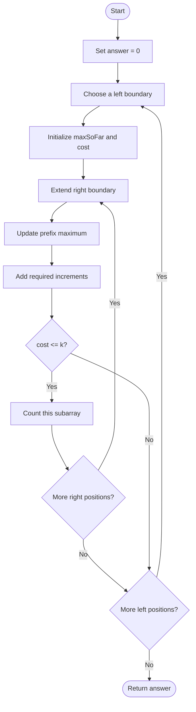
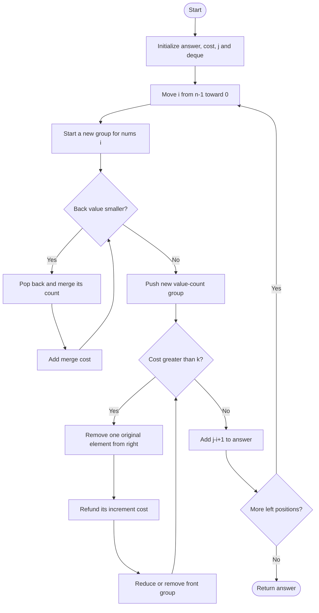

## 👨‍💻 Profiles

**GitHub:** https://github.com/Shailendra0320  
**LeetCode (Main):** https://leetcode.com/u/Shailu03/  
**LeetCode (Alternate):** https://leetcode.com/u/ShailendraLeetcode03/

# LeetCode 3420 – Count Non-Decreasing Subarrays After K Operations

> A complete guide to understanding the minimum operation cost, sliding window, and monotonic deque optimization.

- **Difficulty:** Hard
- **Primary pattern:** Sliding Window + Monotonic Deque
- **Also related to:** Array, Monotonic Stack, Queue, Prefix Maximum
- **Recommended approach:** Sliding Window + Monotonic Deque
- **Optimal complexity:** `O(n)` time and `O(n)` extra space

---

## 📚 Table of Contents

1. [Problem Statement](#-problem-statement)
2. [Examples](#-examples)
3. [Constraints](#-constraints)
4. [Understanding the Problem](#-understanding-the-problem)
5. [The Minimum Operations Formula](#-the-minimum-operations-formula)
6. [Why Brute Force Is Too Slow](#-why-brute-force-is-too-slow)
7. [Approach 1 – Brute Force](#-approach-1--brute-force)
8. [Approach 2 – Sliding Window + Monotonic Deque Using Value-Count Pairs](#-approach-2--sliding-window--monotonic-deque-using-value-count-pairs)
9. [Approach 3 – Sliding Window + Monotonic Deque Using Indices](#-approach-3--sliding-window--monotonic-deque-using-indices)
10. [Dry Run of the Optimized Approach](#-dry-run-of-the-optimized-approach)
11. [Correctness Proof](#-correctness-proof)
12. [Complexity Comparison](#-complexity-comparison)
13. [Important Edge Cases](#-important-edge-cases)
14. [Common Mistakes](#-common-mistakes)
15. [Interview Explanation](#-interview-explanation)
16. [Quick Revision](#-quick-revision)
17. [Practice Checklist](#-practice-checklist)

---

## 📌 Problem Statement

You are given an integer array `nums` of length `n` and an integer `k`.

For every possible subarray, you are allowed to perform at most `k` operations. In one operation, you can increase any one element of that subarray by `1`.

Each subarray is considered independently. Changes made while processing one subarray do not affect any other subarray.

Return the **number of subarrays that can be made non-decreasing using at most `k` operations**.

An array is non-decreasing when every element is greater than or equal to the element immediately before it.

In other words, for a subarray `a`, the final array must satisfy:

\[
a_0 \le a_1 \le a_2 \le \dots \le a_{m-1}
\]

### What does one operation mean?

One operation increases exactly one selected element by `1`.

For example, changing `[6, 3, 1]` into `[6, 6, 6]` requires:

- Increase `3` three times.
- Increase `1` five times.
- Total operations: `3 + 5 = 8`.

We are not allowed to decrease an element. We only increase values.

---

## 🧪 Examples

### Example 1

```text
Input:  nums = [6, 3, 1, 2, 4, 4], k = 7
Output: 17
```

There are `6 * 7 / 2 = 21` total subarrays.

Only these four subarrays need more than `7` operations:

```text
[6, 3, 1]
[6, 3, 1, 2]
[6, 3, 1, 2, 4]
[6, 3, 1, 2, 4, 4]
```

Therefore:

\[
21 - 4 = \boxed{17}
\]

### Example 2

```text
Input:  nums = [6, 3, 1, 3, 6], k = 4
Output: 12
```

There are `15` total subarrays. The subarrays that cannot be made non-decreasing within `4` operations are:

```text
[6, 3, 1]
[6, 3, 1, 3]
[6, 3, 1, 3, 6]
```

Therefore:

\[
15 - 3 = \boxed{12}
\]

### Example 3 – Already non-decreasing

```text
Input:  nums = [1, 2, 2, 5], k = 1
Output: 10
```

The array is already non-decreasing, so every one of its `4 * 5 / 2 = 10` subarrays is valid.

---

## 📏 Constraints

| Parameter | Constraint |
|---|---:|
| `nums.length` | `1 <= n <= 100,000` |
| `nums[i]` | `1 <= nums[i] <= 1,000,000,000` |
| `k` | `1 <= k <= 1,000,000,000` |

### What do these constraints tell us?

1. `n` can be as large as `100,000`, so an `O(n²)` algorithm is too slow in the worst case.
2. The operation cost can be much larger than a 32-bit integer, so we need 64-bit arithmetic.
3. The answer can be as large as the number of all subarrays:

\[
\frac{n(n+1)}{2}
\]

For `n = 100,000`, this is `5,000,050,000`, which does not fit in a signed 32-bit integer.

Use:

- Java: `long`
- C++: `long long`
- Python: normal `int` (arbitrary precision)

---

## 🧠 Understanding the Problem

The main question is not simply whether the current subarray is sorted.

We need to calculate the **minimum number of increments** required to make that subarray non-decreasing.

Consider:

```text
[6, 3, 1, 2, 4]
```

We cannot reduce the first value `6`. Every later value must be at least the value immediately before it. Therefore, the cheapest final sequence is:

```text
Original: [6, 3, 1, 2, 4]
Final:    [6, 6, 6, 6, 6]
```

The cost is:

```text
6 - 6 = 0
6 - 3 = 3
6 - 1 = 5
6 - 2 = 4
6 - 4 = 2
-----------
Total    = 14
```

So this subarray requires `14` operations.

### A second example

```text
Original: [2, 5, 3, 7]
Final:    [2, 5, 5, 7]
```

Only the third value must be increased:

\[
(5-3)=2
\]

The minimum cost is `2`.

### Important observation

When we move from left to right inside a fixed subarray, each value must be at least the maximum value seen so far.

That means the target value at position `i` is the **prefix maximum** of the subarray ending at `i`.

---

## 🧮 The Minimum Operations Formula

For a subarray `nums[l...r]`, define:

\[
maxSoFar_i = \max(nums[l], nums[l+1], \dots, nums[i])
\]

The minimum final value at position `i` is `maxSoFar_i`.

Therefore, the minimum number of increments is:

\[
\boxed{cost(l,r)=\sum_{i=l}^{r}(maxSoFar_i-nums[i])}
\]

### Why is this the minimum?

At each position, the final value cannot be smaller than the previous final value. Since we are not allowed to decrease values, the smallest possible value at the current position is the maximum of:

- The current original value.
- The previous final value.

This is exactly the running prefix maximum.

Any other valid final array would use values that are equal to or greater than these minimum values, so it could never require fewer operations.

### Cost for a fixed left boundary

For a fixed `l`, extend the right boundary one element at a time.

Maintain `maxSoFar` and `cost`:

```text
maxSoFar = max(maxSoFar, nums[r])
cost += maxSoFar - nums[r]
```

The cost never decreases when we extend the subarray to the right. This property allows the brute-force loop to stop as soon as the cost exceeds `k`.

---

## 🚫 Why Brute Force Is Too Slow

The array contains:

\[
\frac{n(n+1)}{2}
\]

possible subarrays.

At `n = 100,000`, there are more than five billion subarrays.

Checking every subarray individually is not practical.

We need to avoid recalculating the prefix-maximum structure from scratch. The optimized approach uses:

- A sliding window to maintain a valid range.
- A monotonic deque to store groups of equal adjusted values.
- A running operation cost to update the window efficiently.

---

## 1️⃣ Approach 1 – Brute Force

### Idea

Fix the left boundary and expand the right boundary.

For each new element:

1. Update the maximum value seen so far.
2. The current element must be raised to that maximum if it is smaller.
3. Add the required increment to the total cost.
4. If the cost is at most `k`, count this subarray.
5. If the cost becomes greater than `k`, stop extending this left boundary.

The cost cannot decrease as the right boundary moves forward, so once it exceeds `k`, every longer subarray with the same left boundary is also invalid.

### Algorithm

```text
answer = 0

for left from 0 to n - 1:
    maxSoFar = nums[left]
    cost = 0

    for right from left to n - 1:
        maxSoFar = max(maxSoFar, nums[right])
        cost += maxSoFar - nums[right]

        if cost > k:
            break

        answer++

return answer
```

### Flowchart



### Dry Run

Consider:

```text
nums = [3, 1, 2]
k = 3
```

Fix `left = 0`:

| Subarray | Prefix maximums | Cost | Valid? |
|---|---|---:|---|
| `[3]` | `[3]` | 0 | Yes |
| `[3, 1]` | `[3, 3]` | 2 | Yes |
| `[3, 1, 2]` | `[3, 3, 3]` | 3 | Yes |

Fix `left = 1`:

| Subarray | Prefix maximums | Cost | Valid? |
|---|---|---:|---|
| `[1]` | `[1]` | 0 | Yes |
| `[1, 2]` | `[1, 2]` | 0 | Yes |

Fix `left = 2`:

| Subarray | Prefix maximums | Cost | Valid? |
|---|---|---:|---|
| `[2]` | `[2]` | 0 | Yes |

All six subarrays are valid, so the answer is `6`.

### Java Code

```java
// Approach-1 (Brute Force: Expand Every Starting Position)
// T.C: O(n^2)
// S.C: O(1)

class Solution {
    public long countNonDecreasingSubarrays(int[] nums, int k) {
        int n = nums.length;
        long answer = 0;

        for (int left = 0; left < n; left++) {
            long maxSoFar = nums[left];
            long cost = 0;

            for (int right = left; right < n; right++) {
                maxSoFar = Math.max(maxSoFar, nums[right]);
                cost += maxSoFar - nums[right];

                if (cost > k) {
                    break;
                }

                answer++;
            }
        }

        return answer;
    }
}
```

### C++ Code

```cpp
#include <bits/stdc++.h>
using namespace std;

// Approach-1 (Brute Force: Expand Every Starting Position)
// T.C: O(n^2)
// S.C: O(1)

class Solution {
public:
    long long countNonDecreasingSubarrays(vector<int>& nums, int k) {
        int n = nums.size();
        long long answer = 0;

        for (int left = 0; left < n; left++) {
            long long maxSoFar = nums[left];
            long long cost = 0;

            for (int right = left; right < n; right++) {
                maxSoFar = max(maxSoFar, (long long)nums[right]);
                cost += maxSoFar - nums[right];

                if (cost > k) {
                    break;
                }

                answer++;
            }
        }

        return answer;
    }
};
```

### Python Code

```python
# Approach-1 (Brute Force: Expand Every Starting Position)
# T.C: O(n^2)
# S.C: O(1)

from typing import List

class Solution:
    def countNonDecreasingSubarrays(self, nums: List[int], k: int) -> int:
        n = len(nums)
        answer = 0

        for left in range(n):
            max_so_far = nums[left]
            cost = 0

            for right in range(left, n):
                max_so_far = max(max_so_far, nums[right])
                cost += max_so_far - nums[right]

                if cost > k:
                    break

                answer += 1

        return answer
```

### Complexity Analysis

- **Time:** `O(n²)` in the worst case because every pair of boundaries may be visited.
- **Space:** `O(1)` because only a few variables are used.

This solution is useful for understanding the cost formula and for testing optimized implementations. It is not suitable for the maximum constraint.

---

## 2️⃣ Approach 2 – Sliding Window + Monotonic Deque Using Value-Count Pairs

<mark>Recommended optimized approach</mark>

### Main idea

Instead of fixing the left boundary and moving right, process the array **from right to left**.

Maintain a window:

\[
[i, j]
\]

where:

- `i` is the current left boundary.
- `j` is the farthest right boundary that keeps the operation cost at most `k`.

For the current `i`, all subarrays that start at `i` and end at or before `j` are valid.

Therefore, the number of valid subarrays starting at `i` is:

\[
j-i+1
\]

Add this number to the answer.

### Why move from right to left?

When a new element is inserted at the left side, it may become the largest value for a suffix of the current window.

For example:

```text
Existing adjusted values: [4, 4, 2, 1]
New value at the left:      3

After raising smaller values:
                           [4, 4, 3, 3]
```

The values `2` and `1` must be raised to `3`.

The extra cost is:

\[
(3-2)+(3-1)=3
\]

We need a data structure that can merge these smaller values efficiently.

### What does the deque store?

The deque stores pairs:

```text
(value, count)
```

Each pair represents a consecutive group of original elements that currently need to have the same adjusted value.

The values in the deque are maintained in **non-increasing order** from front to back.

Example:

```text
Deque: [(4, 2), (3, 3), (1, 1)]
```

This means:

- Two elements are represented at adjusted value `4`.
- Three elements are represented at adjusted value `3`.
- One element is represented at adjusted value `1`.

The deque is a compact representation of the prefix-maximum-adjusted window, not a copy of the original array.

### Step 1 – Insert the new value

When processing `nums[i]`, start with:

```text
count = 1
```

While the back value is smaller than the new value:

1. Remove that pair from the back.
2. Add its count to the new group.
3. Increase the operation cost by:

\[
(newValue-oldValue)\times count
\]

4. Continue until the back value is greater than or equal to the new value.

Finally, insert `(newValue, count)` at the back.

### Step 2 – Shrink the window if necessary

If `cost > k`, the current window is invalid.

Remove one original element from the right side, at index `j`.

The front pair gives the adjusted value for that rightmost group. If its adjusted value is `v`, removing `nums[j]` reduces the operation cost by:

\[
v-nums[j]
\]

Then decrement `j`.

If the front pair represented more than one element, insert the remaining group back at the front with its count reduced by one.

Repeat until:

\[
cost \le k
\]

### Step 3 – Count valid subarrays

After shrinking, `[i...j]` is the longest valid subarray that starts at `i`.

Every shorter subarray ending between `i` and `j` is also valid, so add:

\[
\boxed{j-i+1}
\]

to the answer.

### Algorithm

```text
answer = 0
cost = 0
j = n - 1
create an empty deque of (value, count)

for i from n - 1 down to 0:
    value = nums[i]
    count = 1

    while deque is not empty and deque.back.value < value:
        remove (oldValue, oldCount) from back
        count += oldCount
        cost += (value - oldValue) * oldCount

    push (value, count) to back

    while cost > k:
        remove (rightValue, rightCount) from front
        cost -= rightValue - nums[j]
        j--

        if rightCount > 1:
            push (rightValue, rightCount - 1) to front

    answer += j - i + 1

return answer
```

### Flowchart



### Detailed dry run – Example 1

```text
nums = [6, 3, 1, 2, 4, 4]
k = 7
```

We begin at the right end. `j` initially points to index `5`.

| New left index `i` | New value | Merge cost added | Cost after shrinking | Final `j` | Valid starts counted |
|---:|---:|---:|---:|---:|---:|
| 5 | 4 | 0 | 0 | 5 | 1 |
| 4 | 4 | 0 | 0 | 5 | 2 |
| 3 | 2 | 0 | 0 | 5 | 3 |
| 2 | 1 | 0 | 0 | 5 | 4 |
| 1 | 3 | 3 | 3 | 5 | 5 |
| 0 | 6 | 13 | 3 | 1 | 2 |

The contribution for each left index is:

```text
1 + 2 + 3 + 4 + 5 + 2 = 17
```

So the answer is:

\[
\boxed{17}
\]

#### Zoom in on the final iteration (`i = 0`)

Before inserting `6`, the deque represents the window `[3, 1, 2, 4, 4]` from right to left:

```text
[(4, 1), (4, 1), (3, 3)]
```

The current cost is `3`.

Insert `6`:

- Merge `(3, 3)`: add `(6 - 3) * 3 = 9`.
- Merge `(4, 1)`: add `(6 - 4) * 1 = 2`.
- Merge the other `(4, 1)`: add another `2`.

New cost:

\[
3+9+2+2=16
\]

Since `16 > 7`, remove elements from the right:

| Removed index | Original value | Adjusted value | Cost refund | Remaining cost |
|---:|---:|---:|---:|---:|
| 5 | 4 | 6 | 2 | 14 |
| 4 | 4 | 6 | 2 | 12 |
| 3 | 2 | 6 | 4 | 8 |
| 2 | 1 | 6 | 5 | 3 |

Now `j = 1` and the window `[6, 3]` has cost `3`, which is valid.

The valid subarrays starting at index `0` are:

```text
[6]
[6, 3]
```

Contribution: `2`.

### Java Code

```java
// Approach-2 (Sliding Window + Monotonic Deque: Value-Count Pairs)
// T.C: O(n)
// S.C: O(n)

import java.util.ArrayDeque;
import java.util.Deque;

class Solution2 {
    public long countNonDecreasingSubarrays(int[] nums, int k) {
        long answer = 0;
        long cost = 0;
        int j = nums.length - 1;

        Deque<int[]> deque = new ArrayDeque<>();

        for (int i = nums.length - 1; i >= 0; i--) {
            int value = nums[i];
            int count = 1;

            while (!deque.isEmpty() && deque.peekLast()[0] < value) {
                int[] last = deque.pollLast();
                count += last[1];
                cost += (long) (value - last[0]) * last[1];
            }

            deque.offerLast(new int[]{value, count});

            while (cost > k) {
                int[] first = deque.pollFirst();
                int rightValue = first[0];
                int rightCount = first[1];

                cost -= rightValue - nums[j];
                j--;

                if (rightCount > 1) {
                    deque.offerFirst(new int[]{rightValue, rightCount - 1});
                }
            }

            answer += j - i + 1L;
        }

        return answer;
    }
}
```

### C++ Code

```cpp
#include <bits/stdc++.h>
using namespace std;

// Approach-2 (Sliding Window + Monotonic Deque: Value-Count Pairs)
// T.C: O(n)
// S.C: O(n)

class Solution2 {
public:
    long long countNonDecreasingSubarrays(vector<int>& nums, int k) {
        long long answer = 0;
        long long cost = 0;
        int j = (int)nums.size() - 1;

        deque<pair<int, int>> dq;

        for (int i = (int)nums.size() - 1; i >= 0; i--) {
            int value = nums[i];
            int count = 1;

            while (!dq.empty() && dq.back().first < value) {
                auto [oldValue, oldCount] = dq.back();
                dq.pop_back();

                count += oldCount;
                cost += 1LL * (value - oldValue) * oldCount;
            }

            dq.push_back({value, count});

            while (cost > k) {
                auto [rightValue, rightCount] = dq.front();
                dq.pop_front();

                cost -= (long long)rightValue - nums[j];
                --j;

                if (rightCount > 1) {
                    dq.push_front({rightValue, rightCount - 1});
                }
            }

            answer += j - i + 1LL;
        }

        return answer;
    }
};
```

### Python Code

```python
# Approach-2 (Sliding Window + Monotonic Deque: Value-Count Pairs)
# T.C: O(n)
# S.C: O(n)

from collections import deque
from typing import List

class Solution2:
    def countNonDecreasingSubarrays(self, nums: List[int], k: int) -> int:
        answer = 0
        cost = 0
        j = len(nums) - 1

        dq = deque()

        for i in range(len(nums) - 1, -1, -1):
            value = nums[i]
            count = 1

            while dq and dq[-1][0] < value:
                old_value, old_count = dq.pop()
                count += old_count
                cost += (value - old_value) * old_count

            dq.append((value, count))

            while cost > k:
                right_value, right_count = dq.popleft()

                cost -= right_value - nums[j]
                j -= 1

                if right_count > 1:
                    dq.appendleft((right_value, right_count - 1))

            answer += j - i + 1

        return answer
```

### Why does the pair deque remain efficient?

Every group is:

- Inserted once when its leftmost value is processed.
- Removed from the back at most once when a larger value merges it.
- Removed from the front as the right boundary shrinks.

A group can be split only by reducing its count when an original element is removed from the right. The total number of such removals is at most `n`.

Thus, the total number of deque operations over the entire algorithm is `O(n)`.

---

## 3️⃣ Approach 3 – Sliding Window + Monotonic Deque Using Indices

### Idea

Approach 2 stores groups as `(value, count)` pairs.

We can store only the indices of the important values instead. The original array gives us the values, and the distance between indices tells us how many elements belong to a raised segment.

The deque stores indices whose values are in non-increasing order from front to back.

### How an index represents a segment

Suppose the current right boundary is `j` and the deque is:

```text
[4, 2]
```

The index at the back is a boundary for a group of positions. When a new, larger value is inserted at the left, smaller boundary values are removed and their whole spans become raised to the new value.

If index `l` is removed and the next remaining boundary is `r`, the segment length is:

\[
r-l
\]

If there is no remaining boundary, the segment ends at `j`, so:

\[
r=j+1
\]

The cost to raise that segment from `nums[l]` to the new value `nums[i]` is:

\[
\boxed{(r-l)\times(nums[i]-nums[l])}
\]

### Insert the new index

For each `i` from right to left:

1. While the value at the back index is smaller than `nums[i]`, pop it.
2. Find the next boundary `r`.
3. Add the cost of raising the segment to `nums[i]`.
4. Push `i` into the deque.

### Remove from the right

If the cost exceeds `k`, remove the current rightmost original element at `j`.

Its contribution to the cost is:

\[
nums[dq.front]-nums[j]
\]

Subtract that amount and move `j` one position left.

If the front index equals `j`, remove it from the deque because that boundary is no longer in the window.

Continue until the cost is valid.

### Flowchart

```mermaid
flowchart TD
    A([Start]) --> B[Initialize deque, cost, answer and j]
    B --> C[Process i from right to left]
    C --> D{Back index value < nums i?}
    D -- Yes --> E[Pop index l]
    E --> F[Find next boundary r]
    F --> G[Add (r-l) times value difference]
    G --> D
    D -- No --> H[Push i]
    H --> I{Cost > k?}
    I -- Yes --> J[Refund contribution of nums j]
    J --> K[Remove front if it equals j]
    K --> L[Decrease j]
    L --> I
    I -- No --> M[Add j-i+1 to answer]
    M --> N{More positions?}
    N -- Yes --> C
    N -- No --> O([Return answer])
```

### Algorithm

```text
answer = 0
cost = 0
j = n - 1
create an empty deque of indices

for i from n - 1 down to 0:
    while deque is not empty and nums[deque.back] < nums[i]:
        l = remove deque.back
        r = deque.back if deque is not empty else j + 1
        cost += (r - l) * (nums[i] - nums[l])

    push i to deque.back

    while cost > k:
        cost -= nums[deque.front] - nums[j]

        if deque.front == j:
            remove deque.front

        j--

    answer += j - i + 1

return answer
```

### Java Code

```java
// Approach-3 (Sliding Window + Monotonic Deque: Store Indices)
// T.C: O(n)
// S.C: O(n)

import java.util.ArrayDeque;
import java.util.Deque;

class Solution3 {
    public long countNonDecreasingSubarrays(int[] nums, int k) {
        long answer = 0;
        long cost = 0;
        int j = nums.length - 1;

        Deque<Integer> deque = new ArrayDeque<>();

        for (int i = nums.length - 1; i >= 0; i--) {
            while (!deque.isEmpty() && nums[deque.peekLast()] < nums[i]) {
                int left = deque.pollLast();
                int right = deque.isEmpty() ? j + 1 : deque.peekLast();

                cost += (long) (right - left) * (nums[i] - nums[left]);
            }

            deque.offerLast(i);

            while (cost > k) {
                cost -= (long) nums[deque.peekFirst()] - nums[j];

                if (deque.peekFirst() == j) {
                    deque.pollFirst();
                }

                j--;
            }

            answer += j - i + 1L;
        }

        return answer;
    }
}
```

### C++ Code

```cpp
#include <bits/stdc++.h>
using namespace std;

// Approach-3 (Sliding Window + Monotonic Deque: Store Indices)
// T.C: O(n)
// S.C: O(n)

class Solution3 {
public:
    long long countNonDecreasingSubarrays(vector<int>& nums, int k) {
        long long answer = 0;
        long long cost = 0;
        int j = (int)nums.size() - 1;

        deque<int> dq;

        for (int i = (int)nums.size() - 1; i >= 0; i--) {
            while (!dq.empty() && nums[dq.back()] < nums[i]) {
                int left = dq.back();
                dq.pop_back();

                int right = dq.empty() ? j + 1 : dq.back();

                cost += 1LL * (right - left) * (nums[i] - nums[left]);
            }

            dq.push_back(i);

            while (cost > k) {
                cost -= (long long)nums[dq.front()] - nums[j];

                if (dq.front() == j) {
                    dq.pop_front();
                }

                --j;
            }

            answer += j - i + 1LL;
        }

        return answer;
    }
};
```

### Python Code

```python
# Approach-3 (Sliding Window + Monotonic Deque: Store Indices)
# T.C: O(n)
# S.C: O(n)

from collections import deque
from typing import List

class Solution3:
    def countNonDecreasingSubarrays(self, nums: List[int], k: int) -> int:
        answer = 0
        cost = 0
        j = len(nums) - 1

        dq = deque()

        for i in range(len(nums) - 1, -1, -1):
            while dq and nums[dq[-1]] < nums[i]:
                left = dq.pop()
                right = dq[-1] if dq else j + 1

                cost += (right - left) * (nums[i] - nums[left])

            dq.append(i)

            while cost > k:
                cost -= nums[dq[0]] - nums[j]

                if dq[0] == j:
                    dq.popleft()

                j -= 1

            answer += j - i + 1

        return answer
```

### Complexity Analysis

- **Time:** `O(n)` because every index is pushed once and popped at most once.
- **Space:** `O(n)` for the deque.

This implementation is mathematically equivalent to Approach 2. It stores segment boundaries rather than explicit value-count pairs.

---

## 🔍 Dry Run of the Optimized Approach

Use Example 2:

```text
nums = [6, 3, 1, 3, 6]
k = 4
```

The algorithm processes indices from `4` down to `0`.

| `i` | Inserted value | Cost before shrinking | Window right `j` after shrinking | Contribution |
|---:|---:|---:|---:|---:|
| 4 | 6 | 0 | 4 | 1 |
| 3 | 3 | 0 | 4 | 2 |
| 2 | 1 | 0 | 4 | 3 |
| 1 | 3 | 2 | 4 | 4 |
| 0 | 6 | 11 | 1 | 2 |

Total:

\[
1+2+3+4+2=\boxed{12}
\]

### Why does the last iteration add only 2?

When `6` is inserted at index `0`, it forces the following values `[3, 1, 3, 6]` to become `[6, 6, 6, 6]` relative to the first `6`.

The updated total cost for the current window is `11`, which exceeds `k = 4`.

The right boundary moves left: removing the final `6` refunds `0`, removing `3` refunds `3`, and removing `1` refunds `5`. The remaining window `[6, 3]` has cost `3`.

There are only two valid subarrays starting at index `0`:

```text
[6]
[6, 3]
```

---

## ✅ Correctness Proof

We need to show that the optimized algorithm counts every valid subarray exactly once and never counts an invalid subarray.

### 1. The prefix maximum gives the minimum cost

For any fixed subarray, every final element must be at least the previous final element and at least its original value.

Therefore, the smallest valid final value at each position is the maximum original value from the start of the subarray through that position.

The formula used by the algorithm is the minimum possible number of increments.

### 2. The deque maintains the cost correctly

The deque groups consecutive positions that share the same adjusted prefix-maximum value.

When a new larger value is added on the left, every smaller group that it dominates must be raised to that value. The algorithm adds exactly:

\[
(newValue-oldValue)\times groupSize
\]

When an element is removed from the right, the algorithm subtracts exactly the increment that had been applied to that element.

Thus, `cost` always equals the minimum operations required for the current window.

### 3. The right boundary is the farthest valid one

For a fixed left boundary, extending a subarray to the right cannot decrease the minimum operation cost.

The algorithm moves `j` left only while `cost > k`. When the loop stops, `[i...j]` is valid, and every longer subarray `[i...r]` with `r > j` is invalid.

Therefore, exactly `j - i + 1` subarrays starting at `i` are valid.

### 4. Every subarray is counted exactly once

Every non-empty subarray has one unique left boundary.

At iteration `i`, the algorithm counts all valid subarrays whose left boundary is `i`.

No subarray is counted during another iteration. Since all valid right boundaries for this `i` are counted, the total answer is correct.

---

## 📊 Complexity Comparison

Let `n` be the length of `nums`.

| Approach | Time Complexity | Extra Space | Suitable for `n = 100,000`? |
|---|---:|---:|---|
| Brute Force | `O(n²)` | `O(1)` | No |
| Value-Count Monotonic Deque | `O(n)` | `O(n)` | Yes |
| Index Monotonic Deque | `O(n)` | `O(n)` | Yes |

### Why are the optimized approaches linear?

Although there are nested `while` loops, they do not make the algorithm quadratic.

- Each new index is inserted into the deque once.
- Each deque entry is removed from the back at most once.
- Each original right-side element is removed from the window at most once.
- The two boundaries only move in one direction.

The total number of deque operations is therefore proportional to `n`.

---

## ⚠️ Important Edge Cases

### 1. Single element

```text
nums = [9]
k = 1
Output = 1
```

A single element is already non-decreasing.

### 2. Already non-decreasing array

```text
nums = [1, 2, 3, 4]
k = 1
Output = 10
```

Every subarray is valid.

### 3. Strictly decreasing array

```text
nums = [5, 4, 3, 2]
k = 1
```

Longer subarrays require progressively more increments. The sliding window shrinks as needed.

### 4. All values equal

```text
nums = [7, 7, 7, 7]
k = 1
Output = 10
```

No increments are needed.

### 5. Large values

```text
nums = [1000000000, 1, 1, 1]
k = 1000000000
```

The operation cost must be calculated using 64-bit arithmetic in Java and C++.

### 6. Large answer

For an array of length `100,000`, the number of all subarrays is `5,000,050,000`. The answer must not be stored in a 32-bit integer.

---

## ❌ Common Mistakes

1. **Counting only already non-decreasing subarrays.** The task allows incrementing elements, so a subarray may still be valid even if it is initially decreasing.
2. **Trying to decrease an element.** Only increments are allowed. The minimum final sequence is formed from prefix maximums.
3. **Using the current maximum for every element without grouping.** Recalculating the entire window makes the algorithm too slow.
4. **Shrinking the left side instead of maintaining the right boundary in this right-to-left sweep.** The algorithm adds a new left element and removes elements from the right when the budget is exceeded.
5. **Forgetting to refund the exact contribution of the removed element.** When the rightmost element is removed, subtract `adjustedValue - nums[j]`.
6. **Using `int` for the answer or total cost.** Both can exceed the 32-bit limit.
7. **Using `<=` instead of `<` in the merge condition without adjusting the group logic.** The provided implementations merge only strictly smaller values. Equal values can safely remain in separate groups.
8. **Adding `j - i` instead of `j - i + 1`.** The subarray `[i...i]` must also be counted.
9. **Recomputing the adjusted array after every insertion.** The monotonic deque is specifically used to avoid this repeated work.

---

## 🎤 Interview Explanation

You can explain the optimized solution in the following way:

> For a subarray to become non-decreasing using only increments, every element must be raised to at least the maximum value that appeared before it in that subarray. This gives us the minimum operation cost as the sum of each prefix maximum minus the original element.
>
> A brute-force solution can calculate this cost for every subarray, but it takes quadratic time. To optimize it, I process the array from right to left and maintain a sliding window `[i, j]` whose cost is at most `k`.
>
> I use a monotonic deque to represent groups of positions that share the same adjusted prefix-maximum value. When a new value is inserted on the left, smaller groups are merged into it and the required increment cost is added. If the cost exceeds `k`, I remove elements from the right and subtract their individual contributions until the window becomes valid again.
>
> For each left boundary `i`, the valid right boundaries are exactly from `i` to `j`, so I add `j - i + 1` to the answer. Every index enters and leaves the deque at most once, giving `O(n)` time and `O(n)` space.

---

## 📝 Quick Revision

| Concept | Remember |
|---|---|
| Minimum final value | Prefix maximum of the subarray |
| Cost formula | `sum(prefixMax[i] - nums[i])` |
| Direction | Right to left |
| Window | `[i, j]` |
| Deque stores | `(value, count)` pairs or indices |
| Deque order | Non-increasing values from front to back |
| Merge condition | Back value `< nums[i]` |
| Merge cost | `(nums[i] - oldValue) * oldCount` |
| Shrink condition | `cost > k` |
| Right removal refund | `adjustedRightValue - nums[j]` |
| Contribution | `j - i + 1` |
| Optimal time | `O(n)` |
| Extra space | `O(n)` |
| Return type | 64-bit integer |

### The one formula to remember

\[
\boxed{cost(l,r)=\sum_{i=l}^{r}(\max(nums[l...i])-nums[i])}
\]

### The one counting rule to remember

\[
\boxed{answer += j-i+1}
\]

---

## ✅ Practice Checklist

- [ ] I can explain why prefix maximums give the minimum number of operations.
- [ ] I can calculate the operation cost for a fixed subarray.
- [ ] I understand why the cost never decreases when extending a fixed-left subarray.
- [ ] I understand why the optimized sweep processes indices from right to left.
- [ ] I can explain what each monotonic deque group represents.
- [ ] I understand why smaller groups are merged when a new larger value arrives.
- [ ] I can explain how removing the rightmost element refunds its cost.
- [ ] I remember to add `j - i + 1` for each left boundary.
- [ ] I use 64-bit types for the answer and operation cost.

---

## 🔗 References

- [Official LeetCode Problem – 3420. Count Non-Decreasing Subarrays After K Operations](https://leetcode.com/problems/count-non-decreasing-subarrays-after-k-operations/)
- [LeetCode Wiki – Monotonic Deque Solutions](https://leetcode.doocs.org/en/lc/3420/)
- [WalkCCC – Value-Count and Index Deque Implementations](https://walkccc.me/LeetCode/problems/3420/)
