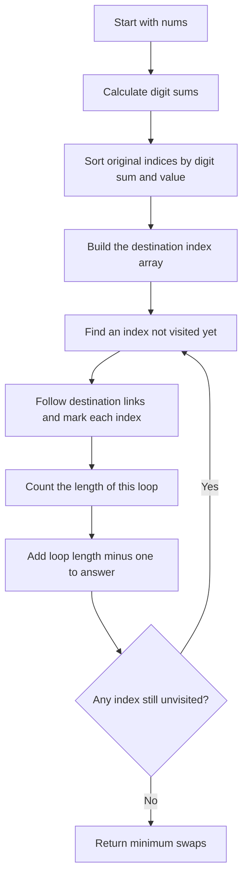
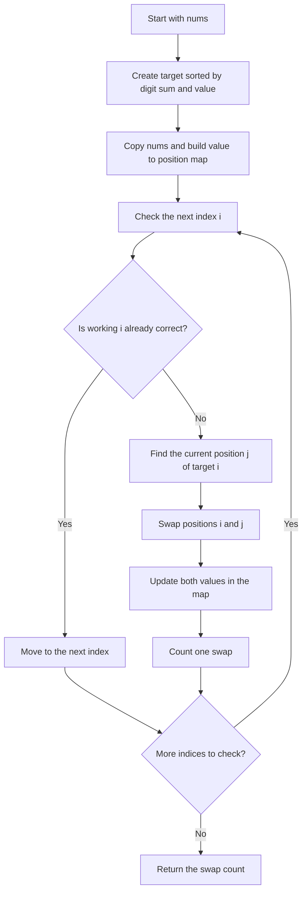

## 👨‍💻 Profiles

**GitHub:** https://github.com/Shailendra0320  
**LeetCode (Main):** https://leetcode.com/u/Shailu03/  
**LeetCode (Alternate):** https://leetcode.com/u/ShailendraLeetcode03/

# 3551. Minimum Swaps to Sort by Digit Sum

**Difficulty:** Medium  
**Topics:** Array, Hash Table, Sorting  
**Main patterns:** Custom sorting, permutation cycles, minimum swaps  
**Official problem:** [LeetCode 3551 — Minimum Swaps to Sort by Digit Sum](https://leetcode.com/problems/minimum-swaps-to-sort-by-digit-sum/)

---

## Table of Contents

- [1. Understand the Problem](#1-understand-the-problem)
- [2. Examples](#2-examples)
- [3. Important Observations](#3-important-observations)
- [4. The Main Idea](#4-the-main-idea)
- [5. Approach 1 — Find and Count Cycles](#5-approach-1--find-and-count-cycles)
- [6. Approach 2 — Put Each Value in Its Correct Position](#6-approach-2--put-each-value-in-its-correct-position)
- [7. Compare the Approaches](#7-compare-the-approaches)
- [8. Edge Cases](#8-edge-cases)
- [9. Common Mistakes](#9-common-mistakes)
- [10. Interview Explanation](#10-interview-explanation)
- [11. Quick Revision](#11-quick-revision)

---

## 1. Understand the Problem

You are given an array of **distinct positive integers**. You must sort the array using these rules:

1. A number with a smaller digit sum comes first.
2. If two numbers have the same digit sum, the smaller number comes first.

Return the **minimum number of swaps** needed to put the array in this order. One swap means exchanging the values at any two different positions.

### What is a digit sum?

Add all the decimal digits of a number.

| Number | Digit sum | Explanation |
|---:|---:|---|
| `37` | `10` | `3 + 7 = 10` |
| `100` | `1` | `1 + 0 + 0 = 1` |
| `43` | `7` | `4 + 3 = 7` |
| `34` | `7` | `3 + 4 = 7` |

Because `34` and `43` both have digit sum `7`, `34` must come first because it is smaller.

**The sorting rule is:** sort by `(digit sum, number)`.

### Constraints

- `1 <= nums.length <= 100000`
- `1 <= nums[i] <= 1000000000`
- Every number in `nums` is distinct.

The array can contain up to 100,000 values, so trying every possible swap sequence would be far too slow. We need to use sorting and track where each number belongs.

---

## 2. Examples

### Example 1

```text
Input:  nums = [37, 100]
Output: 1
```

| Number | Digit sum |
|---:|---:|
| `37` | `10` |
| `100` | `1` |

The required order is `[100, 37]`.

```text
Before: [37, 100]
After:  [100, 37]
```

Only one swap is needed, so the answer is `1`.

### Example 2

```text
Input:  nums = [22, 14, 33, 7]
Output: 0
```

The digit sums are `4, 5, 6, 7`, so the array is already sorted by the required rule. No swap is needed.

### Example 3

```text
Input:  nums = [18, 43, 34, 16]
Output: 2
```

| Number | Digit sum |
|---:|---:|
| `18` | `9` |
| `43` | `7` |
| `34` | `7` |
| `16` | `7` |

The required order is `[16, 34, 43, 18]`.

```text
Start:   [18, 43, 34, 16]
Swap 18 with 16:
         [16, 43, 34, 18]
Swap 43 with 34:
         [16, 34, 43, 18]
```

The answer is `2`.

---

## 3. Important Observations

- **We must use both sorting keys.** Sorting only by digit sum can give the wrong order when two values have the same digit sum.
- **All values are distinct.** This means a value can be used as a unique key in a map that stores its current or target position.
- **First find the final order.** Once we know exactly where every value belongs, counting swaps becomes a position-tracking problem.
- **A swap can exchange any two positions.** The values do not need to be adjacent, so we can fix a position directly instead of using bubble sort.

---

## 4. The Main Idea

First, build the target array by sorting the values with this key:

```text
(digitSum(value), value)
```

For example:

```text
Original: [18, 43, 34, 16]
Target:   [16, 34, 43, 18]
```

Now every value has one correct destination. The two approaches below use this information in different ways:

- **Approach 1:** Work out which original position each value must move to. These movements form loops called *cycles*. Count the cost of each cycle without performing the swaps.
- **Approach 2:** Walk from left to right. Whenever a position is wrong, find the value that belongs there and swap it directly into place.

Both methods find the same minimum number of swaps. Approach 1 is the classic mathematical solution; Approach 2 is often easier to follow when tracing actual swaps.

---

# 5. Approach 1 — Find and Count Cycles

**Time:** `O(n log n)`  
**Auxiliary space:** `O(n)`

### How this approach works

#### Step 1 — Calculate each digit sum

Calculate the digit sum of each value once and save it. This makes the sorting rule clear and avoids repeating the calculation unnecessarily.

#### Step 2 — Sort the original indices

Instead of sorting the input values themselves, sort their original indices. Compare two indices `a` and `b` using these rules:

1. Compare `digitSum(nums[a])` with `digitSum(nums[b])`.
2. If the digit sums are equal, compare `nums[a]` with `nums[b]`.

After sorting, each entry tells us which original position supplies a value for a target position.

#### Step 3 — Record each value's destination

Create an array called `targetIndex`.

```text
targetIndex[originalIndex] = targetIndex where that value belongs
```

For example, if the value currently at index `0` must go to index `3`, store `targetIndex[0] = 3`.

#### Step 4 — Follow the position loops

Start at an index that has not been visited. Follow its destination, then the next destination, and continue until the loop returns to a visited index. Mark every index you visit so the same loop is not counted twice.

A loop of length `L` needs exactly `L - 1` swaps. Add that number to the answer and then look for another unvisited index.

### Approach 1 flowchart



### Diagram: What does a cycle mean?

Suppose the position links look like this:

```text
Position 0 needs to go to position 3
Position 3 needs to go to position 0

Cycle: 0 -> 3 -> 0
Cycle length: 2
Swaps needed: 2 - 1 = 1
```

Another cycle might look like `1 -> 2 -> 1`. Those two cycles are separate, so we count each one independently.

### Dry run for Approach 1

Use this input:

```text
nums = [18, 43, 34, 16]
```

The target order is `[16, 34, 43, 18]`.

| Original index | Value at that index | Correct target index |
|---:|---:|---:|
| `0` | `18` | `3` |
| `1` | `43` | `2` |
| `2` | `34` | `1` |
| `3` | `16` | `0` |

The destination array is:

```text
targetIndex = [3, 2, 1, 0]
```

Now follow the links:

```text
Start at 0: 0 -> 3 -> 0
Cycle length = 2, add 1 swap

Next unvisited index is 1: 1 -> 2 -> 1
Cycle length = 2, add 1 swap

Total = 1 + 1 = 2 swaps
```

### Why Approach 1 gives the minimum

Imagine a loop containing `L` positions. Every value in that loop belongs somewhere else within the same loop. A swap can break the loop into smaller loops, but one swap can increase the number of separate loops by at most one. To turn one loop of length `L` into `L` single-position loops, we need at least `L - 1` swaps.

We can reach that number by repeatedly placing a value in its correct position. Therefore, the cost of a loop really is `L - 1`. Adding this cost for every loop gives the minimum total.

### Approach 1 code

#### Java

```java
//Approach-1 (Permutation Cycles after Sorting by Digit Sum)
//T.C : O(n log n)
//S.C : O(n)

import java.util.Arrays;

class Solution {
    private int digitSum(int value) {
        int sum = 0;
        while (value > 0) {
            sum += value % 10;
            value /= 10;
        }
        return sum;
    }

    public int minSwaps(int[] nums) {
        int n = nums.length;
        int[] digitSums = new int[n];
        Integer[] order = new Integer[n];

        for (int i = 0; i < n; i++) {
            digitSums[i] = digitSum(nums[i]);
            order[i] = i;
        }

        Arrays.sort(order, (a, b) -> {
            int compareSum = Integer.compare(digitSums[a], digitSums[b]);
            if (compareSum != 0) {
                return compareSum;
            }
            return Integer.compare(nums[a], nums[b]);
        });

        int[] targetIndex = new int[n];
        for (int target = 0; target < n; target++) {
            targetIndex[order[target]] = target;
        }

        boolean[] visited = new boolean[n];
        int swaps = 0;

        for (int start = 0; start < n; start++) {
            if (visited[start]) {
                continue;
            }

            int current = start;
            int cycleLength = 0;

            while (!visited[current]) {
                visited[current] = true;
                cycleLength++;
                current = targetIndex[current];
            }

            swaps += cycleLength - 1;
        }

        return swaps;
    }
}
```

#### C++

```cpp
//Approach-1 (Permutation Cycles after Sorting by Digit Sum)
//T.C : O(n log n)
//S.C : O(n)

#include <bits/stdc++.h>
using namespace std;

class Solution {
private:
    int digitSum(int value) {
        int sum = 0;
        while (value > 0) {
            sum += value % 10;
            value /= 10;
        }
        return sum;
    }

public:
    int minSwaps(vector<int>& nums) {
        int n = static_cast<int>(nums.size());
        vector<int> digitSums(n);
        vector<int> order(n);
        iota(order.begin(), order.end(), 0);

        for (int i = 0; i < n; i++) {
            digitSums[i] = digitSum(nums[i]);
        }

        sort(order.begin(), order.end(), [&](int a, int b) {
            if (digitSums[a] != digitSums[b]) {
                return digitSums[a] < digitSums[b];
            }
            return nums[a] < nums[b];
        });

        vector<int> targetIndex(n);
        for (int target = 0; target < n; target++) {
            targetIndex[order[target]] = target;
        }

        vector<bool> visited(n, false);
        int swaps = 0;

        for (int start = 0; start < n; start++) {
            if (visited[start]) {
                continue;
            }

            int current = start;
            int cycleLength = 0;

            while (!visited[current]) {
                visited[current] = true;
                cycleLength++;
                current = targetIndex[current];
            }

            swaps += cycleLength - 1;
        }

        return swaps;
    }
};
```

#### Python

```python
#Approach-1 (Permutation Cycles after Sorting by Digit Sum)
#T.C : O(n log n)
#S.C : O(n)

from typing import List

class Solution:
    def minSwaps(self, nums: List[int]) -> int:
        def digit_sum(value: int) -> int:
            total = 0
            while value > 0:
                total += value % 10
                value //= 10
            return total

        n = len(nums)
        order = sorted(
            range(n),
            key=lambda i: (digit_sum(nums[i]), nums[i])
        )

        target_index = [0] * n
        for target, original_index in enumerate(order):
            target_index[original_index] = target

        visited = [False] * n
        swaps = 0

        for start in range(n):
            if visited[start]:
                continue

            current = start
            cycle_length = 0

            while not visited[current]:
                visited[current] = True
                cycle_length += 1
                current = target_index[current]

            swaps += cycle_length - 1

        return swaps
```

---

# 6. Approach 2 — Put Each Value in Its Correct Position

**Time:** `O(n log n)`  
**Auxiliary space:** `O(n)`

This approach follows the actual swaps, so many people find it easier to understand at first. It fixes positions from left to right.

### How this approach works

#### Step 1 — Build the target array

Sort a copy of `nums` by `(digitSum(value), value)`. This is the exact array we need to reach.

#### Step 2 — Remember where each value is now

Make a map named `position`:

```text
position[value] = index where value currently appears
```

For example, if the working array is `[18, 43, 34, 16]`, then `position[34] = 2`.

#### Step 3 — Fix the array from left to right

At each index `i`:

- If `working[i]` already equals `target[i]`, move on.
- Otherwise, look up where `target[i]` currently is. Call that index `j`.
- Swap `working[i]` and `working[j]`.
- Update the map for both values because their positions have changed.
- Count one swap.

Since all values are distinct, the map always identifies the exact location of the value we need.

### Approach 2 flowchart



### Dry run for Approach 2

Input:

```text
nums = [18, 43, 34, 16]
target = [16, 34, 43, 18]
```

| Step | Working array | Action | Swaps so far |
|---:|---|---|---:|
| Start | `[18, 43, 34, 16]` | No changes yet | `0` |
| 1 | `[16, 43, 34, 18]` | Put `16` at index `0` by swapping with `18` | `1` |
| 2 | `[16, 34, 43, 18]` | Put `34` at index `1` by swapping with `43` | `2` |
| 3 | `[16, 34, 43, 18]` | `43` is already correct | `2` |
| 4 | `[16, 34, 43, 18]` | `18` is already correct | `2` |

The final array matches the target, and the algorithm used `2` swaps.

### Why Approach 2 gives the minimum

If the current value at index `i` is wrong, the value that belongs there must be moved from somewhere else. We bring that value straight to `i` with one swap instead of moving it through several intermediate positions.

This is the same process as resolving one cycle: each swap breaks a cycle into smaller parts and fixes at least the position we are working on. A cycle of length `L` takes `L - 1` swaps, so fixing each position this way reaches the minimum.

**Do not forget:** after a swap, update the position map for both values. Otherwise, the map will point to old locations and later swaps may be wrong.

### Approach 2 code

#### Java

```java
//Approach-2 (Greedy Correct-Position Swaps)
//T.C : O(n log n)
//S.C : O(n)

import java.util.Arrays;
import java.util.HashMap;
import java.util.Map;

class Solution2 {
    private int digitSum(int value) {
        int sum = 0;
        while (value > 0) {
            sum += value % 10;
            value /= 10;
        }
        return sum;
    }

    public int minSwaps(int[] nums) {
        int n = nums.length;
        Integer[] target = new Integer[n];

        for (int i = 0; i < n; i++) {
            target[i] = nums[i];
        }

        Arrays.sort(target, (a, b) -> {
            int compareSum = Integer.compare(digitSum(a), digitSum(b));
            if (compareSum != 0) {
                return compareSum;
            }
            return Integer.compare(a, b);
        });

        int[] working = nums.clone();
        Map<Integer, Integer> position = new HashMap<>();
        for (int i = 0; i < n; i++) {
            position.put(working[i], i);
        }

        int swaps = 0;

        for (int i = 0; i < n; i++) {
            if (working[i] == target[i]) {
                continue;
            }

            int needed = target[i];
            int j = position.get(needed);
            int displaced = working[i];

            working[i] = needed;
            working[j] = displaced;

            position.put(needed, i);
            position.put(displaced, j);
            swaps++;
        }

        return swaps;
    }
}
```

#### C++

```cpp
//Approach-2 (Greedy Correct-Position Swaps)
//T.C : O(n log n)
//S.C : O(n)

#include <bits/stdc++.h>
using namespace std;

class Solution2 {
private:
    int digitSum(int value) {
        int sum = 0;
        while (value > 0) {
            sum += value % 10;
            value /= 10;
        }
        return sum;
    }

public:
    int minSwaps(vector<int>& nums) {
        int n = static_cast<int>(nums.size());
        vector<int> target = nums;

        sort(target.begin(), target.end(), [&](int a, int b) {
            int sumA = digitSum(a);
            int sumB = digitSum(b);
            if (sumA != sumB) {
                return sumA < sumB;
            }
            return a < b;
        });

        vector<int> working = nums;
        unordered_map<int, int> position;
        position.reserve(n * 2);

        for (int i = 0; i < n; i++) {
            position[working[i]] = i;
        }

        int swaps = 0;

        for (int i = 0; i < n; i++) {
            if (working[i] == target[i]) {
                continue;
            }

            int needed = target[i];
            int j = position[needed];
            int displaced = working[i];

            swap(working[i], working[j]);
            position[needed] = i;
            position[displaced] = j;
            swaps++;
        }

        return swaps;
    }
};
```

#### Python

```python
#Approach-2 (Greedy Correct-Position Swaps)
#T.C : O(n log n)
#S.C : O(n)

from typing import List

class Solution2:
    def minSwaps(self, nums: List[int]) -> int:
        def digit_sum(value: int) -> int:
            total = 0
            while value > 0:
                total += value % 10
                value //= 10
            return total

        target = sorted(nums, key=lambda value: (digit_sum(value), value))
        working = nums[:]
        position = {value: i for i, value in enumerate(working)}
        swaps = 0

        for i in range(len(nums)):
            if working[i] == target[i]:
                continue

            needed = target[i]
            j = position[needed]
            displaced = working[i]

            working[i], working[j] = working[j], working[i]
            position[needed] = i
            position[displaced] = j
            swaps += 1

        return swaps
```

---

## 7. Compare the Approaches

| Detail | Approach 1: Count cycles | Approach 2: Fix positions |
|---|---|---|
| Main idea | Count how many swaps each position loop needs | Swap the required value directly into each position |
| Changes the working array? | No | Yes, it sorts a copy |
| Uses a position map? | Uses an index-to-destination array | Uses a value-to-current-position map |
| Time complexity | `O(n log n)` | `O(n log n)` |
| Auxiliary space | `O(n)` | `O(n)` |
| Best reason to use it | Very standard solution for minimum swaps | Easier to trace because the swaps are visible |

**Recommendation:** Use Approach 1 if you want to learn the classic minimum-swaps pattern. Use Approach 2 if you prefer to see each correct position being filled in the array.

---

## 8. Edge Cases

| Case | Example | Expected behavior |
|---|---|---|
| One element | `[8]` | `0` swaps |
| Already in order | `[22, 14, 33, 7]` | `0` swaps |
| Two elements need swapping | `[37, 100]` | `1` swap |
| Same digit sum | `[43, 34]` | Target order is `[34, 43]` because the smaller value comes first |
| Several positions are wrong | `[18, 43, 34, 16]` | Count all cycles or fix each position |

---

## 9. Common Mistakes

1. **Sorting only by digit sum.** If two digit sums match, the smaller number must come first.
2. **Counting misplaced elements instead of swaps.** Two arrays can have the same number of misplaced elements but different cycle structures.
3. **Using the wrong direction for the mapping.** For Approach 1, `targetIndex[originalIndex]` must hold the final destination of that original position.
4. **Counting a cycle of length `L` as `L` swaps.** It takes `L - 1` swaps.
5. **Visiting the same cycle more than once.** Mark indices as visited as you follow a cycle.
6. **Forgetting to update the map after swapping.** This breaks Approach 2 because the stored positions become outdated.
7. **Ignoring distinctness.** The problem guarantees different values, which is why a value-to-position map is safe.

---

## 10. Interview Explanation

> “First, I sort the values by digit sum, using the number itself as a tie-breaker. That gives the exact target order. To minimize swaps, I can either map each original index to its target index and count permutation cycles, or keep a working copy and swap the value required at each index directly into place. A cycle of length `L` needs `L - 1` swaps. Both solutions take `O(n log n)` time due to sorting and `O(n)` extra space.”

---

## 11. Quick Revision

- Digit sum means adding a number's decimal digits.
- Sort key: `(digitSum(value), value)`.
- Distinct values make value-to-position lookup unambiguous.
- **Approach 1:** Build an index-to-destination mapping, visit each cycle, and add `cycleLength - 1`.
- **Approach 2:** For each index, directly swap in the value that belongs there and update both map entries.
- Both approaches: `O(n log n)` time and `O(n)` auxiliary space.
- Main pattern: **minimum swaps = cycle decomposition of a permutation**.

---

**Final takeaway:** Sorting tells you where every value belongs. The remaining task is to move each value to that destination with as few swaps as possible. Counting cycles solves this mathematically; greedy position fixing performs the corresponding swaps directly.

**Reference:** [LeetCode 3551 — Minimum Swaps to Sort by Digit Sum](https://leetcode.com/problems/minimum-swaps-to-sort-by-digit-sum/)
