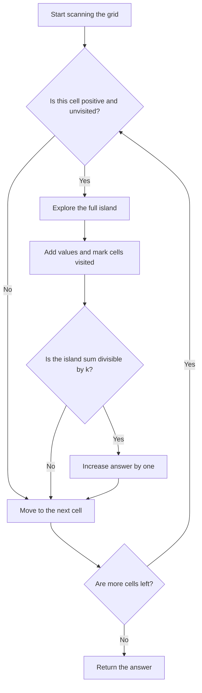
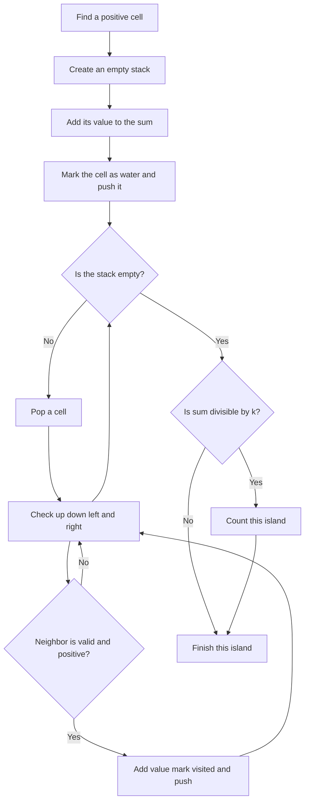
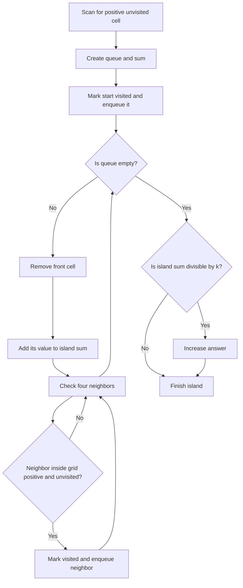

## 👨‍💻 Profiles

**GitHub:** https://github.com/Shailendra0320  
**LeetCode (Main):** [https://leetcode.com/u/Shailu03/](https://leetcode.com/u/Shailu03/)  
**LeetCode (Alternate):** [https://leetcode.com/u/ShailendraLeetcode03/](https://leetcode.com/u/ShailendraLeetcode03/)

# 3619. Count Islands With Total Value Divisible by K

**Difficulty:** Medium  
**Topics:** Array, Depth-First Search, Breadth-First Search, Matrix, Grid Traversal, Connected Components  
**Main pattern:** Flood fill a connected component, calculate its total value, and check whether the total is divisible by `k`.

**Official problem:** [LeetCode 3619 — Count Islands With Total Value Divisible by K](https://leetcode.com/problems/count-islands-with-total-value-divisible-by-k/)

---

## Table of Contents

- [1. Understand the Problem](#1-understand-the-problem)
- [2. Official Examples](#2-official-examples)
- [3. Important Grid Rules](#3-important-grid-rules)
- [4. Core Idea](#4-core-idea)
- [5. Approach 1 — Iterative DFS With In-Place Marking](#5-approach-1--iterative-dfs-with-in-place-marking)
- [6. Approach 2 — BFS With a Separate Visited Matrix](#6-approach-2--bfs-with-a-separate-visited-matrix)
- [7. Compare Both Approaches](#7-compare-both-approaches)
- [8. Edge Cases](#8-edge-cases)
- [9. Common Mistakes](#9-common-mistakes)
- [10. Interview Explanation](#10-interview-explanation)
- [11. Quick Revision](#11-quick-revision)

---

## 1. Understand the Problem

You receive a two-dimensional integer grid called `grid` and a positive integer `k`.

A cell with a value greater than `0` represents **land**. A cell with value `0` represents **water**.

An **island** is a group of land cells connected by moving only in these four directions:

- Up
- Down
- Left
- Right

Diagonal contact does **not** connect two land cells.

For every island, add the values of all its cells. Count the islands whose total is divisible by `k` — meaning the total leaves a remainder of `0` when divided by `k`.

### What does “divisible by k” mean?

An island is counted exactly when:

```text
islandSum % k == 0
```

For example, if `k = 5`:

| Island sum | Calculation | Count it? |
|---:|---|---|
| `15` | `15 % 5 = 0` | Yes |
| `8` | `8 % 5 = 3` | No |
| `5` | `5 % 5 = 0` | Yes |
| `0` | There is no island with sum zero, because land cells are positive | Not applicable |

### Constraints

| Constraint | Meaning |
|---|---|
| `1 <= m, n <= 1000` | The grid can have up to 1,000 rows and 1,000 columns individually. |
| `1 <= m * n <= 100000` | There are at most 100,000 cells overall. |
| `0 <= grid[i][j] <= 10^6` | Zero is water; a positive value is land. |
| `1 <= k <= 10^6` | `k` is always positive. |

The sum of one island can reach as high as `100000 * 1000000 = 100000000000`. That is why Java should use `long` and C++ should use `long long` for an island sum. Python integers handle this size naturally.

### What are we actually counting?

We are **not** counting land cells. We are counting whole connected groups of land.

For example:

```text
1 1 0
0 1 0
0 0 4
```

There are two islands:

- Island 1: the connected cells with values `1`, `1`, and `1`; total `3`.
- Island 2: the isolated cell with value `4`; total `4`.

If `k = 3`, only the first island is counted, so the answer is `1`.

---

## 2. Official Examples

### Example 1

**Input**

```text
grid = [[0,2,1,0,0],
        [0,5,0,0,5],
        [0,0,1,0,0],
        [0,1,4,7,0],
        [0,2,0,0,8]]
k = 5
```

**Output**

```text
2
```

The four islands can be separated visually like this. Letters mark cells that belong to the same island; dots are water.

```text
. A A . .
. A . . B
. . C . .
. C C C .
. C . . D
```

The island totals are:

| Island | Cell values | Total | `total % 5` | Counted? |
|---|---|---:|---:|---|
| A | `2, 1, 5` | `8` | `3` | No |
| B | `5` | `5` | `0` | Yes |
| C | `1, 1, 4, 7, 2` | `15` | `0` | Yes |
| D | `8` | `8` | `3` | No |

So there are **2 qualifying islands**.

### Example 2

**Input**

```text
grid = [[3,0,3,0],
        [0,3,0,3],
        [3,0,3,0]]
k = 3
```

**Output**

```text
6
```

The six land cells touch only diagonally. Because diagonal movement is not allowed, every `3` forms its own island.

Each island has sum `3`, and `3 % 3 == 0`. All six islands count.

### What these examples teach us

1. A single positive cell can be an island by itself.
2. Diagonal cells are not connected.
3. Check the **sum of the entire component**, not individual values.
4. When a component is finished, make one divisibility decision for that island.

---

## 3. Important Grid Rules

### Rule 1 — Only four directions count

For a cell `(r, c)`, its possible neighbors are:

```text
            (r - 1, c)
                 ↑
(r, c - 1) ← (r, c) → (r, c + 1)
                 ↓
            (r + 1, c)
```

The diagonal positions `(r - 1, c - 1)`, `(r - 1, c + 1)`, `(r + 1, c - 1)`, and `(r + 1, c + 1)` are **not** neighbors for this problem.

### Rule 2 — Water stops traversal

A cell with value `0` is not part of an island. DFS or BFS must never continue through water.

### Rule 3 — Visit each land cell once

If a cell is explored more than once, it could be added to an island total multiple times or create repeated work. We need a visit-marking method:

- Approach 1 changes a visited land cell to `0`.
- Approach 2 leaves the grid unchanged and records visits in `visited[r][c]`.

### Rule 4 — Finish one island before starting another

When DFS's stack or BFS's queue becomes empty, all cells belonging to that connected component have been processed. Only then do we test its sum against `k`.

---

## 4. Core Idea

Imagine the grid as a graph:

- Every positive cell is a vertex.
- An edge connects two vertices when their cells share a side.
- Every island is one connected component of this graph.

We can find all connected components by starting a traversal at every positive cell we have not visited yet.

The overall algorithm is the same for both approaches:

1. Scan every grid cell.
2. When a positive, unvisited cell is found, start exploring its island.
3. Add every cell value in that island to a running sum.
4. Mark each cell as visited so it cannot be counted again.
5. When the traversal finishes, check `islandSum % k == 0`.
6. Increase the answer if it is divisible.
7. Continue scanning the rest of the grid.

### Overall algorithm flowchart



### Why a grid traversal is enough

The question does not ask for the shape or perimeter of an island. We only need every cell in that island and the sum of their values. A traversal naturally visits exactly the cells connected to the starting cell through positive neighbors.

The grid has at most `100000` cells. If each cell is marked when it is first reached, no cell is processed twice. This gives linear time: `O(m * n)`.

---

# 5. Approach 1 — Iterative DFS With In-Place Marking

**Idea:** Use a stack to explore one island. As soon as a positive cell is placed on the stack, add its value to the island sum and change it to `0`. That marks it as visited without needing a separate `visited` matrix.

| Complexity | Cost |
|---|---|
| Time | `O(m * n)` |
| Auxiliary space | `O(m * n)` worst case for the explicit stack |
| Extra visited matrix | Not needed |
| Does it modify `grid`? | Yes; visited land cells become `0`. |

## Approach 1.1 — Understand DFS in plain English

DFS means **Depth-First Search**. We keep a stack of cells still waiting to be explored.

For each island:

1. Start at a positive cell.
2. Add its value to `islandSum`.
3. Change its grid value to `0` immediately.
4. Push its position onto the stack.
5. Pop one position from the stack.
6. Check its four neighbors.
7. For each neighbor that is inside the grid and still positive, add its value to the sum, set it to `0`, and push it.
8. Repeat until the stack is empty.
9. Check whether the completed island sum is divisible by `k`.

### Why mark a cell before pushing it?

Suppose two adjacent cells both discover the same third cell. If we wait until popping a cell to mark it, both paths could push that cell. Marking it as soon as it is scheduled ensures it is put on the stack only once.

This is an important detail in both iterative DFS and BFS.

## Approach 1.2 — Flowchart



## Approach 1.3 — Visual representation of the stack

Consider this small grid:

```text
grid = [
  [1, 1, 0],
  [0, 2, 0],
  [0, 0, 5]
]
```

The component containing `1`, `1`, and `2` forms one island. The `5` is another island.

A possible DFS trace for the first island is:

```text
Start at (0,0), value 1
    stack = [(0,0)], sum = 1
    mark grid[0][0] = 0

Explore (0,0), discover (0,1), value 1
    stack = [(0,1)], sum = 2
    mark grid[0][1] = 0

Explore (0,1), discover (1,1), value 2
    stack = [(1,1)], sum = 4
    mark grid[1][1] = 0

Explore (1,1), no positive unvisited neighbor remains
    stack = []
    final sum = 4
```

If `k = 2`, this island counts because `4 % 2 == 0`. The isolated island containing `5` does not count because `5 % 2 != 0`.

The exact order in which DFS visits neighbors can vary, but the final component and its sum stay the same.

## Approach 1.4 — Dry run on Official Example 1

Input:

```text
grid = [[0,2,1,0,0],
        [0,5,0,0,5],
        [0,0,1,0,0],
        [0,1,4,7,0],
        [0,2,0,0,8]]
k = 5
```

The first positive cell encountered is `(0,1)`. DFS explores its connected component:

| Cell | Value | Running sum |
|---|---:|---:|
| `(0,1)` | `2` | `2` |
| `(0,2)` | `1` | `3` |
| `(1,1)` | `5` | `8` |

Its stack eventually becomes empty. Since `8 % 5 = 3`, this island is not counted.

The scan continues to `(1,4)`:

| Cell | Value | Running sum |
|---|---:|---:|
| `(1,4)` | `5` | `5` |

Since `5 % 5 = 0`, increment the answer to `1`.

The next not-yet-visited island begins at `(2,2)`:

| Cell | Value | Running sum |
|---|---:|---:|
| `(2,2)` | `1` | `1` |
| `(3,2)` | `4` | `5` |
| `(3,1)` | `1` | `6` |
| `(3,3)` | `7` | `13` |
| `(4,1)` | `2` | `15` |

The traversal order may differ, but these five cells are all connected. Since `15 % 5 = 0`, increment the answer to `2`.

Finally, the cell `(4,4)` forms an island by itself. Its sum is `8`, so it does not count.

**Final answer: `2`.**

### Island summary

| Island | Sum | Remainder with `k = 5` | Added to answer? |
|---|---:|---:|---|
| A | `8` | `3` | No |
| B | `5` | `0` | Yes |
| C | `15` | `0` | Yes |
| D | `8` | `3` | No |

## Approach 1.5 — Why this approach works

DFS begins only on a cell that is still positive. It follows only positive neighboring cells, so it reaches exactly the cells connected to that starting cell and does not cross water.

Every cell is changed to `0` when it is scheduled for exploration. That prevents a cell from being included twice and prevents the outer grid scan from starting a second traversal inside the same island.

When the stack becomes empty, every reachable cell in that island has been processed, so `islandSum` is the sum of the entire island. Checking `islandSum % k == 0` therefore applies the problem's rule to the complete island, exactly once.

## Approach 1.6 — Java Code

```java
//Approach-1 (Iterative DFS with In-Place Marking)
//T.C : O(m * n)
//S.C : O(m * n)

import java.util.ArrayDeque;
import java.util.Deque;

class Solution {
    private static final int[] DR = {-1, 1, 0, 0};
    private static final int[] DC = {0, 0, -1, 1};

    public int countIslands(int[][] grid, int k) {
        int m = grid.length;
        int n = grid[0].length;
        int answer = 0;

        for (int r = 0; r < m; r++) {
            for (int c = 0; c < n; c++) {
                if (grid[r][c] == 0) {
                    continue;
                }

                Deque<Integer> stack = new ArrayDeque<>();
                long islandSum = 0;

                islandSum += grid[r][c];
                grid[r][c] = 0;
                stack.push(r * n + c);

                while (!stack.isEmpty()) {
                    int cell = stack.pop();
                    int row = cell / n;
                    int col = cell % n;

                    for (int d = 0; d < 4; d++) {
                        int nr = row + DR[d];
                        int nc = col + DC[d];

                        if (nr < 0 || nr >= m || nc < 0 || nc >= n) {
                            continue;
                        }

                        if (grid[nr][nc] == 0) {
                            continue;
                        }

                        islandSum += grid[nr][nc];
                        grid[nr][nc] = 0;
                        stack.push(nr * n + nc);
                    }
                }

                if (islandSum % k == 0) {
                    answer++;
                }
            }
        }

        return answer;
    }
}
```

## Approach 1.7 — C++ Code

```cpp
//Approach-1 (Iterative DFS with In-Place Marking)
//T.C : O(m * n)
//S.C : O(m * n)

#include <bits/stdc++.h>
using namespace std;

class Solution {
public:
    int countIslands(vector<vector<int>>& grid, int k) {
        int m = static_cast<int>(grid.size());
        int n = static_cast<int>(grid[0].size());
        const int dr[4] = {-1, 1, 0, 0};
        const int dc[4] = {0, 0, -1, 1};
        int answer = 0;

        for (int r = 0; r < m; r++) {
            for (int c = 0; c < n; c++) {
                if (grid[r][c] == 0) {
                    continue;
                }

                vector<int> st;
                long long islandSum = grid[r][c];
                grid[r][c] = 0;
                st.push_back(r * n + c);

                while (!st.empty()) {
                    int cell = st.back();
                    st.pop_back();
                    int row = cell / n;
                    int col = cell % n;

                    for (int d = 0; d < 4; d++) {
                        int nr = row + dr[d];
                        int nc = col + dc[d];

                        if (nr < 0 || nr >= m || nc < 0 || nc >= n) {
                            continue;
                        }

                        if (grid[nr][nc] == 0) {
                            continue;
                        }

                        islandSum += grid[nr][nc];
                        grid[nr][nc] = 0;
                        st.push_back(nr * n + nc);
                    }
                }

                if (islandSum % k == 0) {
                    answer++;
                }
            }
        }

        return answer;
    }
};
```

## Approach 1.8 — Python Code

```python
#Approach-1 (Iterative DFS with In-Place Marking)
#T.C : O(m * n)
#S.C : O(m * n)

from typing import List


class Solution:
    def countIslands(self, grid: List[List[int]], k: int) -> int:
        m, n = len(grid), len(grid[0])
        directions = [(-1, 0), (1, 0), (0, -1), (0, 1)]
        answer = 0

        for r in range(m):
            for c in range(n):
                if grid[r][c] == 0:
                    continue

                stack = [(r, c)]
                island_sum = grid[r][c]
                grid[r][c] = 0

                while stack:
                    row, col = stack.pop()

                    for dr, dc in directions:
                        nr, nc = row + dr, col + dc

                        if not (0 <= nr < m and 0 <= nc < n):
                            continue

                        if grid[nr][nc] == 0:
                            continue

                        island_sum += grid[nr][nc]
                        grid[nr][nc] = 0
                        stack.append((nr, nc))

                if island_sum % k == 0:
                    answer += 1

        return answer
```

## Approach 1.9 — Complexity explained

Let `m` be the number of rows, `n` the number of columns, and `N = m * n` the number of cells.

**Time: `O(m * n)`**

- The outer loops inspect every cell.
- Each positive cell is pushed onto the stack once because it is changed to zero before being pushed.
- Each processed cell checks exactly four neighbors, a constant amount of work.
- The total work is therefore proportional to the number of grid cells.

**Auxiliary space: `O(m * n)` worst case**

- If the whole grid is one large island, the explicit stack can store many cells.
- No separate `visited` matrix is required.
- The input grid is modified in place.

---

# 6. Approach 2 — BFS With a Separate Visited Matrix

**Idea:** Use a queue instead of a stack and keep a separate `visited` matrix. This lets us explore an island without changing any original grid values.

| Complexity | Cost |
|---|---|
| Time | `O(m * n)` |
| Auxiliary space | `O(m * n)` for `visited` and the queue |
| Does it modify `grid`? | No |
| Main data structure | Queue (First In, First Out) |

## Approach 2.1 — Understand BFS in plain English

BFS means **Breadth-First Search**. Instead of going deep along one path as DFS does, BFS processes cells in the order they enter a queue.

For each unvisited positive cell:

1. Create a queue and put the starting cell into it.
2. Mark the starting cell as visited immediately.
3. Remove a cell from the front of the queue.
4. Add its value to the island sum.
5. Check its four neighbors.
6. If a neighbor is positive and has not been visited, mark it visited and add it to the queue.
7. Continue until the queue is empty.
8. Test whether the island sum is divisible by `k`.

The traversal order is different from DFS, but BFS still visits all and only the cells that belong to the same island.

### Why use a separate `visited` matrix?

In Approach 1, we use `grid[r][c] = 0` as the visit mark. That is compact, but it changes the input.

In Approach 2, `visited[r][c]` tells us whether a cell has already been scheduled or processed. The grid remains unchanged. This is useful when the original matrix must be available after the method returns.

The cost is an extra `m x n` Boolean matrix.

## Approach 2.2 — Flowchart



## Approach 2.3 — Diagram: stack versus queue

The two approaches differ only in how they choose the next waiting cell.

```text
DFS stack                         BFS queue
---------                         ---------
Last added cell comes out first   First added cell comes out first
        |                                  |
        v                                  v
Follow one path deeply            Expand outward in layers
        |                                  |
        +----------------+-----------------+
                         |
                         v
          Visit the same connected island
                         |
                         v
              Calculate one island sum
```

Neither order changes the set of cells in an island or its total value.

## Approach 2.4 — Dry run with a small grid

Consider:

```text
grid = [
  [1, 0, 2],
  [3, 4, 0],
  [0, 0, 5]
]
k = 5
```

The land components are:

```text
A . B
A A .
. . C
```

- Island A contains `1`, `3`, and `4`; its sum is `8`.
- Island B contains only `2`; its sum is `2`.
- Island C contains only `5`; its sum is `5`.

The answer is `1` because only the third island has a sum divisible by five.

### BFS trace for Island A

| Step | Queue action | Running sum | Visited land cells |
|---:|---|---:|---|
| 1 | Enqueue `(0,0)` | `0` | `(0,0)` marked |
| 2 | Pop `(0,0)`; add `1`; enqueue `(1,0)` | `1` | `(0,0)`, `(1,0)` |
| 3 | Pop `(1,0)`; add `3`; enqueue `(1,1)` | `4` | `(0,0)`, `(1,0)`, `(1,1)` |
| 4 | Pop `(1,1)`; add `4`; no new land neighbors | `8` | All three island cells |
| 5 | Queue empty | `8` | Component complete |

Since `8 % 5 = 3`, Island A is not counted.

BFS then handles B and C. B fails the divisibility check (`2 % 5 != 0`); C passes (`5 % 5 == 0`). The final answer is `1`.

## Approach 2.5 — Dry run on Official Example 2

```text
grid = [[3,0,3,0],
        [0,3,0,3],
        [3,0,3,0]]
k = 3
```

Every `3` is isolated because its neighboring cells up, down, left, and right are all either outside the grid or zero. BFS starts six times, once for each cell with value `3`.

Each traversal finishes immediately with `islandSum = 3`. Because `3 % 3 == 0`, every traversal increments the answer.

```text
Island sums: 3, 3, 3, 3, 3, 3
Divisible by 3: Yes for all six
Answer: 6
```

## Approach 2.6 — Why this approach works

The queue starts from one positive cell and only adds positive neighbors. Therefore, it cannot cross water. Since every added cell is marked visited immediately, no cell is queued twice.

When the queue becomes empty, there are no more reachable positive neighbors left to process. The accumulated sum contains each cell of that connected component exactly once. We then apply the divisibility rule to that sum.

Because the outer loop skips visited cells, the same island cannot be counted again. Every island is processed exactly once, so the returned answer is correct.

## Approach 2.7 — Java Code

```java
//Approach-2 (BFS with a Separate Visited Matrix)
//T.C : O(m * n)
//S.C : O(m * n)

import java.util.ArrayDeque;
import java.util.Queue;

class Solution2 {
    private static final int[] DR = {-1, 1, 0, 0};
    private static final int[] DC = {0, 0, -1, 1};

    public int countIslands(int[][] grid, int k) {
        int m = grid.length;
        int n = grid[0].length;
        boolean[][] visited = new boolean[m][n];
        int answer = 0;

        for (int r = 0; r < m; r++) {
            for (int c = 0; c < n; c++) {
                if (grid[r][c] == 0 || visited[r][c]) {
                    continue;
                }

                Queue<Integer> queue = new ArrayDeque<>();
                long islandSum = 0;

                visited[r][c] = true;
                queue.offer(r * n + c);

                while (!queue.isEmpty()) {
                    int cell = queue.poll();
                    int row = cell / n;
                    int col = cell % n;
                    islandSum += grid[row][col];

                    for (int d = 0; d < 4; d++) {
                        int nr = row + DR[d];
                        int nc = col + DC[d];

                        if (nr < 0 || nr >= m || nc < 0 || nc >= n) {
                            continue;
                        }

                        if (grid[nr][nc] == 0 || visited[nr][nc]) {
                            continue;
                        }

                        visited[nr][nc] = true;
                        queue.offer(nr * n + nc);
                    }
                }

                if (islandSum % k == 0) {
                    answer++;
                }
            }
        }

        return answer;
    }
}
```

## Approach 2.8 — C++ Code

```cpp
//Approach-2 (BFS with a Separate Visited Matrix)
//T.C : O(m * n)
//S.C : O(m * n)

#include <bits/stdc++.h>
using namespace std;

class Solution2 {
public:
    int countIslands(vector<vector<int>>& grid, int k) {
        int m = static_cast<int>(grid.size());
        int n = static_cast<int>(grid[0].size());
        const int dr[4] = {-1, 1, 0, 0};
        const int dc[4] = {0, 0, -1, 1};

        vector<vector<bool>> visited(m, vector<bool>(n, false));
        int answer = 0;

        for (int r = 0; r < m; r++) {
            for (int c = 0; c < n; c++) {
                if (grid[r][c] == 0 || visited[r][c]) {
                    continue;
                }

                queue<int> q;
                long long islandSum = 0;

                visited[r][c] = true;
                q.push(r * n + c);

                while (!q.empty()) {
                    int cell = q.front();
                    q.pop();
                    int row = cell / n;
                    int col = cell % n;
                    islandSum += grid[row][col];

                    for (int d = 0; d < 4; d++) {
                        int nr = row + dr[d];
                        int nc = col + dc[d];

                        if (nr < 0 || nr >= m || nc < 0 || nc >= n) {
                            continue;
                        }

                        if (grid[nr][nc] == 0 || visited[nr][nc]) {
                            continue;
                        }

                        visited[nr][nc] = true;
                        q.push(nr * n + nc);
                    }
                }

                if (islandSum % k == 0) {
                    answer++;
                }
            }
        }

        return answer;
    }
};
```

## Approach 2.9 — Python Code

```python
#Approach-2 (BFS with a Separate Visited Matrix)
#T.C : O(m * n)
#S.C : O(m * n)

from collections import deque
from typing import List


class Solution2:
    def countIslands(self, grid: List[List[int]], k: int) -> int:
        m, n = len(grid), len(grid[0])
        visited = [[False] * n for _ in range(m)]
        directions = [(-1, 0), (1, 0), (0, -1), (0, 1)]
        answer = 0

        for r in range(m):
            for c in range(n):
                if grid[r][c] == 0 or visited[r][c]:
                    continue

                queue = deque([(r, c)])
                visited[r][c] = True
                island_sum = 0

                while queue:
                    row, col = queue.popleft()
                    island_sum += grid[row][col]

                    for dr, dc in directions:
                        nr, nc = row + dr, col + dc

                        if not (0 <= nr < m and 0 <= nc < n):
                            continue

                        if grid[nr][nc] == 0 or visited[nr][nc]:
                            continue

                        visited[nr][nc] = True
                        queue.append((nr, nc))

                if island_sum % k == 0:
                    answer += 1

        return answer
```

## Approach 2.10 — Complexity explained

**Time: `O(m * n)`**

- Every grid cell is checked by the outer loops.
- Every land cell enters the queue once.
- Each dequeued cell checks four neighbors.
- All work is linear in the number of cells.

**Auxiliary space: `O(m * n)`**

- `visited` stores one Boolean for each cell.
- The queue can contain up to `O(m * n)` cells in a large island.
- Unlike Approach 1, this method does not change the input grid.

---

## 7. Compare Both Approaches

| Feature | Approach 1: Iterative DFS | Approach 2: BFS + `visited` |
|---|---|---|
| Traversal structure | Stack | Queue |
| Marks visits by | Replacing the grid value with `0` | Separate Boolean matrix |
| Modifies the input? | Yes | No |
| Time | `O(m * n)` | `O(m * n)` |
| Worst-case auxiliary space | `O(m * n)` stack | `O(m * n)` visited matrix and queue |
| Main advantage | No separate visited matrix | Original grid remains intact |
| Main caution | Input is destroyed for visited land cells | Uses more memory for `visited` |

### Which one should you choose?

Use **Approach 1** if changing the input grid is allowed and you want a straightforward flood fill with no separate visited matrix.

Use **Approach 2** if you need to keep `grid` unchanged, or if you prefer separating the input data from the visit state.

Both approaches are efficient enough for the stated maximum of `100000` cells.

---

## 8. Edge Cases

| Case | Example | Expected behavior |
|---|---|---|
| All water | `[[0,0],[0,0]]`, `k = 2` | `0`, because there are no islands. |
| One land cell divisible by `k` | `[[6]]`, `k = 3` | `1` |
| One land cell not divisible by `k` | `[[5]]`, `k = 3` | `0` |
| One connected island | `[[1,1],[1,1]]`, `k = 4` | Sum is `4`, so answer is `1`. |
| Multiple isolated islands | `[[3,0,3],[0,3,0]]`, `k = 3` | Each `3` is a separate valid island. |
| Connected island not divisible | `[[1,2]]`, `k = 4` | Sum is `3`, so answer is `0`. |
| Component sum is a multiple of `k` | `[[2,3],[0,0]]`, `k = 5` | One component with sum `5`; answer is `1`. |
| Diagonal-only contact | `[[1,0],[0,1]]`, `k = 1` | Two separate islands, not one. |
| Large component | Large connected region of positive cells | Every cell is counted once; use a 64-bit sum in Java/C++. |

### Why `k = 1` is a useful test

Every integer is divisible by `1`. Therefore, when `k = 1`, the answer must equal the total number of islands, regardless of the actual cell values.

---

## 9. Common Mistakes

### Mistake 1 — Counting cells instead of islands

Do not increment the answer for every cell that is divisible by `k`. The rule applies to the **sum of a complete connected component**.

### Mistake 2 — Treating diagonals as connected

Only up, down, left, and right are allowed. Diagonal neighbors stay in separate islands unless another path connects them through side-adjacent land cells.

### Mistake 3 — Checking the sum too early

Do not check divisibility after every cell. Finish traversing the entire island first, then test the final sum.

### Mistake 4 — Forgetting to mark a cell visited

If a cell is pushed into a stack or queue without being marked, another neighboring cell may schedule it again. Mark it when scheduling the visit.

### Mistake 5 — Marking the wrong cells

Water already has value `0`. Only positive cells represent land and should be added to an island sum.

### Mistake 6 — Using 32-bit sum storage

A component can have up to `100000` cells, each with value `1000000`, so a sum can reach `100000000000`. Use `long` in Java and `long long` in C++.

### Mistake 7 — Forgetting the queue or stack can be large

A single island may contain most of the grid. Iterative traversal avoids depending on the programming language’s recursive call-stack limit.

### Mistake 8 — Counting the same component twice

When a traversal ends, all cells in that component must already be marked. The outer loops then skip them.

---

## 10. Interview Explanation

> “I treat every positive cell as land and every zero as water. I scan the grid, and when I find unvisited land, I run a flood-fill traversal to visit the complete four-directionally connected island. During that traversal, I accumulate the values of its cells. Once the stack or queue is empty, I check whether the island sum is divisible by `k`. I increment the answer only when the remainder is zero. Since each cell is visited at most once and each cell checks four neighbors, the time complexity is `O(m * n)`. I can mark visited cells directly in the grid or use a separate visited matrix if I need to preserve the input.”

### If the interviewer asks, “Why is it linear?”

Every cell is visited at most once. For each visited cell, we inspect exactly four possible neighbors, which is a constant amount of work. Therefore, all traversals combined take `O(m * n)` time.

### If the interviewer asks, “Why not use recursion?”

Recursive DFS is valid logically, but an island can contain as many as `100000` cells. That can create a very deep call stack in Java, C++, or Python. An explicit stack or queue avoids depending on recursion depth.

### If the interviewer asks, “Why use a 64-bit sum?”

The maximum total can be approximately `10^11`, which is larger than the maximum signed 32-bit integer. A 64-bit integer safely holds that total.

---

## 11. Quick Revision

- Land means `grid[r][c] > 0`.
- Water means `grid[r][c] == 0`.
- Neighbors are up, down, left, and right only.
- One island is one four-directionally connected group of land cells.
- Explore every island with DFS or BFS.
- Add every cell value in the current component.
- Count the island if `islandSum % k == 0`.
- Approach 1 uses an explicit stack and marks visited land in-place.
- Approach 2 uses a queue and a separate `visited` matrix.
- Both approaches run in `O(m * n)` time.
- Use `long` / `long long` for island sums in Java / C++.

## One-Line Insight

**Find each four-directionally connected group of positive cells, sum its values once, and count the group if its total is divisible by `k`.**

## Final Takeaway

The main challenge is making sure you count a whole island exactly once. Once you recognize that an island is simply a connected component in a grid, DFS or BFS does the job directly. The divisibility check happens only after the component is fully explored. Use iterative DFS when you can mark the grid in place; use BFS with a separate visited matrix when you want to preserve the original input.

**Reference:** [Official LeetCode problem — 3619. Count Islands With Total Value Divisible by K](https://leetcode.com/problems/count-islands-with-total-value-divisible-by-k/)
