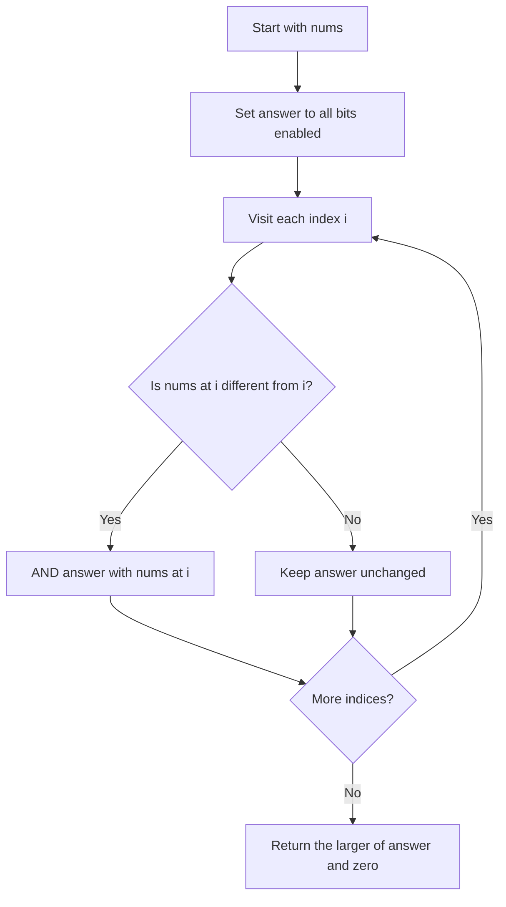
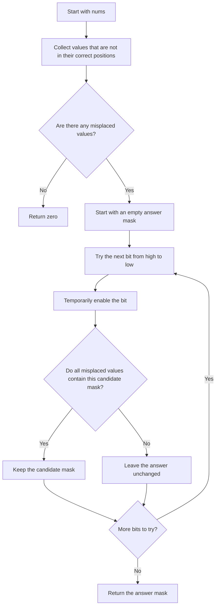

## 👨‍💻 Profiles

**GitHub:** https://github.com/Shailendra0320  
**LeetCode (Main):** https://leetcode.com/u/Shailu03/  
**LeetCode (Alternate):** https://leetcode.com/u/ShailendraLeetcode03/

# 3644. Maximum K to Sort a Permutation

**Difficulty:** Medium  
**Topics:** Array, Bit Manipulation  
**Main pattern:** Bitwise AND of misplaced values

**Official problem:** [LeetCode 3644 — Maximum K to Sort a Permutation](https://leetcode.com/problems/maximum-k-to-sort-a-permutation/)

---

## Table of Contents

- [1. Understand the Problem](#1-understand-the-problem)
- [2. Examples](#2-examples)
- [3. Core Observation](#3-core-observation)
- [4. Approach 1 — AND All Misplaced Values](#4-approach-1--and-all-misplaced-values)
- [5. Approach 2 — Build the Answer Bit by Bit](#5-approach-2--build-the-answer-bit-by-bit)
- [6. Compare the Approaches](#6-compare-the-approaches)
- [7. Common Mistakes](#7-common-mistakes)
- [8. Interview Explanation](#8-interview-explanation)
- [9. Quick Revision](#9-quick-revision)

---

## 1. Understand the Problem

You are given a permutation of all integers from `0` to `n - 1`. A permutation contains every number in that range exactly once, but the numbers may be in the wrong order.

You may swap two values only when their **bitwise AND** is exactly `k`:

```text
nums[i] & nums[j] == k
```

Your task is to return the **largest possible value of `k`** that still allows the whole permutation to be sorted into:

```text
[0, 1, 2, ..., n - 1]
```

If the array is already sorted, return `0`.

### Constraints

- `1 <= nums.length <= 100000`
- `nums` is a permutation of the integers from `0` through `n - 1`.
- All values are distinct.

### What does bitwise AND mean?

A bit in the result is `1` only when that bit is `1` in **both** numbers.

| Expression | Binary view | Result |
|---|---|---:|
| `3 & 1` | `011 & 001` | `1` (`001`) |
| `3 & 2` | `011 & 010` | `2` (`010`) |
| `2 & 1` | `010 & 001` | `0` (`000`) |
| `6 & 2` | `110 & 010` | `2` (`010`) |

For example, when `k = 2`, swapping `3` and `2` is allowed because `3 & 2 == 2`. Swapping `3` and `1` would not be allowed for `k = 2`, because `3 & 1 == 1`.

---

## 2. Examples

### Example 1

```text
Input:  nums = [0, 3, 2, 1]
Output: 1
```

Only the values `3` and `1` are out of place. Their common set bit is bit `0`:

```text
3 = 011
1 = 001
    ---
AND 001 = 1
```

We can swap `3` and `1`, because `3 & 1 == 1`:

```text
Before: [0, 3, 2, 1]
After:  [0, 1, 2, 3]
```

The maximum valid `k` is `1`.

### Example 2

```text
Input:  nums = [0, 1, 3, 2]
Output: 2
```

Only `3` and `2` are misplaced, and:

```text
3 & 2 = 2
```

One valid swap sorts the array:

```text
[0, 1, 3, 2] -> [0, 1, 2, 3]
```

So the answer is `2`.

### Example 3

```text
Input:  nums = [3, 2, 1, 0]
Output: 0
```

Every position is wrong. The AND of all misplaced values is:

```text
3 & 2 & 1 & 0 = 0
```

Therefore, the answer is `0`.

---

## 3. Core Observation

### Only look at values that are not in their correct positions

For a sorted permutation, the value at index `i` must be `i`. So an element is misplaced exactly when:

```text
nums[i] != i
```

Elements already satisfying `nums[i] == i` do not need to move. We only need to look at the values that are misplaced.

The key observation is:

> **The maximum answer is the bitwise AND of every value whose current index does not equal that value.**

Start with all bits enabled (`answer = -1` in standard signed integer bit operations), then AND each misplaced value into the answer. Finally, return at least `0`.

### Why does AND give the maximum possible `k`?

If a misplaced value must move, it must take part in at least one legal swap. A legal swap uses two values whose AND is exactly `k`. That means every bit set in `k` must also be set in each value that has to move.

So a valid `k` cannot contain a bit that is missing from even one misplaced value. The bitwise AND keeps **only the bits shared by all misplaced values**. Any larger `k` would require a bit that at least one necessary value does not have.

Those common bits are enough: every misplaced value contains the resulting `k`, and the value `k` itself exists in the permutation. Since `k & x == k` for any value `x` containing all bits of `k`, the value `k` can serve as a helper for legal swaps. Therefore the common AND is both the largest possible choice and a value that permits sorting.

### Visual example

For `nums = [0, 3, 2, 1]`:

```text
Index:       0  1  2  3
Value:       0  3  2  1
Correct?:    Y  N  Y  N
                 |     |
Misplaced:       3     1
                 |     |
Binary:        011   001
                 \     /
                  AND
                   |
                 001 = 1
```

The value `0` at index `0` and the value `2` at index `2` are already correct, so they do not reduce the answer.

---

# 4. Approach 1 — AND All Misplaced Values

**Recommended approach**  
**Time:** `O(n)`  
**Auxiliary space:** `O(1)`

### Idea in plain English

Walk through the array once. Whenever `nums[i] != i`, the current value is misplaced, so include it in the running bitwise AND. Ignore values already in their correct positions.

If the array is already sorted, no value is included. The running value remains `-1`, so `max(answer, 0)` correctly returns `0`.

### Flowchart



### Step-by-step dry run

Input:

```text
nums = [0, 3, 2, 1]
```

| Index `i` | `nums[i]` | Check `nums[i] != i` | Running answer |
|---:|---:|---|---:|
| 0 | 0 | No, already correct | unchanged (`-1`) |
| 1 | 3 | Yes | `-1 & 3 = 3` |
| 2 | 2 | No, already correct | `3` |
| 3 | 1 | Yes | `3 & 1 = 1` |

The final running answer is `1`, so the function returns `1`.

### Why this works

- Every value that must move is included in the AND.
- A legal swap with AND equal to `k` requires every participating value to contain every set bit of `k`.
- Therefore, `k` cannot have any set bit that is absent from one of the misplaced values.
- ANDing all misplaced values removes exactly those bits that are not shared by all of them.
- The common mask can be used for sorting, so it is the maximum feasible `k`.

### Java

```java
//Approach-1 (AND All Misplaced Values)
//T.C : O(n)
//S.C : O(1)

class Solution {
    public int sortPermutation(int[] nums) {
        int answer = -1;

        for (int i = 0; i < nums.length; i++) {
            if (nums[i] != i) {
                answer &= nums[i];
            }
        }

        return Math.max(answer, 0);
    }
}
```

### C++

```cpp
//Approach-1 (AND All Misplaced Values)
//T.C : O(n)
//S.C : O(1)

#include <bits/stdc++.h>
using namespace std;

class Solution {
public:
    int sortPermutation(vector<int>& nums) {
        int answer = -1;

        for (int i = 0; i < static_cast<int>(nums.size()); i++) {
            if (nums[i] != i) {
                answer &= nums[i];
            }
        }

        return max(answer, 0);
    }
};
```

### Python

```python
#Approach-1 (AND All Misplaced Values)
#T.C : O(n)
#S.C : O(1)

from typing import List

class Solution:
    def sortPermutation(self, nums: List[int]) -> int:
        answer = -1

        for i, value in enumerate(nums):
            if value != i:
                answer &= value

        return max(answer, 0)
```

---

# 5. Approach 2 — Build the Answer Bit by Bit

**Time:** `O(n log n)` in the general expression, or `O(B * n)` where `B` is the number of relevant bits  
**Auxiliary space:** `O(n)` to collect misplaced values

This approach reaches the same answer but explains the bitwise idea differently. Instead of ANDing every value in one pass, try to build the largest possible answer from the highest bit down to the lowest bit.

### Idea in plain English

1. Collect every misplaced value.
2. If there are no misplaced values, return `0`.
3. Try to turn on each bit, starting at the highest relevant bit.
4. Keep a bit only if **every misplaced value** contains that bit and all bits already chosen.
5. The final mask contains exactly the bits common to all misplaced values.

Because `nums[i]` is at most `n - 1` and `n <= 100000`, there are at most 17 relevant bits.

### Flowchart



### Dry run

Use `nums = [0, 3, 2, 1]`. The misplaced values are `[3, 1]`.

| Candidate mask | Does every misplaced value contain it? | Decision |
|---:|---|---|
| `2` (`010`) | `1` does not contain bit `1` | Reject `2` |
| `1` (`001`) | Both `3` and `1` contain bit `0` | Keep `1` |

The answer is `1`.

For `nums = [0, 1, 3, 2]`, the only misplaced values are `3` and `2`. Bit `1` is present in both, so we keep `2`. Bit `0` is missing from `2`, so we reject adding it. The final answer is `2`.

### Java

```java
//Approach-2 (Build the Common Mask Bit by Bit)
//T.C : O(B * n), where B is the number of relevant bits
//S.C : O(n)

import java.util.ArrayList;
import java.util.List;

class Solution2 {
    public int sortPermutation(int[] nums) {
        List<Integer> misplaced = new ArrayList<>();

        for (int i = 0; i < nums.length; i++) {
            if (nums[i] != i) {
                misplaced.add(nums[i]);
            }
        }

        if (misplaced.isEmpty()) {
            return 0;
        }

        int answer = 0;
        int maxBit = 31 - Integer.numberOfLeadingZeros(nums.length - 1);

        for (int bit = maxBit; bit >= 0; bit--) {
            int candidate = answer | (1 << bit);
            boolean sharedByAll = true;

            for (int value : misplaced) {
                if ((value & candidate) != candidate) {
                    sharedByAll = false;
                    break;
                }
            }

            if (sharedByAll) {
                answer = candidate;
            }
        }

        return answer;
    }
}
```

### C++

```cpp
//Approach-2 (Build the Common Mask Bit by Bit)
//T.C : O(B * n), where B is the number of relevant bits
//S.C : O(n)

#include <bits/stdc++.h>
using namespace std;

class Solution2 {
public:
    int sortPermutation(vector<int>& nums) {
        vector<int> misplaced;

        for (int i = 0; i < static_cast<int>(nums.size()); i++) {
            if (nums[i] != i) {
                misplaced.push_back(nums[i]);
            }
        }

        if (misplaced.empty()) {
            return 0;
        }

        int answer = 0;
        int maxBit = 31 - __builtin_clz(static_cast<unsigned>(nums.size() - 1));

        for (int bit = maxBit; bit >= 0; bit--) {
            int candidate = answer | (1 << bit);
            bool sharedByAll = true;

            for (int value : misplaced) {
                if ((value & candidate) != candidate) {
                    sharedByAll = false;
                    break;
                }
            }

            if (sharedByAll) {
                answer = candidate;
            }
        }

        return answer;
    }
};
```

### Python

```python
#Approach-2 (Build the Common Mask Bit by Bit)
#T.C : O(B * n), where B is the number of relevant bits
#S.C : O(n)

from typing import List

class Solution2:
    def sortPermutation(self, nums: List[int]) -> int:
        misplaced = [value for i, value in enumerate(nums) if value != i]

        if not misplaced:
            return 0

        answer = 0
        max_bit = (len(nums) - 1).bit_length() - 1

        for bit in range(max_bit, -1, -1):
            candidate = answer | (1 << bit)

            if all((value & candidate) == candidate for value in misplaced):
                answer = candidate

        return answer
```

---

## 6. Compare the Approaches

| Detail | Approach 1: Direct AND | Approach 2: Bit-by-bit mask |
|---|---|---|
| Main idea | AND every misplaced value | Try each bit and retain it only when all misplaced values share it |
| Time | `O(n)` | `O(B * n)` |
| Auxiliary space | `O(1)` | `O(n)` |
| Easy to implement | Very easy | Slightly more involved |
| Best use | Recommended submission | Helpful for understanding how the maximum mask is built |

**Recommendation:** Use Approach 1. It produces the same maximum mask with one pass and constant extra space.

---

## 7. Common Mistakes

1. **ANDing every array value.** Correctly placed values are not required to move, so only include values where `nums[i] != i`.
2. **Using OR instead of AND.** OR keeps bits that appear in either value; we need only the bits shared by every misplaced value.
3. **Returning `-1` when the array is sorted.** No value was ANDed in that case; clamp the result to `0`.
4. **Checking only whether a bit appears in at least one misplaced value.** It must appear in every misplaced value.
5. **Forgetting that the condition requires exact equality.** A swap is allowed only if the pair's AND equals `k`; it is not enough for the pair's AND to merely contain the bits of `k`.

---

## 8. Interview Explanation

> “Every value not at its own index must move. Any legal swap has bitwise AND equal to `k`, so each misplaced value must contain every bit set in `k`. Therefore, the largest possible `k` is the AND of all misplaced values. I scan the array once, ANDing values only when `nums[i] != i`. If no position is wrong, I return zero. This gives `O(n)` time and `O(1)` extra space.”

---

## 9. Quick Revision

- Correct position condition: `nums[i] == i`.
- Misplaced value condition: `nums[i] != i`.
- Main insight: `answer = AND` of all misplaced values.
- Approach 1: one pass, `O(n)` time, `O(1)` auxiliary space.
- Approach 2: build common bits from high to low, `O(B * n)` time.
- Already sorted array: return `0`.
- Official method name: `sortPermutation`.

**Final takeaway:** Ignore values already in place. The bitwise AND of all values that must move gives the maximum `k` they can use to be rearranged into sorted order.

**Reference:** [LeetCode 3644 — Maximum K to Sort a Permutation](https://leetcode.com/problems/maximum-k-to-sort-a-permutation/)
