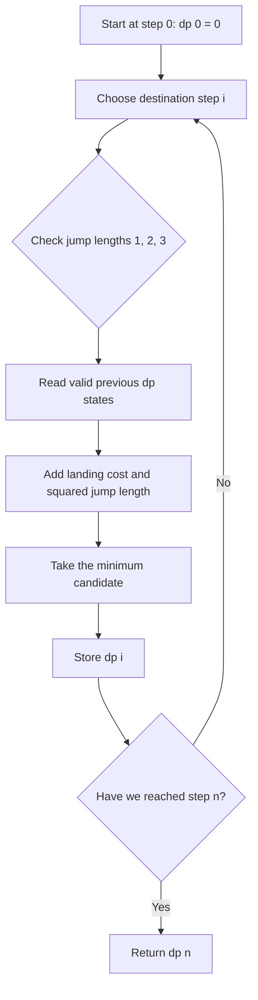
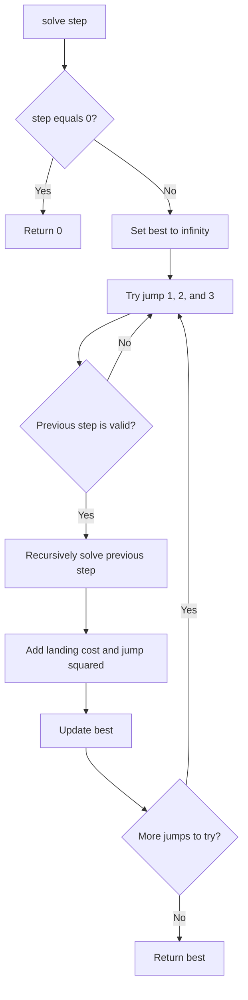
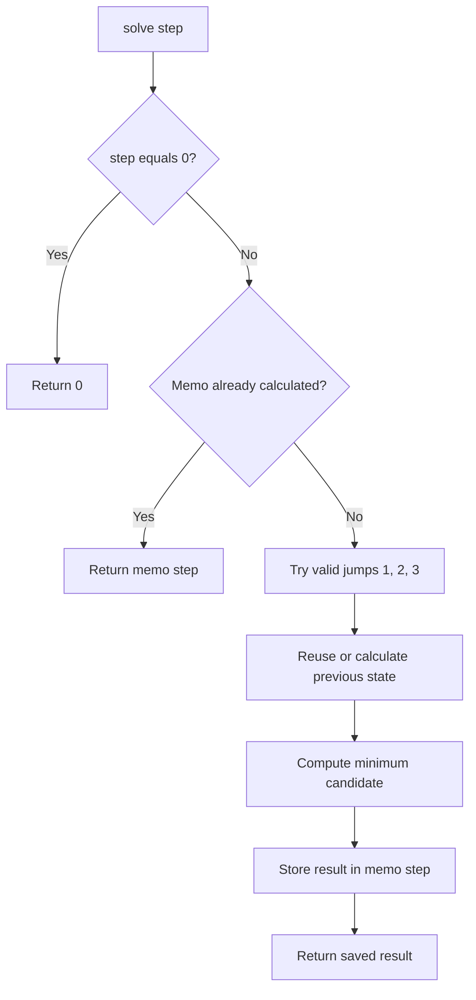
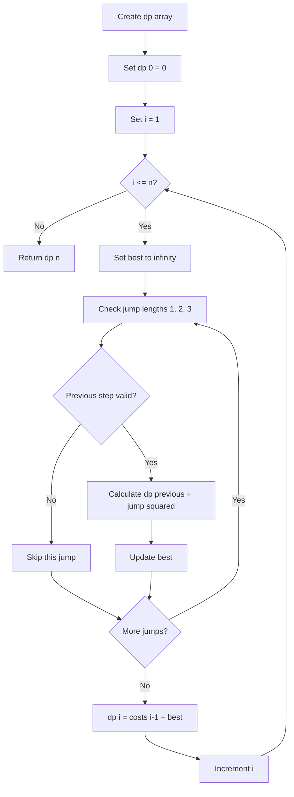
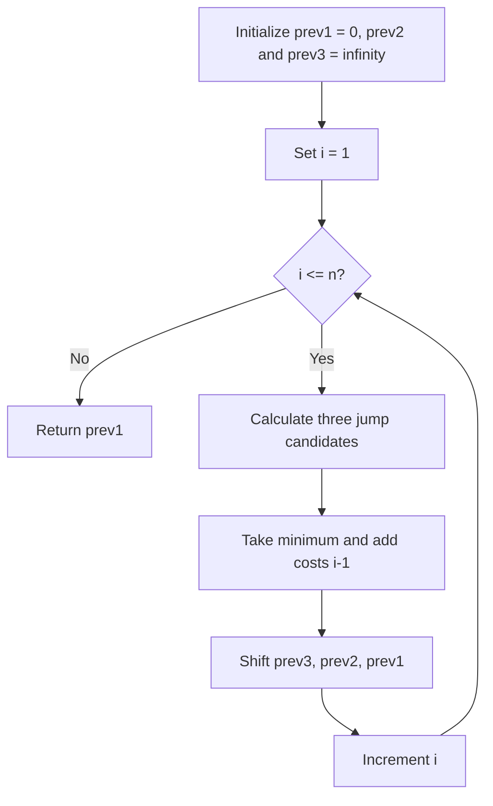

## 👨‍💻 Profiles

**GitHub:** https://github.com/Shailendra0320  
**LeetCode (Main):** https://leetcode.com/u/Shailu03/  
**LeetCode (Alternate):** https://leetcode.com/u/ShailendraLeetcode03/

# 3693. Climbing Stairs II

> **Difficulty:** Medium  
> **Topics:** Array, Dynamic Programming

## Table of Contents

- [1. Problem Statement](#1-problem-statement)
- [2. Examples](#2-examples)
- [3. Constraints](#3-constraints)
- [4. Understand the Rules](#4-understand-the-rules)
- [5. Dynamic Programming Thinking](#5-dynamic-programming-thinking)
- [6. Approach 1 — Recursion](#6-approach-1--recursion)
- [7. Approach 2 — Recursion + Memoization](#7-approach-2--recursion--memoization)
- [8. Approach 3 — Bottom-Up Dynamic Programming](#8-approach-3--bottom-up-dynamic-programming)
- [9. Approach 4 — Space-Optimized Dynamic Programming](#9-approach-4--space-optimized-dynamic-programming)
- [10. Correctness Proof](#10-correctness-proof)
- [11. Approach Comparison](#11-approach-comparison)
- [12. Edge Cases](#12-edge-cases)
- [13. Common Mistakes](#13-common-mistakes)
- [14. Interview Explanation](#14-interview-explanation)
- [15. Quick Revision](#15-quick-revision)

---

## 1. Problem Statement

You are standing at step `0` of a staircase whose steps are numbered from `0` through `n`. The goal is to reach step `n`.

You are given an array `costs` of length `n`. The cost at the 1-indexed position `i` is the amount paid when you land on step `i`. The starting step `0` is free.

From a current step `i`, you may jump forward by exactly one, two, or three steps. When a jump takes you from step `i` to step `j`, its total cost is:

\[
\text{costs}[j] + (j-i)^2
\]

Return the minimum total cost needed to reach step `n`.

**Important indexing detail:** the statement describes `costs` as 1-indexed, but Java, C++, and Python arrays are 0-indexed. Therefore, the cost of landing on step `j` is stored at `costs[j - 1]` in code.

## 2. Examples

### Example 1

**Input:** `n = 4, costs = [1,2,3,4]`  
**Output:** `13`

One optimal route is `0 → 1 → 2 → 4`.

| Jump | Landing cost | Distance penalty | Jump total |
|---|---:|---:|---:|
| `0 → 1` | `1` | `1² = 1` | `2` |
| `1 → 2` | `2` | `1² = 1` | `3` |
| `2 → 4` | `4` | `2² = 4` | `8` |
| **Total** | | | **13** |

### Example 2

**Input:** `n = 4, costs = [5,1,6,2]`  
**Output:** `11`

One optimal route is `0 → 2 → 4`.

| Jump | Landing cost | Distance penalty | Jump total |
|---|---:|---:|---:|
| `0 → 2` | `1` | `2² = 4` | `5` |
| `2 → 4` | `2` | `2² = 4` | `6` |
| **Total** | | | **11** |

### Example 3

**Input:** `n = 3, costs = [9,8,3]`  
**Output:** `12`

The direct jump `0 → 3` costs `3 + 3² = 12`, which is cheaper than the alternatives.

## 3. Constraints

- `1 <= n == costs.length <= 100000`
- `1 <= costs[i] <= 10000`

These constraints make an `O(n)` dynamic programming solution suitable. A solution that explores every possible route recursively is too slow for the largest input.

## 4. Understand the Rules

There are two separate parts to the cost of every jump:

1. **Landing cost:** pay the cost of the step where you arrive.
2. **Jump penalty:** pay the square of the jump length.

The only allowed jump lengths are `1`, `2`, and `3`.

For example, if we jump from step `2` to step `4`, the jump length is `4 - 2 = 2`. We pay the cost of step `4` plus `2²`.

```text
Current step: 2
Destination:  4
Jump length:  4 - 2 = 2
Cost:         costs[4] + 2 * 2
```

The starting step has no landing charge because we begin there. A step's landing cost is paid when we arrive at it, regardless of which previous step we came from.

### Why Dynamic Programming fits

To reach step `i`, the final jump must have started at one of only three positions:

- `i - 1` (jump length 1)
- `i - 2` (jump length 2)
- `i - 3` (jump length 3)

If we already know the cheapest cost to reach each of those previous steps, we can calculate the cheapest cost to reach `i`. Each position is computed once in the efficient solutions.

## 5. Dynamic Programming Thinking

### 5.1 Define the state

Let:

\[
\boxed{dp[i] = \text{minimum total cost to reach step } i}
\]

The starting step is free:

\[
dp[0] = 0
\]

### 5.2 Derive the transition

Suppose we want to reach step `i`.

For a jump of length `jump`, where `jump` is `1`, `2`, or `3`, the previous step is `i - jump`.

The cost of this route is:

\[
dp[i-jump] + costs[i-1] + jump^2
\]

The `i - 1` index is used because the C++/Java/Python array is 0-indexed while the staircase steps are described starting at step 1 for `costs`.

Take the minimum among all valid previous steps:

\[
\boxed{dp[i] = costs[i-1] + \min\begin{cases}
dp[i-1] + 1^2\\
dp[i-2] + 2^2\\
dp[i-3] + 3^2
\end{cases}}
\]

Only include a term when its previous step is at least `0`.

An equivalent loop-based transition is:

```text
best = infinity
for jump = 1, 2, 3:
    previous = i - jump
    if previous >= 0:
        best = min(best, dp[previous] + jump * jump)

dp[i] = costs[i - 1] + best
```

### 5.3 Base case

`dp[0] = 0`, because we start at step 0 without paying anything.

There are no negative-index states. During the first few steps, simply ignore jumps whose previous position would be negative.

### 5.4 Final answer

Once step `n` has been computed, the required answer is:

\[
\boxed{dp[n]}
\]

### 5.5 DP dependency diagram



---

## 6. Approach 1 — Recursion

### 6.1 Intuition

Think backward from the destination. To arrive at step `i`, the previous step must be `i - 1`, `i - 2`, or `i - 3`.

Try every valid previous step, recursively calculate its minimum cost, add the cost of landing on step `i` and the squared jump penalty, and choose the smallest result.

This directly follows the transition equation, so it is a useful way to understand the problem before optimizing it.

### 6.2 Algorithm

1. If the requested step is `0`, return `0`.
2. Initialize the best answer to a very large value.
3. Try jump lengths `1`, `2`, and `3`.
4. Skip a jump if it would come from a negative step.
5. Recursively calculate the cost to reach the previous step.
6. Add `costs[step - 1]` and `jump * jump`.
7. Return the smallest candidate.

### 6.3 Flowchart



### 6.4 Dry Run — `n = 3`, `costs = [9,8,3]`

To reach step `3`, recursion considers:

| Previous step | Jump length | Previous best cost | Landing cost | Penalty | Candidate |
|---:|---:|---:|---:|---:|---:|
| `2` | `1` | `12` | `3` | `1` | `16` |
| `1` | `2` | `10` | `3` | `4` | `17` |
| `0` | `3` | `0` | `3` | `9` | `12` |

The minimum candidate is `12`, from the direct route `0 → 3`.

### 6.5 Java Code

```java
// Approach-1 (Recursion)
// T.C: O(3^n) upper bound
// S.C: O(n) recursion stack

class Solution {
    public int climbStairs(int n, int[] costs) {
        return solve(n, costs);
    }

    private int solve(int step, int[] costs) {
        if (step == 0) {
            return 0;
        }

        int best = Integer.MAX_VALUE;

        for (int jump = 1; jump <= 3; jump++) {
            int previous = step - jump;

            if (previous >= 0) {
                int candidate = solve(previous, costs)
                        + costs[step - 1] + jump * jump;
                best = Math.min(best, candidate);
            }
        }

        return best;
    }
}
```

### 6.6 C++ Code

```cpp
// Approach-1 (Recursion)
// T.C: O(3^n) upper bound
// S.C: O(n) recursion stack

class Solution {
public:
    int climbStairs(int n, vector<int>& costs) {
        return solve(n, costs);
    }

private:
    int solve(int step, vector<int>& costs) {
        if (step == 0) {
            return 0;
        }

        int best = INT_MAX;

        for (int jump = 1; jump <= 3; jump++) {
            int previous = step - jump;

            if (previous >= 0) {
                int candidate = solve(previous, costs)
                        + costs[step - 1] + jump * jump;
                best = min(best, candidate);
            }
        }

        return best;
    }
};
```

### 6.7 Python Code

```python
# Approach-1 (Recursion)
# T.C: O(3^n) upper bound
# S.C: O(n) recursion stack

from typing import List

class Solution:
    def climbStairs(self, n: int, costs: List[int]) -> int:
        def solve(step: int) -> int:
            if step == 0:
                return 0

            best = float("inf")

            for jump in range(1, 4):
                previous = step - jump

                if previous >= 0:
                    candidate = (
                        solve(previous) + costs[step - 1] + jump * jump
                    )
                    best = min(best, candidate)

            return best

        return solve(n)
```

### 6.8 Complexity Analysis

- **Time:** `O(3^n)` as a simple upper bound. The same smaller states are recalculated through many paths, so the actual recursion grows exponentially.
- **Space:** `O(n)` for the deepest recursion chain.

**Verdict:** This approach is for understanding the recurrence only. It will not finish within the time limit for large constraints.

---

## 7. Approach 2 — Recursion + Memoization

### 7.1 Intuition

The recursive solution repeatedly solves the same subproblem. For example, the minimum cost to reach step `2` may be requested while solving step `3`, step `4`, and many later steps.

Memoization stores the answer the first time a step is solved. Every later request for that step returns the stored value immediately.

### 7.2 State and transition

Use the same state:

\[
dp[i] = \text{minimum cost to reach step } i
\]

Use `-1` to mean that a state has not been calculated yet. Since every valid total cost is non-negative, `-1` is a safe marker.

The transition does not change. The only difference is that each state is calculated once.

### 7.3 Algorithm

1. Create a memo array of size `n + 1`, initialized to `-1`.
2. Return `0` when the recursive step is `0`.
3. If the current step already has a saved answer, return it.
4. Try all valid jump lengths from `1` through `3`.
5. Save the minimum candidate in the memo array.
6. Return the saved value for step `n`.

### 7.4 Flowchart



### 7.5 Dry Run — `n = 4`, `costs = [1,2,3,4]`

The first call for a step calculates and stores it. A later call for that step reuses the stored answer.

| Step | Minimum cost | Reason |
|---:|---:|---|
| `0` | `0` | Starting position |
| `1` | `2` | `0 + 1 + 1²` |
| `2` | `5` | `min(2 + 2 + 1², 0 + 2 + 2²)` |
| `3` | `9` | `min(5 + 3 + 1², 2 + 3 + 2², 0 + 3 + 3²)` |
| `4` | `13` | `min(9 + 4 + 1², 5 + 4 + 2², 2 + 4 + 3²)` |

The final memoized answer is `13`.

### 7.6 Java Code

```java
// Approach-2 (Recursion + Memoization)
// T.C: O(n)
// S.C: O(n) memo array + O(n) recursion stack

class Solution {
    public int climbStairs(int n, int[] costs) {
        int[] memo = new int[n + 1];
        java.util.Arrays.fill(memo, -1);
        return solve(n, costs, memo);
    }

    private int solve(int step, int[] costs, int[] memo) {
        if (step == 0) {
            return 0;
        }

        if (memo[step] != -1) {
            return memo[step];
        }

        int best = Integer.MAX_VALUE;

        for (int jump = 1; jump <= 3; jump++) {
            int previous = step - jump;

            if (previous >= 0) {
                int candidate = solve(previous, costs, memo)
                        + costs[step - 1] + jump * jump;
                best = Math.min(best, candidate);
            }
        }

        return memo[step] = best;
    }
}
```

### 7.7 C++ Code

```cpp
// Approach-2 (Recursion + Memoization)
// T.C: O(n)
// S.C: O(n) memo array + O(n) recursion stack

class Solution {
public:
    int climbStairs(int n, vector<int>& costs) {
        vector<int> memo(n + 1, -1);
        return solve(n, costs, memo);
    }

private:
    int solve(int step, vector<int>& costs, vector<int>& memo) {
        if (step == 0) {
            return 0;
        }

        if (memo[step] != -1) {
            return memo[step];
        }

        int best = INT_MAX;

        for (int jump = 1; jump <= 3; jump++) {
            int previous = step - jump;

            if (previous >= 0) {
                int candidate = solve(previous, costs, memo)
                        + costs[step - 1] + jump * jump;
                best = min(best, candidate);
            }
        }

        return memo[step] = best;
    }
};
```

### 7.8 Python Code

```python
# Approach-2 (Recursion + Memoization)
# T.C: O(n)
# S.C: O(n) memo array + O(n) recursion stack

from typing import List

class Solution:
    def climbStairs(self, n: int, costs: List[int]) -> int:
        memo = [-1] * (n + 1)

        def solve(step: int) -> int:
            if step == 0:
                return 0

            if memo[step] != -1:
                return memo[step]

            best = float("inf")

            for jump in range(1, 4):
                previous = step - jump

                if previous >= 0:
                    candidate = (
                        solve(previous) + costs[step - 1] + jump * jump
                    )
                    best = min(best, candidate)

            memo[step] = best
            return memo[step]

        return solve(n)
```

### 7.9 Complexity Analysis and Practical Note

- **Time:** `O(n)`. There are `n + 1` states, and each state checks at most three transitions.
- **Space:** `O(n)` for the memo array and `O(n)` for recursion depth.

**Important:** Although memoization reduces the time complexity to linear, a recursive call chain can still become very deep when `n` is as large as `100000`. Python may hit its recursion limit, and Java/C++ may run out of call-stack space. Use an iterative approach for a reliable submission.

---

## 8. Approach 3 — Bottom-Up Dynamic Programming

### 8.1 Intuition

Instead of starting at step `n` and recursively asking for earlier answers, compute the answers from the bottom upward.

We know `dp[0] = 0`. Then calculate `dp[1]`, `dp[2]`, and continue until `dp[n]`.

When we calculate `dp[i]`, the previous three states are already available. This removes recursion and guarantees that every state is processed once.

### 8.2 Algorithm

1. Create `dp` with `n + 1` entries.
2. Set `dp[0] = 0`.
3. For each step `i` from `1` to `n`, initialize `best` to infinity.
4. Check jump lengths `1`, `2`, and `3`.
5. For every valid previous step, calculate `dp[i - jump] + jump²`.
6. Add the landing cost `costs[i - 1]` to the smallest candidate.
7. Store the result in `dp[i]`.
8. Return `dp[n]`.

### 8.3 Flowchart



### 8.4 Detailed Dry Run — Example 1

**Input:** `n = 4`, `costs = [1,2,3,4]`

Start with `dp[0] = 0`.

| Destination `i` | From `i-1` | From `i-2` | From `i-3` | `dp[i]` |
|---:|---:|---:|---:|---:|
| `0` | — | — | — | `0` |
| `1` | `0 + 1 + 1 = 2` | Invalid | Invalid | `2` |
| `2` | `2 + 2 + 1 = 5` | `0 + 2 + 4 = 6` | Invalid | `5` |
| `3` | `5 + 3 + 1 = 9` | `2 + 3 + 4 = 9` | `0 + 3 + 9 = 12` | `9` |
| `4` | `9 + 4 + 1 = 14` | `5 + 4 + 4 = 13` | `2 + 4 + 9 = 15` | `13` |

The completed DP array is:

```text
dp = [0, 2, 5, 9, 13]
```

Therefore, the minimum total cost is `dp[4] = 13`.

### 8.5 Java Code

```java
// Approach-3 (Bottom-Up Dynamic Programming)
// T.C: O(n)
// S.C: O(n)

class Solution {
    public int climbStairs(int n, int[] costs) {
        long[] dp = new long[n + 1];
        dp[0] = 0;

        for (int i = 1; i <= n; i++) {
            long best = Long.MAX_VALUE / 4;

            for (int jump = 1; jump <= 3; jump++) {
                int previous = i - jump;

                if (previous >= 0) {
                    long candidate = dp[previous] + (long) jump * jump;
                    best = Math.min(best, candidate);
                }
            }

            dp[i] = costs[i - 1] + best;
        }

        return (int) dp[n];
    }
}
```

### 8.6 C++ Code

```cpp
// Approach-3 (Bottom-Up Dynamic Programming)
// T.C: O(n)
// S.C: O(n)

class Solution {
public:
    int climbStairs(int n, vector<int>& costs) {
        vector<long long> dp(n + 1, 0);
        dp[0] = 0;

        for (int i = 1; i <= n; i++) {
            long long best = LLONG_MAX / 4;

            for (int jump = 1; jump <= 3; jump++) {
                int previous = i - jump;

                if (previous >= 0) {
                    long long candidate = dp[previous] + 1LL * jump * jump;
                    best = min(best, candidate);
                }
            }

            dp[i] = costs[i - 1] + best;
        }

        return (int) dp[n];
    }
};
```

### 8.7 Python Code

```python
# Approach-3 (Bottom-Up Dynamic Programming)
# T.C: O(n)
# S.C: O(n)

from typing import List

class Solution:
    def climbStairs(self, n: int, costs: List[int]) -> int:
        dp = [0] * (n + 1)

        for i in range(1, n + 1):
            best = float("inf")

            for jump in range(1, 4):
                previous = i - jump

                if previous >= 0:
                    candidate = dp[previous] + jump * jump
                    best = min(best, candidate)

            dp[i] = costs[i - 1] + best

        return dp[n]
```

### 8.8 Complexity Analysis

- **Time:** `O(n)`. Each of the `n` destination steps checks only three possible jumps. Three is a constant, so the total work is linear.
- **Space:** `O(n)` for the DP array.

**Verdict:** This is a clean and reliable solution. We can reduce its memory further because each state only needs the previous three states.

---

## 9. Approach 4 — Space-Optimized Dynamic Programming

### 9.1 Intuition

The full DP array is not necessary. To calculate `dp[i]`, we only read:

- `dp[i - 1]`
- `dp[i - 2]`
- `dp[i - 3]`

After calculating `dp[i]`, older values will never be used again. We can keep only three rolling variables instead of an array of size `n + 1`.

This keeps the same linear running time while using constant extra space.

### 9.2 The three variables

Before calculating the current destination `i`, maintain:

| Variable | Represents |
|---|---|
| `prev1` | `dp[i - 1]` |
| `prev2` | `dp[i - 2]` |
| `prev3` | `dp[i - 3]` |

Initially, before calculating step `1`:

```text
prev1 = dp[0] = 0
prev2 = infinity
prev3 = infinity
```

The infinity values represent previous steps that do not exist yet.

### 9.3 Transition

For the current step `i`, let `landing = costs[i - 1]`.

\[
current = landing + \min\begin{cases}
prev1 + 1\\
prev2 + 4\\
prev3 + 9
\end{cases}
\]

Then shift the variables forward:

```text
prev3 = prev2
prev2 = prev1
prev1 = current
```

After this shift, the variables represent the three previous DP states for the next iteration.

### 9.4 Algorithm

1. Initialize `prev1 = 0` and `prev2`, `prev3` to infinity.
2. Iterate through destination steps from `1` to `n`.
3. Calculate the minimum of the three possible previous-state costs.
4. Add the current step's landing cost.
5. Shift the three state variables.
6. After the loop, `prev1` contains the minimum cost to reach step `n`.

### 9.5 Flowchart



### 9.6 Dry Run — `n = 4`, `costs = [1,2,3,4]`

The table shows the rolling values **before** each destination is calculated and then the new result.

| Step | `prev1` | `prev2` | `prev3` | New `current` |
|---:|---:|---:|---:|---:|
| `1` | `0` | `∞` | `∞` | `0 + 1 + 1 = 2` |
| `2` | `2` | `0` | `∞` | `min(2+1, 0+4) + 2 = 5` |
| `3` | `5` | `2` | `0` | `min(5+1, 2+4, 0+9) + 3 = 9` |
| `4` | `9` | `5` | `2` | `min(9+1, 5+4, 2+9) + 4 = 13` |

After processing step `4`, `prev1 = 13`. That is the answer.

### 9.7 Java Code

```java
// Approach-4 (Space-Optimized Dynamic Programming)
// T.C: O(n)
// S.C: O(1)

class Solution {
    public int climbStairs(int n, int[] costs) {
        long prev1 = 0;
        long prev2 = Long.MAX_VALUE / 4;
        long prev3 = Long.MAX_VALUE / 4;

        for (int i = 1; i <= n; i++) {
            long landing = costs[i - 1];

            long oneStep = prev1 + landing + 1;
            long twoSteps = prev2 + landing + 4;
            long threeSteps = prev3 + landing + 9;

            long current = Math.min(oneStep, Math.min(twoSteps, threeSteps));

            prev3 = prev2;
            prev2 = prev1;
            prev1 = current;
        }

        return (int) prev1;
    }
}
```

### 9.8 C++ Code

```cpp
// Approach-4 (Space-Optimized Dynamic Programming)
// T.C: O(n)
// S.C: O(1)

class Solution {
public:
    int climbStairs(int n, vector<int>& costs) {
        const long long INF = LLONG_MAX / 4;

        long long prev1 = 0;
        long long prev2 = INF;
        long long prev3 = INF;

        for (int i = 1; i <= n; i++) {
            long long landing = costs[i - 1];

            long long oneStep = prev1 + landing + 1;
            long long twoSteps = prev2 + landing + 4;
            long long threeSteps = prev3 + landing + 9;

            long long current = min(oneStep, min(twoSteps, threeSteps));

            prev3 = prev2;
            prev2 = prev1;
            prev1 = current;
        }

        return (int) prev1;
    }
};
```

### 9.9 Python Code

```python
# Approach-4 (Space-Optimized Dynamic Programming)
# T.C: O(n)
# S.C: O(1)

from typing import List

class Solution:
    def climbStairs(self, n: int, costs: List[int]) -> int:
        infinity = 10**30

        prev1 = 0
        prev2 = infinity
        prev3 = infinity

        for i in range(1, n + 1):
            landing = costs[i - 1]

            one_step = prev1 + landing + 1
            two_steps = prev2 + landing + 4
            three_steps = prev3 + landing + 9

            current = min(one_step, two_steps, three_steps)

            prev3 = prev2
            prev2 = prev1
            prev1 = current

        return prev1
```

### 9.10 Complexity Analysis

- **Time:** `O(n)`, because we process every step once and perform three constant-time comparisons.
- **Space:** `O(1)`, because only three previous DP values and a few temporary variables are stored.

**Verdict:** This is the recommended submission. It is iterative, efficient, and avoids recursion depth issues.

---

## 10. Correctness Proof

We prove that the DP recurrence returns the minimum possible cost for every step.

### Base case

At step `0`, the climber starts without making a jump and pays nothing. Therefore `dp[0] = 0` is correct.

### Inductive assumption

Assume that `dp[0]` through `dp[i - 1]` contain the minimum costs for reaching their respective steps.

### Transition

Every valid route that ends at step `i` must make its final jump from exactly one of `i - 1`, `i - 2`, or `i - 3`, because no other jump length is allowed.

For each valid predecessor `p`, the cheapest route that uses that predecessor as its final jump costs:

\[
dp[p] + costs[i-1] + (i-p)^2
\]

By the inductive assumption, `dp[p]` is already the cheapest cost to reach `p`. Taking the minimum over all valid predecessors therefore chooses the cheapest possible final route to `i`.

Thus, the recurrence computes the correct `dp[i]`.

### Conclusion

By induction, all states through `dp[n]` are correct. Therefore, returning `dp[n]` gives the minimum total cost to reach the final step.

### Why the rolling optimization is also correct

The rolling version keeps exactly the three prior states that the recurrence can read. Its invariant is that before calculating step `i`, `prev1`, `prev2`, and `prev3` equal `dp[i-1]`, `dp[i-2]`, and `dp[i-3]` whenever those states exist. Shifting them after each calculation preserves that invariant. It therefore computes the same values as the full DP array.

---

## 11. Approach Comparison

| Approach | Time Complexity | Auxiliary Space | Suitable for `n = 100000`? |
|---|---:|---:|---|
| Recursion | `O(3^n)` upper bound | `O(n)` stack | No |
| Memoization | `O(n)` | `O(n)` + recursion stack | Not reliably due to deep recursion |
| Bottom-Up DP | `O(n)` | `O(n)` | Yes |
| Space-Optimized DP | `O(n)` | `O(1)` | **Yes — recommended** |

### Which approach should you use?

- Use **recursion** to understand how the three previous states lead to the current state.
- Use **memoization** to understand how caching removes repeated work.
- Use **bottom-up DP** when you want the clearest iterative implementation.
- Use **space-optimized DP** for the most memory-efficient submission.

---

## 12. Edge Cases

| Case | Input | Expected output | What it checks |
|---|---|---:|---|
| One stair | `n = 1, costs = [7]` | `8` | Only the one-step jump is possible |
| Two stairs | `n = 2, costs = [5,1]` | `5` | Choose between `0→2` and `0→1→2` |
| Three stairs | `n = 3, costs = [9,8,3]` | `12` | All three jump lengths are possible from start |
| Prefer one-step jumps | `n = 4, costs = [1,2,3,4]` | `13` | A mixed route can be optimal |
| Prefer longer jumps | `n = 4, costs = [5,1,6,2]` | `11` | A two-step jump can reduce the total |
| Large input | `n = 100000` | Valid integer answer | Linear time and iterative stack safety |

### Small input calculations

For `n = 1`, only `0 → 1` is possible:

\[
answer = costs[0] + 1^2
\]

For `n = 2`, the answer is the minimum of:

\[
\begin{aligned}
0 \rightarrow 1 \rightarrow 2 &: costs[0]+1+costs[1]+1\\
0 \rightarrow 2 &: costs[1]+4
\end{aligned}
\]

---

## 13. Common Mistakes

### Mistake 1: Forgetting the squared jump length

A jump of length `3` adds `9`, not `3`.

Correct:

```java
jump * jump
```

### Mistake 2: Adding the wrong step's landing cost

When calculating the cost to reach step `i`, add `costs[i - 1]`, not `costs[i]`.

### Mistake 3: Treating `costs` as a 0-indexed step array

The staircase has steps `0` through `n`, but `costs` contains only the costs for steps `1` through `n`. Thus `costs[0]` belongs to step `1`.

### Mistake 4: Forgetting the free starting step

The correct base case is:

```text
dp[0] = 0
```

Do not charge a landing cost at step `0`.

### Mistake 5: Using an invalid previous step

At step `1`, only a jump from step `0` exists. At step `2`, only jumps from steps `1` and `0` exist. Check `previous >= 0` before accessing the DP state.

### Mistake 6: Keeping only two previous DP values

A jump may be three steps long, so `dp[i - 3]` is also needed. The optimized solution must retain three previous states.

### Mistake 7: Using naive recursion for the constraints

There are many repeated subproblems. Plain recursion grows exponentially and will time out.

### Mistake 8: Using recursive memoization without considering stack depth

Memoization makes the number of calculated states linear, but the recursion chain can still reach `n`. An iterative implementation avoids this risk.

### Mistake 9: Incorrectly shifting rolling variables

The correct update order is:

```text
prev3 = prev2
prev2 = prev1
prev1 = current
```

This makes the variables represent the previous three states for the next step. Do not overwrite `prev1` before moving its old value into `prev2`.

---

## 14. Interview Explanation

You can explain the solution like this:

> I define `dp[i]` as the minimum cost to reach stair `i`. The starting stair has cost zero. Since I can jump only one, two, or three steps, the last jump to stair `i` must come from `i-1`, `i-2`, or `i-3`. For a jump of length `k`, I add the minimum cost of reaching the previous stair, the landing cost `costs[i-1]`, and the jump penalty `k*k`. I take the minimum of the valid choices. This gives an `O(n)` DP solution. Since each state uses only the previous three states, I can keep three variables and reduce extra space from `O(n)` to `O(1)`.

### Follow-up questions

**Q1. Why is the starting state zero?**  
Because the climber begins on step `0` and the problem says the initial cost is zero.

**Q2. Why do we consider only three previous steps?**  
Because jumps longer than three steps are not allowed.

**Q3. Why is the transition linear?**  
There are `n` destination steps and each one checks at most three possible predecessors.

**Q4. Why can we optimize the DP array to three variables?**  
The recurrence never reads a state older than `dp[i-3]`. Once the current state is calculated, earlier values can be discarded.

**Q5. Why does a longer jump not always cost more overall?**  
Its distance penalty is larger, but it may avoid paying landing costs on intermediate steps. We must compare all valid choices rather than always taking the smallest jump.

---

## 15. Quick Revision

### Core formula

\[
\boxed{dp[i] = costs[i-1] + \min_{k\in\{1,2,3\},\ i-k\ge0}(dp[i-k]+k^2)}
\]

### Remember these points

- Start at step `0` with cost `0`.
- Each landing on step `i` adds `costs[i - 1]`.
- Allowed jump lengths are `1`, `2`, and `3`.
- Jump penalties are `1`, `4`, and `9`.
- Check only valid previous steps.
- The answer is `dp[n]`.
- Space optimization needs exactly three rolling states.

### Final complexity

<details>
<summary>Recommended solution — Space-Optimized DP</summary>

- **Time Complexity:** `O(n)`
- **Space Complexity:** `O(1)`

</details>

**Final recommendation:** Submit **Approach 4 — Space-Optimized Dynamic Programming**. It processes every stair once, checks only three possible jumps, and stores only three previous DP values.

---

## Official Reference

- [LeetCode 3693 — Climbing Stairs II](https://leetcode.com/problems/climbing-stairs-ii/)
