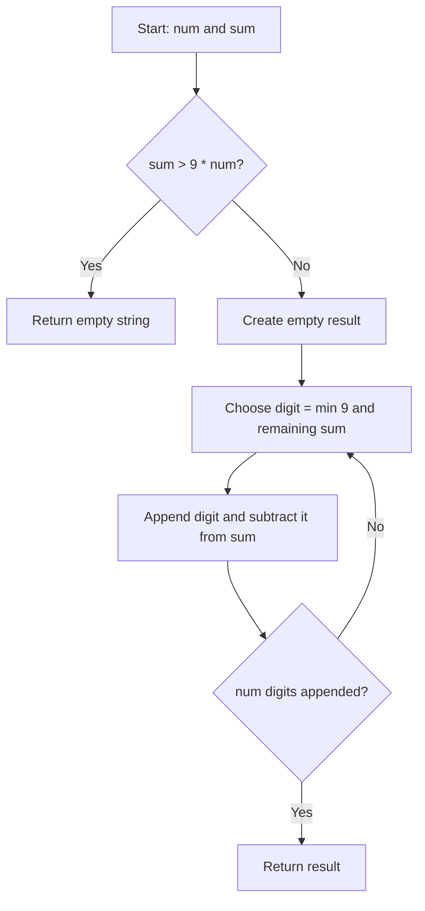
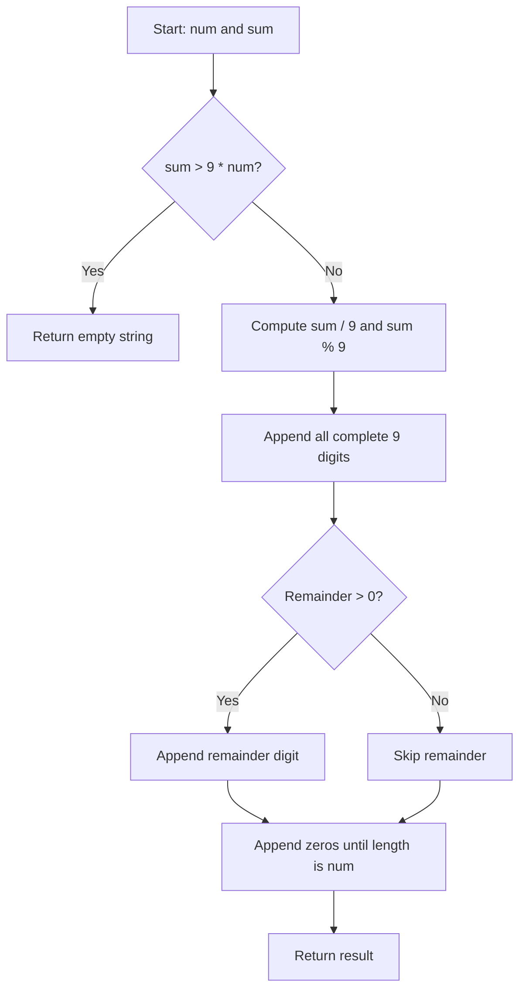

## 👨‍💻 Profiles

| Platform                 | Profile                                                              |
| :----------------------- | :------------------------------------------------------------------- |
| **GitHub**               | [Shailendra0320](https://github.com/Shailendra0320)                  |
| **LeetCode — Main**      | [Shailu03](https://leetcode.com/u/Shailu03/)                         |
| **LeetCode — Alternate** | [ShailendraLeetcode03](https://leetcode.com/u/ShailendraLeetcode03/) |

<div align="center">
<h1>3723. Maximize Sum of Squares of Digits</h1>
<p><strong>Greedy · Math · String Construction</strong></p>
<p><strong>Tags:</strong> Math · Greedy · String Construction</p>
<p><a href="https://leetcode.com/problems/maximize-sum-of-squares-of-digits/">LeetCode Problem</a> · <strong>Medium</strong></p>
</div>

---

## Table of Contents

- [Problem at a Glance](#problem-at-a-glance)
- [Problem Statement](#problem-statement)
- [Examples](#examples)
- [Constraints](#constraints)
- [Core Insight](#core-insight)
- [Approach 1 — Greedy Digit Filling](#approach-1--greedy-digit-filling)
- [Approach 2 — Quotient and Remainder](#approach-2--quotient-and-remainder)
- [Code Implementations](#code-implementations)
- [Correctness Proof](#correctness-proof)
- [Complexity Comparison](#complexity-comparison)
- [Edge Cases](#edge-cases)
- [Common Mistakes](#common-mistakes)
- [Pattern Recognition](#pattern-recognition)
- [Interview Explanation](#interview-explanation)
- [Quick Revision](#quick-revision)

## Problem at a Glance

| Item                     | Details                                                                   |
| :----------------------- | :------------------------------------------------------------------------ |
| **Input**                | `num`: required digit count; `sum`: required digit sum                    |
| **Output**               | The optimal integer as a string, or `""` if impossible                    |
| **Primary pattern**      | Greedy construction                                                       |
| **Key decision**         | Put as much of the remaining sum as possible into each leftmost digit     |
| **Recommended approach** | Greedy digit filling                                                      |
| **Time complexity**      | `O(num)`                                                                  |
| **Space complexity**     | `O(num)` for the returned string; `O(1)` auxiliary space excluding output |

> **Core idea:** Use as many `9`s as possible, then one non-zero remainder digit if needed, and fill the remaining places with `0`s. Put the larger digits first.

## Problem Statement

You are given two positive integers, `num` and `sum`.

A positive integer `n` is considered **good** when:

- It contains exactly `num` digits.
- The sum of its digits is exactly `sum`.

The **score** of `n` is the sum of the squares of its digits. For example, the score of `n = 321` is `3² + 2² + 1² = 14`.

Return a string representing the good integer with the **maximum possible score**. If multiple good integers have the same score, return the **numerically largest** one. If no good integer exists, return an empty string, `""`.

### What must be optimized?

There are two priorities, in this order:

1. Maximize the sum of squared digits.
2. If multiple answers have that same score, return the largest integer.

This is a construction problem: we do not need to enumerate candidate integers. We can build the optimal result directly.

## Examples

### Example 1

```text
Input:  num = 2, sum = 3
Output: "30"
```

The possible good integers are `12`, `21`, and `30`.

| Integer  |  Digit sum  |             Score |
| :------: | :---------: | ----------------: |
|   `12`   | `1 + 2 = 3` |     `1² + 2² = 5` |
|   `21`   | `2 + 1 = 3` |     `2² + 1² = 5` |
| **`30`** | `3 + 0 = 3` | **`3² + 0² = 9`** |

`30` has the maximum score, so the answer is `"30"`.

### Example 2

```text
Input:  num = 2, sum = 17
Output: "98"
```

The only possible digit arrangements are `89` and `98`. Both score `8² + 9² = 145`, but `98` is numerically larger, so return `"98"`.

### Example 3

```text
Input:  num = 1, sum = 10
Output: ""
```

A single digit can be at most `9`. Since the required sum is `10`, no valid answer exists.

## Constraints

- `1 <= num <= 2 * 10^5`
- `1 <= sum <= 2 * 10^6`

The maximum sum that `num` digits can represent is `9 * num`. If `sum > 9 * num`, no solution is possible.

## Core Insight

### 1. Why should we prefer large digits?

The digit sum is fixed, but the score squares every digit. Squaring rewards concentrating the sum into fewer, larger digits.

Suppose two digits are `a` and `b`, where `a >= b`, `a < 9`, and `b > 0`. Move one unit from `b` to `a`:

- Before: `a² + b²`
- After: `(a + 1)² + (b - 1)²`

The score changes by:

```text
(a + 1)² + (b - 1)² - a² - b²
= 2(a - b) + 2
> 0
```

So, whenever possible, transferring one unit from a smaller positive digit to a larger digit increases the score. Repeating this process makes digits as large as possible, up to `9`.

### 2. Why should the largest digits come first?

The score does not change when digits are rearranged. For example, `89` and `98` both have the score `145`.

When several arrangements have the same best score, arranging digits in descending order gives the numerically largest result. Therefore, place `9`s first, then the remainder digit, then zeros.

### 3. Feasibility check

Every digit can contribute at most `9`. Therefore:

```text
maximum possible digit sum = 9 * num
```

If `sum > 9 * num`, return `""` immediately.

### 4. The optimal structure

Let:

```text
nines     = sum / 9
remainder = sum % 9
```

Using integer division, `nines` is the number of complete `9` digits. The `remainder` is between `0` and `8`.

The answer has this structure:

```text
[ nines copies of '9' ][ remainder digit if non-zero ][ enough '0's to reach num digits ]
```

The remainder digit is omitted when `remainder == 0`.

## Approach 1 — Greedy Digit Filling

**Idea:** Starting from the leftmost digit, put as much of the remaining sum as possible into the current digit, capped at `9`.

### Algorithm

1. If `sum > 9 * num`, return `""` because the digit sum is impossible.
2. Create an empty result string with capacity `num`.
3. Repeat exactly `num` times:
   - Choose `digit = min(9, sum)`.
   - Append that digit to the answer.
   - Subtract the chosen digit from `sum`.
4. Return the constructed string.

After the remaining sum reaches zero, all later digits become `0`. Since we fill from left to right, the largest digits naturally appear first.

### Flowchart



### Dry Run — `num = 4`, `sum = 23`

| Position | Remaining sum before | Chosen digit `min(9, remaining)` | Remaining sum after | Result so far |
| -------: | -------------------: | -------------------------------: | ------------------: | :------------ |
|        1 |                   23 |                                9 |                  14 | `9`           |
|        2 |                   14 |                                9 |                   5 | `99`          |
|        3 |                    5 |                                5 |                   0 | `995`         |
|        4 |                    0 |                                0 |                   0 | `9950`        |

The answer is `"9950"`.

- Digit sum: `9 + 9 + 5 + 0 = 23`
- Score: `9² + 9² + 5² + 0² = 187`

### Implementation Notes

- Use a mutable string builder in Java and C++ to avoid repeatedly copying a growing string.
- Return a **string**, not a numeric type, because `num` can be as large as `200,000` digits.
- The feasibility check must happen before constructing the result.

## Approach 2 — Quotient and Remainder

**Idea:** Compute the number of `9`s and the leftover digit mathematically, then append zeros until the answer has exactly `num` digits.

### Algorithm

1. If `sum > 9 * num`, return `""`.
2. Compute `nines = sum / 9` and `remainder = sum % 9`.
3. Append `nines` copies of `'9'`.
4. If `remainder > 0`, append that single remainder digit.
5. Append `'0'` until the result length is exactly `num`.
6. Return the result.

### Flowchart



### Dry Run — `num = 2`, `sum = 17`

| Step             | Calculation           | Value           |
| :--------------- | :-------------------- | :-------------- |
| Feasibility      | `17 <= 9 * 2`         | Valid           |
| Number of nines  | `17 / 9`              | `1`             |
| Remainder        | `17 % 9`              | `8`             |
| Append nines     | One `'9'`             | `9`             |
| Append remainder | Append `'8'`          | `98`            |
| Padding          | Length is already `2` | No zeros needed |

Return `"98"`. Its digit sum is `17`, its score is `9² + 8² = 145`, and it is larger than `"89"` among equal-score arrangements.

### Why this approach is useful

It shows the optimal structure directly: complete groups of nine, at most one leftover digit, and zeros. It has the same asymptotic complexity as Approach 1, but the construction is expressed through arithmetic rather than a digit-by-digit greedy loop.

## Code Implementations

The implementations below use the required LeetCode method name, `maxSumOfSquares`. Each language has both approaches in one code block. Approach name and complexity comments come before each implementation, as preferred.

### Java

```java
//Approach-1 (Greedy Digit Filling)
//T.C : O(num)
//S.C : O(1) auxiliary, O(num) including output

class Solution {
    public String maxSumOfSquares(int num, int sum) {
        if ((long) sum > 9L * num) {
            return "";
        }

        StringBuilder answer = new StringBuilder(num);
        int remaining = sum;

        for (int i = 0; i < num; i++) {
            int digit = Math.min(9, remaining);
            answer.append((char) ('0' + digit));
            remaining -= digit;
        }

        return answer.toString();
    }
}

//Approach-2 (Quotient and Remainder)
//T.C : O(num)
//S.C : O(1) auxiliary, O(num) including output

class Solution2 {
    public String maxSumOfSquares(int num, int sum) {
        if ((long) sum > 9L * num) {
            return "";
        }

        StringBuilder answer = new StringBuilder(num);
        int nines = sum / 9;
        int remainder = sum % 9;

        for (int i = 0; i < nines; i++) {
            answer.append('9');
        }

        if (remainder > 0) {
            answer.append((char) ('0' + remainder));
        }

        while (answer.length() < num) {
            answer.append('0');
        }

        return answer.toString();
    }
}
```

### C++

```cpp
//Approach-1 (Greedy Digit Filling)
//T.C : O(num)
//S.C : O(1) auxiliary, O(num) including output

#include <bits/stdc++.h>
using namespace std;

class Solution {
public:
    string maxSumOfSquares(int num, int sum) {
        if (1LL * sum > 9LL * num) {
            return "";
        }

        string answer;
        answer.reserve(num);
        int remaining = sum;

        for (int i = 0; i < num; i++) {
            int digit = min(9, remaining);
            answer.push_back(static_cast<char>('0' + digit));
            remaining -= digit;
        }

        return answer;
    }
};

//Approach-2 (Quotient and Remainder)
//T.C : O(num)
//S.C : O(1) auxiliary, O(num) including output

class Solution2 {
public:
    string maxSumOfSquares(int num, int sum) {
        if (1LL * sum > 9LL * num) {
            return "";
        }

        string answer;
        answer.reserve(num);
        int nines = sum / 9;
        int remainder = sum % 9;

        answer.append(nines, '9');

        if (remainder > 0) {
            answer.push_back(static_cast<char>('0' + remainder));
        }

        answer.append(num - static_cast<int>(answer.size()), '0');
        return answer;
    }
};
```

### Python

```python
#Approach-1 (Greedy Digit Filling)
#T.C : O(num)
#S.C : O(1) auxiliary, O(num) including output

class Solution:
    def maxSumOfSquares(self, num: int, sum: int) -> str:
        if sum > 9 * num:
            return ""

        answer = []
        remaining = sum

        for _ in range(num):
            digit = min(9, remaining)
            answer.append(str(digit))
            remaining -= digit

        return "".join(answer)


#Approach-2 (Quotient and Remainder)
#T.C : O(num)
#S.C : O(1) auxiliary, O(num) including output

class Solution2:
    def maxSumOfSquares(self, num: int, sum: int) -> str:
        if sum > 9 * num:
            return ""

        nines, remainder = divmod(sum, 9)
        answer = ['9'] * nines

        if remainder > 0:
            answer.append(str(remainder))

        answer.extend(['0'] * (num - len(answer)))
        return "".join(answer)
```

## Correctness Proof

### Lemma 1 — Feasibility check is correct

Each of the `num` digits is at most `9`, so no valid number can have digit sum greater than `9 * num`. If `sum` exceeds this limit, returning `""` is correct. Otherwise, the greedy construction can represent the requested sum by assigning up to `9` to each position.

### Lemma 2 — An optimal score uses as many `9`s as possible

If a smaller positive digit can transfer one unit to a larger digit without making the larger digit exceed `9`, the score increases by `2(a - b) + 2`, which is positive. Therefore, a maximum-score arrangement cannot leave such a transfer available. The sum must be concentrated into as many `9`s as possible, then at most one non-zero remainder digit, with all other digits equal to zero.

### Lemma 3 — Descending order gives the largest optimal number

Permuting digits does not affect either the digit sum or the sum of squared digits. Among all permutations of the same digits, placing the largest digit at the leftmost position makes the number largest. Applying this rule at every position means the digits must be in descending order.

### Theorem

The algorithm first rejects exactly those inputs that are impossible. For every feasible input, it constructs as many `9`s as possible, includes the remainder digit if needed, and fills the remaining places with zeros. By Lemma 2, this maximizes the score; by Lemma 3, the descending order selects the largest number among maximum-score answers. Hence the returned string is correct.

## Complexity Comparison

Let `N = num`.

| Approach                                |  Time  | Auxiliary space excluding output | Returned string |
| :-------------------------------------- | :----: | :------------------------------: | :-------------: |
| **Approach 1 — Greedy digit filling**   | `O(N)` |              `O(1)`              |     `O(N)`      |
| **Approach 2 — Quotient and remainder** | `O(N)` |              `O(1)`              |     `O(N)`      |

Both approaches are optimal in time because the answer itself contains exactly `num` characters, so constructing it requires `O(num)` work.

**Recommendation:** Use Approach 1 when you want the simplest direct greedy explanation. Use Approach 2 when you want the number of `9`s and the leftover digit to be explicit in the implementation.

## Edge Cases

| Case                     | Input               | Output    | Reason                                                |
| :----------------------- | :------------------ | :-------- | :---------------------------------------------------- |
| Sum exceeds capacity     | `num = 1, sum = 10` | `""`      | One digit cannot exceed `9`                           |
| Smallest permitted sum   | `num = 5, sum = 1`  | `"10000"` | Put `1` first and fill remaining positions with zeros |
| Exact multiple of nine   | `num = 4, sum = 18` | `"9900"`  | Two nines use the full sum                            |
| Maximum possible sum     | `num = 3, sum = 27` | `"999"`   | Every digit must be `9`                               |
| No remainder after nines | `num = 3, sum = 9`  | `"900"`   | One nine, then zeros                                  |
| Remainder digit          | `num = 4, sum = 23` | `"9950"`  | Two nines, one five, then zero                        |

## Common Mistakes

- **Forgetting the feasibility check:** if `sum > 9 * num`, the answer must be `""`.
- **Returning a number instead of a string:** the answer may contain up to `200,000` digits and cannot fit in standard numeric types.
- **Appending the remainder when it is zero:** when `sum % 9 == 0`, do not append an extra digit for the remainder; just pad with zeros.
- **Putting zeros before the large digits:** that would not produce the largest optimal integer and may create a leading zero.
- **Only maximizing the score, ignoring the tie-breaker:** after determining the best digits, arrange them in descending order.
- **Using repeated immutable-string concatenation:** prefer `StringBuilder`, `string`, or a character list to keep construction linear.
- **Using the wrong loop bound:** the result must contain exactly `num` digits, including padding zeros.

## Pattern Recognition

Think of greedy digit construction when a problem asks you to:

- Build a fixed-length number under a digit-sum constraint.
- Maximize a convex score such as the sum of squared digits.
- Respect a fixed upper bound on each digit (`0` through `9`).
- Apply a tie-breaker that prefers the largest number.

A useful general habit is to prove whether concentrating the resource into larger values improves the objective. If it does, fill the largest positions first, then handle any remainder.

## Interview Explanation

> “Every digit is at most nine, so if `sum > 9 * num`, no answer exists. Otherwise, squaring favors concentrating the digit sum: moving one unit from a smaller positive digit to a larger digit increases the sum of squares, as long as the larger digit is below nine. Therefore, I place as many nines as possible from the left, then the remaining digit if it is non-zero, and fill all remaining positions with zeros. Descending order also makes the answer numerically largest when scores tie. The construction is linear in the number of digits.”

## Quick Revision

- **Feasibility:** if `sum > 9 * num`, return `""`.
- **Greedy choice:** use `9` as often as possible.
- **Remainder:** append `sum % 9` only if it is greater than zero.
- **Padding:** append zeros until the length equals `num`.
- **Tie-break:** larger digits first.
- **Time:** `O(num)`.
- **Output size:** `O(num)`; auxiliary space excluding output is `O(1)`.

## Final Takeaway

**Pack the digit sum into the largest digits first:** nines, one optional remainder digit, then zeros. This maximizes the sum of squared digits, and descending order resolves ties in favor of the largest integer.

---

---

**Source:** [LeetCode 3723 — Maximize Sum of Squares of Digits](https://leetcode.com/problems/maximize-sum-of-squares-of-digits/)
