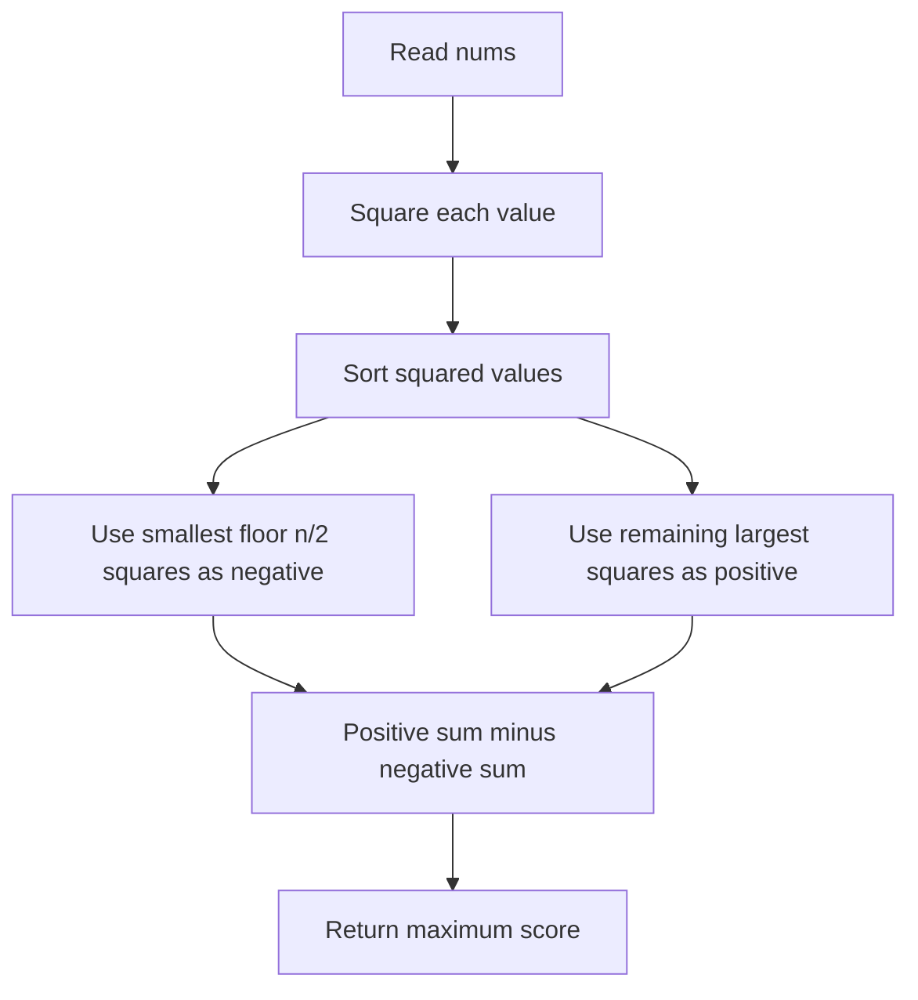
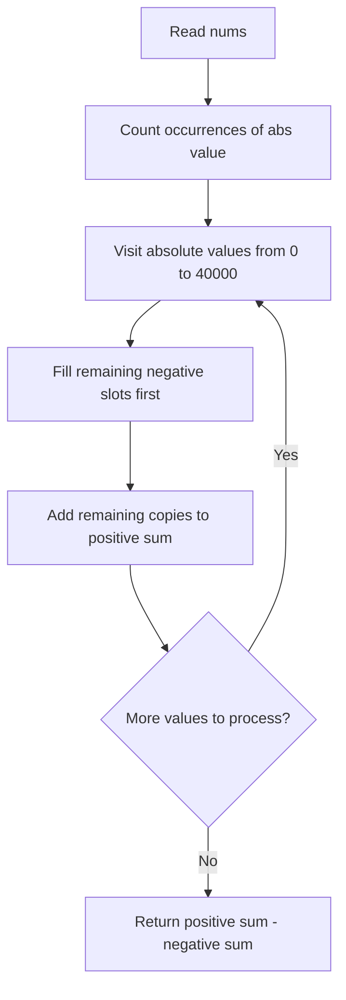

## 👨‍💻 Profiles

**GitHub:** https://github.com/Shailendra0320  
**LeetCode (Main):** [https://leetcode.com/u/Shailu03/](https://leetcode.com/u/Shailu03/)  
**LeetCode (Alternate):** [https://leetcode.com/u/ShailendraLeetcode03/](https://leetcode.com/u/ShailendraLeetcode03/)

---

# 3727. Maximum Alternating Sum of Squares

**Difficulty:** Medium  
**Primary pattern:** Greedy + Sorting  
**Topics:** Array · Greedy · Sorting · Counting · Mathematics  
**Problem:** [LeetCode 3727 — Maximum Alternating Sum of Squares](https://leetcode.com/problems/maximum-alternating-sum-of-squares/)

## Table of Contents

- [Problem Statement](#problem-statement)
- [Examples](#examples)
- [Constraints](#constraints)
- [Core Insight](#core-insight)
- [Why the Greedy Strategy Works](#why-the-greedy-strategy-works)
- [Approach 1 — Sort the Squares](#approach-1--sort-the-squares)
- [Approach 2 — Count Absolute Values](#approach-2--count-absolute-values)
- [Correctness Proof](#correctness-proof)
- [Complexity Comparison](#complexity-comparison)
- [Java, C++, and Python Solutions](#java-c-and-python-solutions)
- [Dry Runs](#dry-runs)
- [Edge Cases](#edge-cases)
- [Common Mistakes](#common-mistakes)
- [Interview Explanation](#interview-explanation)
- [Quick Revision](#quick-revision)

## Problem Statement

You are given an integer array `nums`. You may rearrange its elements in any order.

For a rearranged array `arr`, define its alternating score as:

```text
score = arr[0]² - arr[1]² + arr[2]² - arr[3]² + ...
```

Elements at even indices contribute their squares positively; elements at odd indices contribute their squares negatively. Return the **maximum possible score** after rearranging `nums`.

The original sign of an element does not affect its contribution because both `x²` and `(-x)²` equal `x²`.

## Examples

### Example 1

```text
Input:  nums = [1, 2, 3]
Output: 12
```

One optimal rearrangement is `[2, 1, 3]`:

```text
2² - 1² + 3² = 4 - 1 + 9 = 12
```

### Example 2

```text
Input:  nums = [1, -1, 2, -2, 3, -3]
Output: 16
```

One optimal rearrangement is `[-3, -1, -2, 1, 3, 2]`:

```text
(-3)² - (-1)² + (-2)² - 1² + 3² - 2²
= 9 - 1 + 4 - 1 + 9 - 4
= 16
```

## Constraints

- `1 <= nums.length <= 100000`
- `-40000 <= nums[i] <= 40000`

The answer can exceed a 32-bit signed integer, so use a 64-bit result in Java and C++.

## Core Insight

The score always has a fixed number of positive and negative positions:

- **Positive positions:** `ceil(n / 2)` — indices `0, 2, 4, ...`
- **Negative positions:** `floor(n / 2)` — indices `1, 3, 5, ...`

Since the score uses squares, convert each value conceptually to `x²`. Then the problem becomes:

> Put the **largest squares in positive positions** and the **smallest squares in negative positions**.

Let the squared values in non-decreasing order be:

```text
s[0] <= s[1] <= ... <= s[n - 1]
```

There are `n / 2` negative positions using integer division. Therefore, the optimal score is:

```text
answer = sum(s[n / 2 ... n - 1]) - sum(s[0 ... n / 2 - 1])
```

In words: **sum the larger half (including the middle element when `n` is odd), then subtract the smaller `floor(n / 2)` squares.**

### Why not sort the original signed values?

The values `-5` and `5` both contribute `25`. Ordering by the original numeric value does not order the contributions correctly. We must order by square—or equivalently by absolute value.

## Why the Greedy Strategy Works

Suppose a positive position currently contains a square `a`, while a negative position contains a larger square `b`, where `b > a`.

Before swapping, these two positions contribute:

```text
a - b
```

After putting the larger square in the positive position and the smaller one in the negative position, their contribution becomes:

```text
b - a
```

The change is:

```text
(b - a) - (a - b) = 2(b - a) > 0
```

So any arrangement that places a larger square in a negative position while a smaller square occupies a positive position can be improved by swapping them. Repeating this exchange places the largest squares in positive positions and the smallest squares in negative positions.

### Algorithm Flow



## Approach 1 — Sort the Squares

**Recommended for interviews:** this is the simplest and most general solution.

### Steps

1. Create an array `squares` containing `nums[i] * nums[i]` for every element.
2. Sort `squares` in ascending order.
3. Let `half = n / 2` using integer division.
4. Subtract the first `half` squares from the answer.
5. Add the remaining squares to the answer.
6. Return the answer as a 64-bit integer.

The array is split exactly where the negative positions stop and the positive positions begin. For odd `n`, the extra element belongs to the positive group.

### Pseudocode

```text
squares = sorted squares of nums
half = length(nums) / 2
answer = 0

for i from 0 to n - 1:
    if i < half:
        answer -= squares[i]
    else:
        answer += squares[i]

return answer
```

### Data Flow

```text
nums
  │
  ▼
Square every element
  │
  ▼
Sort squares in ascending order
  │
  ├── First floor(n / 2) values ──► subtract
  │
  └── Remaining values ───────────► add
                                    │
                                    ▼
                           Maximum alternating score
```

## Approach 2 — Count Absolute Values

The constraints guarantee that every absolute value is at most `40000`. Instead of sorting, we can count how often each absolute value appears and process those values from smallest to largest.

Because squaring preserves the ordering of non-negative absolute values, ascending absolute-value order is also ascending square order:

```text
0² <= 1² <= 2² <= ... <= 40000²
```

### Steps

1. Build `freq[a]`, the number of elements whose absolute value equals `a`, for `0 <= a <= 40000`.
2. Set `negativeSlots = n / 2`.
3. Visit absolute values in ascending order.
4. Use as many copies as possible to fill the remaining negative slots. Add their squares to `negativeSum`.
5. Any copies left at the current absolute value belong to the positive group. Add their squares to `positiveSum`.
6. Return `positiveSum - negativeSum`.

If the boundary falls in the middle of a group of equal absolute values, splitting that group is safe because equal values have equal squares.

### Flow Diagram



### When is this approach useful?

Use frequency counting when the value range is small and explicitly bounded. It avoids comparison sorting, but it allocates a fixed array of `40001` counters. For a general problem with a much larger or unbounded value range, Approach 1 is preferable.

## Correctness Proof

### Lemma 1 — The number of positive and negative positions is fixed

For an array of length `n`, even indices always contribute positively and odd indices always contribute negatively. There are exactly `ceil(n / 2)` positive positions and `floor(n / 2)` negative positions, regardless of the rearrangement.

### Lemma 2 — Larger squares should occupy positive positions

Suppose a positive position contains `a` and a negative position contains `b`, where `a < b`. Their current combined score is `a - b`. Swapping them gives `b - a`, increasing the score by `2(b - a) > 0`. Therefore, an optimal arrangement cannot leave a larger square in a negative position while a smaller square occupies a positive position.

### Theorem — Both approaches return the maximum score

By Lemma 1, the number of values assigned to each sign group is fixed. By Lemma 2, an optimal arrangement assigns the smallest `floor(n / 2)` squares to the negative group and all remaining, largest squares to the positive group.

Approach 1 sorts the squared values and splits them into exactly these groups. Approach 2 processes absolute values in ascending order and fills the negative group with the smallest available squares before assigning remaining values to the positive group. Both compute the positive sum minus the negative sum of the same optimal partition. Hence, both return the maximum possible alternating score.

## Complexity Comparison

Let `n` be the array length and `M = 40001` be the number of possible absolute values under the constraints.

| Approach              | Time Complexity | Auxiliary Space | Best use                            |
| --------------------- | --------------: | --------------: | ----------------------------------- |
| Sort the squares      |    `O(n log n)` |          `O(n)` | Most general and easiest to explain |
| Count absolute values |      `O(n + M)` |          `O(M)` | Bounded integer range               |

For Approach 1, constructing the squares takes `O(n)`, sorting takes `O(n log n)`, and scanning them takes `O(n)`. For Approach 2, filling the frequency array takes `O(n)` and scanning all possible absolute values takes `O(M)`.

## Java, C++, and Python Solutions

Each language has both approaches in a single code block. The approach name and complexities appear immediately before each implementation.

### Java

```java
//Approach-1 (Sort the Squares)
//T.C : O(n log n)
//S.C : O(n)

import java.util.Arrays;

class Solution {
    public long maxAlternatingSum(int[] nums) {
        int n = nums.length;
        long[] squares = new long[n];

        for (int i = 0; i < n; i++) {
            squares[i] = 1L * nums[i] * nums[i];
        }

        Arrays.sort(squares);

        int half = n / 2;
        long answer = 0;

        for (int i = 0; i < n; i++) {
            if (i < half) {
                answer -= squares[i];
            } else {
                answer += squares[i];
            }
        }

        return answer;
    }
}

//Approach-2 (Count Absolute Values)
//T.C : O(n + M), where M = 40001
//S.C : O(M), where M = 40001

class Solution2 {
    public long maxAlternatingSum(int[] nums) {
        final int MAX_ABS = 40000;
        int[] freq = new int[MAX_ABS + 1];

        for (int num : nums) {
            freq[Math.abs(num)]++;
        }

        int negativeSlots = nums.length / 2;
        long negativeSum = 0;
        long positiveSum = 0;

        for (int value = 0; value <= MAX_ABS; value++) {
            int takeNegative = Math.min(freq[value], negativeSlots);
            long square = 1L * value * value;

            negativeSum += takeNegative * square;
            negativeSlots -= takeNegative;

            int takePositive = freq[value] - takeNegative;
            positiveSum += takePositive * square;
        }

        return positiveSum - negativeSum;
    }
}
```

### C++

```cpp
//Approach-1 (Sort the Squares)
//T.C : O(n log n)
//S.C : O(n)

#include <bits/stdc++.h>
using namespace std;

class Solution {
public:
    long long maxAlternatingSum(vector<int>& nums) {
        int n = nums.size();
        vector<long long> squares(n);

        for (int i = 0; i < n; i++) {
            squares[i] = 1LL * nums[i] * nums[i];
        }

        sort(squares.begin(), squares.end());

        int half = n / 2;
        long long answer = 0;

        for (int i = 0; i < n; i++) {
            if (i < half) {
                answer -= squares[i];
            } else {
                answer += squares[i];
            }
        }

        return answer;
    }
};

//Approach-2 (Count Absolute Values)
//T.C : O(n + M), where M = 40001
//S.C : O(M), where M = 40001

class Solution2 {
public:
    long long maxAlternatingSum(vector<int>& nums) {
        const int MAX_ABS = 40000;
        vector<int> freq(MAX_ABS + 1, 0);

        for (int num : nums) {
            freq[abs(num)]++;
        }

        int negativeSlots = nums.size() / 2;
        long long negativeSum = 0;
        long long positiveSum = 0;

        for (int value = 0; value <= MAX_ABS; value++) {
            int takeNegative = min(freq[value], negativeSlots);
            long long square = 1LL * value * value;

            negativeSum += 1LL * takeNegative * square;
            negativeSlots -= takeNegative;

            int takePositive = freq[value] - takeNegative;
            positiveSum += 1LL * takePositive * square;
        }

        return positiveSum - negativeSum;
    }
};
```

### Python

```python
#Approach-1 (Sort the Squares)
#T.C : O(n log n)
#S.C : O(n)

from typing import List

class Solution:
    def maxAlternatingSum(self, nums: List[int]) -> int:
        squares = sorted(x * x for x in nums)
        half = len(nums) // 2
        answer = 0

        for i, square in enumerate(squares):
            if i < half:
                answer -= square
            else:
                answer += square

        return answer


#Approach-2 (Count Absolute Values)
#T.C : O(n + M), where M = 40001
#S.C : O(M), where M = 40001

class Solution2:
    def maxAlternatingSum(self, nums: List[int]) -> int:
        MAX_ABS = 40000
        freq = [0] * (MAX_ABS + 1)

        for num in nums:
            freq[abs(num)] += 1

        negative_slots = len(nums) // 2
        negative_sum = 0
        positive_sum = 0

        for value, count in enumerate(freq):
            take_negative = min(count, negative_slots)
            square = value * value

            negative_sum += take_negative * square
            negative_slots -= take_negative

            take_positive = count - take_negative
            positive_sum += take_positive * square

        return positive_sum - negative_sum
```

## Dry Runs

### Example 1 — Odd-length array

```text
nums = [1, 2, 3]
squares sorted = [1, 4, 9]
n = 3
negative slots = 3 / 2 = 1
```

| Sorted square | Assignment     | Contribution | Running score |
| ------------: | -------------- | -----------: | ------------: |
|           `1` | Negative group |         `-1` |          `-1` |
|           `4` | Positive group |         `+4` |           `3` |
|           `9` | Positive group |         `+9` |          `12` |

**Maximum score: `12`**

### Example 2 — Negative input values and repeated squares

```text
nums = [1, -1, 2, -2, 3, -3]
squares sorted = [1, 1, 4, 4, 9, 9]
n = 6
negative slots = 6 / 2 = 3
```

| Group    | Squares   | Group sum |
| -------- | --------- | --------: |
| Negative | `1, 1, 4` |       `6` |
| Positive | `4, 9, 9` |      `22` |

```text
answer = positive sum - negative sum
       = 22 - 6
       = 16
```

The values `-x` and `x` have the same square, so negative input values do not need special treatment beyond using their absolute values in Approach 2.

## Edge Cases

| Case                      | Example                                     | Expected reasoning                                            |
| ------------------------- | ------------------------------------------- | ------------------------------------------------------------- |
| One element               | `[7]`                                       | No negative slot; answer is `49`                              |
| Two elements              | `[2, 5]`                                    | `25 - 4 = 21`                                                 |
| Odd length                | `[1, 2, 3]`                                 | One more positive position than negative positions            |
| All equal absolute values | `[-4, 4, -4, 4]`                            | Every square is `16`; score is `0` for even length            |
| Repeated values           | `[3, 3, 1, 1]`                              | Equal squares may be assigned to either group at the boundary |
| Zero values               | `[0, 2, 0]`                                 | Zero contributes nothing; answer is `4`                       |
| Large accumulated score   | `50000` values of `40000` and `50000` zeros | The score can exceed 32-bit range; use a 64-bit result        |

## Common Mistakes

- **Sorting the original signed values:** `-10` and `10` have the same square. Sort the squares or count absolute values instead.
- **Using the wrong split for odd lengths:** exactly `floor(n / 2)` values are subtracted; the remaining values are added.
- **Subtracting the largest squares:** the smallest squares belong to negative positions and the largest belong to positive positions.
- **Using 32-bit arithmetic for the total:** a single square can be `1,600,000,000`, and the sum across up to `100000` values can be much larger than a 32-bit integer.
- **Overcomplicating the arrangement:** you do not have to construct the final rearranged array. The partition of squared values is enough.
- **Using counting sort without respecting constraints:** Approach 2 depends on the maximum absolute value being `40000`.

## Interview Explanation

“We can rearrange the array freely, and the score depends only on the squares of its elements. Even indices are positive and odd indices are negative, so there are `ceil(n / 2)` positive slots and `floor(n / 2)` negative slots. To maximize the score, the smallest `floor(n / 2)` squares should be assigned to negative slots and all remaining largest squares to positive slots. Sorting the squares gives an `O(n log n)` solution with `O(n)` extra space. Since the absolute values are bounded by `40000`, we can also use frequency counting in `O(n + 40001)` time.”

## Quick Revision

- **Ignore original signs:** the objective uses `nums[i]²`.
- **Negative group size:** `n / 2` using integer division.
- **Positive group size:** `n - n / 2`.
- **Optimal partition:** subtract the smallest `n / 2` squares; add all remaining squares.
- **Approach 1:** sort squares — `O(n log n)` time, `O(n)` space.
- **Approach 2:** count absolute values — `O(n + 40001)` time, `O(40001)` space.
- **Use 64-bit arithmetic** for the answer in Java and C++.

> **One-line insight:** Assign the smallest squares to minus signs and the largest squares to plus signs.
