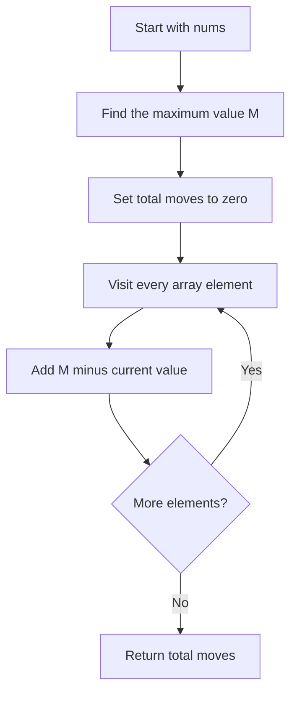
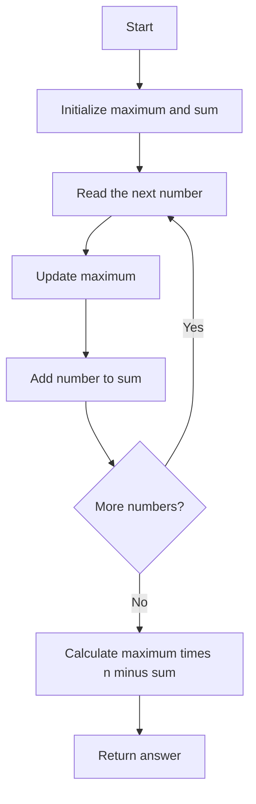
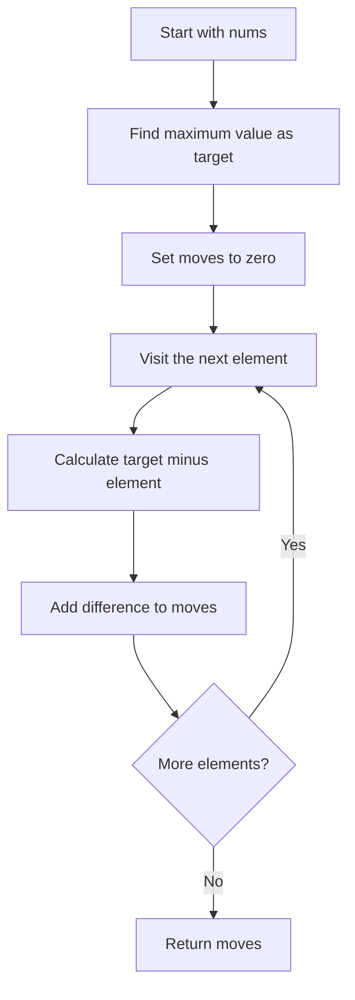

## 👨‍💻 Profiles

**GitHub:** https://github.com/Shailendra0320  
**LeetCode (Main):** https://leetcode.com/u/Shailu03/  
**LeetCode (Alternate):** https://leetcode.com/u/ShailendraLeetcode03/

# 3736. Minimum Moves to Equal Array Elements III

**Difficulty:** Easy  
**Topics:** Array, Math, Greedy  
**Main pattern:** Find the only optimal target, then add the required increments.

**Official problem:** [LeetCode 3736 — Minimum Moves to Equal Array Elements III](https://leetcode.com/problems/minimum-moves-to-equal-array-elements-iii/)

---

## Table of Contents

- [1. Understand the Problem](#1-understand-the-problem)
- [2. Official Examples](#2-official-examples)
- [3. The Main Observation](#3-the-main-observation)
- [4. Approach 1 — Maximum and Total Sum](#4-approach-1--maximum-and-total-sum)
- [5. Approach 2 — Find Maximum and Add Differences](#5-approach-2--find-maximum-and-add-differences)
- [6. Compare Both Approaches](#6-compare-both-approaches)
- [7. Edge Cases](#7-edge-cases)
- [8. Common Mistakes](#8-common-mistakes)
- [9. Interview Explanation](#9-interview-explanation)
- [10. Quick Revision](#10-quick-revision)

---

## 1. Understand the Problem

You are given an integer array `nums`.

In one move, you may choose **one element** and increase it by exactly `1`.

Return the minimum total number of moves needed to make every element equal.

### What is allowed?

- You can increase any element by `1` in one move.
- You can choose the same element many times.
- You cannot decrease an element.
- You do not have to change an element that is already equal to the final target.

### Constraints

- `1 <= nums.length <= 100`
- `1 <= nums[i] <= 100`

The array is guaranteed to contain at least one element.

### What are we really trying to find?

We need one final value that every array element can reach using only increments. Then we count how many increments each element needs.

The important question is: **which final value gives the fewest moves?**

---

## 2. Official Examples

### Example 1

```text
Input:  nums = [2, 1, 3]
Output: 3
```

The largest element is `3`. Every element must reach `3`:

| Index | Starting value | Final value | Increments needed |
|---:|---:|---:|---:|
| 0 | 2 | 3 | 1 |
| 1 | 1 | 3 | 2 |
| 2 | 3 | 3 | 0 |
| **Total** |  |  | **3** |

The moves are:

```text
[2, 1, 3]
  ^
  2 -> 3        (1 move)

[3, 1, 3]
     ^
     1 -> 2 -> 3 (2 moves)

[3, 3, 3]
```

Therefore, the answer is `1 + 2 + 0 = 3`.

### Example 2

```text
Input:  nums = [4, 4, 5]
Output: 2
```

The largest element is `5`.

| Index | Starting value | Final value | Increments needed |
|---:|---:|---:|---:|
| 0 | 4 | 5 | 1 |
| 1 | 4 | 5 | 1 |
| 2 | 5 | 5 | 0 |
| **Total** |  |  | **2** |

Final array: `[5, 5, 5]`  
Answer: `1 + 1 + 0 = 2`.

---

## 3. The Main Observation

### The final value must be the maximum element

Let:

- `M` = maximum value in `nums`.
- `n` = number of elements.

Because we can only increase values, no element can finish below `M`. The element that currently equals `M` cannot be reduced.

Could we choose a target greater than `M`? We could, but that would require extra moves for every element, including the current maximum. So a target greater than `M` can never be better.

Therefore, the best target is exactly:

\[
\boxed{M = \max(nums)}
\]

### How many moves does one element need?

To change `nums[i]` into `M`, we need:

\[
M - nums[i]
\]

Add this for every element:

\[
\text{answer} = \sum_{i=0}^{n-1}(M - nums[i])
\]

We can also simplify the formula:

\[
\boxed{\text{answer} = M \times n - \sum nums[i]}
\]

Both formulas calculate exactly the same total.

### Visual example

For `nums = [2, 1, 3]`, the target is `3`:

```text
Value       Moves to reach 3
-----       ---------------
  2         2 -> 3             1 move
  1         1 -> 2 -> 3       2 moves
  3         already equal     0 moves
                         -------------
                         Total = 3
```

### Overall algorithm flowchart



---

## 4. Approach 1 — Maximum and Total Sum

**Idea:** Find the maximum value and the sum of all elements in one pass. Then use the formula `maximum * n - sum`.

### Step 1 — Track the maximum and sum

Start with:

```text
maximum = 0
sum = 0
```

For every value:

- Update `maximum` if the current value is larger.
- Add the current value to `sum`.

### Step 2 — Apply the formula

After scanning all elements, calculate:

```text
answer = maximum * nums.length - sum
```

Why does this formula work?

If every one of the `n` elements becomes `maximum`, the final total sum will be `maximum * n`. The current sum is `sum`. The difference between these two sums is exactly the total number of increments required.

### Approach 1 flowchart



### Approach 1 dry run

Input:

```text
nums = [2, 1, 3]
```

| Step | Current value | Maximum so far | Sum so far |
|---:|---:|---:|---:|
| Start | — | 0 | 0 |
| 1 | 2 | 2 | 2 |
| 2 | 1 | 2 | 3 |
| 3 | 3 | 3 | 6 |

Now:

```text
n = 3
maximum = 3
sum = 6

answer = maximum * n - sum
       = 3 * 3 - 6
       = 9 - 6
       = 3
```

### Approach 1: Why it works

The current maximum cannot be decreased. Therefore, every valid final value must be at least the current maximum.

Choosing a value larger than the maximum adds unnecessary increments. Choosing the maximum itself is both possible and the smallest valid target.

If all `n` elements become `M`, their final sum is `M * n`. Each move increases the array sum by exactly `1`, so the difference between the final sum and the current sum is the number of moves:

\[
M \times n - \sum nums[i]
\]

That is exactly what the algorithm returns.

### Java — Approach 1

```java
//Approach-1 (Maximum and Total Sum)
//T.C : O(n)
//S.C : O(1)

class Solution {
    public int minMoves(int[] nums) {
        int maximum = 0;
        int sum = 0;

        for (int num : nums) {
            maximum = Math.max(maximum, num);
            sum += num;
        }

        return maximum * nums.length - sum;
    }
}
```

### C++ — Approach 1

```cpp
//Approach-1 (Maximum and Total Sum)
//T.C : O(n)
//S.C : O(1)

#include <bits/stdc++.h>
using namespace std;

class Solution {
public:
    int minMoves(vector<int>& nums) {
        int maximum = 0;
        int sum = 0;

        for (int num : nums) {
            maximum = max(maximum, num);
            sum += num;
        }

        return maximum * static_cast<int>(nums.size()) - sum;
    }
};
```

### Python — Approach 1

```python
#Approach-1 (Maximum and Total Sum)
#T.C : O(n)
#S.C : O(1)

from typing import List

class Solution:
    def minMoves(self, nums: List[int]) -> int:
        maximum = 0
        total = 0

        for num in nums:
            maximum = max(maximum, num)
            total += num

        return maximum * len(nums) - total
```

### Complexity analysis — Approach 1

| Measure | Complexity | Reason |
|---|---|---|
| Time | `O(n)` | One pass visits every element once. |
| Auxiliary space | `O(1)` | Only `maximum` and `sum` are stored. |

---

## 5. Approach 2 — Find Maximum and Add Differences

**Idea:** First find the largest value. Then visit the array again and directly add `maximum - nums[i]` for each element.

This approach follows the move calculation literally. It is useful when you want to see how many increments each individual element needs.

### Step 1 — Find the target

```text
target = maximum element in nums
```

### Step 2 — Add each element's required increments

For every value:

```text
moves += target - value
```

At the end, `moves` contains the total number of increments.

### Approach 2 flowchart



### Approach 2 dry run

Input:

```text
nums = [4, 4, 5]
target = 5
```

| Index | Value | Calculation | Moves added | Total moves |
|---:|---:|---:|---:|---:|
| 0 | 4 | `5 - 4` | 1 | 1 |
| 1 | 4 | `5 - 4` | 1 | 2 |
| 2 | 5 | `5 - 5` | 0 | 2 |

The answer is `2`.

### Approach 2: Why it works

The target is the maximum element for the same reason explained earlier: values can only increase, and any target above the maximum would waste moves.

Once the target is fixed, an element with value `x` needs exactly `target - x` increments. Adding these exact costs for all elements counts every required move once and does not count any unnecessary move.

### Java — Approach 2

```java
//Approach-2 (Find Maximum and Add Differences)
//T.C : O(n)
//S.C : O(1)

class Solution2 {
    public int minMoves(int[] nums) {
        int target = nums[0];

        for (int num : nums) {
            target = Math.max(target, num);
        }

        int moves = 0;

        for (int num : nums) {
            moves += target - num;
        }

        return moves;
    }
}
```

### C++ — Approach 2

```cpp
//Approach-2 (Find Maximum and Add Differences)
//T.C : O(n)
//S.C : O(1)

#include <bits/stdc++.h>
using namespace std;

class Solution2 {
public:
    int minMoves(vector<int>& nums) {
        int target = *max_element(nums.begin(), nums.end());
        int moves = 0;

        for (int num : nums) {
            moves += target - num;
        }

        return moves;
    }
};
```

### Python — Approach 2

```python
#Approach-2 (Find Maximum and Add Differences)
#T.C : O(n)
#S.C : O(1)

from typing import List

class Solution2:
    def minMoves(self, nums: List[int]) -> int:
        target = max(nums)
        moves = 0

        for num in nums:
            moves += target - num

        return moves
```

### Complexity analysis — Approach 2

| Measure | Complexity | Reason |
|---|---|---|
| Time | `O(n)` | One pass finds the maximum and another adds the differences. |
| Auxiliary space | `O(1)` | Only a few variables are used. |

---

## 6. Compare Both Approaches

| Detail | Approach 1: Maximum and Sum | Approach 2: Add Differences |
|---|---|---|
| Main formula | `maximum * n - sum` | `sum(maximum - num)` |
| Passes | One | Two |
| Time | `O(n)` | `O(n)` |
| Auxiliary space | `O(1)` | `O(1)` |
| Main benefit | Shortest calculation | Shows the cost for each element clearly |
| Best use | Preferred submission | Best for understanding individual increments |

Both approaches calculate the same value because:

\[
\sum (M - nums[i]) = nM - \sum nums[i]
\]

**Recommendation:** Use Approach 1 for submission. Use Approach 2 when explaining the problem step by step, because it shows the moves required by each element.

---

## 7. Edge Cases

| Input | Target | Output | Why |
|---|---:|---:|---|
| `[7]` | 7 | 0 | A single element is already equal to itself. |
| `[5, 5, 5]` | 5 | 0 | All elements are already equal. |
| `[1, 2, 3, 4]` | 4 | 6 | Required moves are `3 + 2 + 1 + 0`. |
| `[1, 100]` | 100 | 99 | The smaller value must catch up. |
| `[10, 1, 1]` | 10 | 18 | Required moves are `0 + 9 + 9`. |
| `[3, 2, 2, 3]` | 3 | 2 | Duplicate values are handled normally. |

---

## 8. Common Mistakes

1. **Choosing the minimum as the target.** We cannot decrease the largest element, so the target cannot be below the maximum.
2. **Choosing the average.** Some values may be below the average, but the maximum still cannot be reduced. The average is not a valid universal target unless it equals the maximum.
3. **Adding `num - maximum`.** The required increments are `maximum - num`, not the reverse.
4. **Counting the maximum as extra moves.** An element already equal to the target needs zero moves.
5. **Simulating every increment.** There is no need to perform the moves one by one. Calculate the total directly.
6. **Using sorting unnecessarily.** Sorting does not help because only the maximum and sum are needed.

---

## 9. Interview Explanation

> “Because the only allowed operation is increasing an element, the final common value cannot be smaller than the maximum element. Choosing anything larger would add unnecessary operations, so the optimal target is the current maximum. Every element `x` needs exactly `maximum - x` increments. I add these differences. Equivalently, I can calculate `maximum * n - sum(nums)`. This takes linear time and constant extra space.”

---

## 10. Quick Revision

- Operation: increase one element by `1`.
- Decreasing an element is not allowed.
- Optimal target: `max(nums)`.
- Moves for one element: `max(nums) - nums[i]`.
- Final formula: `maximum * n - sum(nums)`.
- Time complexity: `O(n)`.
- Auxiliary space: `O(1)`.
- Best submission: **Approach 1 — Maximum and Total Sum**.

### One-line insight

**When every operation can only increase a value, make every element reach the current maximum.**

---

**Reference:** [LeetCode 3736 — Minimum Moves to Equal Array Elements III](https://leetcode.com/problems/minimum-moves-to-equal-array-elements-iii/)
