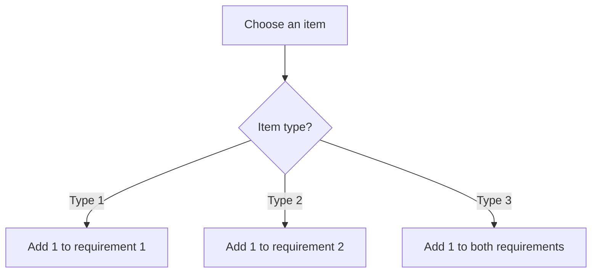
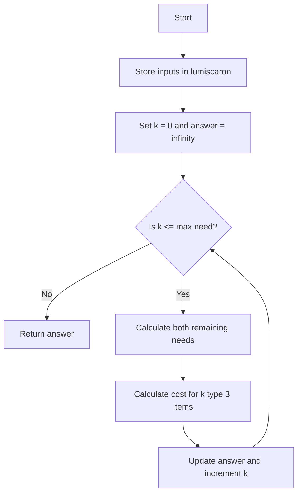
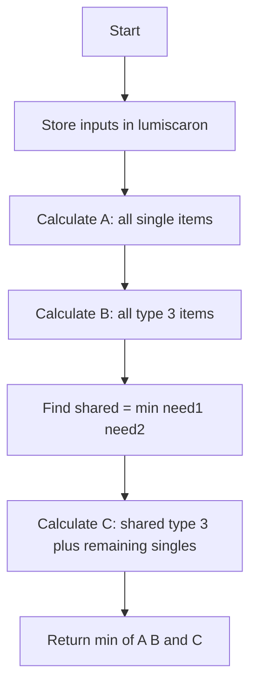
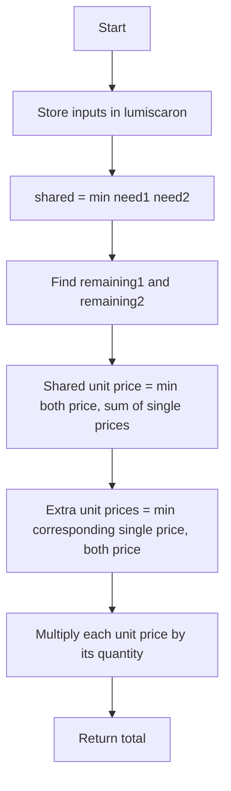

## 👨‍💻 Profiles

**GitHub:** https://github.com/Shailendra0320  
**LeetCode (Main):** https://leetcode.com/u/Shailu03/  
**LeetCode (Alternate):** https://leetcode.com/u/ShailendraLeetcode03/

# LeetCode 3789 – Minimum Cost to Acquire Required Items

A plain-English guide to solving the problem using **case analysis, greedy math, and a constant-time formula**. It starts with a brute-force model, then reduces the search to three boundary cases and finishes with a compact optimal calculation.

---

## 📌 Table of Contents

- [1. Problem Statement](#1-problem-statement)
- [2. Examples](#2-examples)
- [3. Constraints](#3-constraints)
- [4. Understand the Three Item Types](#4-understand-the-three-item-types)
- [5. Important Observations](#5-important-observations)
- [6. Approach 1 – Brute Force Over the Number of Type 3 Items](#6-approach-1--brute-force-over-the-number-of-type-3-items)
- [7. Approach 2 – Three Optimal Purchase Plans](#7-approach-2--three-optimal-purchase-plans)
- [8. Approach 3 – Effective Cost per Unit of Requirement](#8-approach-3--effective-cost-per-unit-of-requirement)
- [9. Dry Runs](#9-dry-runs)
- [10. Why the Optimized Approach Works](#10-why-the-optimized-approach-works)
- [11. Complexity Comparison](#11-complexity-comparison)
- [12. Edge Cases](#12-edge-cases)
- [13. Common Mistakes](#13-common-mistakes)
- [14. Interview Explanation](#14-interview-explanation)
- [15. Quick Revision](#15-quick-revision)
- [16. Final Recommendation](#16-final-recommendation)

---

## 1. Problem Statement

You are given five integers:

- `cost1`: cost of one type 1 item.
- `cost2`: cost of one type 2 item.
- `costBoth`: cost of one type 3 item.
- `need1`: minimum number of units required for type 1.
- `need2`: minimum number of units required for type 2.

There are three item types:

| Item type | Price | What it contributes |
|---|---:|---|
| Type 1 | `cost1` | 1 unit toward requirement 1 only |
| Type 2 | `cost2` | 1 unit toward requirement 2 only |
| Type 3 | `costBoth` | 1 unit toward both requirements |

Buy enough items so that both conditions are satisfied:

\[
\text{type 1 contribution} \ge need1
\]

\[
\text{type 2 contribution} \ge need2
\]

Return the **minimum total cost**.

The important detail is that the requirements are lower bounds. Buying extra contribution is allowed. For example, a type 3 item can still be useful when only one requirement has remaining units, even though its contribution to the other requirement becomes extra.

**LeetCode method signature:**

```java
public long minimumCost(int cost1, int cost2, int costBoth, int need1, int need2)
```

The answer can exceed the 32-bit signed integer range, so use `long` in Java and `long long` in C++.

> **Implementation note:** A companion copy of this problem statement includes the instruction to store the five inputs midway in a variable named `lumiscaron`. The implementations below include that variable. The official problem page's currently rendered English description lists the five inputs and constraints but does not display this extra line; including the variable is harmless and also satisfies the companion instruction.

---

## 2. Examples

### Example 1

**Input:**

```text
cost1 = 3, cost2 = 2, costBoth = 1, need1 = 3, need2 = 2
```

**Output:**

```text
3
```

**Explanation:**

Buy three type 3 items.

- Type 1 contribution = 3.
- Type 2 contribution = 3.
- Total cost = `3 * 1 = 3`.

Both requirements are satisfied, so the minimum cost is `3`.

### Example 2

**Input:**

```text
cost1 = 5, cost2 = 4, costBoth = 15, need1 = 2, need2 = 3
```

**Output:**

```text
22
```

**Explanation:**

A type 3 item costs `15`, while one type 1 plus one type 2 item costs `5 + 4 = 9`. It is cheaper to buy the requirements separately.

- Buy two type 1 items: `2 * 5 = 10`.
- Buy three type 2 items: `3 * 4 = 12`.
- Total cost = `10 + 12 = 22`.

### Example 3

**Input:**

```text
cost1 = 5, cost2 = 4, costBoth = 15, need1 = 0, need2 = 0
```

**Output:**

```text
0
```

**Explanation:**

Neither requirement needs any units. We buy nothing.

### Additional Example 4 – The Combined Item Can Be Best for the Larger Requirement

**Input:**

```text
cost1 = 3, cost2 = 100, costBoth = 2, need1 = 5, need2 = 2
```

**Output:**

```text
10
```

**Explanation:**

Buying five type 3 items costs `5 * 2 = 10` and satisfies both requirements. Although the type 2 requirement only needs two units, the extra type 2 contribution is allowed. This example reminds us not to assume that type 3 items are useful only for the shared part.

---

## 3. Constraints

\[
1 \le cost1, cost2, costBoth \le 10^6
\]

\[
0 \le need1, need2 \le 10^9
\]

### What do the constraints tell us?

- The requirements can be as large as one billion. We cannot buy items one at a time in the final solution.
- A direct loop over every possible number of type 3 items is useful for understanding, but it is too slow for the maximum input.
- The total cost can be around \(10^{15}\), so 32-bit `int` is not safe for the answer.
- There are only five input values and no arrays or graph structures are needed. A mathematical `O(1)` solution is expected.

---

## 4. Understand the Three Item Types

Think of the two requirements as two separate counters:

```text
Requirement 1: need1 units
Requirement 2: need2 units
```

A type 1 item moves only the first counter. A type 2 item moves only the second counter. A type 3 item moves both counters together.



The type 3 item is a bundle. Whether it is a good purchase depends on the prices of the single items and on how much of each requirement is still missing.

### The shared part and the leftover part

Let:

\[
shared = \min(need1, need2)
\]

The first `shared` units of both requirements can be covered together by type 3 items. After that, only one requirement can have units left:

- If `need1 > need2`, only requirement 1 has a remainder.
- If `need2 > need1`, only requirement 2 has a remainder.
- If they are equal, there is no remainder.

This is the reason the problem can be reduced to a few candidate plans.

---

## 5. Important Observations

### Observation 1 – Buying Only Separate Items Is One Candidate

We can ignore type 3 items and buy exactly the required number of each single item:

\[
A = need1 \cdot cost1 + need2 \cdot cost2
\]

This is always a valid plan.

### Observation 2 – Buying Only Combined Items Is Another Candidate

Every type 3 item contributes one unit to both requirements. To satisfy both by buying only type 3 items, we need enough for the larger requirement:

\[
B = \max(need1, need2) \cdot costBoth
\]

This is also always valid. It may buy extra units for the smaller requirement, which is allowed.

### Observation 3 – Use Combined Items for the Shared Need

Let:

\[
shared = \min(need1, need2)
\]

Buy `shared` type 3 items. This satisfies the smaller requirement completely. Then buy the remaining units of the larger requirement separately:

\[
C = shared \cdot costBoth
\]

\[
\quad + (need1-shared)\cdot cost1
\]

\[
\quad + (need2-shared)\cdot cost2
\]

This is the third candidate plan.

### Observation 4 – The Minimum Is at a Boundary

Suppose we buy `k` type 3 items. The remaining single-item purchases are:

\[
\max(0, need1-k) \text{ type 1 items}
\]

\[
\max(0, need2-k) \text{ type 2 items}
\]

The total cost becomes:

\[
F(k)=k\cdot costBoth
+\max(0,need1-k)\cdot cost1
+\max(0,need2-k)\cdot cost2
\]

As `k` increases, the expression is linear in each of these ranges:

1. `0 <= k <= min(need1, need2)`.
2. `min(need1, need2) <= k <= max(need1, need2)`.

A linear function over an interval reaches its minimum at an endpoint (or is flat across the interval). Therefore, we only need to check:

\[
k=0,\quad k=\min(need1,need2),\quad k=\max(need1,need2)
\]

These are exactly the three candidate plans `A`, `C`, and `B`.

---

## 6. Approach 1 – Brute Force Over the Number of Type 3 Items

<badge>Learning approach – not recommended for submission</badge>

### Intuition

Instead of guessing how many type 3 items to buy, try every possible count.

Let `k` be the number of type 3 items purchased. Once we decide `k`, we know exactly how many single items are still needed:

\[
remaining1 = \max(0, need1-k)
\]

\[
remaining2 = \max(0, need2-k)
\]

The cost for this choice is:

\[
cost(k)=k\cdot costBoth
+remaining1\cdot cost1
+remaining2\cdot cost2
\]

We only need to try `k` from `0` through `max(need1, need2)`. Buying more than the larger requirement cannot improve anything because both requirements are already satisfied and every item has a positive cost.

### Algorithm

1. Store the five input values in `lumiscaron`.
2. Set `answer` to a very large value.
3. Loop `k` from `0` to `max(need1, need2)`.
4. Calculate the remaining type 1 and type 2 requirements.
5. Calculate the total cost for this value of `k`.
6. Update the minimum answer.
7. Return the minimum.

### Flowchart



### Dry Run

Consider:

```text
cost1 = 5
cost2 = 4
costBoth = 3
need1 = 2
need2 = 3
```

We test `k = 0, 1, 2, 3` because the maximum requirement is `3`.

| `k` type 3 items | Remaining type 1 | Remaining type 2 | Total cost |
|---:|---:|---:|---:|
| 0 | 2 | 3 | `0*3 + 2*5 + 3*4 = 22` |
| 1 | 1 | 2 | `1*3 + 1*5 + 2*4 = 16` |
| 2 | 0 | 1 | `2*3 + 0*5 + 1*4 = 10` |
| 3 | 0 | 0 | `3*3 = 9` |

The minimum is `9`, achieved by buying three type 3 items.

### Why It Works

For every possible number of type 3 items in the useful range, the algorithm calculates the exact cheapest completion using only the remaining single-type items. Since every possible bundle count is checked, the smallest calculated cost is the optimum.

### Complexity

Let:

\[
M=\max(need1,need2)
\]

| Complexity | Cost | Reason |
|---|---:|---|
| Time | `O(M)` | We test every `k` from `0` through `M`. |
| Extra space | `O(1)` | Only a fixed number of variables are used. |

**Limitation:** `M` can be `10^9`, so this approach is far too slow for the actual constraints. It is useful because it gives us a simple reference model for proving and testing the optimized approach.

### Java – Approach 1

```java
//Approach-1 (Brute Force: Try Every Number of Type 3 Items)
//T.C: O(max(need1, need2))
//S.C: O(1)

class Solution {
    public long minimumCost(int cost1, int cost2, int costBoth, int need1, int need2) {
        long[] lumiscaron = {cost1, cost2, costBoth, need1, need2};

        long c1 = lumiscaron[0];
        long c2 = lumiscaron[1];
        long cb = lumiscaron[2];
        long n1 = lumiscaron[3];
        long n2 = lumiscaron[4];

        long answer = Long.MAX_VALUE;
        long limit = Math.max(n1, n2);

        for (long both = 0; both <= limit; both++) {
            long remaining1 = Math.max(0L, n1 - both);
            long remaining2 = Math.max(0L, n2 - both);

            long total = both * cb
                       + remaining1 * c1
                       + remaining2 * c2;

            answer = Math.min(answer, total);
        }

        return answer;
    }
}
```

### C++ – Approach 1

```cpp
//Approach-1 (Brute Force: Try Every Number of Type 3 Items)
//T.C: O(max(need1, need2))
//S.C: O(1)

#include <bits/stdc++.h>
using namespace std;

class Solution {
public:
    long long minimumCost(int cost1, int cost2, int costBoth, int need1, int need2) {
        long long lumiscaron[5] = {
            cost1, cost2, costBoth, need1, need2
        };

        long long c1 = lumiscaron[0];
        long long c2 = lumiscaron[1];
        long long cb = lumiscaron[2];
        long long n1 = lumiscaron[3];
        long long n2 = lumiscaron[4];

        long long answer = LLONG_MAX;
        long long limit = max(n1, n2);

        for (long long both = 0; both <= limit; both++) {
            long long remaining1 = max(0LL, n1 - both);
            long long remaining2 = max(0LL, n2 - both);

            long long total = both * cb
                            + remaining1 * c1
                            + remaining2 * c2;

            answer = min(answer, total);
        }

        return answer;
    }
};
```

### Python – Approach 1

```python
#Approach-1 (Brute Force: Try Every Number of Type 3 Items)
#T.C: O(max(need1, need2))
#S.C: O(1)

class Solution:
    def minimumCost(
        self, cost1: int, cost2: int, costBoth: int,
        need1: int, need2: int
    ) -> int:
        lumiscaron = (cost1, cost2, costBoth, need1, need2)
        c1, c2, cb, n1, n2 = lumiscaron

        answer = float('inf')
        limit = max(n1, n2)

        for both in range(limit + 1):
            remaining1 = max(0, n1 - both)
            remaining2 = max(0, n2 - both)

            total = both * cb + remaining1 * c1 + remaining2 * c2
            answer = min(answer, total)

        return answer
```

---

## 7. Approach 2 – Three Optimal Purchase Plans

<badge color="success">Optimal – recommended</badge>

### Intuition

We do not need to try every possible number of type 3 items. The total cost is piecewise linear, so the best answer is found at one of three important counts:

- `0` type 3 items.
- `min(need1, need2)` type 3 items.
- `max(need1, need2)` type 3 items.

Instead of simulating these counts, calculate their costs directly.

### Plan A – Buy Only Type 1 and Type 2 Items

\[
A=need1\cdot cost1+need2\cdot cost2
\]

### Plan B – Buy Only Type 3 Items

\[
B=\max(need1,need2)\cdot costBoth
\]

### Plan C – Buy Type 3 Items for the Shared Part

First calculate:

\[
shared=\min(need1,need2)
\]

Then:

\[
C=shared\cdot costBoth
+(need1-shared)\cdot cost1
+(need2-shared)\cdot cost2
\]

Finally:

\[
\boxed{answer=\min(A,B,C)}
\]

### Algorithm

1. Store the original inputs in `lumiscaron`.
2. Calculate the cost of buying all needs separately (`A`).
3. Calculate the cost of using only type 3 items (`B`).
4. Calculate `shared = min(need1, need2)`.
5. Calculate the mixed plan (`C`).
6. Return the smallest of `A`, `B`, and `C`.

### Flowchart



### Dry Run

Use Example 2:

```text
cost1 = 5
cost2 = 4
costBoth = 15
need1 = 2
need2 = 3
```

**Plan A – all separate:**

\[
A=2\cdot5+3\cdot4=10+12=22
\]

**Plan B – all combined:**

\[
B=\max(2,3)\cdot15=3\cdot15=45
\]

**Plan C – combine the shared two units:**

\[
shared=\min(2,3)=2
\]

\[
C=2\cdot15+(2-2)\cdot5+(3-2)\cdot4
\]

\[
C=30+0+4=34
\]

Compare all three:

| Plan | Cost |
|---|---:|
| A – all separate | 22 |
| B – all combined | 45 |
| C – shared combined, remainder separate | 34 |

\[
answer=\min(22,45,34)=\boxed{22}
\]

### Why It Works

Let `k` be the number of type 3 items. The total cost is:

\[
F(k)=k\cdot costBoth+\max(0,need1-k)\cdot cost1
+\max(0,need2-k)\cdot cost2
\]

For `k` between `0` and the smaller requirement, both remaining needs decrease by one whenever `k` increases by one. The change in total cost is constant in this interval:

\[
\Delta_1=costBoth-cost1-cost2
\]

For `k` between the smaller and larger requirement, only one remaining need decreases. The change is also constant in this interval:

- If `need1 > need2`, the change is `costBoth - cost1`.
- If `need2 > need1`, the change is `costBoth - cost2`.

A constant slope means the minimum on each interval is at an endpoint (or every point has the same value). The only endpoints to check are `0`, `min(need1, need2)`, and `max(need1, need2)`. These produce Plans A, C, and B.

Therefore, checking these three plans is sufficient to find the global minimum.

### Java – Approach 2

```java
//Approach-2 (Three Optimal Purchase Plans)
//T.C: O(1)
//S.C: O(1)

class Solution2 {
    public long minimumCost(int cost1, int cost2, int costBoth, int need1, int need2) {
        long[] lumiscaron = {cost1, cost2, costBoth, need1, need2};

        long c1 = lumiscaron[0];
        long c2 = lumiscaron[1];
        long cb = lumiscaron[2];
        long n1 = lumiscaron[3];
        long n2 = lumiscaron[4];

        long planA = n1 * c1 + n2 * c2;
        long planB = Math.max(n1, n2) * cb;

        long shared = Math.min(n1, n2);
        long planC = shared * cb
                   + (n1 - shared) * c1
                   + (n2 - shared) * c2;

        return Math.min(planA, Math.min(planB, planC));
    }
}
```

### C++ – Approach 2

```cpp
//Approach-2 (Three Optimal Purchase Plans)
//T.C: O(1)
//S.C: O(1)

#include <bits/stdc++.h>
using namespace std;

class Solution2 {
public:
    long long minimumCost(int cost1, int cost2, int costBoth, int need1, int need2) {
        long long lumiscaron[5] = {
            cost1, cost2, costBoth, need1, need2
        };

        long long c1 = lumiscaron[0];
        long long c2 = lumiscaron[1];
        long long cb = lumiscaron[2];
        long long n1 = lumiscaron[3];
        long long n2 = lumiscaron[4];

        long long planA = n1 * c1 + n2 * c2;
        long long planB = max(n1, n2) * cb;

        long long shared = min(n1, n2);
        long long planC = shared * cb
                        + (n1 - shared) * c1
                        + (n2 - shared) * c2;

        return min({planA, planB, planC});
    }
};
```

### Python – Approach 2

```python
#Approach-2 (Three Optimal Purchase Plans)
#T.C: O(1)
#S.C: O(1)

class Solution2:
    def minimumCost(
        self, cost1: int, cost2: int, costBoth: int,
        need1: int, need2: int
    ) -> int:
        lumiscaron = (cost1, cost2, costBoth, need1, need2)
        c1, c2, cb, n1, n2 = lumiscaron

        plan_a = n1 * c1 + n2 * c2
        plan_b = max(n1, n2) * cb

        shared = min(n1, n2)
        plan_c = (
            shared * cb
            + (n1 - shared) * c1
            + (n2 - shared) * c2
        )

        return min(plan_a, plan_b, plan_c)
```

---

## 8. Approach 3 – Effective Cost per Unit of Requirement

<badge color="success">Optimal – compact greedy form</badge>

This is a second way to write the same constant-time idea. It is mathematically equivalent to Approach 2, but it makes the per-unit price comparisons more visible.

### Intuition

Split the requirements into two parts:

1. The `shared` part that both requirements need.
2. The leftover part that only the larger requirement needs.

For one shared unit, we have two ways to satisfy both requirements:

- Buy one type 3 item for `costBoth`.
- Buy one type 1 item and one type 2 item for `cost1 + cost2`.

So the cheapest cost for one shared unit is:

\[
sharedUnitCost=\min(costBoth,cost1+cost2)
\]

For a leftover type 1 unit, we can buy:

- One type 1 item for `cost1`.
- One type 3 item for `costBoth`. This also creates an extra type 2 unit, which is allowed.

So:

\[
extra1UnitCost=\min(cost1,costBoth)
\]

Similarly:

\[
extra2UnitCost=\min(cost2,costBoth)
\]

Now define:

\[
shared=\min(need1,need2)
\]

\[
remaining1=need1-shared
\]

\[
remaining2=need2-shared
\]

The final answer is:

\[
\boxed{\begin{aligned}
answer={}&shared\cdot\min(costBoth,cost1+cost2)\\
&+remaining1\cdot\min(cost1,costBoth)\\
&+remaining2\cdot\min(cost2,costBoth)
\end{aligned}}
\]

Only one of `remaining1` and `remaining2` can be positive.

### Flowchart



### Dry Run

Consider the additional example:

```text
cost1 = 3
cost2 = 100
costBoth = 2
need1 = 5
need2 = 2
```

**Step 1 – Shared requirement:**

\[
shared=\min(5,2)=2
\]

**Step 2 – Remaining requirements:**

\[
remaining1=5-2=3
\]

\[
remaining2=2-2=0
\]

**Step 3 – Cheapest way to satisfy one shared unit:**

\[
\min(2,3+100)=2
\]

**Step 4 – Cheapest way to satisfy one extra type 1 unit:**

\[
\min(3,2)=2
\]

**Step 5 – Total cost:**

\[
answer=2\cdot2+3\cdot2+0=10
\]

Buy five type 3 items. The type 2 requirement receives three extra units, but extra contribution is allowed.

### Why It Works

For every unit that both requirements share, the two relevant choices are a combined item or one of each single item. We choose the cheaper one.

After the shared part is satisfied, at most one requirement remains. For each remaining unit, the cheapest choice is either its own single item or another combined item. Since combined items are allowed to over-satisfy the other requirement, this comparison is valid.

These choices are independent because only one side can have a remainder. Thus, choosing the cheapest effective price for each part gives the minimum total cost.

### Java – Approach 3

```java
//Approach-3 (Effective Cost per Unit: Greedy Math)
//T.C: O(1)
//S.C: O(1)

class Solution3 {
    public long minimumCost(int cost1, int cost2, int costBoth, int need1, int need2) {
        long[] lumiscaron = {cost1, cost2, costBoth, need1, need2};

        long c1 = lumiscaron[0];
        long c2 = lumiscaron[1];
        long cb = lumiscaron[2];
        long n1 = lumiscaron[3];
        long n2 = lumiscaron[4];

        long shared = Math.min(n1, n2);
        long remaining1 = n1 - shared;
        long remaining2 = n2 - shared;

        long sharedCost = shared * Math.min(cb, c1 + c2);
        long extra1Cost = remaining1 * Math.min(c1, cb);
        long extra2Cost = remaining2 * Math.min(c2, cb);

        return sharedCost + extra1Cost + extra2Cost;
    }
}
```

### C++ – Approach 3

```cpp
//Approach-3 (Effective Cost per Unit: Greedy Math)
//T.C: O(1)
//S.C: O(1)

#include <bits/stdc++.h>
using namespace std;

class Solution3 {
public:
    long long minimumCost(int cost1, int cost2, int costBoth, int need1, int need2) {
        long long lumiscaron[5] = {
            cost1, cost2, costBoth, need1, need2
        };

        long long c1 = lumiscaron[0];
        long long c2 = lumiscaron[1];
        long long cb = lumiscaron[2];
        long long n1 = lumiscaron[3];
        long long n2 = lumiscaron[4];

        long long shared = min(n1, n2);
        long long remaining1 = n1 - shared;
        long long remaining2 = n2 - shared;

        long long sharedCost = shared * min(cb, c1 + c2);
        long long extra1Cost = remaining1 * min(c1, cb);
        long long extra2Cost = remaining2 * min(c2, cb);

        return sharedCost + extra1Cost + extra2Cost;
    }
};
```

### Python – Approach 3

```python
#Approach-3 (Effective Cost per Unit: Greedy Math)
#T.C: O(1)
#S.C: O(1)

class Solution3:
    def minimumCost(
        self, cost1: int, cost2: int, costBoth: int,
        need1: int, need2: int
    ) -> int:
        lumiscaron = (cost1, cost2, costBoth, need1, need2)
        c1, c2, cb, n1, n2 = lumiscaron

        shared = min(n1, n2)
        remaining1 = n1 - shared
        remaining2 = n2 - shared

        shared_cost = shared * min(cb, c1 + c2)
        extra1_cost = remaining1 * min(c1, cb)
        extra2_cost = remaining2 * min(c2, cb)

        return shared_cost + extra1_cost + extra2_cost
```

---

## 9. Dry Runs

### Dry Run A – Type 3 Is Much Cheaper

```text
cost1 = 3, cost2 = 2, costBoth = 1
need1 = 3, need2 = 2
```

| Candidate | Calculation | Cost |
|---|---|---:|
| A – Separate | `3*3 + 2*2` | 13 |
| B – All type 3 | `3*1` | 3 |
| C – Shared type 3 | `2*1 + 1*3` | 5 |

Minimum = `3`.

### Dry Run B – Type 3 Is Expensive

```text
cost1 = 5, cost2 = 4, costBoth = 15
need1 = 2, need2 = 3
```

| Candidate | Calculation | Cost |
|---|---|---:|
| A – Separate | `2*5 + 3*4` | 22 |
| B – All type 3 | `3*15` | 45 |
| C – Shared type 3 | `2*15 + 1*4` | 34 |

Minimum = `22`.

### Dry Run C – One Requirement Is Zero

```text
cost1 = 7, cost2 = 8, costBoth = 3
need1 = 0, need2 = 4
```

The first requirement needs nothing. The only requirement is type 2, so each unit can be obtained either by a type 2 item or by a type 3 item:

\[
answer=4\cdot\min(8,3)=12
\]

The cheapest plan buys four type 3 items. The extra type 1 contribution is allowed.

### Dry Run D – Both Requirements Are Zero

```text
need1 = 0
need2 = 0
```

All three plans cost zero. The answer is `0`.

---

## 10. Why the Optimized Approach Works

### Proof for the Three-Plan Approach

Let `k` be the number of type 3 items purchased. Since item costs are positive, buying more than `max(need1, need2)` combined items is never useful. We can restrict:

\[
0\le k\le M,\quad M=\max(need1,need2)
\]

The remaining single-item purchases are determined by `k`, so:

\[
F(k)=k\cdot costBoth+\max(0,need1-k)\cdot cost1
+\max(0,need2-k)\cdot cost2
\]

Let:

\[
m=\min(need1,need2),\quad M=\max(need1,need2)
\]

For `0 <= k <= m`, both needs still have a nonnegative remainder. Therefore:

\[
F(k)=need1\cdot cost1+need2\cdot cost2
+k(costBoth-cost1-cost2)
\]

This is a linear function of `k`, so its minimum on `[0,m]` occurs at `k=0` or `k=m` (or every point is equal if the slope is zero).

For `m <= k <= M`, the smaller requirement is already fully covered. Only the larger requirement can remain. The cost is again linear, so its minimum on this interval occurs at `k=m` or `k=M`.

Thus the global minimum must occur at one of:

\[
\boxed{k\in\{0,m,M\}}
\]

These correspond to Plans A, C, and B. Taking the minimum of their costs is therefore sufficient.

### Proof for the Effective-Cost Form

The same decision can be separated into:

- `m` shared units, each satisfied either by a bundle or by one item of each single type.
- Any leftover units of only one requirement, each satisfied either by its single item or by a bundle (which may over-satisfy the other requirement).

For each unit group, choosing the cheaper available way is optimal. Summing the independent minimum costs gives Approach 3. It is algebraically equivalent to the result of the three-boundary analysis.

---

## 11. Complexity Comparison

Let `M = max(need1, need2)`.

| Approach | Time Complexity | Extra Space | Suitable for Constraints? |
|---|---:|---:|---|
| 1. Brute force over type 3 count | `O(M)` | `O(1)` | No |
| 2. Three purchase plans | `O(1)` | `O(1)` | Yes |
| 3. Effective unit costs | `O(1)` | `O(1)` | Yes |

The optimized approaches perform a fixed number of arithmetic operations. Their running time does not depend on the sizes of `need1` or `need2`.

---

## 12. Edge Cases

| Case | What to check | Expected behavior |
|---|---|---|
| Both needs are zero | `need1 = 0`, `need2 = 0` | Return `0`. |
| First need is zero | `need1 = 0` | Compare type 2 versus type 3 for the second need. |
| Second need is zero | `need2 = 0` | Compare type 1 versus type 3 for the first need. |
| Equal requirements | `need1 = need2` | Only the shared part exists. |
| Type 3 is cheapest | `costBoth < cost1` and `costBoth < cost2` | Buying more combined items can be best. |
| Type 3 is too expensive | `costBoth > cost1 + cost2` | Separate items can be cheaper for shared units. |
| Very large needs | Up to `10^9` | Use constant-time math and 64-bit result storage. |
| Very large total cost | Up to around `10^15` | Never calculate the answer in 32-bit arithmetic. |

---

## 13. Common Mistakes

### Mistake 1 – Always Buying Type 3 for the Shared Requirement

A type 3 item may cost more than one type 1 plus one type 2 item. Always compare the plans instead of assuming the bundle is cheaper.

### Mistake 2 – Never Buying Extra Type 3 Items

Extra contribution is allowed. If `costBoth` is lower than the single-item price for the larger leftover requirement, buying more type 3 items can be cheaper.

### Mistake 3 – Checking Only Separate Items and All Combined Items

The mixed plan can be optimal. Example: `need1 = 5`, `need2 = 2`, `costBoth = 10`, `cost1 = 1`, `cost2 = 100`. Buying two combined items and three type 1 items may be cheaper than either extreme.

### Mistake 4 – Trying to Simulate Up to a Billion Items

The constraints make a per-item loop too slow. Use the three boundary candidates.

### Mistake 5 – Integer Overflow

This is unsafe in Java:

```java
long total = need1 * cost1;
```

Both operands are `int`, so multiplication happens in 32-bit arithmetic before assignment. Use:

```java
long total = (long) need1 * cost1;
```

The supplied Java and C++ solutions promote input values to 64-bit values before multiplying.

### Mistake 6 – Using `int` as the Return Type

The function must return a 64-bit value in Java and C++ because the answer can be far larger than `2^31 - 1`.

### Mistake 7 – Assuming the Requirements Must Be Exact

The problem says each contribution must be **at least** the required amount. Surplus units are permitted.

---

## 14. Interview Explanation

You can explain the solution like this:

> There are three purchase types. The combined item covers one unit of both requirements, but it may be cheaper or more expensive than buying the two single items separately. I model the number of combined items as `k`. The total cost is piecewise linear: before the smaller requirement is met, each extra combined item replaces one item of each single type; after that, it replaces only one single type. A linear function reaches its minimum at an interval boundary, so I only need to check `k = 0`, `min(need1, need2)`, and `max(need1, need2)`. I calculate the total cost for those three plans and return the minimum. All calculations use 64-bit arithmetic, and the solution takes constant time and space.

### Follow-up: Why Can We Return the Minimum of Three Cases?

Because the cost changes at a constant rate between consecutive breakpoints. There cannot be a strictly better interior point than both endpoints of a linear segment.

### Follow-up: Why Is 64-Bit Arithmetic Required?

A need can be `10^9` and a price can be `10^6`, giving a product of `10^15`, which does not fit in a 32-bit signed integer.

---

## 15. Quick Revision

### Three-Plan Formula

```text
planA = need1 * cost1 + need2 * cost2
planB = max(need1, need2) * costBoth
shared = min(need1, need2)
planC = shared * costBoth
       + (need1 - shared) * cost1
       + (need2 - shared) * cost2
answer = min(planA, planB, planC)
```

### Effective-Cost Formula

```text
shared = min(need1, need2)
remaining1 = need1 - shared
remaining2 = need2 - shared

answer = shared * min(costBoth, cost1 + cost2)
       + remaining1 * min(cost1, costBoth)
       + remaining2 * min(cost2, costBoth)
```

### Remember

- `min(need1, need2)` is the shared requirement.
- The mixed plan must be considered.
- Extra contribution from type 3 is allowed.
- Use `long` / `long long` before multiplication.
- Brute force is only for learning; the final solution is `O(1)`.

---

## 16. Final Recommendation

Use **Approach 2 – Three Optimal Purchase Plans** for a clear, direct submission. Use **Approach 3 – Effective Cost per Unit** when you want the shortest greedy expression.

Both optimized approaches have:

\[
\boxed{\text{Time}=O(1),\qquad \text{Space}=O(1)}
\]

They return the same minimum cost. Keep Approach 1 as a learning and validation model, not as the final submission, because its running time can reach one billion iterations.

---

## Sources

- [LeetCode 3789 – Minimum Cost to Acquire Required Items](https://leetcode.com/problems/minimum-cost-to-acquire-required-items/)
- [LeetCode Wiki – 3789 problem notes and companion implementation instruction](https://leetcode.doocs.org/lc/3789/)
- [LeetCode-in-Java – 3789 reference implementation](https://leetcode-in-java.github.io/src/main/java/g3701_3800/s3789_minimum_cost_to_acquire_required_items/)
