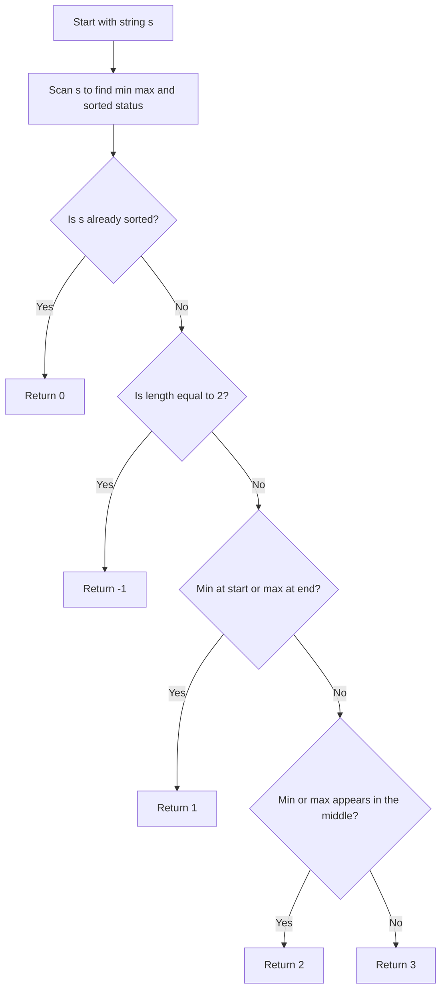
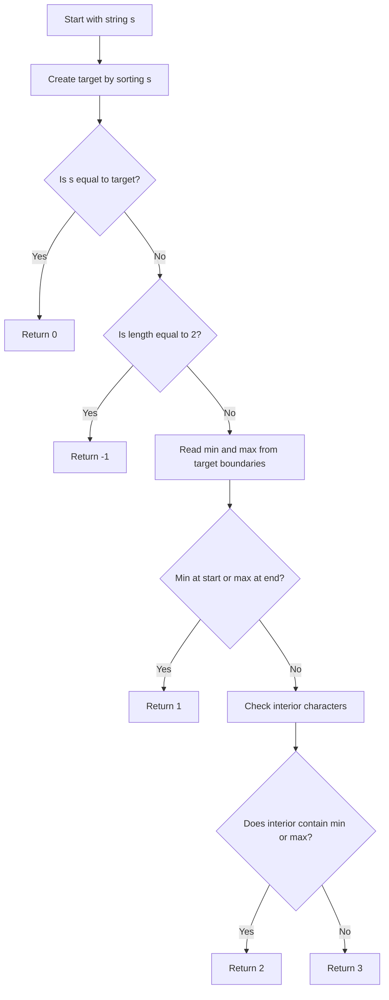

## 👨‍💻 Profiles

**GitHub:** https://github.com/Shailendra0320  
**LeetCode (Main):** https://leetcode.com/u/Shailu03/  
**LeetCode (Alternate):** https://leetcode.com/u/ShailendraLeetcode03/

# 3863. Minimum Operations to Sort a String

**Difficulty:** Medium  
**Topics:** String, Greedy, Case Analysis  
**Main pattern:** Find the minimum and maximum characters, then decide how many proper-substring sorts are needed based on where those characters appear.  
**Official problem:** [LeetCode 3863 — Minimum Operations to Sort a String](https://leetcode.com/problems/minimum-operations-to-sort-a-string/)

---

## Table of Contents

- [1. Understand the Problem](#1-understand-the-problem)
- [2. Official Examples](#2-official-examples)
- [3. Important Rules and Observations](#3-important-rules-and-observations)
- [4. The Main Insight](#4-the-main-insight)
- [5. Approach 1 — Linear Scan and Case Analysis](#5-approach-1--linear-scan-and-case-analysis)
  - [Approach 1: Flowchart](#approach-1-flowchart)
  - [Approach 1: Dry Runs](#approach-1-dry-runs)
  - [Approach 1: Why It Works](#approach-1-why-it-works)
  - [Approach 1: Code](#approach-1-code)
- [6. Approach 2 — Build the Sorted Target and Inspect Boundaries](#6-approach-2--build-the-sorted-target-and-inspect-boundaries)
  - [Approach 2: Flowchart](#approach-2-flowchart)
  - [Approach 2: Dry Runs](#approach-2-dry-runs)
  - [Approach 2: Why It Works](#approach-2-why-it-works)
  - [Approach 2: Code](#approach-2-code)
- [7. Compare the Approaches](#7-compare-the-approaches)
- [8. Edge Cases](#8-edge-cases)
- [9. Common Mistakes](#9-common-mistakes)
- [10. Interview Explanation](#10-interview-explanation)
- [11. Quick Revision](#11-quick-revision)
- [12. Final Takeaway](#12-final-takeaway)

---

## 1. Understand the Problem

You are given a string `s` made of lowercase English letters. In one operation, you may choose **one contiguous substring**, as long as it is **not the entire string**, and sort only that substring in alphabetical order.

Return the minimum number of operations needed to make the complete string sorted. If it cannot be done, return `-1`.

### What does “proper substring” mean here?

A substring is a continuous part of a string. The selected substring must be non-empty, and it cannot contain every character in `s`.

For example, if `s = "dog"`:

| Selected substring | Allowed? | Reason |
|---|---|---|
| `"do"` | Yes | It is contiguous and is not the whole string. |
| `"og"` | Yes | It is contiguous and is not the whole string. |
| `"o"` | Yes | A one-character substring is allowed, though sorting it changes nothing. |
| `"dog"` | **No** | This is the entire string. |

That last restriction is the important part. If sorting the entire string were allowed, every answer would be at most `1`. Since it is forbidden, we must look at where the smallest and largest characters are.

### Constraints

- `1 <= s.length <= 100000`
- `s` contains only lowercase English letters (`'a'` through `'z'`).

The string can be very long, so repeatedly sorting many substrings is unnecessary. We can solve the problem by checking a few properties in linear time.

---

## 2. Official Examples

### Example 1

```text
Input:  s = "dog"
Output: 1
```

Sort the proper substring `"og"`:

```text
Before: d o g
              └─┘  Sort "og" into "go"
After:  d g o
```

The result is `"dgo"`, which is already sorted. Only one operation is needed.

### Example 2

```text
Input:  s = "card"
Output: 2
```

One valid sequence is:

```text
Start:             c a r d
Sort substring:    [ c a r ] d
After operation 1: a c r d
Sort substring:    a [ r d ]
After operation 2: a c d r
```

The final string is `"acdr"`. The answer is `2`.

Notice that the smallest character `'a'` starts inside the string, and the largest character `'r'` also appears before the final position. One operation is not enough, but two are enough.

### Example 3

```text
Input:  s = "gf"
Output: -1
```

The only substring containing both characters is the whole string `"gf"`, and selecting the whole string is forbidden. Sorting either single character does not change anything, so the string cannot be fixed.

### Additional example: Three operations are necessary

```text
Input:  s = "cba"
Output: 3
```

Here, the largest character `'c'` is at the beginning and the smallest character `'a'` is at the end. Neither extreme is in the middle, so the answer is `3`.

```text
Start:       c b a
Operation 1: b c a    Sort the first two characters "cb"
Operation 2: b a c    Sort the last two characters "ac"
Operation 3: a b c    Sort the first two characters "ba"
```

The entire string was never selected as a substring.

---

## 3. Important Rules and Observations

### Rule 1 — An already sorted string needs no operation

If every character is less than or equal to the character after it, the string is already in non-descending order.

```text
"aabcc"  -> 0 operations
"abc"    -> 0 operations
```

### Rule 2 — An unsorted string of length two cannot be fixed

For a two-character string such as `"gf"`, the only substring containing both characters is the entire string. We are not allowed to sort it. So, after checking whether the string is already sorted, if its length is `2`, return `-1`.

### Rule 3 — The smallest character matters at the beginning

Let `mn` be the smallest character in the string. If `s[0] == mn`, the correct first character is already in place. Sorting the remaining suffix (indices `1` through `n - 1`) is allowed and sorts everything else.

### Rule 4 — The largest character matters at the end

Let `mx` be the largest character. If `s[n - 1] == mx`, the correct final character is already in place. Sorting the prefix (indices `0` through `n - 2`) sorts the rest.

Therefore, if the string is not already sorted but either of these conditions holds, the answer is `1`.

### Rule 5 — If an extreme is inside, two operations are enough

If the smallest character or the largest character appears at an interior index, one operation can bring that extreme to its correct end. A second operation can sort the remaining part.

### Rule 6 — The last case needs three operations

If none of the earlier conditions applies, the largest character must be at the beginning and the smallest character must be at the end. The middle contains neither extreme. For a string longer than two characters, three proper-substring sorts are enough, and fewer cannot fix both ends under this case.

---

## 4. The Main Insight

We do **not** need to simulate every possible substring sort. We only need to answer a few questions:

1. Is the string already sorted?
2. Is the string length `2` and unsorted?
3. Where are the minimum and maximum characters?
4. Are either of them already at the correct outer boundary, or does one of them appear in the middle?

Let:

- `mn` = smallest character in `s`
- `mx` = largest character in `s`
- `n` = length of `s`

The answer follows this table, in this exact order:

| Condition | Minimum operations | Why |
|---|---:|---|
| `s` is already sorted | `0` | Nothing needs to change. |
| `s` is unsorted and `n == 2` | `-1` | The only substring containing both characters is forbidden. |
| `s[0] == mn` or `s[n - 1] == mx` | `1` | Sort the other `n - 1` characters as one proper substring. |
| `mn` or `mx` occurs at an interior position | `2` | One operation puts an extreme at an end; another sorts the remaining part. |
| None of the above | `3` | The maximum is at the beginning and the minimum is at the end; the remaining case needs three operations. |

**Important:** Check whether the string is sorted *before* the length-two case. For example, `"ab"` is already sorted and must return `0`, not `-1`.

---

# 5. Approach 1 — Linear Scan and Case Analysis

**Recommended approach.** It uses a single scan to find the smallest character, the largest character, and whether the string is already sorted. It then applies the case table above.

| Complexity | Cost |
|---|---:|
| Time | `O(n)` |
| Auxiliary space | `O(1)` |

Here, `n` is the length of the string. The algorithm keeps only a few character variables and a Boolean flag; it does not create another string or array.

## How Approach 1 works

### Step 1 — Scan the string

During one pass, keep track of:

- the minimum character seen so far;
- the maximum character seen so far;
- whether every adjacent pair is in sorted order.

If you ever find `s[i - 1] > s[i]`, the string is not sorted.

### Step 2 — Return `0` if it is sorted

This check has priority. A sorted string requires no operation, even if its length is `1` or `2`.

### Step 3 — Handle the impossible two-character case

If the string is not sorted and `n == 2`, return `-1`.

### Step 4 — Check the two outer boundaries

If the first character is the minimum, or the last character is the maximum, return `1`.

For example, for `"dog"`, `'d'` is already the minimum character at the start. Sorting `"og"` is enough.

### Step 5 — Check the middle characters

Look only at indices `1` through `n - 2`. If the minimum or maximum character occurs there, return `2`.

### Step 6 — Return `3` for the remaining case

If no earlier case matched, return `3`.

## Approach 1 flowchart



## Boundary diagram

Think of the string as three parts:

```text
Index:       0       1 ... n-2       n-1
             |          |              |
String:    [ first ] [   middle   ] [ last ]
```

The most important positions are:

```text
Correct first character = minimum character (mn)
Correct last character  = maximum character (mx)
```

If those two extremes are already placed at the correct ends, only one substring sort is needed. If an extreme is in the middle, two operations are enough. The difficult case is when `mx` starts the string and `mn` ends it, with neither in the middle; that is the three-operation case.

## Approach 1 dry runs

### Dry run A — `s = "dog"`

| Item | Value |
|---|---|
| String | `"dog"` |
| Sorted already? | No, because `'o' > 'g'` |
| Length | `3` |
| Minimum | `'d'` |
| Maximum | `'o'` |
| First character equals minimum? | Yes |
| Decision | Return `1` |

One operation sorts the suffix `"og"` into `"go"`, producing `"dgo"`.

### Dry run B — `s = "card"`

| Item | Value |
|---|---|
| String | `"card"` |
| Sorted already? | No |
| Length | `4` |
| Minimum | `'a'` |
| Maximum | `'r'` |
| First character equals minimum? | No (`'c'`) |
| Last character equals maximum? | No (`'d'`) |
| Does the middle contain `mn` or `mx`? | Yes (`'a'` and `'r'`) |
| Decision | Return `2` |

One valid sequence sorts `"car"` into `"acr"`, producing `"acrd"`; then it sorts `"rd"` into `"dr"`, producing `"acdr"`.

### Dry run C — `s = "gf"`

| Item | Value |
|---|---|
| String | `"gf"` |
| Sorted already? | No (`'g' > 'f'`) |
| Length | `2` |
| Decision | Return `-1` |

The only substring containing both characters is the entire string, which is not allowed.

### Dry run D — `s = "cba"`

| Item | Value |
|---|---|
| String | `"cba"` |
| Sorted already? | No |
| Length | `3` |
| Minimum | `'a'`, at the last position |
| Maximum | `'c'`, at the first position |
| Minimum at start or maximum at end? | No |
| Does either extreme appear in the middle? | No (`'b'` is in the middle) |
| Decision | Return `3` |

One valid transformation is `"cba" -> "bca" -> "bac" -> "abc"`, sorting `"cb"`, then `"ca"`, then `"ba"`.

## Approach 1: Why it works

The answer depends on the smallest and largest characters because these are the characters that must end up at the two boundaries of a sorted string.

1. **Already sorted:** Zero operations is clearly the minimum possible number.
2. **Unsorted length two:** No allowed substring can reorder both characters, so the answer is `-1`.
3. **One boundary is already correct:** If the minimum is first, sort everything after it. If the maximum is last, sort everything before it. This needs exactly one operation because the string was not already sorted.
4. **An extreme is inside the string:** One operation can include the extreme and move it to an endpoint of the chosen substring. A second operation can sort the remaining part. This case needs two operations.
5. **Neither extreme is at a correct boundary or in the middle:** The maximum must be first and the minimum last. The two extremes block the fully sorted order from being reached in one or two operations; three proper-substring sorts suffice.

These cases cover every possible string, so the algorithm always returns the minimum required number of operations (or `-1` when sorting is impossible).

## Approach 1 code

### Java

```java
//Approach-1 (Linear Scan and Case Analysis)
//T.C : O(n)
//S.C : O(1)

class Solution {
    public int minOperations(String s) {
        int n = s.length();
        char minChar = 'z';
        char maxChar = 'a';
        boolean sorted = true;

        for (int i = 0; i < n; i++) {
            char current = s.charAt(i);
            minChar = (char) Math.min(minChar, current);
            maxChar = (char) Math.max(maxChar, current);

            if (i > 0 && s.charAt(i - 1) > current) {
                sorted = false;
            }
        }

        if (sorted) {
            return 0;
        }

        if (n == 2) {
            return -1;
        }

        if (s.charAt(0) == minChar || s.charAt(n - 1) == maxChar) {
            return 1;
        }

        for (int i = 1; i < n - 1; i++) {
            char current = s.charAt(i);
            if (current == minChar || current == maxChar) {
                return 2;
            }
        }

        return 3;
    }
}
```

### C++

```cpp
//Approach-1 (Linear Scan and Case Analysis)
//T.C : O(n)
//S.C : O(1)

#include <bits/stdc++.h>
using namespace std;

class Solution {
public:
    int minOperations(string s) {
        int n = static_cast<int>(s.size());
        char minChar = 'z';
        char maxChar = 'a';
        bool sorted = true;

        for (int i = 0; i < n; i++) {
            minChar = min(minChar, s[i]);
            maxChar = max(maxChar, s[i]);

            if (i > 0 && s[i - 1] > s[i]) {
                sorted = false;
            }
        }

        if (sorted) {
            return 0;
        }

        if (n == 2) {
            return -1;
        }

        if (s[0] == minChar || s[n - 1] == maxChar) {
            return 1;
        }

        for (int i = 1; i < n - 1; i++) {
            if (s[i] == minChar || s[i] == maxChar) {
                return 2;
            }
        }

        return 3;
    }
};
```

### Python

```python
#Approach-1 (Linear Scan and Case Analysis)
#T.C : O(n)
#S.C : O(1)

class Solution:
    def minOperations(self, s: str) -> int:
        n = len(s)
        min_char = 'z'
        max_char = 'a'
        sorted_string = True

        for i, char in enumerate(s):
            min_char = min(min_char, char)
            max_char = max(max_char, char)

            if i > 0 and s[i - 1] > char:
                sorted_string = False

        if sorted_string:
            return 0

        if n == 2:
            return -1

        if s[0] == min_char or s[-1] == max_char:
            return 1

        for i in range(1, n - 1):
            if s[i] == min_char or s[i] == max_char:
                return 2

        return 3
```

---

# 6. Approach 2 — Build the Sorted Target and Inspect Boundaries

This version first creates the fully sorted target string. Comparing the input with that target makes the zero-operation case obvious, and the first and last characters of the target directly give the minimum and maximum characters.

This approach uses the same case analysis after building the sorted target. It is useful as a straightforward version because the target string is visible and easy to inspect, but sorting makes it slower than Approach 1.

| Complexity | Cost |
|---|---:|
| Time | `O(n log n)` due to sorting |
| Auxiliary space | `O(n)` for the sorted copy |

## How Approach 2 works

### Step 1 — Create the target string

Sort all characters of `s` into a new string called `target`.

For example:

```text
s      = "card"
target = "acdr"
```

### Step 2 — Compare the input and target

If `s == target`, return `0`. This means every character is already in its final sorted position.

### Step 3 — Handle the impossible case

If the strings differ and the length is `2`, return `-1` because the only substring that can exchange the character order is the forbidden whole string.

### Step 4 — Get the smallest and largest characters from the target

Since `target` is sorted:

- `target[0]` is the smallest character;
- `target[n - 1]` is the largest character.

If `s[0] == target[0]` or `s[n - 1] == target[n - 1]`, return `1`.

### Step 5 — Inspect the inner part

If either boundary is not correct, check whether an occurrence of the target's minimum or maximum character is inside the string. If yes, return `2`. Otherwise, return `3`.

## Approach 2 flowchart



## Approach 2 dry runs

### Dry run A — `s = "card"`

```text
Input string:  c a r d
Sorted target: a c d r
```

1. The input and target differ, so the answer is not `0`.
2. The length is `4`, so the impossible length-two case does not apply.
3. The target minimum is `'a'`; the target maximum is `'r'`.
4. The input begins with `'c'`, not `'a'`, and ends with `'d'`, not `'r'`.
5. The minimum `'a'` and maximum `'r'` occur inside the string.
6. Return `2`.

### Dry run B — `s = "dog"`

```text
Input string:  d o g
Sorted target: d g o
```

The input is not already sorted. The smallest character `'d'` is already at the first position, so sorting the suffix is enough. Return `1`.

### Dry run C — `s = "abc"`

```text
Input string:  a b c
Sorted target: a b c
```

The input equals the target, so return `0` immediately.

### Dry run D — `s = "cba"`

```text
Input string:  c b a
Sorted target: a b c
```

The input differs from the target and has length `3`. The smallest character is not at the start, and the largest character is not at the end. Neither is in the interior. Return `3`.

## Approach 2: Why it works

Sorting the target does not change the case logic; it simply provides the reference order explicitly.

- If the input equals the target, it is already sorted and the minimum answer is `0`.
- If the input differs and has length two, the only useful operation would select the whole string, which is not permitted.
- The target's first and last characters are exactly the minimum and maximum characters. Checking whether these characters already occupy their correct boundaries tells us whether one operation is sufficient.
- If an extreme is inside the input, two operations suffice: first move that extreme to its correct end, then sort the remaining part.
- If neither extreme is at a correct boundary nor in the middle, the remaining case has the maximum at the beginning and the minimum at the end. Three operations suffice.

This approach is correct for the same reason as Approach 1. The extra cost comes only from sorting the target string.

## Approach 2 code

### Java

```java
//Approach-2 (Sorted Target and Boundary Inspection)
//T.C : O(n log n)
//S.C : O(n)

import java.util.Arrays;

class Solution2 {
    public int minOperations(String s) {
        int n = s.length();
        char[] chars = s.toCharArray();
        Arrays.sort(chars);
        String target = new String(chars);

        if (s.equals(target)) {
            return 0;
        }

        if (n == 2) {
            return -1;
        }

        char minChar = target.charAt(0);
        char maxChar = target.charAt(n - 1);

        if (s.charAt(0) == minChar || s.charAt(n - 1) == maxChar) {
            return 1;
        }

        for (int i = 1; i < n - 1; i++) {
            char current = s.charAt(i);
            if (current == minChar || current == maxChar) {
                return 2;
            }
        }

        return 3;
    }
}
```

### C++

```cpp
//Approach-2 (Sorted Target and Boundary Inspection)
//T.C : O(n log n)
//S.C : O(n)

#include <bits/stdc++.h>
using namespace std;

class Solution2 {
public:
    int minOperations(string s) {
        int n = static_cast<int>(s.size());
        string target = s;
        sort(target.begin(), target.end());

        if (s == target) {
            return 0;
        }

        if (n == 2) {
            return -1;
        }

        char minChar = target.front();
        char maxChar = target.back();

        if (s.front() == minChar || s.back() == maxChar) {
            return 1;
        }

        for (int i = 1; i < n - 1; i++) {
            if (s[i] == minChar || s[i] == maxChar) {
                return 2;
            }
        }

        return 3;
    }
};
```

### Python

```python
#Approach-2 (Sorted Target and Boundary Inspection)
#T.C : O(n log n)
#S.C : O(n)

class Solution2:
    def minOperations(self, s: str) -> int:
        n = len(s)
        target = ''.join(sorted(s))

        if s == target:
            return 0

        if n == 2:
            return -1

        min_char = target[0]
        max_char = target[-1]

        if s[0] == min_char or s[-1] == max_char:
            return 1

        for i in range(1, n - 1):
            if s[i] == min_char or s[i] == max_char:
                return 2

        return 3
```

---

## 7. Compare the Approaches

| Feature | Approach 1: Linear Scan | Approach 2: Sorted Target |
|---|---|---|
| Main idea | Find min, max, and sorted status in one scan | Build the sorted target, then inspect its boundaries |
| Checks already sorted? | During the scan | Compare `s` with the target string |
| Time complexity | `O(n)` | `O(n log n)` |
| Auxiliary space | `O(1)` | `O(n)` |
| Best use | Recommended submission | Beginner-friendly reference version |

**Recommendation:** Use Approach 1. The input contains only lowercase English letters, and the answer depends on a few boundary cases. Sorting the whole string is unnecessary.

---

## 8. Edge Cases

| Input | Expected result | Reason |
|---|---:|---|
| `"a"` | `0` | A one-character string is already sorted. |
| `"ab"` | `0` | It is already sorted; check this before length two. |
| `"ba"` | `-1` | The string is unsorted, and sorting the whole string is forbidden. |
| `"aaaa"` | `0` | All characters are equal, so the string is sorted. |
| `"dog"` | `1` | The minimum character is already first. |
| `"card"` | `2` | An extreme appears inside the string. |
| `"cba"` | `3` | The maximum is first and minimum is last; neither is in the middle. |

---

## 9. Common Mistakes

1. **Checking the length before checking whether the string is sorted.** `"ab"` must return `0`, not `-1`.
2. **Sorting the whole string as one operation.** The operation explicitly forbids selecting the entire string.
3. **Checking only the first character.** A string can be solved in one operation if its minimum is at the beginning **or** its maximum is at the end.
4. **Forgetting the tie-free character ordering is alphabetical.** The minimum and maximum are simply the smallest and largest lowercase letters present.
5. **Returning `2` whenever the string is not already sorted.** The boundary positions can force the answer to be `1` or `3`.
6. **Scanning the middle when `n == 2`.** Handle the unsorted length-two case first, so the inner range is never relied on for that case.
7. **Using a slower simulation.** The answer can be derived from the extremes and boundary positions in linear time.

---

## 10. Interview Explanation

> “I do not simulate all possible substring sorts. First, I check whether the string is already sorted. If it is not sorted and has length two, the answer is `-1`, because sorting the only substring that contains both characters would mean sorting the entire string. Otherwise, I find the smallest and largest characters. If the minimum is already first or the maximum is already last, one proper-substring sort is enough. If either extreme appears in the middle, two operations are enough. If neither is true, the maximum must be at the beginning and the minimum at the end, which is the three-operation case. This gives an `O(n)` time and `O(1)` auxiliary-space solution.”

---

## 11. Quick Revision

- The selected substring must be proper: it cannot be the whole string.
- If already sorted, return `0`.
- If unsorted and the length is `2`, return `-1`.
- If the minimum is first or maximum is last, return `1`.
- Otherwise, if the minimum or maximum appears in the middle, return `2`.
- Otherwise, return `3`.
- Best solution: one scan, `O(n)` time and `O(1)` auxiliary space.

### One-line insight

**The minimum and maximum characters determine the answer because a sorted string must place the minimum at the beginning and the maximum at the end.**

---

## 12. Final Takeaway

The trick is to focus on the two characters that must occupy the ends of every sorted string. We do not need a complicated data structure or a simulation of substring sorting. A linear scan identifies the extremes and checks the boundary conditions, giving the minimum number of operations in `O(n)` time and constant auxiliary space.

**Reference:** [LeetCode 3863 — Minimum Operations to Sort a String](https://leetcode.com/problems/minimum-operations-to-sort-a-string/)
