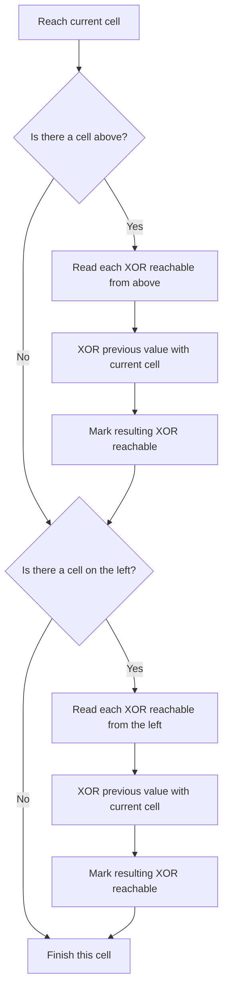
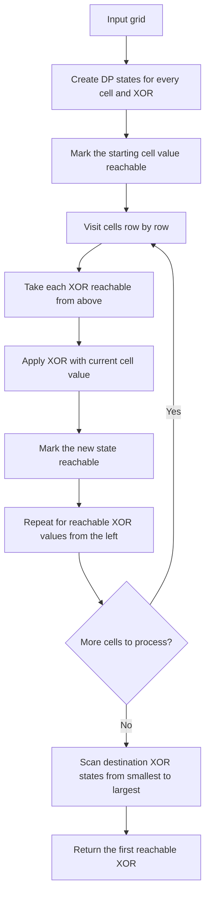
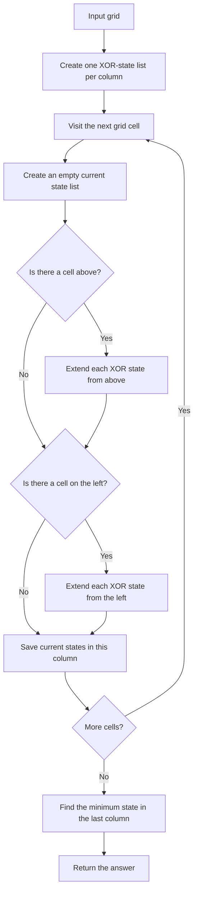

## 👨‍💻 Profiles

**GitHub:** https://github.com/Shailendra0320  
**LeetCode (Main):** https://leetcode.com/u/Shailu03/  
**LeetCode (Alternate):** https://leetcode.com/u/ShailendraLeetcode03/

# 3882. Minimum XOR Path in a Grid

**Difficulty:** Medium  
**Topics:** Dynamic Programming, Bit Manipulation, Matrix, Grid Traversal  
**Main pattern:** Track every XOR value that can reach a cell instead of keeping only one value.

**Official problem:** [LeetCode 3882 — Minimum XOR Path in a Grid](https://leetcode.com/problems/minimum-xor-path-in-a-grid/)

---

## Table of Contents

- [1. Understand the Problem](#1-understand-the-problem)
- [2. Official Examples](#2-official-examples)
- [3. Constraints and What They Tell Us](#3-constraints-and-what-they-tell-us)
- [4. XOR Refresher](#4-xor-refresher)
- [5. Why a Normal Minimum-Path DP Is Not Enough](#5-why-a-normal-minimum-path-dp-is-not-enough)
- [6. The Main DP Idea](#6-the-main-dp-idea)
- [7. Approach 1 — Full Grid DP for Reachable XOR Values](#7-approach-1--full-grid-dp-for-reachable-xor-values)
- [8. Approach 2 — Rolling-Row DP to Save Space](#8-approach-2--rolling-row-dp-to-save-space)
- [9. Approach Comparison](#9-approach-comparison)
- [10. Edge Cases](#10-edge-cases)
- [11. Common Mistakes](#11-common-mistakes)
- [12. Interview Explanation](#12-interview-explanation)
- [13. Quick Revision](#13-quick-revision)
- [14. Final Takeaway](#14-final-takeaway)

---

## 1. Understand the Problem

You are given a grid of integers. You start at the **top-left cell** `(0, 0)` and need to reach the **bottom-right cell** `(m - 1, n - 1)`.

You may move only in two directions:

- **Right:** `(r, c) -> (r, c + 1)`
- **Down:** `(r, c) -> (r + 1, c)`

The cost of one path is the **bitwise XOR of every value visited along that path**, including both the starting and ending cells.

Return the **smallest possible path XOR** among all valid paths.

### What does XOR mean?

XOR compares each bit of two numbers:

- The result bit is `1` when the two input bits are different.
- The result bit is `0` when the two input bits are the same.

For example:

```text
  5 = 0101
  3 = 0011
XOR = 0110 = 6
```

Another useful fact is that XORing the same value twice cancels it:

```text
x ^ a ^ a = x
```

The order of XOR operations does not change the result, but **the path still determines which grid values are included**.

### What makes this problem interesting?

The task is not to find the path with the smallest sum. It is to find the path with the smallest XOR. A path that has a smaller XOR halfway through the grid is not guaranteed to finish with the smallest XOR, because XOR with a later value can change the bits in either direction.

So, at each cell, we need to remember **all XOR values that can reach that cell**.

---

## 2. Official Examples

### Example 1

```text
grid = [[1, 2],
        [3, 4]]
Output: 6
```

There are two valid paths.

**Path A — right, then down**

```text
1 -> 2
     |
     4
```

```text
1 ^ 2 ^ 4 = 3 ^ 4 = 7
```

**Path B — down, then right**

```text
1
|
3 -> 4
```

```text
1 ^ 3 ^ 4 = 2 ^ 4 = 6
```

The two path XOR values are `7` and `6`, so the answer is **6**.

### Example 2

```text
grid = [[6, 7],
        [5, 8]]
Output: 9
```

| Path | XOR calculation | Result |
|---|---|---:|
| Right, then down | `6 ^ 7 ^ 8` | `9` |
| Down, then right | `6 ^ 5 ^ 8` | `11` |

The minimum is **9**.

### Example 3

```text
grid = [[2, 7, 5]]
Output: 0
```

There is only one path because the grid has one row:

```text
[2] -> [7] -> [5]
```

```text
2 ^ 7 = 5
5 ^ 5 = 0
```

The answer is **0**. This example is a useful reminder that a path XOR can be zero even when every cell is positive.

---

## 3. Constraints and What They Tell Us

The official constraints are:

- `1 <= m == grid.length <= 1000`
- `1 <= n == grid[i].length <= 1000`
- `m * n <= 1000`
- `0 <= grid[i][j] <= 1023`

The most important two facts are:

1. There are at most `1000` cells in total, so processing a small fixed set of states at every cell is practical.
2. Every value is at most `1023`, which is `2^10 - 1`. Therefore, every value uses at most 10 bits.

XOR never creates a new set bit above the highest bit present in its operands. Since all input values fit in 10 bits, every possible path XOR is also in the range:

```text
0 through 1023
```

That means there are only **1024 possible XOR states**.

We will use:

```text
XOR_LIMIT = 1024
```

This fixed range is the key that makes the dynamic programming solution efficient.

---

## 4. XOR Refresher

Before building the DP, let us look at a few XOR properties that appear in the solution.

### Property 1 — XOR is bitwise

```text
  1 = 0001
  2 = 0010
  3 = 0011
```

So `1 ^ 2 = 3`.

### Property 2 — XOR is reversible

If:

```text
previousXor ^ cellValue = newXor
```

then:

```text
previousXor = newXor ^ cellValue
```

This works because XORing by `cellValue` a second time cancels that value.

For a cell whose value is `4`, a previous XOR of `3` becomes:

```text
3 ^ 4 = 7
```

And if we know the new XOR is `7`, we can get the prior XOR back:

```text
7 ^ 4 = 3
```

This explains why a transition can be written in either direction. In the code below we use the forward direction because it reads naturally: take each reachable previous XOR and XOR it with the current cell.

### Property 3 — XOR is not ordinary numeric addition

Compare:

```text
3 + 4 = 7
3 ^ 4 = 7
```

Those happen to match here. But:

```text
5 + 3 = 8
5 ^ 3 = 6
```

Do not replace XOR with addition, and do not assume a smaller partial XOR always leads to a smaller final XOR.

### Property 4 — Repeated XOR values do not need repeated storage

Different paths may reach the same cell with the same XOR. We only need to know that this XOR is possible, not how many paths produce it.

Therefore, the DP stores a **reachable/not-reachable flag** for each XOR, rather than counting paths.

---

## 5. Why a Normal Minimum-Path DP Is Not Enough

For a shortest-sum problem, it is often enough to keep one best value for every cell. That does not work here.

Imagine that two paths reach a cell with XOR values `2` and `7`. If the next cell value is `5`, the new values become:

```text
2 ^ 5 = 7
7 ^ 5 = 2
```

The path with the larger partial XOR (`7`) becomes the path with the smaller new XOR (`2`). So remembering only the smallest XOR at the earlier cell would lose a valid answer.

### The wrong idea

```text
At each cell, store only the smallest XOR seen so far.
```

This throws away other values that may later turn into the minimum.

### The correct idea

```text
At each cell, store every XOR value that can reach it.
```

This is feasible because the XOR range has only 1024 values.

---

## 6. The Main DP Idea

Define a state:

```text
dp[r][c][x] = true
```

when there is at least one valid path from `(0, 0)` to `(r, c)` whose XOR is exactly `x`.

Otherwise, the state is `false`.

### Starting point

At the beginning, we stand on the top-left cell. That cell is part of the path, so its value is the initial XOR:

```text
dp[0][0][grid[0][0]] = true
```

For example, if `grid[0][0] = 6`, only XOR `6` is reachable at the starting cell.

### Transitions

For a cell `(r, c)` with value `v`, we can enter it from only two cells:

- The cell above: `(r - 1, c)`
- The cell to the left: `(r, c - 1)`

If the previous path reaches either predecessor with XOR `x`, then after including the current value the new XOR becomes:

```text
newXor = x ^ v
```

Therefore:

```text
If dp[r - 1][c][x] is reachable:
    mark dp[r][c][x ^ v] reachable

If dp[r][c - 1][x] is reachable:
    mark dp[r][c][x ^ v] reachable
```

We skip a predecessor that does not exist (above the top row or left of the first column).

### DP transition diagram



### Final answer

At the bottom-right cell, look through XOR values from `0` to `1023`. The first reachable value is the smallest possible answer.

```text
for x from 0 to 1023:
    if dp[m - 1][n - 1][x] is true:
        return x
```

At least one path always exists in a rectangular grid when you can move right and down, so the destination has at least one reachable XOR value.

---

# 7. Approach 1 — Full Grid DP for Reachable XOR Values

**Idea:** Store the reachable XOR states for every cell in the grid. This is the most direct version of the solution and is easiest to trace on paper.

### Step 1 — Allocate the state table

There are `m` rows, `n` columns, and 1024 possible XOR values for each cell:

```text
dp[m][n][1024]
```

Every entry is a boolean value. It answers one question: “Can I reach this cell with exactly this XOR?”

### Step 2 — Initialize the start

Only the value in `grid[0][0]` is initially reachable:

```text
dp[0][0][grid[0][0]] = true
```

The start value must be included. Forgetting it causes every path XOR to be wrong.

### Step 3 — Process cells in row-major order

Visit cells from top to bottom and left to right. By the time we reach a cell, the states for its upper and left neighbors are already known.

For each reachable XOR from above or from the left, XOR it with the current cell value and mark the resulting state.

### Step 4 — Find the minimum at the destination

Scan `dp[m - 1][n - 1]` from `0` upward. The first reachable state is the minimum XOR.

### Approach 1 flowchart



### Visual example — Example 1

Input:

```text
grid = [[1, 2],
        [3, 4]]
```

Grid coordinates and values:

```text
        col 0      col 1
row 0    (0,0)=1   (0,1)=2
row 1    (1,0)=3   (1,1)=4
```

The only two paths are:

```text
Path A: (0,0) -> (0,1) -> (1,1)
        1       -> 2       -> 4
        XOR = 1 ^ 2 ^ 4 = 7

Path B: (0,0) -> (1,0) -> (1,1)
        1       -> 3       -> 4
        XOR = 1 ^ 3 ^ 4 = 6
```

### Dry run table

| Cell | Cell value | Previous XOR states | New XOR states |
|---|---:|---|---|
| `(0,0)` | `1` | Start | `{1}` |
| `(0,1)` | `2` | Above does not exist; left has `{1}` | `{1 ^ 2} = {3}` |
| `(1,0)` | `3` | Above has `{1}`; left does not exist | `{1 ^ 3} = {2}` |
| `(1,1)` | `4` | Above has `{3}`, left has `{2}` | `{3 ^ 4, 2 ^ 4} = {7, 6}` |

The destination can be reached with XOR `6` or `7`. The smallest is **6**.

### How to read a state table

A small part of the DP can be written like this:

| Cell | Reachable XORs |
|---|---|
| `(0,0)` | `{1}` |
| `(0,1)` | `{3}` |
| `(1,0)` | `{2}` |
| `(1,1)` | `{6, 7}` |

The sets contain possible values, not counts of paths. If two different paths create XOR `6`, we still store `6` only once.

### Another dry run — Example 2

```text
grid = [[6, 7],
        [5, 8]]
```

Start:

```text
dp[0][0] = {6}
```

Move right to value `7`:

```text
6 ^ 7 = 1
dp[0][1] = {1}
```

Move down to value `5`:

```text
6 ^ 5 = 3
dp[1][0] = {3}
```

Reach the final value `8` from both predecessors:

```text
From above: 1 ^ 8 = 9
From left:  3 ^ 8 = 11

dp[1][1] = {9, 11}
```

The answer is **9**.

### Why Approach 1 works

Every valid path to a non-start cell must arrive from above or from the left. There is no third possible previous cell because moves are limited to right and down.

For every XOR state stored at either predecessor, the algorithm applies XOR with the current cell value. That creates exactly the XOR of the extended path. So the algorithm includes every valid path XOR.

It does not create impossible states, because every new state is based on a real reachable predecessor and a valid move. Starting with the correct state at `(0,0)` and following this rule row by row means each cell ends with exactly the XOR values of valid paths reaching it.

Finally, scanning the destination states in increasing numeric order returns the smallest valid path XOR.

### Complexity — Approach 1

Let `R` be the number of possible XOR values. Here `R = 1024`.

- **Time:** `O(m * n * R)` — each cell checks the possible XOR states from its available predecessors.
- **Auxiliary space:** `O(m * n * R)` — the boolean state table has one slot per cell and XOR value.

With `m * n <= 1000` and `R <= 1024`, the table has at most about 1,024,000 boolean states, which is manageable.

### Java — Approach 1

```java
//Approach-1 (Full Grid DP for Reachable XOR Values)
//T.C : O(m * n * 1024)
//S.C : O(m * n * 1024)

class Solution {
    private static final int XOR_LIMIT = 1024;

    public int minCost(int[][] grid) {
        int m = grid.length;
        int n = grid[0].length;

        boolean[][][] dp = new boolean[m][n][XOR_LIMIT];
        dp[0][0][grid[0][0]] = true;

        for (int r = 0; r < m; r++) {
            for (int c = 0; c < n; c++) {
                if (r == 0 && c == 0) {
                    continue;
                }

                int value = grid[r][c];

                if (r > 0) {
                    for (int previousXor = 0; previousXor < XOR_LIMIT; previousXor++) {
                        if (dp[r - 1][c][previousXor]) {
                            dp[r][c][previousXor ^ value] = true;
                        }
                    }
                }

                if (c > 0) {
                    for (int previousXor = 0; previousXor < XOR_LIMIT; previousXor++) {
                        if (dp[r][c - 1][previousXor]) {
                            dp[r][c][previousXor ^ value] = true;
                        }
                    }
                }
            }
        }

        for (int xorValue = 0; xorValue < XOR_LIMIT; xorValue++) {
            if (dp[m - 1][n - 1][xorValue]) {
                return xorValue;
            }
        }

        return -1;
    }
}
```

### C++ — Approach 1

```cpp
//Approach-1 (Full Grid DP for Reachable XOR Values)
//T.C : O(m * n * 1024)
//S.C : O(m * n * 1024)

#include <bits/stdc++.h>
using namespace std;

class Solution {
public:
    int minCost(vector<vector<int>>& grid) {
        const int XOR_LIMIT = 1024;
        int m = static_cast<int>(grid.size());
        int n = static_cast<int>(grid[0].size());

        vector<vector<vector<char>>> dp(
            m,
            vector<vector<char>>(n, vector<char>(XOR_LIMIT, 0))
        );

        dp[0][0][grid[0][0]] = 1;

        for (int r = 0; r < m; r++) {
            for (int c = 0; c < n; c++) {
                if (r == 0 && c == 0) {
                    continue;
                }

                int value = grid[r][c];

                if (r > 0) {
                    for (int previousXor = 0; previousXor < XOR_LIMIT; previousXor++) {
                        if (dp[r - 1][c][previousXor]) {
                            dp[r][c][previousXor ^ value] = 1;
                        }
                    }
                }

                if (c > 0) {
                    for (int previousXor = 0; previousXor < XOR_LIMIT; previousXor++) {
                        if (dp[r][c - 1][previousXor]) {
                            dp[r][c][previousXor ^ value] = 1;
                        }
                    }
                }
            }
        }

        for (int xorValue = 0; xorValue < XOR_LIMIT; xorValue++) {
            if (dp[m - 1][n - 1][xorValue]) {
                return xorValue;
            }
        }

        return -1;
    }
};
```

### Python — Approach 1

```python
#Approach-1 (Full Grid DP for Reachable XOR Values)
#T.C : O(m * n * 1024)
#S.C : O(m * n * 1024)

from typing import List

class Solution:
    def minCost(self, grid: List[List[int]]) -> int:
        XOR_LIMIT = 1024
        m, n = len(grid), len(grid[0])

        dp = [
            [bytearray(XOR_LIMIT) for _ in range(n)]
            for _ in range(m)
        ]

        dp[0][0][grid[0][0]] = 1

        for r in range(m):
            for c in range(n):
                if r == 0 and c == 0:
                    continue

                value = grid[r][c]
                current = dp[r][c]

                if r > 0:
                    for previous_xor, reachable in enumerate(dp[r - 1][c]):
                        if reachable:
                            current[previous_xor ^ value] = 1

                if c > 0:
                    for previous_xor, reachable in enumerate(dp[r][c - 1]):
                        if reachable:
                            current[previous_xor ^ value] = 1

        for xor_value, reachable in enumerate(dp[m - 1][n - 1]):
            if reachable:
                return xor_value

        return -1
```

---

# 8. Approach 2 — Rolling-Row DP to Save Space

**Idea:** The full DP table is easy to understand, but a cell only uses states from the cell above and the cell to its left. Once a row is no longer needed, we do not need to keep all its historical states.

We can therefore store only one array of XOR-state lists, one per column.

### What does `dp[c]` mean now?

During processing, `dp[c]` stores reachable XOR values for the most recently processed cell in column `c`.

- Before processing row `r`, `dp[c]` still belongs to row `r - 1`. It is the **above** cell's state list.
- After we process column `c - 1` in the current row, `dp[c - 1]` already belongs to row `r`. It is the **left** cell's state list.
- We build a separate `current` state list for the cell `(r, c)`, using both sources.
- After `current` is complete, assign it to `dp[c]`. The old above-row states for that column are no longer needed.

This ordering is important. Do not overwrite `dp[c]` before reading all the states from above.

### Approach 2 flowchart



### Step-by-step walkthrough

For each cell `(r, c)`:

1. Create an empty state list named `current`.
2. If the cell is the start, mark only `grid[0][0]` reachable.
3. Otherwise, for every reachable XOR `x` in the above states, mark `x ^ grid[r][c]` in `current`.
4. Do the same for the left states, if a left cell exists.
5. Store `current` in `dp[c]`.
6. After the last cell is processed, scan the states stored in `dp[n - 1]` and return the minimum reachable XOR.

### Rolling-row diagram

```text
Before processing cell (r, c):

    dp[c]       = states from ABOVE (row r - 1)
    dp[c - 1]   = states from LEFT  (row r)

                 ABOVE
                   |
                   v
    LEFT ------> CURRENT CELL
                   |
                   v
            save current states in dp[c]
```

### Dry run using Example 1

Input:

```text
grid = [[1, 2],
        [3, 4]]
```

Start with two empty state lists, one for each column:

```text
dp[0] = {}
dp[1] = {}
```

**Cell `(0,0)`, value `1`**

This is the start, so:

```text
dp[0] = {1}
```

**Cell `(0,1)`, value `2`**

There is no cell above. The left state is `{1}`:

```text
current = {1 ^ 2} = {3}
dp[1] = {3}
```

**Cell `(1,0)`, value `3`**

The old `dp[0]` is the state list from above `{1}`. There is no left cell:

```text
current = {1 ^ 3} = {2}
dp[0] = {2}
```

**Cell `(1,1)`, value `4`**

At this moment:

```text
Above: {3}   (old dp[1])
Left:  {2}   (updated dp[0])
```

Build the current state list:

```text
From above: 3 ^ 4 = 7
From left:  2 ^ 4 = 6

current = {6, 7}
dp[1] = {6, 7}
```

The minimum reachable XOR in the final column is **6**.

### Why Approach 2 gives the same answer

Approach 2 does not change the DP recurrence. It changes only how much history we keep in memory.

The state list for a cell depends only on the state lists immediately above and to its left. Once those states have been used to calculate the current cell, the old states from above that column are never needed again. Keeping one rolling list per column is therefore enough to calculate exactly the same states that the full table would calculate.

At the end of the scan, the last column contains the states for the bottom row's last cell, which is the destination. Taking its smallest reachable XOR returns the answer.

### Complexity — Approach 2

Let `R = 1024` be the number of possible XOR values.

- **Time:** `O(m * n * R)` — each cell processes at most `R` states from above and at most `R` states from the left.
- **Auxiliary space:** `O(n * R)` — only one rolling state list per column is stored.

This improves the space usage from `O(m * n * R)` to `O(n * R)` without changing the result.

### Java — Approach 2

```java
//Approach-2 (Rolling-Row DP to Save Space)
//T.C : O(m * n * 1024)
//S.C : O(n * 1024)

class Solution2 {
    private static final int XOR_LIMIT = 1024;

    public int minCost(int[][] grid) {
        int m = grid.length;
        int n = grid[0].length;

        boolean[][] dp = new boolean[n][XOR_LIMIT];

        for (int r = 0; r < m; r++) {
            for (int c = 0; c < n; c++) {
                int value = grid[r][c];
                boolean[] current = new boolean[XOR_LIMIT];

                if (r == 0 && c == 0) {
                    current[value] = true;
                } else {
                    if (r > 0) {
                        for (int previousXor = 0; previousXor < XOR_LIMIT; previousXor++) {
                            if (dp[c][previousXor]) {
                                current[previousXor ^ value] = true;
                            }
                        }
                    }

                    if (c > 0) {
                        for (int previousXor = 0; previousXor < XOR_LIMIT; previousXor++) {
                            if (dp[c - 1][previousXor]) {
                                current[previousXor ^ value] = true;
                            }
                        }
                    }
                }

                dp[c] = current;
            }
        }

        for (int xorValue = 0; xorValue < XOR_LIMIT; xorValue++) {
            if (dp[n - 1][xorValue]) {
                return xorValue;
            }
        }

        return -1;
    }
}
```

### C++ — Approach 2

```cpp
//Approach-2 (Rolling-Row DP to Save Space)
//T.C : O(m * n * 1024)
//S.C : O(n * 1024)

#include <bits/stdc++.h>
using namespace std;

class Solution2 {
public:
    int minCost(vector<vector<int>>& grid) {
        const int XOR_LIMIT = 1024;
        int m = static_cast<int>(grid.size());
        int n = static_cast<int>(grid[0].size());

        vector<vector<char>> dp(n, vector<char>(XOR_LIMIT, 0));

        for (int r = 0; r < m; r++) {
            for (int c = 0; c < n; c++) {
                int value = grid[r][c];
                vector<char> current(XOR_LIMIT, 0);

                if (r == 0 && c == 0) {
                    current[value] = 1;
                } else {
                    if (r > 0) {
                        for (int previousXor = 0; previousXor < XOR_LIMIT; previousXor++) {
                            if (dp[c][previousXor]) {
                                current[previousXor ^ value] = 1;
                            }
                        }
                    }

                    if (c > 0) {
                        for (int previousXor = 0; previousXor < XOR_LIMIT; previousXor++) {
                            if (dp[c - 1][previousXor]) {
                                current[previousXor ^ value] = 1;
                            }
                        }
                    }
                }

                dp[c] = current;
            }
        }

        for (int xorValue = 0; xorValue < XOR_LIMIT; xorValue++) {
            if (dp[n - 1][xorValue]) {
                return xorValue;
            }
        }

        return -1;
    }
};
```

### Python — Approach 2

```python
#Approach-2 (Rolling-Row DP to Save Space)
#T.C : O(m * n * 1024)
#S.C : O(n * 1024)

from typing import List

class Solution2:
    def minCost(self, grid: List[List[int]]) -> int:
        XOR_LIMIT = 1024
        m, n = len(grid), len(grid[0])

        dp = [bytearray(XOR_LIMIT) for _ in range(n)]

        for r in range(m):
            for c in range(n):
                value = grid[r][c]
                current = bytearray(XOR_LIMIT)

                if r == 0 and c == 0:
                    current[value] = 1
                else:
                    if r > 0:
                        for previous_xor, reachable in enumerate(dp[c]):
                            if reachable:
                                current[previous_xor ^ value] = 1

                    if c > 0:
                        for previous_xor, reachable in enumerate(dp[c - 1]):
                            if reachable:
                                current[previous_xor ^ value] = 1

                dp[c] = current

        for xor_value, reachable in enumerate(dp[n - 1]):
            if reachable:
                return xor_value

        return -1
```

---

## 9. Approach Comparison

| Detail | Approach 1: Full Grid DP | Approach 2: Rolling-Row DP |
|---|---|---|
| What it stores | States for every cell | States for the current row / column frontier |
| DP idea | Reachable XORs from above and left | The same recurrence, but old rows are overwritten |
| Time | `O(m * n * 1024)` | `O(m * n * 1024)` |
| Auxiliary space | `O(m * n * 1024)` | `O(n * 1024)` |
| Easiest to debug | Yes, every cell's history remains available | Slightly more careful because `dp[c]` changes during each row |
| Best use | Learning and visualizing the state transition | Submission when memory efficiency matters |

### Which approach should you choose?

- Choose **Approach 1** when you want the clearest state table and an easy-to-follow explanation.
- Choose **Approach 2** when you want the same answer with less auxiliary memory.

Both are valid for the given constraints. Approach 2 is usually the better implementation once the recurrence is understood.

---

## 10. Edge Cases

| Case | Input | Expected answer | What it checks |
|---|---|---:|---|
| Single cell containing zero | `[[0]]` | `0` | The start and end are the same cell |
| Single cell containing a value | `[[5]]` | `5` | The starting value is included |
| One row | `[[2, 7, 5]]` | `0` | Only right moves are possible |
| One column | `[[2], [7], [5]]` | `0` | Only down moves are possible; `2 ^ 7 ^ 5 = 0` |
| Two different paths | `[[1, 2], [3, 4]]` | `6` | Must compare both possible XORs |
| Two paths with different results | `[[6, 7], [5, 8]]` | `9` | A smaller final XOR may come from a larger intermediate XOR |
| Every cell is zero | `[[0, 0], [0, 0]]` | `0` | XOR zero remains reachable |
| Maximum cell value | A cell with `1023` | Depends on full path | All XOR values still fit in `0..1023` |
| Repeated values | `[[1, 1], [1, 1]]` | `1` | Reachability flags avoid duplicate states |

### One-row check

For a one-row grid, there is exactly one path. The answer is the XOR of all cells in that row. The DP still works: every cell only receives states from its left neighbor.

### One-column check

For a one-column grid, there is exactly one path downward. Every cell only receives states from above. Again, no special algorithm is needed.

### Why returning zero is valid

XOR values cannot be negative. Therefore, if XOR zero is reachable at the destination, it is automatically the minimum possible answer. Example 3 demonstrates this case.

---

## 11. Common Mistakes

### Mistake 1 — Keeping only one XOR per cell

A single smallest prefix XOR is not enough. XOR with a later value can reverse which prefix is better. Keep every reachable XOR state.

### Mistake 2 — Forgetting the starting cell

The path includes `(0, 0)`. Initialize the first reachable XOR to `grid[0][0]`, not to zero.

### Mistake 3 — Forgetting to include the destination cell

Every transition into a cell must XOR the previous value with the current cell value. The end cell is included by the same rule.

### Mistake 4 — Moving diagonally

Only right and down moves are allowed. For a cell `(r, c)`, the only possible predecessors are `(r - 1, c)` and `(r, c - 1)`.

### Mistake 5 — Using the value maximum as the number of states

If the maximum cell value is `1023`, then the number of possible XOR states is `1024`. It is a count of states, not the maximum XOR value itself.

### Mistake 6 — Using too small an XOR range

The maximum input value can be `1023`, which needs 10 bits. A range of `0..511` would lose valid states. Use `1024` states.

### Mistake 7 — Overwriting the rolling state too early

For Approach 2, compute a fresh `current` state array first. Read all states from above and left before replacing `dp[c]`.

### Mistake 8 — Counting paths instead of tracking reachable XOR values

The question asks for the minimum XOR, not the number of ways. If many paths produce the same XOR, a single boolean flag is enough.

### Mistake 9 — Returning the first path found

DFS or BFS path enumeration may find a valid path but not the minimum XOR. The DP must gather the possibilities before selecting the smallest XOR at the destination.

---

## 12. Interview Explanation

You can explain the solution like this:

> “I cannot keep only the smallest XOR for each cell because XOR does not preserve numeric order: a larger prefix XOR can turn into a smaller result after another value is XORed. Instead, I define `dp[r][c][x]` to mean that a path exists to cell `(r, c)` with XOR `x`. Since every grid value is at most 1023, there are only 1024 possible XOR values. Each cell receives states from above and from the left, and I XOR each reachable previous value with the current cell. At the destination, I scan the states in increasing order and return the first reachable value. The full DP uses `O(m*n*1024)` space; I can reduce that to `O(n*1024)` by keeping only one rolling row of state arrays.”

### Common follow-up questions

**Why does this DP work when there are exponentially many paths?**  
Different paths that reach the same cell with the same XOR are equivalent for all future moves. We only need to record that the state is reachable, so many paths collapse into one state.

**Why is `1024` enough?**  
Every input value is below `2^10`. XOR only changes bits that appear in its operands; it cannot introduce a new bit above bit 9.

**Can the answer be zero?**  
Yes. XOR values can cancel out. If zero is reachable at the destination, no value can be smaller.

**Why can the grid be processed row by row?**  
Every move goes right or down. A cell can only depend on the cell above and the cell to its left, both of which are processed before it in row-major order.

**Why is Approach 2 safe?**  
The current cell needs states from only two neighbors. After the new states are built, no future cell needs the old states for that same column from the previous row.

---

## 13. Quick Revision

- **Start:** `dp[0][0][grid[0][0]] = true`.
- **State meaning:** XOR `x` is reachable at cell `(r, c)`.
- **Transition:** `newXor = previousXor ^ grid[r][c]`.
- **Valid previous cells:** above and left only.
- **XOR range:** `0..1023`, so there are 1024 states.
- **Answer:** smallest reachable XOR at `(m - 1, n - 1)`.
- **Approach 1 time:** `O(m * n * 1024)`.
- **Approach 1 space:** `O(m * n * 1024)`.
- **Approach 2 space:** `O(n * 1024)`.
- **Best pattern:** dynamic programming over a small, bounded state space.

### One-line memory trick

**Every cell keeps all possible XORs; every move XORs the current value; the destination returns the smallest reachable state.**

---

## 14. Final Takeaway

The hard part of this problem is recognizing that a normal “best value so far” DP is not enough. XOR can change the numeric order of partial results, so we must preserve all possible XOR states at each cell.

The constraints make that practical: values are at most `1023`, so a cell has only 1024 possible XOR states. Start with the value at the top-left cell, extend states from above and left, and choose the smallest state that reaches the bottom-right cell.

Approach 1 stores every cell's states and is the most direct version to learn. Approach 2 applies the exact same rule while keeping only one rolling row, reducing auxiliary space without changing the answer.

**Final recommendation:** Learn Approach 1 first, then use Approach 2 as the memory-optimized submission.

**Reference:** [Official LeetCode Problem — 3882. Minimum XOR Path in a Grid](https://leetcode.com/problems/minimum-xor-path-in-a-grid/)
