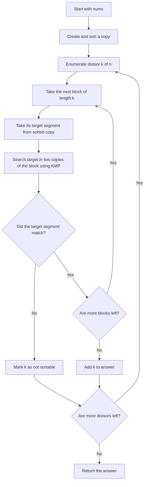
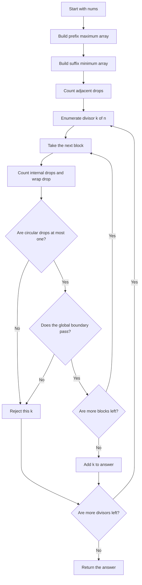

## 👨‍💻 Profiles

**GitHub:** https://github.com/Shailendra0320  
**LeetCode (Main):** https://leetcode.com/u/Shailu03/  
**LeetCode (Alternate):** https://leetcode.com/u/ShailendraLeetcode03/

# 3886. Sum of Sortable Integers

**Difficulty:** Hard  
**Topics:** Array, Math, Sorting, Enumeration  
**Main patterns:** Divisors, cyclic rotations, prefix maximum, suffix minimum, descent counting  
**Official problem:** [LeetCode 3886 — Sum of Sortable Integers](https://leetcode.com/problems/sum-of-sortable-integers/)

> **Core idea:** A block can be made sorted by rotation only when its circular order has at most one strict drop. The blocks must also stay in the correct global order. Check only the divisors of `n`, because those are the only possible block lengths.

---

## Table of Contents

- [Understand the Problem](#understand-the-problem)
- [Official Examples](#official-examples)
- [Important Observations](#important-observations)
- [Why Only Divisors of n Matter](#why-only-divisors-of-n-matter)
- [Approach 1: Direct Block Matching with KMP](#approach-1-direct-block-matching-with-kmp)
- [Approach 2: Circular Drops and Boundary Arrays](#approach-2-circular-drops-and-boundary-arrays)
- [Compare Both Approaches](#compare-both-approaches)
- [Edge Cases](#edge-cases)
- [Common Mistakes](#common-mistakes)
- [Interview Explanation](#interview-explanation)
- [Quick Revision](#quick-revision)

---

## Understand the Problem

You are given an integer array `nums` with `n` elements.

A positive integer `k` is called **sortable** when both of these conditions are true:

1. `k` divides `n`, so the array can be split into blocks of exactly `k` elements.
2. After splitting the array into consecutive blocks of length `k`, we can cyclically rotate each block independently and make the **entire array non-decreasing**.

A **cyclic rotation** moves elements around the ends of the same block. It does not reorder elements arbitrarily and does not move values between blocks.

For example, these are rotations of `[3, 1, 2]`:

```text
[3, 1, 2]  original
[1, 2, 3]  rotate left once
[2, 3, 1]  rotate left twice
```

But `[1, 3, 2]` is not a rotation of `[3, 1, 2]`, because the relative circular order has changed.

Your task is to **return the sum of every sortable value of `k`**.

### Constraints

- `1 <= nums.length <= 100000`
- `1 <= nums[i] <= 100000`
- `k` must divide `n`.
- The final answer is small enough to fit in a 32-bit signed integer under these constraints.

The official examples below show why we must consider both the order inside a block and the order across block boundaries.

---

## Official Examples

### Example 1

```text
Input:  nums = [3, 1, 2]
Output: 3
```

The divisors of `n = 3` are `1` and `3`.

- `k = 1`: every block has just one value. Rotating a single value changes nothing, so `[3, 1, 2]` cannot become sorted.
- `k = 3`: the entire array is one block. Rotate `[3, 1, 2]` left once to get `[1, 2, 3]`.

Only `k = 3` works, so the sum is `3`.

### Example 2

```text
Input:  nums = [7, 6, 5]
Output: 0
```

Again, the only candidates are `1` and `3`.

- `k = 1` cannot change the array.
- `k = 3` gives one block `[7, 6, 5]`. Its rotations are `[7, 6, 5]`, `[6, 5, 7]`, and `[5, 7, 6]`; none is non-decreasing.

No `k` works, so the answer is `0`.

### Example 3

```text
Input:  nums = [5, 8]
Output: 3
```

The array is already sorted.

- `k = 1` works, contributing `1`.
- `k = 2` also works, contributing `2`.

The answer is `1 + 2 = 3`.

---

## Important Observations

### A block may rotate, but it may not be rearranged freely

For `[4, 2, 3]`, the rotations are `[4, 2, 3]`, `[2, 3, 4]`, and `[3, 4, 2]`. The block can become sorted because `[2, 3, 4]` is one of its rotations.

For `[4, 3, 2]`, no rotation is sorted. Sorting the block as `[2, 3, 4]` would require changing the circular order, which is not allowed.

### Each block must occupy the correct values in the final sorted array

Let `sortedNums` be a sorted copy of `nums`. If a block starts at index `start` and has length `k`, its final values must be exactly:

```text
sortedNums[start ... start + k - 1]
```

So we can solve the problem in two ways:

- **Approach 1:** Directly check whether each original block is a cyclic rotation of its corresponding segment in the sorted array.
- **Approach 2:** Use a short mathematical check for each block, plus precomputed arrays that make these checks constant time.

### Values can repeat

The constraints do not say that all values are distinct. The approaches below work with duplicates because they compare values and use **strict drops** (`left > right`), not unequal values (`left != right`).

---

## Why Only Divisors of n Matter

The array must be partitioned into blocks of length `k` with no leftover elements. This is possible only if `n % k == 0`.

For `n = 12`, the only candidates are:

```text
k = 1, 2, 3, 4, 6, 12
```

There is no need to test `k = 5`, `7`, `8`, and so on.

Instead of trying every number from `1` to `n`, enumerate divisor pairs. If `d` divides `n`, then `n / d` is also a divisor:

```text
for d from 1 while d * d <= n
    if n is divisible by d
        test d
        test n / d, unless both values are equal
```

This finds every possible block length in `O(sqrt(n))` time.

---

# Approach 1: Direct Block Matching with KMP

**Time complexity:** `O(n log n + n * D)` where `D` is the number of positive divisors of `n`  
**Auxiliary space:** `O(n)`

This approach is the most direct way to translate the problem into code. It checks the exact block that must appear at each position after sorting.

## The idea in plain English

First, make `sortedNums`, a sorted copy of the input. For each possible block length `k`:

1. Split the original array into blocks of length `k`.
2. For a block beginning at `start`, take the target segment `sortedNums[start ... start + k - 1]`.
3. Check whether that target segment is a cyclic rotation of the original block.
4. If every block matches its target segment, `k` is sortable and can be added to the answer.

The remaining question is how to check rotations without trying every rotation one by one.

## How two copies of a block reveal all its rotations

Take this block:

```text
Block:          [3, 1, 2]
Two copies:      [3, 1, 2, 3, 1, 2]
Rotations:       [3, 1, 2]
                 [1, 2, 3]
                 [2, 3, 1]
```

Every rotation appears as a consecutive window of length `k` inside `block + block`. For example, `[1, 2, 3]` appears inside `[3, 1, 2, 3, 1, 2]`.

Therefore:

> A block can rotate into its target segment if and only if the target segment appears as a length-`k` substring in two copies of the block.

We use **KMP string matching** to find that target segment efficiently. KMP works on arrays of integers as well as on strings; it only needs equality comparisons.

## Approach 1 flowchart



## Step-by-step dry run

Use `nums = [2, 1, 4, 3]`.

The sorted target is `[1, 2, 3, 4]`. The divisors of `4` are `1`, `2`, and `4`.

### Check k = 1

Each block has one element. A one-element block cannot change its value.

| Block start | Original block | Target segment | Can rotate to target? |
|---:|---|---|---|
| `0` | `[2]` | `[1]` | No |

The first block already fails, so `k = 1` is not sortable.

### Check k = 2

The blocks are `[2, 1]` and `[4, 3]`.

| Block start | Original block | Two copies | Target segment | Match? |
|---:|---|---|---|---|
| `0` | `[2, 1]` | `[2, 1, 2, 1]` | `[1, 2]` | Yes — rotate left once |
| `2` | `[4, 3]` | `[4, 3, 4, 3]` | `[3, 4]` | Yes — rotate left once |

After rotating the blocks independently:

```text
Before: [2, 1] [4, 3]
After:  [1, 2] [3, 4]
Result: [1, 2, 3, 4]
```

Every block matches, so `k = 2` is sortable.

### Check k = 4

There is one block `[2, 1, 4, 3]`. Its target segment is `[1, 2, 3, 4]`.

The target does not appear as a length-4 rotation of the original block, so `k = 4` is not sortable.

The only sortable value is `2`, giving an answer of `2`.

## Why Approach 1 works

The blocks cannot exchange elements, so the values in the block at positions `start` through `start + k - 1` must become the values that belong to those exact positions in the globally sorted array.

KMP checks whether the target segment is a rotation of that block. If every block passes, rotate each block into its target segment and the whole array becomes sorted. If any block fails, no allowed operation can move values between blocks to repair that block, so this `k` cannot work.

## Complexity details

Let `D` be the number of divisors of `n`.

- Sorting a copy takes `O(n log n)` time.
- For one candidate `k`, all blocks together contain `n` values. KMP spends `O(k)` time per block, so checking all its blocks takes `O(n)` time.
- We test each divisor once, so all candidate checks take `O(n * D)` time, plus `O(sqrt(n))` to enumerate the divisors.
- The sorted copy takes `O(n)` space. KMP's temporary prefix table uses at most `O(k)` space, so total auxiliary space is `O(n)`.

This approach is easy to connect directly to the definition of a sortable integer, but it repeats a full-array scan for every divisor.

## Approach 1 code — Java

```java
//Approach-1 (Direct Block Matching with KMP)
//T.C : O(n log n + n * D), where D is the number of divisors of n
//S.C : O(n)

import java.util.Arrays;

class Solution {
    public int sortableIntegers(int[] nums) {
        int n = nums.length;
        int[] sortedNums = nums.clone();
        Arrays.sort(sortedNums);

        int answer = 0;

        for (int d = 1; d <= n / d; d++) {
            if (n % d != 0) {
                continue;
            }

            if (isSortableForK(nums, sortedNums, d)) {
                answer += d;
            }

            int other = n / d;
            if (other != d && isSortableForK(nums, sortedNums, other)) {
                answer += other;
            }
        }

        return answer;
    }

    private boolean isSortableForK(int[] nums, int[] sortedNums, int k) {
        int n = nums.length;

        for (int start = 0; start < n; start += k) {
            if (!isRotation(nums, sortedNums, start, k)) {
                return false;
            }
        }

        return true;
    }

    private boolean isRotation(int[] nums, int[] sortedNums, int start, int k) {
        int[] lps = new int[k];
        int length = 0;
        int i = 1;

        while (i < k) {
            if (sortedNums[start + i] == sortedNums[start + length]) {
                length++;
                lps[i] = length;
                i++;
            } else if (length > 0) {
                length = lps[length - 1];
            } else {
                lps[i] = 0;
                i++;
            }
        }

        int textIndex = 0;
        int patternIndex = 0;
        int textLength = 2 * k - 1;

        while (textIndex < textLength) {
            int value = nums[start + textIndex % k];

            if (value == sortedNums[start + patternIndex]) {
                textIndex++;
                patternIndex++;

                if (patternIndex == k) {
                    return true;
                }
            } else if (patternIndex > 0) {
                patternIndex = lps[patternIndex - 1];
            } else {
                textIndex++;
            }
        }

        return false;
    }
}
```

## Approach 1 code — C++

```cpp
//Approach-1 (Direct Block Matching with KMP)
//T.C : O(n log n + n * D), where D is the number of divisors of n
//S.C : O(n)

#include <bits/stdc++.h>
using namespace std;

class Solution {
private:
    bool isRotation(const vector<int>& nums,
                    const vector<int>& sortedNums,
                    int start, int k) {
        vector<int> lps(k, 0);
        int length = 0;
        int i = 1;

        while (i < k) {
            if (sortedNums[start + i] == sortedNums[start + length]) {
                length++;
                lps[i] = length;
                i++;
            } else if (length > 0) {
                length = lps[length - 1];
            } else {
                lps[i] = 0;
                i++;
            }
        }

        int textIndex = 0;
        int patternIndex = 0;
        int textLength = 2 * k - 1;

        while (textIndex < textLength) {
            int value = nums[start + textIndex % k];

            if (value == sortedNums[start + patternIndex]) {
                textIndex++;
                patternIndex++;

                if (patternIndex == k) {
                    return true;
                }
            } else if (patternIndex > 0) {
                patternIndex = lps[patternIndex - 1];
            } else {
                textIndex++;
            }
        }

        return false;
    }

    bool isSortableForK(const vector<int>& nums,
                        const vector<int>& sortedNums, int k) {
        int n = static_cast<int>(nums.size());

        for (int start = 0; start < n; start += k) {
            if (!isRotation(nums, sortedNums, start, k)) {
                return false;
            }
        }

        return true;
    }

public:
    int sortableIntegers(vector<int>& nums) {
        int n = static_cast<int>(nums.size());
        vector<int> sortedNums = nums;
        sort(sortedNums.begin(), sortedNums.end());

        int answer = 0;

        for (int d = 1; d <= n / d; d++) {
            if (n % d != 0) {
                continue;
            }

            if (isSortableForK(nums, sortedNums, d)) {
                answer += d;
            }

            int other = n / d;
            if (other != d && isSortableForK(nums, sortedNums, other)) {
                answer += other;
            }
        }

        return answer;
    }
};
```

## Approach 1 code — Python

```python
#Approach-1 (Direct Block Matching with KMP)
#T.C : O(n log n + n * D), where D is the number of divisors of n
#S.C : O(n)

from math import isqrt
from typing import List


class Solution:
    def sortableIntegers(self, nums: List[int]) -> int:
        n = len(nums)
        sorted_nums = sorted(nums)
        answer = 0

        for d in range(1, isqrt(n) + 1):
            if n % d != 0:
                continue

            if self._is_sortable_for_k(nums, sorted_nums, d):
                answer += d

            other = n // d
            if other != d and self._is_sortable_for_k(nums, sorted_nums, other):
                answer += other

        return answer

    def _is_sortable_for_k(self, nums: List[int], sorted_nums: List[int], k: int) -> bool:
        for start in range(0, len(nums), k):
            if not self._is_rotation(nums, sorted_nums, start, k):
                return False
        return True

    def _is_rotation(self, nums: List[int], sorted_nums: List[int], start: int, k: int) -> bool:
        lps = [0] * k
        length = 0
        i = 1

        while i < k:
            if sorted_nums[start + i] == sorted_nums[start + length]:
                length += 1
                lps[i] = length
                i += 1
            elif length > 0:
                length = lps[length - 1]
            else:
                lps[i] = 0
                i += 1

        text_index = 0
        pattern_index = 0
        text_length = 2 * k - 1

        while text_index < text_length:
            value = nums[start + text_index % k]

            if value == sorted_nums[start + pattern_index]:
                text_index += 1
                pattern_index += 1
                if pattern_index == k:
                    return True
            elif pattern_index > 0:
                pattern_index = lps[pattern_index - 1]
            else:
                text_index += 1

        return False
```

---

# Approach 2: Circular Drops and Boundary Arrays

**Time complexity:** `O(n + sum(n / k for every divisor k of n))`  
**Auxiliary space:** `O(n)`

This is the recommended approach. Instead of matching every block against a sorted segment, it checks two simple properties of each block using arrays prepared in one pass.

## The idea in plain English

For every candidate block length `k`, every block must satisfy two conditions:

1. **The block must be rotatable into non-decreasing order.** In the circular block, there can be at most one place where a value is strictly greater than the next value.
2. **Blocks must fit together in global order.** At every boundary between blocks, every value to the left must be less than or equal to every value to the right.

We can check these conditions quickly using three arrays:

| Array | Meaning | Why we need it |
|---|---|---|
| `prefMax[i]` | Maximum of `nums[0 ... i - 1]` | Largest value strictly before a boundary at `i` |
| `suffMin[i]` | Minimum of `nums[i ... n - 1]` | Smallest value at or after a boundary at `i` |
| `prefDrop[i]` | Number of strict adjacent drops through index `i` | Counts descending adjacent pairs inside a block quickly |

These arrays are computed once. After that, each block can be checked in constant time.

## Condition 1: Count circular drops inside a block

A **strict drop** occurs when a value is greater than the next value. For example, in `[4, 2, 3]`, the pair `4 > 2` is a drop, but `2 > 3` is not.

Because rotations wrap around, we must also compare the last value with the first value.

```text
Block: [4, 2, 3]

4 > 2  yes, one drop
2 > 3  no
3 > 4  no, this is the wrap-around comparison

Circular drops = 1, so this block can rotate to [2, 3, 4].
```

A block can rotate into sorted order if and only if it has **at most one strict circular drop**. Rotate the block to begin just after the single drop, if there is one. If there are two or more drops, no choice of starting point can make every adjacent pair non-decreasing.

For a block that starts at `start` and ends at `end` (inclusive), the number of internal drops is:

```text
prefDrop[end] - prefDrop[start]
```

Then include the circular edge from the last value back to the first:

```text
if nums[end] > nums[start]:
    drops += 1
```

If `drops > 1`, this block fails.

## Condition 2: Check the boundary between blocks

Rotating a block does not change which values belong to that block. So the elements in all earlier blocks must be no larger than the elements in all later blocks.

At a block boundary `start`, this becomes:

```text
maximum(nums[0 ... start - 1]) <= minimum(nums[start ... n - 1])
```

Using our arrays, the check is simply:

```text
prefMax[start] <= suffMin[start]
```

If the condition fails, some value on the left is larger than a value on the right. Since rotations cannot move those values across block boundaries, the full array can never become sorted for this `k`.

## Approach 2 flowchart



## Diagram: What the boundary arrays mean

For `nums = [2, 1, 4, 3]` and a block length of `2`:

```text
Block 1: [2, 1]       Block 2: [4, 3]
          rotate to              rotate to
         [1, 2]                 [3, 4]

At boundary start = 2:
prefMax[2] = max(2, 1) = 2
suffMin[2] = min(4, 3) = 3

2 <= 3, so the blocks can join in sorted order.
```

If that boundary had `prefMax[start] > suffMin[start]`, some earlier value would be too large to sit before a later value. No rotation inside either block could fix it.

## Step-by-step dry run

Use `nums = [2, 1, 4, 3]` again.

### Precompute the arrays

| Index | `nums[i]` | `prefMax[i]` | `suffMin[i]` | `prefDrop[i]` |
|---:|---:|---:|---:|---:|
| `0` | `2` | `0` | `1` | `0` |
| `1` | `1` | `2` | `1` | `1` |
| `2` | `4` | `2` | `3` | `1` |
| `3` | `3` | `4` | `3` | `2` |

`prefMax` has length `n + 1`; the table shows its useful entries at block boundaries. `suffMin` also has length `n + 1`, with an extra sentinel at the end. The drop-count array is indexed by the original element positions.

### Check k = 1

Every block contains one value, so the internal and wrap-around drop count is zero. But each boundary still has to preserve global order.

At `start = 1`:

```text
prefMax[1] = 2
suffMin[1] = 1
2 > 1, so the boundary fails.
```

Therefore, `k = 1` is not sortable.

### Check k = 2

| Block | Start | End | Internal drops | Wrap drop | Total drops | Boundary check |
|---|---:|---:|---:|---:|---:|---|
| `[2, 1]` | `0` | `1` | `1` | `0` | `1` | Pass |
| `[4, 3]` | `2` | `3` | `1` | `0` | `1` | Pass |

At the second block boundary, `prefMax[2] = 2` and `suffMin[2] = 3`, so `2 <= 3`. Both blocks have at most one circular drop and the boundary is safe.

So `k = 2` is sortable and contributes `2` to the answer.

### Check k = 4

There is a single block `[2, 1, 4, 3]`.

- Internal drops: `2 > 1` and `4 > 3`, so there are `2`.
- Wrap-around check: `3 > 2`, so add one more drop.
- Total circular drops: `3`, which is greater than `1`.

The block cannot rotate into sorted order, so `k = 4` fails.

Only `k = 2` works, and the final answer is `2`.

## Why Approach 2 works

The circular-drop check decides whether a block can be rotated into non-decreasing order. If there are two or more strict circular drops, every possible rotation still leaves a descending adjacent pair. If there is at most one, starting the block immediately after that drop produces a non-decreasing block.

The boundary check makes sure these individually sorted blocks can join into one globally sorted array. At every boundary, the largest value on the left must be no greater than the smallest value on the right. Rotations cannot change the values belonging to either side of a boundary, so this condition is necessary. When it passes at every block start, there is no cross-block inversion left.

Both checks together are sufficient: every block can become sorted, and the sorted blocks are already in a globally compatible order. We therefore add `k` exactly when the rotations can sort the whole array.

## Complexity details

- Building `prefMax`, `suffMin`, and `prefDrop` takes `O(n)` time.
- For one divisor `k`, each block is checked in `O(1)` time, and there are `n / k` blocks. So checking that candidate costs `O(n / k)`.
- Across all divisors, the total work for the checks is `sum(n / k)` over every divisor `k` of `n`. This is also the sum of the positive divisors of `n`, commonly written as `sigma(n)`.
- Total time is `O(n + sigma(n))`; the conservative bound `O(n * sqrt(n))` also follows from testing fewer than `2 * sqrt(n)` divisors, each in at most `O(n)` time.
- The three helper arrays take `O(n)` auxiliary space.

This is the recommended implementation because it avoids sorting for every candidate and checks each block using precomputed information.

## Approach 2 code — Java

```java
//Approach-2 (Circular Drops and Boundary Arrays)
//T.C : O(n + sum(n / k) for all divisors k of n)
//S.C : O(n)

class Solution2 {
    public int sortableIntegers(int[] nums) {
        int n = nums.length;

        int[] prefMax = new int[n + 1];
        for (int i = 0; i < n; i++) {
            prefMax[i + 1] = Math.max(prefMax[i], nums[i]);
        }

        int[] suffMin = new int[n + 1];
        suffMin[n] = Integer.MAX_VALUE;
        for (int i = n - 1; i >= 0; i--) {
            suffMin[i] = Math.min(nums[i], suffMin[i + 1]);
        }

        int[] prefDrop = new int[n];
        for (int i = 1; i < n; i++) {
            prefDrop[i] = prefDrop[i - 1] + (nums[i - 1] > nums[i] ? 1 : 0);
        }

        int answer = 0;
        for (int d = 1; d <= n / d; d++) {
            if (n % d != 0) {
                continue;
            }

            if (isSortableForK(nums, d, prefMax, suffMin, prefDrop)) {
                answer += d;
            }

            int other = n / d;
            if (other != d && isSortableForK(nums, other, prefMax, suffMin, prefDrop)) {
                answer += other;
            }
        }

        return answer;
    }

    private boolean isSortableForK(int[] nums, int k,
                                   int[] prefMax, int[] suffMin,
                                   int[] prefDrop) {
        int n = nums.length;

        for (int start = 0; start < n; start += k) {
            int end = start + k - 1;
            int drops = prefDrop[end] - prefDrop[start];

            if (nums[end] > nums[start]) {
                drops++;
            }

            if (drops > 1 || prefMax[start] > suffMin[start]) {
                return false;
            }
        }

        return true;
    }
}
```

## Approach 2 code — C++

```cpp
//Approach-2 (Circular Drops and Boundary Arrays)
//T.C : O(n + sum(n / k) for all divisors k of n)
//S.C : O(n)

#include <bits/stdc++.h>
using namespace std;

class Solution2 {
private:
    bool isSortableForK(const vector<int>& nums, int k,
                        const vector<int>& prefMax,
                        const vector<int>& suffMin,
                        const vector<int>& prefDrop) {
        int n = static_cast<int>(nums.size());

        for (int start = 0; start < n; start += k) {
            int end = start + k - 1;
            int drops = prefDrop[end] - prefDrop[start];

            if (nums[end] > nums[start]) {
                drops++;
            }

            if (drops > 1 || prefMax[start] > suffMin[start]) {
                return false;
            }
        }

        return true;
    }

public:
    int sortableIntegers(vector<int>& nums) {
        int n = static_cast<int>(nums.size());
        vector<int> prefMax(n + 1, 0);

        for (int i = 0; i < n; i++) {
            prefMax[i + 1] = max(prefMax[i], nums[i]);
        }

        vector<int> suffMin(n + 1, INT_MAX);
        for (int i = n - 1; i >= 0; i--) {
            suffMin[i] = min(nums[i], suffMin[i + 1]);
        }

        vector<int> prefDrop(n, 0);
        for (int i = 1; i < n; i++) {
            prefDrop[i] = prefDrop[i - 1] + (nums[i - 1] > nums[i] ? 1 : 0);
        }

        int answer = 0;
        for (int d = 1; d <= n / d; d++) {
            if (n % d != 0) {
                continue;
            }

            if (isSortableForK(nums, d, prefMax, suffMin, prefDrop)) {
                answer += d;
            }

            int other = n / d;
            if (other != d && isSortableForK(nums, other, prefMax, suffMin, prefDrop)) {
                answer += other;
            }
        }

        return answer;
    }
};
```

## Approach 2 code — Python

```python
#Approach-2 (Circular Drops and Boundary Arrays)
#T.C : O(n + sum(n / k) for all divisors k of n)
#S.C : O(n)

from math import isqrt
from typing import List


class Solution2:
    def sortableIntegers(self, nums: List[int]) -> int:
        n = len(nums)

        pref_max = [0] * (n + 1)
        for i, value in enumerate(nums):
            pref_max[i + 1] = max(pref_max[i], value)

        inf = 10**18
        suff_min = [inf] * (n + 1)
        for i in range(n - 1, -1, -1):
            suff_min[i] = min(nums[i], suff_min[i + 1])

        pref_drop = [0] * n
        for i in range(1, n):
            pref_drop[i] = pref_drop[i - 1] + (1 if nums[i - 1] > nums[i] else 0)

        def is_sortable_for_k(k: int) -> bool:
            for start in range(0, n, k):
                end = start + k - 1
                drops = pref_drop[end] - pref_drop[start]

                if nums[end] > nums[start]:
                    drops += 1

                if drops > 1 or pref_max[start] > suff_min[start]:
                    return False

            return True

        answer = 0
        for d in range(1, isqrt(n) + 1):
            if n % d != 0:
                continue

            if is_sortable_for_k(d):
                answer += d

            other = n // d
            if other != d and is_sortable_for_k(other):
                answer += other

        return answer
```

---

## Compare Both Approaches

| Detail | Approach 1: Direct KMP Matching | Approach 2: Circular Drops and Boundaries |
|---|---|---|
| Main idea | Match each block against its exact target segment | Check each block using its circular drops and global boundary |
| Sorts a copy | Yes | No |
| Uses KMP | Yes | No |
| Time | `O(n log n + n * D)` | `O(n + sigma(n))` |
| Extra space | `O(n)` | `O(n)` |
| Main advantage | Mirrors the definition directly | Faster checks with simple arrays |
| Best use | Learning the exact rotation condition | Recommended for submission and optimization practice |

`D` is the number of divisors of `n`. `sigma(n)` is the sum of those divisors. The number of divisors is much smaller than `n`, but the second approach also avoids rescanning every element for every candidate.

---

## Edge Cases

| Input | Reason to check | Expected answer |
|---|---|---:|
| `[5]` | Only divisor is `1`; the array is already sorted | `1` |
| `[3, 1, 2]` | The full block can rotate into sorted order | `3` |
| `[7, 6, 5]` | No rotation of the full block is sorted | `0` |
| `[5, 8]` | Already sorted, so both divisors work | `3` |
| `[3, 3, 3]` | Equal values have no strict circular drops | `4` |
| `[2, 1, 4, 3]` | Length `2` blocks can each rotate independently | `2` |

---

## Common Mistakes

1. **Testing values of `k` that do not divide `n`.** The array cannot be split into equal-size blocks for those values.
2. **Treating a rotation as a normal sort.** A block must preserve its circular order; arbitrary rearrangement is not allowed.
3. **Checking only the inside of each block.** The block boundaries must also preserve global order.
4. **Forgetting the wrap-around edge.** The comparison `nums[end] > nums[start]` is part of the circular-drop count.
5. **Using `!=` instead of `>`.** Equal neighboring values are fine. Only strict decreases count as drops.
6. **Counting prefix drops with the wrong endpoints.** The internal drop count for inclusive block `[start, end]` is `prefDrop[end] - prefDrop[start]`.
7. **Testing the same square-root divisor twice.** When `d * d == n`, `d` and `n / d` are the same value and should only be checked once.
8. **Assuming a valid block alone makes `k` valid.** Every block must pass, and every boundary must preserve global order.

---

## Interview Explanation

> “Only divisors of the array length can be valid block sizes. My direct solution sorts a copy and checks whether each original block is a rotation of the corresponding sorted segment, using KMP over two copies of the block. For a faster solution, I count strict circular drops in each block and check every block boundary with prefix maxima and suffix minima. A block is rotatable into sorted order when it has at most one circular drop, and the prefix maximum at a boundary must not exceed the suffix minimum there. I sum every divisor that passes all these checks.”

---

## Quick Revision

- Only test `k` where `n % k == 0`.
- A block may only be cyclically rotated, not arbitrarily sorted.
- Approach 1: match each block's target sorted segment inside two copies of that block with KMP.
- Approach 2: a block can rotate into sorted order if its circular-drop count is at most one.
- At every block start, require `prefMax[start] <= suffMin[start]`.
- Count a wrap-around drop when `nums[end] > nums[start]`.
- Approach 1 costs `O(n log n + n * D)` time.
- Approach 2 costs `O(n + sigma(n))` time and uses `O(n)` extra space.

## Final Takeaway

The key is to remember that rotations preserve the circular order of values inside a block. The direct approach verifies that order by matching against the sorted target. The optimized approach recognizes that the same property can be summarized by a single count of strict circular drops, then uses prefix maxima and suffix minima to make sure blocks can join into one globally sorted array.

**Reference:** [Official LeetCode problem 3886](https://leetcode.com/problems/sum-of-sortable-integers/)
