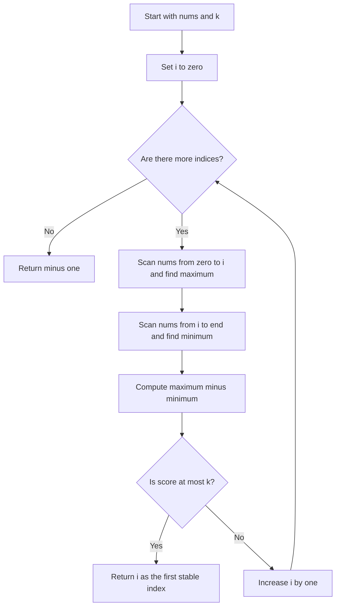
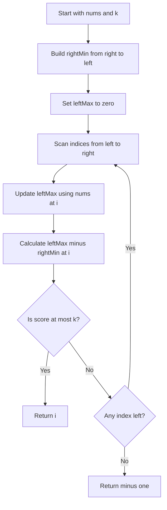

## 👨‍💻 Profiles

**GitHub:** https://github.com/Shailendra0320  
**LeetCode (Main):** https://leetcode.com/u/Shailu03/  
**LeetCode (Alternate):** https://leetcode.com/u/ShailendraLeetcode03/

# 3903. Smallest Stable Index I — Prefix Maximum and Suffix Minimum

**Difficulty:** Easy  
**Topics:** Array, Prefix Maximum, Suffix Minimum  
**Main pattern:** Precompute what the suffix needs to know, then scan from left to right.  
**Official problem:** [LeetCode 3903 — Smallest Stable Index I](https://leetcode.com/problems/smallest-stable-index-i/)

> **Core idea:** At each index, compare the largest value seen on the left (including the current element) with the smallest value on the right (also including the current element). Return the first index where their difference is at most `k`.

---

## Table of Contents

- [Understand the Problem](#1-understand-the-problem)
- [Official Examples](#2-official-examples)
- [Important Observations](#3-important-observations)
- [Approach 1 — Check Every Index from Scratch](#4-approach-1--check-every-index-from-scratch)
- [Approach 2 — Suffix Minimum + Running Prefix Maximum](#5-approach-2--suffix-minimum--running-prefix-maximum)
- [Compare the Approaches](#6-compare-the-approaches)
- [Edge Cases](#7-edge-cases)
- [Common Mistakes](#8-common-mistakes)
- [Interview Explanation](#9-interview-explanation)
- [Quick Revision](#10-quick-revision)

---

## 1. Understand the Problem

You are given an integer array `nums` and an integer `k`. For every index `i`, calculate its **instability score**:

\[
\text{score}(i)=\max(nums[0..i])-\min(nums[i..n-1])
\]

Both parts include index `i`:

- `nums[0..i]` means everything from the beginning through the current index. Find the **maximum** in that part.
- `nums[i..n-1]` means everything from the current index through the end. Find the **minimum** in that part.
- The index is **stable** when `score(i) <= k`.
- Return the **smallest index** that is stable. If every index has a score greater than `k`, return `-1`.

### What does “smallest stable index” mean?

Check indices in order: `0`, `1`, `2`, and so on. The first index that satisfies the condition is the answer. Do not look for the index with the smallest score; the question asks for the **earliest position that passes the condition**.

### Constraints

| Item | Constraint |
|---|---|
| Array length | `1 <= nums.length <= 100` |
| Array values | `0 <= nums[i] <= 1,000,000,000` |
| Threshold | `0 <= k <= 1,000,000,000` |

The small limit of `n <= 100` means a simple solution that checks every index from scratch is acceptable. A linear-time solution is still easy to write and avoids repeated work.

---

## 2. Official Examples

### Example 1

```text
Input:  nums = [5, 0, 1, 4], k = 3
Output: 3
```

At index `0`, the left maximum is `5` and the right minimum is `0`, so the score is `5`. Index `0` is not stable because `5 > 3`.

| Index `i` | Prefix `nums[0..i]` | Prefix max | Suffix `nums[i..n-1]` | Suffix min | Score | Stable? |
|---:|---|---:|---|---:|---:|---|
| 0 | `[5]` | 5 | `[5,0,1,4]` | 0 | `5 - 0 = 5` | No |
| 1 | `[5,0]` | 5 | `[0,1,4]` | 0 | `5 - 0 = 5` | No |
| 2 | `[5,0,1]` | 5 | `[1,4]` | 1 | `5 - 1 = 4` | No |
| 3 | `[5,0,1,4]` | 5 | `[4]` | 4 | `5 - 4 = 1` | Yes |

Index `3` is the first stable index, so return `3`.

### Example 2

```text
Input:  nums = [3, 2, 1], k = 1
Output: -1
```

| Index `i` | Prefix max | Suffix min | Score | Stable? |
|---:|---:|---:|---:|---|
| 0 | 3 | 1 | 2 | No |
| 1 | 3 | 1 | 2 | No |
| 2 | 3 | 1 | 2 | No |

Every score is `2`, which is larger than `k = 1`. No stable index exists, so return `-1`.

### Example 3

```text
Input:  nums = [0], k = 0
Output: 0
```

There is only one index. Its prefix maximum and suffix minimum are both `0`, so the score is `0 - 0 = 0`. Because `0 <= k`, return `0`.

---

## 3. Important Observations

1. **The current element belongs to both ranges.** Use `nums[0..i]` and `nums[i..n-1]`, not ranges that exclude `i`.
2. **The left maximum can be maintained while moving forward.** At index `i`, update it with `max(leftMax, nums[i])`.
3. **The right minimum is easiest to calculate backwards.** At each position, store the smallest value from that position to the end.
4. **Return immediately when a position is stable.** The first match is the answer, even if a later index has a smaller score.
5. **The score is not guaranteed to move in one direction.** Do not use binary search. The prefix maximum and suffix minimum each have predictable behavior, but their difference is not a reliable monotonic search condition.

### The two values at an index

For `nums = [5, 0, 1, 4]`:

```text
nums:          [5, 0, 1, 4]
index:          0  1  2  3
prefix maximum: [5, 5, 5, 5]
suffix minimum: [0, 0, 1, 4]
score:          [5, 5, 4, 1]
k = 3
```

At the first three indices, the score is too large. The score at index `3` is `1`, which passes.

---

# 4. Approach 1 — Check Every Index from Scratch

**Time:** `O(n^2)`  
**Auxiliary space:** `O(1)`

This is the most direct approach. For every index `i`, calculate the prefix maximum by scanning from index `0` to `i`, then calculate the suffix minimum by scanning from `i` to the last index. If the difference is at most `k`, return `i` immediately.

It repeats some work, but it is straightforward and fits the given constraint `n <= 100`.

## Approach 1 flowchart



## Approach 1: step-by-step example

Use `nums = [5, 0, 1, 4]` and `k = 3`.

- **Check index `0`:** prefix max is `5`; suffix min is `0`; score is `5`. Continue.
- **Check index `1`:** prefix max is `5`; suffix min is `0`; score is `5`. Continue.
- **Check index `2`:** prefix max is `5`; suffix min is `1`; score is `4`. Continue.
- **Check index `3`:** prefix max is `5`; suffix min is `4`; score is `1`. Since `1 <= 3`, return `3`.

```text
Index checked:  0       1       2       3
Score:          5       5       4       1
Condition:      5>3     5>3     4>3     1<=3
Decision:       skip    skip    skip    return 3
```

## Why Approach 1 works

For any index `i`, the problem defines the score using exactly two pieces of information: the largest value from the start through `i`, and the smallest value from `i` through the end. This approach calculates both pieces directly, so its score is exactly the score required by the problem.

It checks indices from smallest to largest and returns as soon as a score passes the limit. Therefore, the returned index must be the smallest stable index. If no score passes, the loop finishes and the answer is `-1`.

## Approach 1 code

### Java

```java
//Approach-1 (Check Every Index from Scratch)
//T.C : O(n^2)
//S.C : O(1)

class Solution {
    public int firstStableIndex(int[] nums, int k) {
        int n = nums.length;

        for (int i = 0; i < n; i++) {
            int prefixMax = nums[0];
            for (int j = 1; j <= i; j++) {
                prefixMax = Math.max(prefixMax, nums[j]);
            }

            int suffixMin = nums[i];
            for (int j = i + 1; j < n; j++) {
                suffixMin = Math.min(suffixMin, nums[j]);
            }

            if (prefixMax - suffixMin <= k) {
                return i;
            }
        }

        return -1;
    }
}
```

### C++

```cpp
//Approach-1 (Check Every Index from Scratch)
//T.C : O(n^2)
//S.C : O(1)

#include <bits/stdc++.h>
using namespace std;

class Solution {
public:
    int firstStableIndex(vector<int>& nums, int k) {
        int n = static_cast<int>(nums.size());

        for (int i = 0; i < n; i++) {
            int prefixMax = nums[0];
            for (int j = 1; j <= i; j++) {
                prefixMax = max(prefixMax, nums[j]);
            }

            int suffixMin = nums[i];
            for (int j = i + 1; j < n; j++) {
                suffixMin = min(suffixMin, nums[j]);
            }

            if (prefixMax - suffixMin <= k) {
                return i;
            }
        }

        return -1;
    }
};
```

### Python

```python
#Approach-1 (Check Every Index from Scratch)
#T.C : O(n^2)
#S.C : O(1)

from typing import List

class Solution:
    def firstStableIndex(self, nums: List[int], k: int) -> int:
        n = len(nums)

        for i in range(n):
            prefix_max = max(nums[:i + 1])
            suffix_min = min(nums[i:])

            if prefix_max - suffix_min <= k:
                return i

        return -1
```

## When Approach 1 is useful

- You want the simplest possible implementation.
- You are learning how the score is calculated.
- The array is small, as it is in this problem.
- You want a direct reference implementation to test an optimized solution.

The downside is repeated scanning. A value can be examined many times when calculating scores for different indices.

---

# 5. Approach 2 — Suffix Minimum + Running Prefix Maximum

**Time:** `O(n)`  
**Auxiliary space:** `O(n)`

This approach avoids repeating the same scans. We calculate the suffix minimum for each index once, then calculate prefix maximums while scanning from left to right.

### What is a suffix minimum?

`rightMin[i]` stores the minimum value in `nums[i..n-1]`.

For `nums = [5, 0, 1, 4]`:

| Index | Suffix | `rightMin[i]` |
|---:|---|---:|
| 0 | `[5, 0, 1, 4]` | 0 |
| 1 | `[0, 1, 4]` | 0 |
| 2 | `[1, 4]` | 1 |
| 3 | `[4]` | 4 |

So `rightMin = [0, 0, 1, 4]`.

We can create this array from right to left. The last suffix has only one element, so `rightMin[n - 1] = nums[n - 1]`. For each earlier index:

\[
rightMin[i]=\min(nums[i],rightMin[i+1])
\]

### What is a running prefix maximum?

As we move left to right, `leftMax` always holds the largest value seen so far, including the current index. Update it at every step:

\[
leftMax=\max(leftMax,nums[i])
\]

Now the score is available in constant time:

\[
score(i)=leftMax-rightMin[i]
\]

## Approach 2 flowchart



## Data-flow diagram

```text
                   nums
                    |
          +---------+----------+
          |                    |
          v                    v
   Right-to-left pass    Left-to-right scan
          |                    |
          v                    v
   rightMin[i] array       leftMax at i
          |                    |
          +---------+----------+
                    |
                    v
       score = leftMax - rightMin[i]
                    |
                    v
         Is score <= k at index i?
                    |
          +---------+---------+
          |                   |
         Yes                  No
          |                   |
          v                   v
       Return i        Check next index
```

## Approach 2 dry run — Example 1

Input: `nums = [5, 0, 1, 4]`, `k = 3`.

### Pass 1: build suffix minimums

| Index `i` | `nums[i]` | Minimum to the right including `i` | Stored value |
|---:|---:|---|---:|
| 3 | 4 | `[4]` | 4 |
| 2 | 1 | `min(1, 4)` | 1 |
| 1 | 0 | `min(0, 1)` | 0 |
| 0 | 5 | `min(5, 0)` | 0 |

Final array: `rightMin = [0, 0, 1, 4]`.

### Pass 2: scan for the first stable index

| `i` | `nums[i]` | Running `leftMax` | `rightMin[i]` | Score | Decision |
|---:|---:|---:|---:|---:|---|
| 0 | 5 | 5 | 0 | 5 | `5 > 3`, continue |
| 1 | 0 | 5 | 0 | 5 | `5 > 3`, continue |
| 2 | 1 | 5 | 1 | 4 | `4 > 3`, continue |
| 3 | 4 | 5 | 4 | 1 | `1 <= 3`, return 3 |

The optimized approach returns `3`, the same result as the direct approach.

## Approach 2 dry run — Example 2

Input: `nums = [3, 2, 1]`, `k = 1`.

`rightMin = [1, 1, 1]`.

| `i` | `leftMax` | `rightMin[i]` | Score | Decision |
|---:|---:|---:|---:|---|
| 0 | 3 | 1 | 2 | Continue |
| 1 | 3 | 1 | 2 | Continue |
| 2 | 3 | 1 | 2 | No indices remain |

No index passes the condition, so return `-1`.

## Why Approach 2 works

The suffix array stores the correct minimum for every possible right-hand range. During the forward scan, `leftMax` is updated to the maximum from index `0` through the current index. Therefore, at index `i`, the expression `leftMax - rightMin[i]` is exactly the instability score defined in the problem.

The scan starts at index `0` and moves forward. It immediately returns when the score is at most `k`, so no smaller index could have passed first. If it reaches the end without finding a stable index, returning `-1` is correct.

## Approach 2 code

### Java

```java
//Approach-2 (Suffix Minimum + Running Prefix Maximum)
//T.C : O(n)
//S.C : O(n)

class Solution {
    public int firstStableIndex(int[] nums, int k) {
        int n = nums.length;
        int[] rightMin = new int[n];

        rightMin[n - 1] = nums[n - 1];

        for (int i = n - 2; i >= 0; i--) {
            rightMin[i] = Math.min(nums[i], rightMin[i + 1]);
        }

        int leftMax = nums[0];

        for (int i = 0; i < n; i++) {
            leftMax = Math.max(leftMax, nums[i]);

            if (leftMax - rightMin[i] <= k) {
                return i;
            }
        }

        return -1;
    }
}
```

### C++

```cpp
//Approach-2 (Suffix Minimum + Running Prefix Maximum)
//T.C : O(n)
//S.C : O(n)

#include <bits/stdc++.h>
using namespace std;

class Solution {
public:
    int firstStableIndex(vector<int>& nums, int k) {
        int n = static_cast<int>(nums.size());
        vector<int> rightMin(n);

        rightMin[n - 1] = nums[n - 1];

        for (int i = n - 2; i >= 0; i--) {
            rightMin[i] = min(nums[i], rightMin[i + 1]);
        }

        int leftMax = nums[0];

        for (int i = 0; i < n; i++) {
            leftMax = max(leftMax, nums[i]);

            if (leftMax - rightMin[i] <= k) {
                return i;
            }
        }

        return -1;
    }
};
```

### Python

```python
#Approach-2 (Suffix Minimum + Running Prefix Maximum)
#T.C : O(n)
#S.C : O(n)

from typing import List

class Solution:
    def firstStableIndex(self, nums: List[int], k: int) -> int:
        n = len(nums)
        right_min = [0] * n
        right_min[n - 1] = nums[n - 1]

        for i in range(n - 2, -1, -1):
            right_min[i] = min(nums[i], right_min[i + 1])

        left_max = nums[0]

        for i in range(n):
            left_max = max(left_max, nums[i])

            if left_max - right_min[i] <= k:
                return i

        return -1
```

## Why Approach 2 is preferred

- Every suffix minimum is calculated once rather than rescanned for every index.
- The prefix maximum takes only one variable; it does not need a separate prefix array.
- Each index needs only one subtraction and one comparison after preprocessing.
- The overall time drops from `O(n^2)` to `O(n)`.

---

## 6. Compare the Approaches

| Feature | Approach 1: Recompute ranges | Approach 2: Store suffix minimums |
|---|---|---|
| Main idea | Scan both sides for every index | Precompute suffix minima and maintain one running maximum |
| Time | `O(n^2)` | `O(n)` |
| Auxiliary space | `O(1)` | `O(n)` |
| Easy to understand? | Very direct | Slightly more preparation, much less repeated work |
| Recommended? | Good for learning and verification | **Best for submission** |

Both methods return the same smallest stable index. Approach 2 is the better overall solution because it does not repeatedly scan the same elements.

---

## 7. Edge Cases

| Input | `k` | Expected output | Why |
|---|---:|---:|---|
| `[0]` | 0 | `0` | The only score is zero |
| `[5, 0, 1, 4]` | 3 | `3` | First three scores fail; index 3 passes |
| `[3, 2, 1]` | 1 | `-1` | Every score is 2 |
| `[1, 1, 1]` | 0 | `0` | Every score is zero, so index 0 passes |
| `[1, 2, 3, 4]` | 0 | `0` | At index 0, max and min both equal 1 |
| `[9, 1]` | 7 | `1` | Scores are 8 then 0 |
| `[1, 9]` | 0 | `0` | At index 0, prefix max and suffix min both equal 1 |
| `[1, 9]` | 1 | `0` | Index 0 already has a score of zero |
| `[1000000000]` | 0 | `0` | Handles the largest allowed value |

**Important:** For a single-element array, the same element is both the prefix maximum and suffix minimum. Its score is always zero, so index `0` is stable for any valid `k`.

---

## 8. Common Mistakes

1. **Excluding the current index from one side.** Both the prefix and suffix include `nums[i]`.
2. **Taking the first index with `nums[i] <= k`.** The condition is not based on the current value alone; it is based on prefix maximum minus suffix minimum.
3. **Returning the index with the smallest score.** The answer is the first index that passes the threshold, not necessarily the index with the smallest score.
4. **Building suffix minimums in the wrong direction.** Start at the last index and move backwards.
5. **Forgetting to include the current element in the running maximum.** Update `leftMax` before checking the score at that index.
6. **Using `leftMax - rightMin[i] < k`.** The problem says less than or equal to `k`, so use `<=`.
7. **Using binary search.** The score sequence is not guaranteed to be monotonic.
8. **Returning `0` when no index matches.** The required answer is `-1` if no stable index exists.
9. **Overcomplicating the optimized approach.** You need only one suffix-minimum array and one running prefix-maximum variable.

---

## 9. Interview Explanation

> “For every index, the score is the maximum of the prefix ending there minus the minimum of the suffix starting there. Recomputing both values at every index takes quadratic time. Instead, I precompute suffix minimums by scanning from right to left. Then I scan from left to right while maintaining the prefix maximum. At every index, the score is available in constant time, and I return immediately at the first score that is at most `k`. If none passes, I return `-1`. The algorithm takes `O(n)` time and `O(n)` extra space.”

---

## 10. Quick Revision

- **Instability score:** `prefixMax - suffixMin`.
- **Prefix maximum at `i`:** maximum of `nums[0..i]`.
- **Suffix minimum at `i`:** minimum of `nums[i..n-1]`.
- **Stable condition:** `score <= k`.
- **Answer:** first index satisfying the condition, otherwise `-1`.
- **Approach 1:** recompute both ranges for every index — `O(n^2)` time, `O(1)` extra space.
- **Approach 2:** precompute suffix minima and keep a running prefix maximum — `O(n)` time, `O(n)` extra space.
- **Best choice:** Approach 2.

### One-line insight

**Precompute the minimum to the right, maintain the maximum to the left, and return the first index where their difference is at most `k`.**

---

**Reference:** [LeetCode 3903 — Smallest Stable Index I](https://leetcode.com/problems/smallest-stable-index-i/) — official problem statement, examples, and constraints.  
