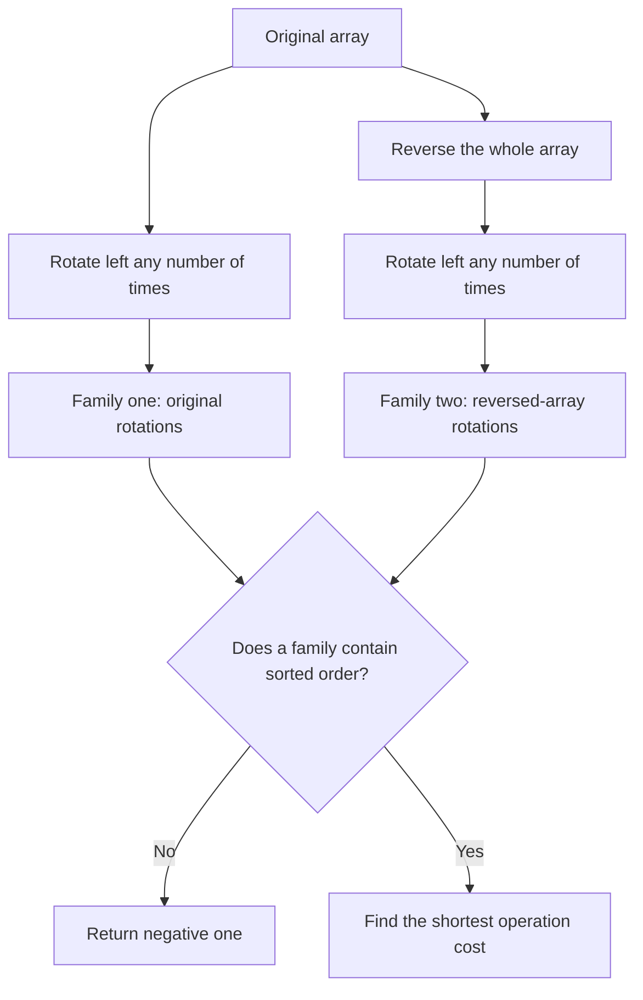
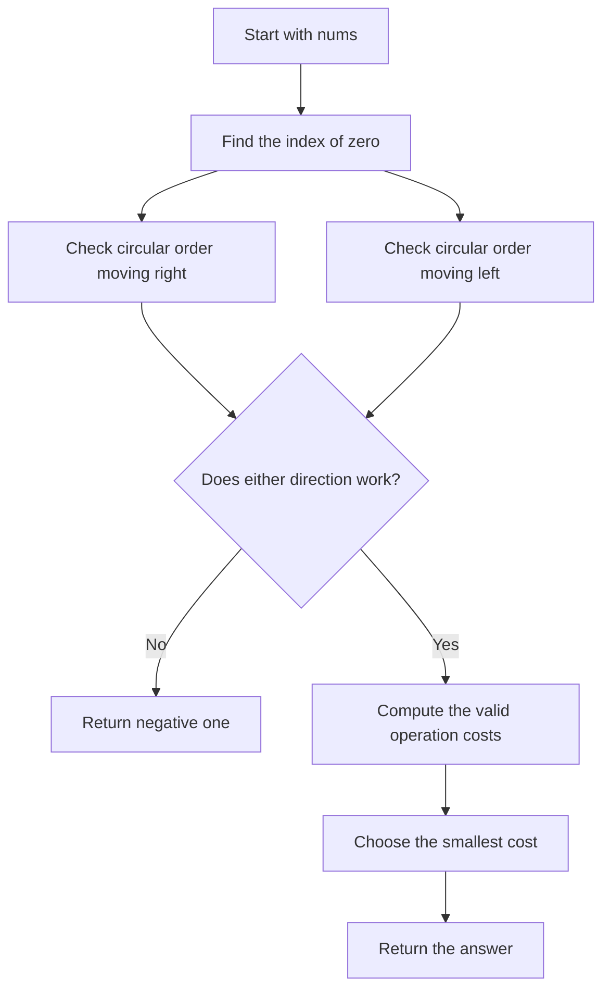
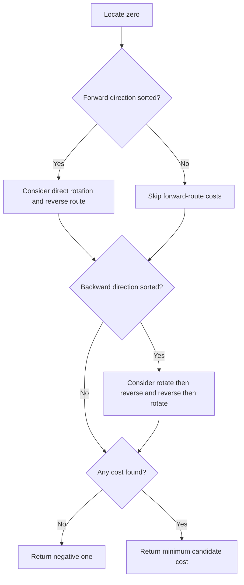
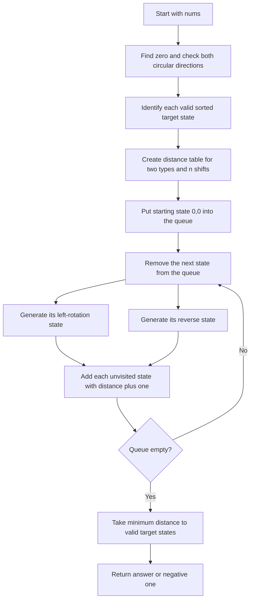
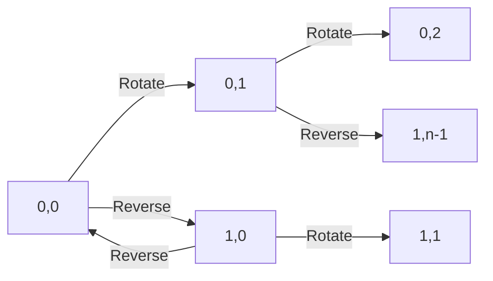

## 👨‍💻 Profiles

**GitHub:** https://github.com/Shailendra0320  
**LeetCode (Main):** https://leetcode.com/u/Shailu03/  
**LeetCode (Alternate):** https://leetcode.com/u/ShailendraLeetcode03/

# 3942. Minimum Operations to Sort a Permutation

**Difficulty:** Medium  
**Topics:** Array, Greedy, Breadth-First Search, Circular Array, State Graph, Case Analysis  
**Main patterns:** Circular order, rotations and reversal, shortest path over a compressed state space

**Official problem:** [LeetCode 3942 — Minimum Operations to Sort a Permutation](https://leetcode.com/problems/minimum-operations-to-sort-a-permutation/)

---

## Table of Contents

- [Quick Summary](#quick-summary)
- [1. Understand the Problem](#1-understand-the-problem)
- [2. The Allowed Operations](#2-the-allowed-operations)
- [3. Official Examples](#3-official-examples)
- [4. First Important Observation](#4-first-important-observation)
- [5. Find the Position of Zero](#5-find-the-position-of-zero)
- [6. Approach 1 — Linear Case Analysis](#6-approach-1--linear-case-analysis)
- [7. Approach 1 — Java, C++, and Python Code](#7-approach-1--java-c-and-python-code)
- [8. Approach 2 — BFS on Compressed States](#8-approach-2--bfs-on-compressed-states)
- [9. Approach 2 — Java, C++, and Python Code](#9-approach-2--java-c-and-python-code)
- [10. Compare the Approaches](#10-compare-the-approaches)
- [11. Dry Runs and State Tables](#11-dry-runs-and-state-tables)
- [12. Edge Cases](#12-edge-cases)
- [13. Common Mistakes](#13-common-mistakes)
- [14. Correctness in Plain English](#14-correctness-in-plain-english)
- [15. Complexity Explained](#15-complexity-explained)
- [16. Interview Explanation](#16-interview-explanation)
- [17. Frequently Asked Questions](#17-frequently-asked-questions)
- [18. Practice Checklist](#18-practice-checklist)
- [19. Final Revision Sheet](#19-final-revision-sheet)
- [References](#references)

---

## Quick Summary

You receive a permutation of the integers from `0` to `n - 1`.

You can reverse the whole array or rotate it left by one position.

The task is to find the fewest operations that turn the array into:

```text
[0, 1, 2, ..., n - 1]
```

If neither operation sequence can make the array sorted, return `-1`.

The main observation is that these operations cannot create an arbitrary rearrangement.

Every reachable array is either a rotation of the original array or a rotation of its reversed version.

That means we only need to check two possible circular directions.

| Approach | Main idea | Time | Extra space |
|---|---|---:|---:|
| Approach 1 | Check the two circular directions and compare the possible operation counts | `O(n)` | `O(1)` |
| Approach 2 | Run BFS over the `2n` compressed states | `O(n)` | `O(n)` |

**Recommended for submission:** Approach 1. It is faster to write, easier to submit, and needs constant auxiliary space.

Approach 2 is valuable for learning how to model operations as a graph and use BFS to find a minimum number of operations.

---

## 1. Understand the Problem

The input array is a permutation of the integers from `0` through `n - 1`.

A permutation means every allowed number appears exactly once.

For example, the following array is a valid permutation of length four:

```text
[2, 0, 3, 1]
```

It contains `0`, `1`, `2`, and `3` exactly once.

The target is always the numbers in increasing order:

```text
[0, 1, 2, 3]
```

You are not allowed to swap any two arbitrary elements.

Instead, you can perform only the two operations described below.

The operations can be used in any order.

You may also repeat an operation as many times as you need.

Every individual operation costs one operation.

The result should be the minimum possible operation count.

If no sequence of allowed operations can make the array sorted, the answer is `-1`.

### What does “minimum” mean here?

It is not enough to show one sequence that sorts the array.

We must find the shortest valid sequence.

For example, if one plan uses three operations and another valid plan uses two, the answer must be `2`.

This distinction matters because the same array can sometimes be sorted using different combinations of reversals and rotations.

### What the constraints tell us

The constraints are:

- `1 <= nums.length <= 100000`
- `0 <= nums[i] <= nums.length - 1`
- `nums` is a permutation of the integers from `0` to `n - 1`

The array can contain up to 100,000 elements.

So trying every possible operation sequence is not practical.

An efficient solution should avoid physically simulating a large number of rotations.

We can reason about rotations using indices and modular arithmetic instead.

### The three questions to ask

When approaching this problem, ask these questions in order:

1. What kinds of arrays can the operations actually produce?
2. How can we recognize whether the sorted target is reachable?
3. If it is reachable, how do we count the shortest operation sequence?

Both approaches in this README answer these questions.

---

## 2. The Allowed Operations

### Operation A — Reverse the entire array

Reversal flips the order of every element.

For example:

```text
Before:  [0, 2, 1]
After:   [1, 2, 0]
```

The first element becomes the last element.

The last element becomes the first element.

The positions in the middle also exchange their order.

This operation is not the same as reversing a substring.

The entire array must be reversed.

Reversing twice returns the original array.

```text
A --reverse--> reverse(A) --reverse--> A
```

Therefore, two consecutive reversals cancel each other out.

### Operation B — Rotate left by one

A left rotation moves the first element to the end.

Every other element moves one position to the left.

For example:

```text
Before:  [0, 2, 1]
After:   [2, 1, 0]
```

A second left rotation gives:

```text
[2, 1, 0] --> [1, 0, 2]
```

A third left rotation gives:

```text
[1, 0, 2] --> [0, 2, 1]
```

After exactly `n` left rotations, the array returns to its starting arrangement.

That is why rotating left `n` times has the same final effect as rotating left zero times.

We can express the rotation count modulo `n`.

### Why modular arithmetic appears

If `n = 5`, left-rotating by `7` positions is equivalent to left-rotating by `2` positions.

The reason is:

```text
7 % 5 = 2
```

Only the remainder matters for the final arrangement.

We use `% n` when calculating circular positions and rotation counts.

### A picture of a left rotation

```text
Index before:    0    1    2    3
Values before:  [A]  [B]  [C]  [D]

Index after:     0    1    2    3
Values after:   [B]  [C]  [D]  [A]
```

The elements keep their circular order.

Only the position where the array begins has changed.

### Why these two operations are special

A normal sorting algorithm can move elements in many ways.

For example, it may swap two neighboring elements or move one value across several positions.

This problem does not allow such arbitrary operations.

A rotation preserves the clockwise circular order of the elements.

A reversal changes that order to the opposite direction.

Combining the two still leaves only two families of possible arrangements.

Those families are:

- Rotations of the original array.
- Rotations of the reversed original array.

The entire problem becomes manageable once we use this observation.

---

## 3. Official Examples

### Example 1

```text
Input:  nums = [0, 2, 1]
Output: 2
```

The first operation is a left rotation:

```text
[0, 2, 1] --> [2, 1, 0]
```

The second operation reverses the complete array:

```text
[2, 1, 0] --> [0, 1, 2]
```

The array is now sorted.

The answer is `2`.

Notice that the first array starts with zero, but the remaining elements are not increasing when we move to the right.

They are increasing when we move to the left around the circular array:

```text
0 --> 1 --> 2
```

That is the useful direction for this example.

### Example 2

```text
Input:  nums = [1, 0, 2]
Output: 2
```

First reverse the array:

```text
[1, 0, 2] --> [2, 0, 1]
```

Then rotate left once:

```text
[2, 0, 1] --> [0, 1, 2]
```

The answer is `2`.

Here, zero is at index `1`.

Reading from zero toward the left gives:

```text
0 --> 1 --> 2
```

So the reverse circular direction works.

### Example 3

```text
Input:  nums = [2, 0, 1, 3]
Output: -1
```

Start at zero and move right around the array:

```text
0 --> 1 --> 3 --> 2
```

This is not increasing.

Now start at zero and move left around the array:

```text
0 --> 2 --> 3 --> 1
```

This is not increasing either.

The array is not a rotation of increasing order or decreasing order.

Reversal and left rotations cannot change it into `[0, 1, 2, 3]`.

Therefore, the answer is `-1`.

### Example comparison

| Input | Increasing circular direction | Decreasing circular direction | Answer |
|---|---|---|---:|
| `[0, 2, 1]` | No | Yes | `2` |
| `[1, 0, 2]` | No | Yes | `2` |
| `[2, 0, 1, 3]` | No | No | `-1` |

The word “decreasing” here describes the left-to-right arrangement around the circle.

When we start at zero and walk backward through that circle, the values should increase.

That is a simple way to test the second possible orientation.

---

## 4. First Important Observation

The key observation is that every operation sequence can be simplified into one of two forms:

1. Rotate the original array some number of positions.
2. Reverse the original array, then rotate it some number of positions.

Why can we simplify a longer sequence like this?

A rotation followed by another rotation is just one larger rotation.

For example, rotating left by one and then left by one is the same as rotating left by two.

Two reversals cancel one another.

A reversal can move across a rotation if we change the direction of that rotation.

This means there is no need to consider every possible operation sequence separately.

We only need to consider the circular order in the two possible directions.

### Family 1 — Rotations of the original array

For `nums = [0, 2, 1]`, its rotations are:

```text
[0, 2, 1]
[2, 1, 0]
[1, 0, 2]
```

The sorted target `[0, 1, 2]` does not appear in this family.

So rotations alone are not enough for this input.

### Family 2 — Rotations of the reversed array

Reverse the original array:

```text
reverse([0, 2, 1]) = [1, 2, 0]
```

Now list its rotations:

```text
[1, 2, 0]
[2, 0, 1]
[0, 1, 2]
```

This family contains the sorted target.

The target can be reached by one reversal and two total left rotations, or by a shorter combination of a rotation and a reversal.

The optimal answer is `2`.

### Why this observation saves time

The problem allows an unlimited number of operations.

An approach that blindly explores operation sequences would revisit many equivalent arrays.

For an array of length `n`, there are only `2n` representation states in these two families.

Approach 1 uses the structure to avoid BFS entirely.

Approach 2 models those `2n` states explicitly and runs BFS.

### A transformation diagram



This is the central idea behind both algorithms.

---

## 5. Find the Position of Zero

Let `zero` be the index where the value `0` appears.

Because `nums` is a permutation of `0` through `n - 1`, zero appears exactly once.

For example:

```text
nums = [2, 0, 3, 1]
zero = 1
```

Zero is already at index `1`.

A sorted array must start with zero.

So any successful rotation that uses the current orientation must move this zero to index `0`.

That directly tells us how many left rotations are needed in one of the cases.

### How to find zero

Scan the array from left to right.

When `nums[i] == 0`, save `i` and stop searching.

This scan takes `O(n)` time.

It uses `O(1)` extra space.

### Why zero is a natural starting point

The target begins with the smallest possible value: zero.

Once zero is placed at the beginning, the remaining order must be:

```text
1, 2, 3, ..., n - 1
```

Since every value is unique, checking the circular sequence from zero is enough to determine whether the orientation is correct.

### Circular indices

If zero is at index `z`, moving right by `i` positions lands at:

```text
(z + i) % n
```

Moving left by `i` positions lands at:

```text
(z - i + n) % n
```

The extra `+ n` keeps the index non-negative before applying modulo.

For a single left-to-right walk starting at zero, the indices are:

```text
z, (z + 1) % n, (z + 2) % n, ...
```

For a walk toward the left, the indices are:

```text
z, (z - 1 + n) % n, (z - 2 + n) % n, ...
```

The values encountered along those index sequences tell us which circular direction is sorted.

---

# 6. Approach 1 — Linear Case Analysis

**Time complexity:** `O(n)`  
**Auxiliary space:** `O(1)`

This is the recommended solution for submission.

It does not simulate every operation.

Instead, it checks whether either circular direction has the exact order needed to reach the sorted array.

Then it calculates the possible costs with small formulas.

### The plan in simple English

1. Find the index of zero.
2. Check whether the array increases when we walk right from zero.
3. Check whether the array increases when we walk left from zero.
4. If neither direction works, return `-1`.
5. Otherwise, compute the costs of the possible operation plans.
6. Return the smallest valid cost.

### Step 1 — Find zero

Find the only index `zero` such that `nums[zero] == 0`.

We use this index as the anchor for all circular checks.

```text
nums = [1, 0, 2]
zero = 1
```

The target begins with zero, so every successful plan must eventually bring this element to the first position.

### Step 2 — Check the forward circular direction

Start at `zero`.

Then visit the next index to the right, wrapping around to the beginning when necessary.

For each pair of consecutive positions, make sure the previous value is not greater than the current value.

The helper can use the following positions:

```text
previous = (zero + (i - 1) * step + n) % n
current  = (zero + i * step + n) % n
```

For the forward check, `step = 1`.

A successful check means reading the array from zero in the normal circular direction gives:

```text
0, 1, 2, ..., n - 1
```

The input can then be sorted by rotating it left `zero` times.

### Forward-direction illustration

```text
Array:        [2, 3, 0, 1]
Index:          0  1  2  3
Zero index:             ^

Read circularly from zero:
0 --> 1 --> 2 --> 3
```

The forward circular order is increasing.

Moving zero to the front by two left rotations produces the sorted array.

### Step 3 — Check the backward circular direction

Again start at zero.

This time, move one index to the left at every step.

The check uses `step = -1`.

A successful check means the order is increasing if we walk backward around the array.

Equivalently, the array is a rotation of a decreasing sequence when read from left to right.

For example:

```text
Array: [1, 0, 2]

Start at zero and move left:
0 --> 1 --> 2
```

This direction is increasing, so the backward circular check succeeds.

### Step 4 — If both checks fail

If neither direction is increasing from zero, the sorted target cannot be reached.

Why?

Rotations can only change the starting point of the circular order.

Reversal can switch the direction of that order.

If neither circular direction is increasing, neither family of reachable arrays contains the sorted target.

In that case, return `-1` immediately.

### Step 5 — Calculate the operation costs

There are up to four useful plans.

The first two are available when the forward direction works.

The other two are available when the backward direction works.

We compare only plans whose direction check succeeded.

The final answer is the minimum cost among those valid plans.

### Plan A — Rotate directly

If forward circular order is increasing, rotate left `zero` times.

After those rotations, zero moves to the first position.

The remaining values appear in increasing order.

The cost is:

```text
zero
```

Example:

```text
Start:       [2, 3, 0, 1]
Rotate left: [3, 0, 1, 2]
Rotate left: [0, 1, 2, 3]
```

The cost is two operations.

### Plan B — Reverse, rotate, and reverse again

Sometimes it is useful to change orientation temporarily.

Reverse the array first.

Then rotate the reversed array until it becomes decreasing from left to right.

Reverse it again to obtain increasing order.

The normalized number of rotations is `(n - zero) % n`.

The plan uses two reversals and that many left rotations.

Its cost is:

```text
((n - zero) % n) + 2
```

This plan may not beat direct rotation, but it must be considered to find the minimum across the valid transformations.

When zero is already at index zero, the rotation count in this alternative route is zero rather than `n`.

The modulo handles that case correctly.

### Plan C — Rotate zero to the end, then reverse

If backward circular order works, we can move zero to the end first.

The number of left rotations is `(zero + 1) % n`.

Then reverse the array once.

After reversal, zero becomes the first value and the remaining values are in sorted order.

The cost is:

```text
((zero + 1) % n) + 1
```

Example:

```text
Start:       [1, 0, 2]
Rotate left: [0, 2, 1]
Rotate left: [2, 1, 0]
Reverse:     [0, 1, 2]
```

This route costs three operations in the example.

### Plan D — Reverse once, then rotate

Another plan starts by reversing the array.

This places the backward circular order into the normal left-to-right orientation.

Then rotate left by `(n - zero - 1) % n` positions to move zero to the front.

The total cost is:

```text
((n - zero - 1) % n) + 1
```

The final `+ 1` counts the reversal.

For `[1, 0, 2]`, reverse once to get `[2, 0, 1]`, then rotate left once to get `[0, 1, 2]`.

The cost is two operations.

### Cost summary table

| Circular check | Valid plan | Number of operations |
|---|---|---:|
| Forward | Rotate directly | `zero` |
| Forward | Reverse, rotate, reverse | `((n - zero) % n) + 2` |
| Backward | Rotate, then reverse | `((zero + 1) % n) + 1` |
| Backward | Reverse, then rotate | `((n - zero - 1) % n) + 1` |

The code keeps the smallest applicable value.

If a check fails, do not use the costs from its row group.

### Approach 1 flowchart



### Approach 1 decision diagram



### Dry run 1 — `nums = [0, 2, 1]`

The array length is `3`.

Zero is at index `0`.

The forward direction is not sorted.

Walking forward gives:

```text
0 --> 2 --> 1
```

The values do not increase all the way around.

Now check the backward direction.

Walking backward gives:

```text
0 --> 1 --> 2
```

This direction works.

The two applicable candidate costs are:

| Plan | Formula | Cost |
|---|---|---:|
| Rotate then reverse | `((0 + 1) % 3) + 1` | `2` |
| Reverse then rotate | `((3 - 0 - 1) % 3) + 1` | `3` |

The smallest cost is `2`.

The actual operations are:

```text
[0, 2, 1]
[2, 1, 0]   rotate left once
[0, 1, 2]   reverse
```

Return `2`.

### Dry run 2 — `nums = [1, 0, 2]`

The array length is `3`.

Zero is at index `1`.

The forward check reads:

```text
0 --> 2 --> 1
```

It fails because `2` is greater than `1`.

The backward check reads:

```text
0 --> 1 --> 2
```

It succeeds.

The candidate costs are:

| Plan | Formula | Cost |
|---|---|---:|
| Rotate then reverse | `((1 + 1) % 3) + 1` | `3` |
| Reverse then rotate | `((3 - 1 - 1) % 3) + 1` | `2` |

The minimum is `2`.

The selected path is:

```text
[1, 0, 2]
[2, 0, 1]   reverse
[0, 1, 2]   rotate left once
```

Return `2`.

### Dry run 3 — `nums = [2, 0, 1, 3]`

The array length is `4`.

Zero is at index `1`.

The forward circular order is:

```text
0 --> 1 --> 3 --> 2
```

This is not increasing.

The backward circular order is:

```text
0 --> 2 --> 3 --> 1
```

This is not increasing either.

Neither direction works.

No valid cost can be calculated.

Return `-1`.

### Dry run 4 — `nums = [0, 1, 2, 3]`

The array is already sorted.

Zero is at index `0`.

The forward check succeeds.

Direct rotation costs zero operations.

All alternative plans have a cost greater than or equal to zero.

The minimum is `0`.

Return `0`.

### Dry run 5 — `nums = [3, 2, 1, 0]`

Zero is at the final index, `3`.

Moving left from zero gives:

```text
0 --> 1 --> 2 --> 3
```

The backward circular order works.

Reverse the array once:

```text
[3, 2, 1, 0] --> [0, 1, 2, 3]
```

The normalized cost of the relevant route is one operation.

Return `1`.

### Dry run 6 — `nums = [1, 2, 0, 3]`

Zero is at index `2`.

The forward check reads:

```text
0 --> 3 --> 1 --> 2
```

The forward check fails.

The backward check reads:

```text
0 --> 2 --> 1 --> 3
```

The backward check fails too.

The array cannot be sorted by the allowed operations.

Return `-1`.

### Why Approach 1 is correct

The allowed operations preserve circular order except that reversal switches the direction.

Therefore, a sorted target can only be reached if one of the two circular directions is increasing from zero.

The forward check detects the first possibility.

The backward check detects the second possibility.

If neither check succeeds, the target does not belong to either reachable family, so `-1` is correct.

If a check succeeds, the cost table considers the direct route and the route that uses reversal to change orientation.

Those are the shortest normalized rotation counts for the available orientation choices.

Taking the minimum of the applicable routes gives the minimum number of operations.

### Complexity of Approach 1

Finding zero scans the array once.

The forward check inspects at most `n - 1` pairs.

The backward check also inspects at most `n - 1` pairs.

There are only four arithmetic candidate costs.

The total work is bounded by a constant number of passes through the array.

**Time complexity: `O(n)`.**

The method stores only indices, booleans, and a handful of counters.

It does not build another array.

**Auxiliary space: `O(1)`.**

## 7. Approach 1 — Java, C++, and Python Code

The next three versions implement exactly the case analysis described above.

Each one scans for zero, checks both circular directions, and compares the valid route costs.

The variable `dranofelik` is an alias for the input reference, so it does not copy the array.

This also accommodates LeetCode variants that request storing the input in a variable with that name.

### Java — Approach 1

```java
//Approach-1 (Linear Case Analysis)
//T.C : O(n)
//S.C : O(1)

class Solution {
    private boolean check(int[] values, int zero, int step) {
        int n = values.length;

        for (int i = 1; i < n; i++) {
            int previous = (zero + (i - 1) * step + n) % n;
            int current = (zero + i * step + n) % n;

            if (values[previous] > values[current]) {
                return false;
            }
        }

        return true;
    }

    public int minOperations(int[] nums) {
        int n = nums.length;
        int zero = 0;

        for (int i = 0; i < n; i++) {
            if (nums[i] == 0) {
                zero = i;
                break;
            }
        }

        int[] dranofelik = nums;
        boolean forward = check(dranofelik, zero, 1);
        boolean backward = check(dranofelik, zero, -1);
        int answer = Integer.MAX_VALUE;

        if (forward) {
            answer = Math.min(answer, zero);
            answer = Math.min(answer, (n - zero) % n + 2);
        }

        if (backward) {
            answer = Math.min(answer, (zero + 1) % n + 1);
            answer = Math.min(answer, (n - zero - 1) % n + 1);
        }

        return answer == Integer.MAX_VALUE ? -1 : answer;
    }
}
```

### Java code walkthrough

The helper `check` accepts a step of `1` or `-1`.

A step of `1` walks forward through the circular array.

A step of `-1` walks backward through the circular array.

The expression `+ n` makes the index non-negative before `% n` is applied.

The input contains zero because it is a permutation of the complete range.

Therefore, the loop always finds the zero index.

The line `int[] dranofelik = nums;` assigns a second reference to the same array.

It does not duplicate the array's elements.

The `forward` and `backward` booleans store the two direction checks.

The answer starts at `Integer.MAX_VALUE`, which means no valid plan has been found yet.

Every time a valid direction is found, its two route costs are compared with the answer.

If the answer remains unchanged, the method returns `-1`.

Otherwise, it returns the minimum valid cost.

### C++ — Approach 1

```cpp
//Approach-1 (Linear Case Analysis)
//T.C : O(n)
//S.C : O(1)

#include <bits/stdc++.h>
using namespace std;

class Solution {
private:
    bool check(const vector<int>& values, int zero, int step) {
        int n = static_cast<int>(values.size());

        for (int i = 1; i < n; i++) {
            int previous = (zero + (i - 1) * step + n) % n;
            int current = (zero + i * step + n) % n;

            if (values[previous] > values[current]) {
                return false;
            }
        }

        return true;
    }

public:
    int minOperations(vector<int>& nums) {
        int n = static_cast<int>(nums.size());
        int zero = 0;

        for (int i = 0; i < n; i++) {
            if (nums[i] == 0) {
                zero = i;
                break;
            }
        }

        const vector<int>& dranofelik = nums;
        bool forward = check(dranofelik, zero, 1);
        bool backward = check(dranofelik, zero, -1);
        int answer = INT_MAX;

        if (forward) {
            answer = min(answer, zero);
            answer = min(answer, (n - zero) % n + 2);
        }

        if (backward) {
            answer = min(answer, (zero + 1) % n + 1);
            answer = min(answer, (n - zero - 1) % n + 1);
        }

        return answer == INT_MAX ? -1 : answer;
    }
};
```

### C++ code walkthrough

The `check` helper receives the input as a constant reference.

This avoids making an array copy.

The code finds the index of zero with a simple loop.

The value `dranofelik` is another reference to the same vector.

All calculations use this reference so the implementation stays consistent.

The formula `(zero + i * step + n) % n` calculates a circular index.

For `step = 1`, it moves right.

For `step = -1`, it moves left.

When a pair is out of increasing order, `check` returns `false` immediately.

Otherwise, it returns `true` after checking all adjacent circular pairs from zero.

The answer is updated only for a direction that passed its check.

### Python — Approach 1

```python
#Approach-1 (Linear Case Analysis)
#T.C : O(n)
#S.C : O(1)

from typing import List


class Solution:
    def _check(self, values: List[int], zero: int, step: int) -> bool:
        n = len(values)

        for i in range(1, n):
            previous = (zero + (i - 1) * step + n) % n
            current = (zero + i * step + n) % n

            if values[previous] > values[current]:
                return False

        return True

    def minOperations(self, nums: List[int]) -> int:
        n = len(nums)
        zero = nums.index(0)

        dranofelik = nums
        forward = self._check(dranofelik, zero, 1)
        backward = self._check(dranofelik, zero, -1)
        answer = float("inf")

        if forward:
            answer = min(answer, zero)
            answer = min(answer, (n - zero) % n + 2)

        if backward:
            answer = min(answer, (zero + 1) % n + 1)
            answer = min(answer, (n - zero - 1) % n + 1)

        return -1 if answer == float("inf") else int(answer)
```

### Python code walkthrough

Python's `nums.index(0)` finds the unique position of zero.

The name `dranofelik` refers to the same list as `nums`.

The helper returns `False` as soon as the circular order decreases.

It returns `True` if all adjacent pairs in the selected direction are increasing.

The expression `float("inf")` is used as a value larger than any possible operation count.

If no route updates that value, the answer is `-1`.

If a route is available, `min` keeps the smallest cost found so far.

The method never rotates or reverses the actual list.

That is why the working space remains constant.

---

# 8. Approach 2 — BFS on Compressed States

**Time complexity:** `O(n)`  
**Auxiliary space:** `O(n)`

Approach 1 is the best option for normal submission.

Approach 2 gives a second way to understand the same operation rules.

It turns every possible rotation/reversal arrangement into a small graph state.

Then BFS finds the fewest operations needed to reach a sorted state.

BFS is useful whenever every edge represents one operation and every operation has the same cost.

### Why BFS can be used here

Both allowed operations cost exactly one operation.

BFS explores states in increasing order of distance from the starting state.

So the first time it reaches a target state, it has used the fewest possible operations for that state.

The problem with a naive BFS is that it may seem to require storing whole arrays.

But we know every reachable array belongs to one of two families.

We can represent an array with only two numbers:

- `type`: whether the base is the original array or its reverse.
- `shift`: how many left rotations have been applied to that base.

There are only `2 * n` possible pairs.

That is small enough for linear-time BFS.

### Define the state

Let the original array be the base for type `0`.

Let the reversed original array be the base for type `1`.

A state `(type, shift)` means:

```text
Start from the base selected by type.
Then rotate it left by shift positions.
```

The starting state is:

```text
(type = 0, shift = 0)
```

No operation has happened yet.

### Example of state representation

Suppose:

```text
nums = [0, 2, 1]
```

The original base is:

```text
Type 0 base: [0, 2, 1]
```

Its first few rotation states are:

```text
(0, 0) -> [0, 2, 1]
(0, 1) -> [2, 1, 0]
(0, 2) -> [1, 0, 2]
```

The reversed base is:

```text
Type 1 base: [1, 2, 0]
```

Its rotation states are:

```text
(1, 0) -> [1, 2, 0]
(1, 1) -> [2, 0, 1]
(1, 2) -> [0, 1, 2]
```

The sorted target is state `(1, 2)` in this representation.

A BFS can reach it in two operations.

### Transition A — Left rotation

A left rotation advances the shift by one.

If the current state is:

```text
(type, shift)
```

then the next state is:

```text
(type, (shift + 1) % n)
```

The type stays the same because the base array has not changed.

Only the starting point changes.

When `shift` reaches `n - 1`, another left rotation takes it back to zero.

This matches the fact that `n` left rotations return to the original arrangement.

### Transition B — Reverse the whole array

Reversing switches which base array is being used.

Type `0` becomes type `1`.

Type `1` becomes type `0`.

The shift also changes.

Reversing a left-rotated array is equivalent to rotating the reversed base in the opposite circular direction.

The new shift is:

```text
(n - shift) % n
```

Therefore, the reverse transition is:

```text
(type, shift) -> (1 - type, (n - shift) % n)
```

### Why the shift changes when we reverse

Take the original array:

```text
[A, B, C, D]
```

Rotate it left by one:

```text
[B, C, D, A]
```

Now reverse it:

```text
[A, D, C, B]
```

The base reversed array is:

```text
[D, C, B, A]
```

Rotate that reversed base left by three positions:

```text
[A, D, C, B]
```

The results match.

Since `n = 4` and the previous shift was `1`, the new shift is:

```text
(4 - 1) % 4 = 3
```

That explains the reverse-transition formula.

### The full state transition table

| Operation | From state | To state |
|---|---|---|
| Left rotate | `(type, shift)` | `(type, (shift + 1) % n)` |
| Reverse | `(type, shift)` | `(1 - type, (n - shift) % n)` |

Each state has two outgoing transitions.

Both transitions cost one operation.

### How to identify a target state

BFS needs to know which state or states represent the sorted array.

First find the position `zero` of value zero in the original input.

Now use the same two circular checks as Approach 1.

If the forward circular check passes, rotating the original array left by `zero` places zero at the first position and gives the sorted order.

The goal is:

```text
(type = 0, shift = zero)
```

If the backward circular check passes, the reversed base has zero at index `n - 1 - zero`.

Rotating that reversed base left by that index places zero at the beginning.

The goal is:

```text
(type = 1, shift = n - 1 - zero)
```

There may be no valid goal state.

If that happens, the target is unreachable and the answer is `-1`.

### Approach 2 flowchart



### State graph illustration



The diagram is schematic.

The exact shift values wrap around modulo `n`.

When a state is discovered for the first time, BFS records its minimum distance.

If it is reached again later, we do not need to visit it again.

### Dry run 1 — BFS for `[0, 2, 1]`

The array length is `3`.

Zero is at index `0`.

The forward check fails.

The backward check succeeds.

So the only target state we need is:

```text
(type = 1, shift = 2)
```

Start BFS from `(0, 0)` with distance `0`.

The state `(0, 0)` is the original array:

```text
[0, 2, 1]
```

Its left-rotation neighbor is `(0, 1)`.

Its reverse neighbor is `(1, 0)`.

Both receive distance `1`.

Next process `(0, 1)`.

This corresponds to:

```text
[2, 1, 0]
```

Reversing this array produces the sorted target:

```text
[0, 1, 2]
```

That state is `(1, 2)`.

It is discovered at distance `2`.

The BFS answer is `2`.

### Dry run 2 — BFS for `[1, 0, 2]`

Zero is at index `1`.

The backward check succeeds.

The reversed base is:

```text
[2, 0, 1]
```

The position of zero in that base is:

```text
n - 1 - zero = 3 - 1 - 1 = 1
```

So the target state is:

```text
(type = 1, shift = 1)
```

Start from `(0, 0)` at distance zero.

Reverse once to reach `(1, 0)` at distance one.

Then rotate left to reach `(1, 1)` at distance two.

The corresponding arrays are:

```text
[1, 0, 2]
[2, 0, 1]   after reverse
[0, 1, 2]   after left rotation
```

BFS reports `2`.

### Dry run 3 — BFS for `[2, 0, 1, 3]`

Zero is at index `1`.

The forward circular check fails.

The backward circular check fails.

There are no valid sorted goal states to add to the target set.

The algorithm can recognize this before starting BFS and return `-1` immediately.

If we choose to run BFS anyway, we would discover all `2n` compressed states but none would correspond to sorted order.

Recognizing the absence of any target is faster and simpler.

### Why BFS returns the minimum number

BFS explores states in layers.

The starting state has distance zero.

All states reachable in one operation are processed next.

All states reachable in two operations are processed after that.

The pattern continues by operation count.

Since both allowed operations cost one, the first distance recorded for a state is the shortest operation count to that state.

The sorted array can be represented by the valid target state or states found from the circular checks.

Taking the minimum distance among these target states gives the fewest operations needed to sort the original array.

### Complexity of Approach 2

There are two possible types.

Each type has `n` possible shifts.

Therefore, there are `2n` states.

Each state has two transitions: left rotation and reversal.

So the graph has `O(n)` vertices and `O(n)` edges.

Building and exploring it takes `O(n)` time.

The distance table stores `2n` values.

The queue can contain at most `2n` states.

Therefore, the auxiliary space is `O(n)`.

## 9. Approach 2 — Java, C++, and Python Code

The following implementations use the compressed state representation.

They do not create a new array for every state.

A pair `(type, shift)` is enough to describe each reachable arrangement.

The code first identifies the valid sorted target states.

Then it runs BFS over the `2n` representation states.

### Java — Approach 2

```java
//Approach-2 (BFS on Compressed States)
//T.C : O(n)
//S.C : O(n)

import java.util.ArrayDeque;
import java.util.Arrays;
import java.util.Queue;

class Solution2 {
    private boolean check(int[] values, int zero, int step) {
        int n = values.length;

        for (int i = 1; i < n; i++) {
            int previous = (zero + (i - 1) * step + n) % n;
            int current = (zero + i * step + n) % n;

            if (values[previous] > values[current]) {
                return false;
            }
        }

        return true;
    }

    public int minOperations(int[] nums) {
        int n = nums.length;
        int zero = 0;

        for (int i = 0; i < n; i++) {
            if (nums[i] == 0) {
                zero = i;
                break;
            }
        }

        int[] dranofelik = nums;
        boolean forward = check(dranofelik, zero, 1);
        boolean backward = check(dranofelik, zero, -1);

        if (!forward && !backward) {
            return -1;
        }

        int[][] distance = new int[2][n];
        for (int[] row : distance) {
            Arrays.fill(row, -1);
        }

        Queue<int[]> queue = new ArrayDeque<>();
        queue.offer(new int[]{0, 0});
        distance[0][0] = 0;

        while (!queue.isEmpty()) {
            int[] state = queue.poll();
            int type = state[0];
            int shift = state[1];
            int nextDistance = distance[type][shift] + 1;

            int rotateShift = (shift + 1) % n;
            if (distance[type][rotateShift] == -1) {
                distance[type][rotateShift] = nextDistance;
                queue.offer(new int[]{type, rotateShift});
            }

            int reverseType = 1 - type;
            int reverseShift = (n - shift) % n;
            if (distance[reverseType][reverseShift] == -1) {
                distance[reverseType][reverseShift] = nextDistance;
                queue.offer(new int[]{reverseType, reverseShift});
            }
        }

        int answer = Integer.MAX_VALUE;

        if (forward) {
            answer = Math.min(answer, distance[0][zero]);
        }

        if (backward) {
            int reverseBaseZero = n - 1 - zero;
            answer = Math.min(answer, distance[1][reverseBaseZero]);
        }

        return answer == Integer.MAX_VALUE ? -1 : answer;
    }
}
```

### Java BFS walkthrough

The distance table has two rows.

Row zero represents rotations of the original array.

Row one represents rotations of the reversed original array.

Every row has `n` columns, one for each shift.

The value `-1` means a state has not been visited.

The initial state `(0, 0)` has distance zero.

When a state is removed from the queue, the algorithm generates two neighbors.

The first neighbor is the next left-rotation state.

The second neighbor is the state obtained by reversing the current array.

Each neighbor gets `current distance + 1` the first time it is reached.

The final answer is read from the appropriate goal state or states.

The method checks whether the forward or backward direction is valid before running BFS.

If both directions fail, it immediately returns `-1`.

That avoids a graph search when there is no possible target state.

### C++ — Approach 2

```cpp
//Approach-2 (BFS on Compressed States)
//T.C : O(n)
//S.C : O(n)

#include <bits/stdc++.h>
using namespace std;

class Solution2 {
private:
    bool check(const vector<int>& values, int zero, int step) {
        int n = static_cast<int>(values.size());

        for (int i = 1; i < n; i++) {
            int previous = (zero + (i - 1) * step + n) % n;
            int current = (zero + i * step + n) % n;

            if (values[previous] > values[current]) {
                return false;
            }
        }

        return true;
    }

public:
    int minOperations(vector<int>& nums) {
        int n = static_cast<int>(nums.size());
        int zero = 0;

        for (int i = 0; i < n; i++) {
            if (nums[i] == 0) {
                zero = i;
                break;
            }
        }

        const vector<int>& dranofelik = nums;
        bool forward = check(dranofelik, zero, 1);
        bool backward = check(dranofelik, zero, -1);

        if (!forward && !backward) {
            return -1;
        }

        vector<vector<int>> distance(2, vector<int>(n, -1));
        queue<pair<int, int>> q;
        q.push({0, 0});
        distance[0][0] = 0;

        while (!q.empty()) {
            auto [type, shift] = q.front();
            q.pop();

            int nextDistance = distance[type][shift] + 1;

            int rotateShift = (shift + 1) % n;
            if (distance[type][rotateShift] == -1) {
                distance[type][rotateShift] = nextDistance;
                q.push({type, rotateShift});
            }

            int reverseType = 1 - type;
            int reverseShift = (n - shift) % n;
            if (distance[reverseType][reverseShift] == -1) {
                distance[reverseType][reverseShift] = nextDistance;
                q.push({reverseType, reverseShift});
            }
        }

        int answer = INT_MAX;

        if (forward) {
            answer = min(answer, distance[0][zero]);
        }

        if (backward) {
            int reverseBaseZero = n - 1 - zero;
            answer = min(answer, distance[1][reverseBaseZero]);
        }

        return answer == INT_MAX ? -1 : answer;
    }
};
```

### C++ BFS walkthrough

The queue holds pairs of integers.

The first integer is the type.

The second integer is the shift.

The distance table stores the shortest distance found so far for each pair.

An unvisited pair has distance `-1`.

A state is only added to the queue the first time it is found.

This prevents the same representation from being explored repeatedly.

The transition calculations use modulo `n` to keep shift values in the range `[0, n - 1]`.

The state graph is finite, so the queue eventually becomes empty.

After the search, the answer is the smallest distance among all valid sorted targets.

### Python — Approach 2

```python
#Approach-2 (BFS on Compressed States)
#T.C : O(n)
#S.C : O(n)

from collections import deque
from typing import List


class Solution2:
    def _check(self, values: List[int], zero: int, step: int) -> bool:
        n = len(values)

        for i in range(1, n):
            previous = (zero + (i - 1) * step + n) % n
            current = (zero + i * step + n) % n

            if values[previous] > values[current]:
                return False

        return True

    def minOperations(self, nums: List[int]) -> int:
        n = len(nums)
        zero = nums.index(0)

        dranofelik = nums
        forward = self._check(dranofelik, zero, 1)
        backward = self._check(dranofelik, zero, -1)

        if not forward and not backward:
            return -1

        distance = [[-1] * n for _ in range(2)]
        queue = deque([(0, 0)])
        distance[0][0] = 0

        while queue:
            kind, shift = queue.popleft()
            next_distance = distance[kind][shift] + 1

            rotate_shift = (shift + 1) % n
            if distance[kind][rotate_shift] == -1:
                distance[kind][rotate_shift] = next_distance
                queue.append((kind, rotate_shift))

            reverse_kind = 1 - kind
            reverse_shift = (n - shift) % n
            if distance[reverse_kind][reverse_shift] == -1:
                distance[reverse_kind][reverse_shift] = next_distance
                queue.append((reverse_kind, reverse_shift))

        answer = float("inf")

        if forward:
            answer = min(answer, distance[0][zero])

        if backward:
            reverse_base_zero = n - 1 - zero
            answer = min(answer, distance[1][reverse_base_zero])

        return -1 if answer == float("inf") else int(answer)
```

### Python BFS walkthrough

The `deque` provides efficient queue operations from both ends.

The algorithm uses `popleft()` to process states in BFS order.

The distance array is initialized with `-1` values.

After setting `distance[0][0] = 0`, the algorithm starts expanding the original array state.

The next left-rotation state uses the same kind and an incremented shift.

The reverse state switches the kind and changes the shift to `(n - shift) % n`.

Both transitions cost one operation.

BFS does not need to store the actual arrays because the pair fully describes the current arrangement.

The return step compares the distances to the valid sorted states.

---

## 10. Compare the Approaches

| Feature | Approach 1: Case analysis | Approach 2: BFS states |
|---|---|---|
| Main idea | Check the two circular directions | Search the graph of all compressed states |
| Uses the position of zero | Yes | Yes |
| Checks reachability | With circular-order checks | With the same checks to identify goal states |
| Counts minimum operations | Uses direct formulas | Uses BFS distances |
| Time complexity | `O(n)` | `O(n)` |
| Auxiliary space | `O(1)` | `O(n)` |
| Implementation length | Shorter | Longer |
| Easiest to submit | Yes | Works, but has more code |
| Best use | Competitive programming answer | Learning state compression and BFS |

### Which one should you choose?

Choose Approach 1 when you want the shortest efficient submission.

It is built specifically around the structure of the allowed operations.

Choose Approach 2 when you want to model the problem as a shortest-path problem.

BFS is a flexible method that can be reused in problems where each action has unit cost and the state graph is small enough.

### Why the first approach is usually preferred

The first approach does not allocate a queue or a distance table.

It checks at most two circular directions.

It evaluates a few candidate costs.

That is enough to solve the problem.

The second approach explores every compressed state even though the formulas already describe the direct answer.

Both are linear time, but the case-analysis code is smaller and uses less memory.

---

## 11. Dry Runs and State Tables

This section revisits representative inputs in a consistent format.

The goal is to make it easy to follow the zero index, the circular checks, and the resulting operation count.

### Case A — Already sorted

```text
nums = [0, 1, 2, 3]
```

The array length is `4`.

Zero is at index `0`.

Forward check: true.

Backward check: true for this short arrangement only if the values encountered backward are non-decreasing; here the actual backward traversal is `0, 3, 2, 1`, so it is false.

The forward route offers direct cost `0`.

The algorithm returns `0` immediately as the smallest candidate.

### Case B — One reverse fixes everything

```text
nums = [3, 2, 1, 0]
```

Zero is at index `3`.

Walking left from zero gives:

```text
0, 1, 2, 3
```

The backward check passes.

The reverse operation gives the target:

```text
[3, 2, 1, 0] --> [0, 1, 2, 3]
```

The answer is `1`.

### Case C — A sorted rotation

```text
nums = [2, 3, 0, 1]
```

Zero is at index `2`.

Moving right from zero gives:

```text
0, 1, 2, 3
```

The forward check passes.

Rotate left twice:

```text
[2, 3, 0, 1]
[3, 0, 1, 2]
[0, 1, 2, 3]
```

The answer is `2`.

### Case D — Backward circular order

```text
nums = [1, 0, 2]
```

Zero is at index `1`.

Moving left from zero gives:

```text
0, 1, 2
```

The backward check passes.

The two-operation route is:

```text
[1, 0, 2]
[2, 0, 1]   reverse
[0, 1, 2]   rotate left
```

The answer is `2`.

### Case E — No circular direction is sorted

```text
nums = [2, 0, 1, 3]
```

Zero is at index `1`.

Forward traversal:

```text
0, 1, 3, 2
```

Backward traversal:

```text
0, 2, 3, 1
```

Both fail.

No allowed transformation can reach sorted order.

The answer is `-1`.

### Case F — Smallest possible array

```text
nums = [0]
```

The array is already sorted.

No operations are needed.

The answer is `0`.

The code does not access an invalid index because both checks iterate from `1` to `n - 1`, which is an empty range for `n = 1`.

### Case G — Two values in reverse order

```text
nums = [1, 0]
```

Zero is at index `1`.

Rotate left once:

```text
[1, 0] --> [0, 1]
```

Alternatively, reverse once to get the target.

The answer is `1`.

For `n = 2`, the two circular orientations can overlap in their representation.

The minimum operation count is still correct because the algorithm takes the smallest candidate from every valid check.

### Case H — Starting with zero is not enough

```text
nums = [0, 2, 1]
```

Zero is already at index zero.

But the array is not sorted.

The forward check fails because the next values go from `2` down to `1`.

The backward check succeeds.

The answer is `2`.

This example shows why checking only the position of zero is not sufficient.

We must also check the order of the remaining values.

### Case I — The largest value is at the wrong circular boundary

```text
nums = [1, 2, 0, 3]
```

Zero is at index `2`.

Moving right from zero gives `0, 3, 1, 2`.

Moving left from zero gives `0, 2, 1, 3`.

Neither direction is sorted.

The result is `-1`.

### Case J — Another valid rotation

```text
nums = [3, 0, 1, 2]
```

Zero is at index `1`.

Moving right from zero gives:

```text
0, 1, 2, 3
```

One left rotation reaches the target.

The answer is `1`.

### Case table

| Input | Index of zero | Forward check | Backward check | Output |
|---|---:|---|---|---:|
| `[0]` | `0` | Yes | Yes | `0` |
| `[0, 1, 2]` | `0` | Yes | No | `0` |
| `[1, 0]` | `1` | Yes | Yes | `1` |
| `[3, 2, 1, 0]` | `3` | No | Yes | `1` |
| `[2, 3, 0, 1]` | `2` | Yes | No | `2` |
| `[0, 2, 1]` | `0` | No | Yes | `2` |
| `[1, 0, 2]` | `1` | No | Yes | `2` |
| `[2, 0, 1, 3]` | `1` | No | No | `-1` |
| `[1, 2, 0, 3]` | `2` | No | No | `-1` |
| `[3, 0, 1, 2]` | `1` | Yes | No | `1` |

## 12. Edge Cases

Edge cases help confirm that our formulas correctly handle the boundaries of the array.

### Edge case 1 — `n = 1`

The only valid input is `[0]`.

It is already sorted.

Return `0`.

The direction-check loop has no adjacent pairs to inspect.

So both checks return `true` without accessing a second element.

### Edge case 2 — Already sorted input

Example:

```text
[0, 1, 2, 3, 4]
```

The zero index is `0`.

The forward check succeeds.

The direct rotation cost is `0`.

The answer must be `0`, even if other valid operation sequences exist.

### Edge case 3 — Reverse-sorted input

Example:

```text
[4, 3, 2, 1, 0]
```

The backward circular check succeeds.

One reversal sorts it.

The answer is `1`.

### Edge case 4 — Valid rotation of sorted order

Example:

```text
[3, 4, 0, 1, 2]
```

The forward check succeeds.

Zero is at index `2`.

Two left rotations produce the target.

Return `2`.

### Edge case 5 — Valid rotation of reverse order

Example:

```text
[1, 0, 4, 3, 2]
```

Zero is at index `1`.

Move backward from zero and check whether the encountered values increase.

If the backward check passes, the algorithm evaluates both reversal-based plans.

It chooses the smaller cost.

### Edge case 6 — Neither circular direction works

Example:

```text
[2, 0, 1, 3]
```

Both direction checks fail.

Return `-1`.

### Edge case 7 — Zero at the first index

Example:

```text
[0, 2, 1]
```

Do not assume the array is sorted just because zero is first.

Check all remaining values in both circular directions.

### Edge case 8 — Zero at the last index

Example:

```text
[3, 2, 1, 0]
```

The backward check succeeds.

A single reversal is enough.

### Edge case 9 — Reversal and rotation both contribute

Example:

```text
[1, 0, 2]
```

Neither left rotation alone nor reversal alone immediately sorts the input.

A combination of one reversal and one left rotation sorts it.

The answer is `2`.

### Edge case 10 — Modulo becomes zero

When a formula contains `(n - zero) % n`, its value is `0` if `zero == 0`.

That is correct because rotating left `n` positions is equivalent to rotating left zero positions.

Using modulo keeps the rotation count normalized.

### Edge case 11 — Maximum constraint

When `n = 100000`, Approach 1 still scans the array only a constant number of times.

It is linear in the array length.

Approach 2 stores `2n` distances and explores at most `2n` states.

Both approaches fit the given constraints.

---

## 13. Common Mistakes

### Mistake 1 — Simulating every operation sequence

The number of operation sequences grows quickly.

Many different sequences may lead to the same array.

Instead, recognize that every reachable array belongs to one of two families.

### Mistake 2 — Checking only whether zero can move to index zero

Moving zero to the front does not guarantee that the other values are sorted.

For `[0, 2, 1]`, zero is already at the front, but the array is not sorted.

You must check circular order as well.

### Mistake 3 — Checking only the forward direction

The array may be sortable only after changing orientation.

The backward direction is necessary for examples such as `[1, 0, 2]`.

### Mistake 4 — Forgetting the wrap-around pair

A circular check must examine the whole cycle beginning at zero.

After the final index, the next index wraps back to index zero.

The modulo expression handles that correctly.

### Mistake 5 — Using `% n` without correcting a negative index

In some languages, a negative remainder may stay negative.

The expression `zero + i * step + n` keeps the value non-negative for the ranges used here.

### Mistake 6 — Reversing and rotating with the wrong count

The operation order changes which index contains zero.

Derive the target shift from the location of zero instead of guessing the formula.

### Mistake 7 — Counting rotations as arbitrary distances

Only left rotations are allowed directly.

A right rotation by one can be achieved with `n - 1` left rotations, not with one left rotation.

That is why some plans use a complement such as `n - zero`.

### Mistake 8 — Forgetting that rotations wrap around

After the last element, a rotation moves back to the first position.

Do not treat the array like a straight line when checking reachability.

### Mistake 9 — In BFS, storing entire arrays as states

That would require copying arrays repeatedly.

A state can be represented by only `(type, shift)`.

There are just `2n` such states.

### Mistake 10 — Getting the reverse transition wrong in BFS

The reverse transition does not keep the same shift.

It maps:

```text
(type, shift) -> (1 - type, (n - shift) % n)
```

The shift changes direction when the base orientation changes.

### Mistake 11 — Forgetting to mark a BFS state

Without a distance or visited table, the queue could add the same state repeatedly.

Record its distance when it is enqueued.

### Mistake 12 — Returning zero when no valid target exists

If the input cannot be reached, the answer is `-1`.

Do not confuse an uninitialized answer with a cost of zero.

### Mistake 13 — Using the wrong target state for the reversed base

The reversed base places the zero at index `n - 1 - zero`.

So the reversed-family sorted state is `(1, n - 1 - zero)` when that direction is valid.

### Mistake 14 — Not handling the input `[0]`

The length can be one.

The input is already sorted, so the answer is zero.

A correct check loop naturally handles this because it has no pairs to compare.

### Mistake 15 — Assuming reversal is free

Every reversal is an operation and costs one.

The candidate costs include `+ 1` for one reversal or `+ 2` for two reversals.

---

## 14. Correctness in Plain English

This section explains why the algorithms return the right result without using unnecessarily formal language.

### Why only two circular directions matter

A left rotation changes only where the circular array begins.

It does not change the order in which elements appear around the circle.

A reversal flips the direction of that order.

Repeating rotations keeps the same circular direction.

Repeating two reversals cancels the orientation change.

So every reachable array is a rotation of the original array or a rotation of the reversed original array.

No third kind of ordering can be created by the allowed operations.

### Why starting from zero is enough

The target array begins with zero.

The values are a permutation, so each number occurs exactly once.

Starting from zero, the only valid increasing sequence of all values is:

```text
0, 1, 2, ..., n - 1
```

If the array has this order when walking forward around the circle, a rotation of the original array reaches the target.

If it has this order when walking backward around the circle, a rotation of the reversed array reaches the target.

If neither direction has this order, the target cannot be reached.

### Why the case-analysis answer is minimum

For each valid circular direction, the position of zero determines the rotation needed to put zero at the start.

There are two ways to reach the target orientation: keep the current orientation or change orientation using reversal.

The formulas calculate the normalized number of left rotations for these options.

They also include the cost of the required reversals.

The algorithm compares all valid options and returns the smallest cost.

Because every reachable transformation reduces to one of these rotation-orientation choices, no other operation sequence can provide a smaller cost.

### Why BFS is correct

Each compressed state describes one reachable representation.

Every legal operation corresponds to one graph edge.

Each edge has a cost of one.

BFS visits states in non-decreasing distance from the start.

Therefore, the recorded distance to a state is the minimum number of operations required to reach it.

The algorithm identifies every representation of the sorted target that can apply to the input.

The minimum BFS distance to those target states is consequently the minimum number of operations needed to sort the array.

### Why both implementations agree

Approach 1 computes the shortest valid cost directly from the two circular-order checks.

Approach 2 explores all possible compressed states to find the shortest distance to the same valid target states.

Both methods use the same operation model and the same target conditions.

So they return the same result for every valid permutation.

---

## 15. Complexity Explained

Let `n` be the length of the input array.

### Approach 1 — Time complexity

Finding zero takes at most `n` checks.

The forward direction check examines at most `n - 1` pairs.

The backward direction check examines at most `n - 1` pairs.

The cost calculations take constant time.

The total number of array accesses grows proportionally to `n`.

**Time: `O(n)`.**

### Approach 1 — Auxiliary space

The algorithm keeps a few integer variables and boolean values.

It uses no arrays, lists, queues, or maps beyond the input reference.

**Auxiliary space: `O(1)`.**

### Approach 2 — Time complexity

The algorithm checks both circular directions in `O(n)` time.

The compressed graph has `2n` states.

Each state produces two transitions.

The total number of transitions is at most `4n`.

BFS processes each state at most once.

So checking the directions and exploring the graph both take linear time.

**Time: `O(n)`.**

### Approach 2 — Auxiliary space

The distance table has `2n` entries.

The queue can hold up to `2n` state pairs.

Both structures grow linearly with the input length.

**Auxiliary space: `O(n)`.**

### Complexity comparison at a glance

| Input size | Approach 1 work | Approach 2 state count |
|---:|---:|---:|
| `n = 1` | Constant | `2` states |
| `n = 10` | A few scans of 10 elements | `20` states |
| `n = 1,000` | A few thousand checks | `2,000` states |
| `n = 100,000` | A few hundred thousand checks | `200,000` states |

Both are efficient for the constraints.

Approach 1 has the lower memory cost.

---

## 16. Interview Explanation

### A 20-second answer

“The operations can only rotate the original array or rotate its reversed version. I locate zero, check whether the values increase when moving right or left around the circle, then calculate the small set of valid operation costs. If neither direction works, I return `-1`. The solution is `O(n)` time and `O(1)` auxiliary space.”

### A one-minute answer

“Since the array is a permutation from zero to `n - 1`, the target always starts with zero. Rotations preserve circular order, while reversal flips its direction. So any reachable target must appear in one of the two circular directions. I find the index of zero and compare adjacent values while walking forward and backward around the array. If both checks fail, sorting is impossible. For each direction that passes, I calculate the costs of rotating directly or using reversal to change orientation. The minimum valid cost is the answer.”

### How to explain the BFS alternative

“I can also represent every reachable array by a pair `(type, shift)`. The type identifies whether I am rotating the original array or its reversal, and the shift tells how many left rotations have been applied. There are only `2n` states. A left rotation increments the shift, while reversal toggles the type and changes the shift to `(n - shift) % n`. BFS then finds the minimum distance to a state representing sorted order.”

### If the interviewer asks why a direct simulation is unnecessary

“Repeated rotations lead back to earlier states, and alternating reversals can be simplified because reversing twice cancels out. A state is determined by orientation and shift, so there are only two families of states. Case analysis gives the answer directly; BFS is another way to search those same states.”

### If the interviewer asks why zero is special

“Zero must be the first value in the sorted array. Once I start at zero, the rest of the circular sequence must be `1, 2, ..., n - 1`. That makes the direction checks easy and uniquely determines the target rotation.”

---

## 17. Frequently Asked Questions

### Q1. Why does the array have to be a permutation?

It guarantees every value from zero to `n - 1` appears exactly once.

That means zero is always present once, and once an increasing circular direction starts at zero, it must be the complete sorted order.

### Q2. Can we solve this by sorting the array normally?

Sorting would tell us the target, but it would not tell us whether the target can be reached using the two restricted operations.

The problem is about reachability and minimum operation count, not general sorting.

### Q3. Why is the answer sometimes `-1`?

Some permutations are not rotations of increasing order or decreasing order.

Reversal and left rotation cannot change their circular order into the sorted target.

### Q4. Why do we check both directions?

The reverse operation flips the circular direction.

A target may be reachable only after that flip.

Checking both directions ensures we do not miss such inputs.

### Q5. Why not use a greedy rotation until zero is first?

That can fail because the other values may still be out of order.

We need to verify the circular order first.

### Q6. Why does the reverse route use a different rotation count?

Reversal changes the position of every element.

After reversing, zero and the other values occupy different indices, so the number of rotations needed is different.

### Q7. Why is modulo used in cost formulas?

A full `n` left rotations bring the array back to the same arrangement.

So rotation counts are normalized to the range from zero through `n - 1`.

### Q8. Why does BFS need only `2n` states?

There are two base orientations and `n` possible shifts for each orientation.

Every reachable array has one of those representations.

### Q9. Does BFS actually build the rotated arrays?

No.

It works entirely with state coordinates.

This avoids repeatedly allocating or copying arrays.

### Q10. What is the most important formula in BFS?

For reversal:

```text
(type, shift) -> (1 - type, (n - shift) % n)
```

It captures both the change of orientation and the change of shift.

### Q11. Why are the operations treated as equal-cost edges?

Each permitted operation counts as one operation in the problem statement.

That makes ordinary BFS suitable for finding the fewest operations.

### Q12. Which approach is better in a contest?

Approach 1 is generally better because it is shorter, linear-time, and constant-space.

### Q13. Which approach is better for learning state graphs?

Approach 2 makes the state space and transitions explicit.

It is a useful example of state compression.

### Q14. Is a right rotation allowed?

Not directly.

But a right rotation by one is equivalent to `n - 1` left rotations.

### Q15. What happens when `n = 1`?

The array is `[0]`, which is already sorted.

The answer is zero.

### Q16. Can the forward and backward checks both pass?

For longer permutations of distinct values, both directions cannot simultaneously form the same strictly increasing circular order.

For very small arrays, representation overlap can make both checks pass.

The algorithm remains correct because it takes the minimum among every valid target and candidate cost.

### Q17. Why does a valid direction imply a target shift?

The target must begin at zero.

If the forward direction is valid, rotate the original array by the index where zero occurs.

If the backward direction is valid, rotate the reversed base by the zero index in that base, which is `n - 1 - zero`.

### Q18. Why don't we need to inspect every target state in BFS?

Only states that represent sorted order are targets.

The two circular checks tell us exactly which target representations are valid.

### Q19. Can an arbitrary operation sequence always be shortened?

Equivalent sequences can be simplified because rotations combine and two reversals cancel.

This is why only rotation counts and orientation matter.

### Q20. What is the main takeaway?

Recognize the small structure of the operation system before attempting to search through all operation sequences.

---

## 18. Practice Checklist

Use this checklist to test your understanding.

- [ ] Explain why the target begins with zero.
- [ ] Explain what a left rotation does to an array.
- [ ] Explain how a reversal changes circular direction.
- [ ] Describe the two families of reachable arrays.
- [ ] Find the zero index by hand.
- [ ] Trace the forward circular check.
- [ ] Trace the backward circular check.
- [ ] Explain why `[2, 0, 1, 3]` is impossible to sort using these operations.
- [ ] Calculate the direct rotation cost.
- [ ] Calculate the cost of reversing and rotating.
- [ ] Explain how modulo normalizes rotation counts.
- [ ] Write the BFS state as `(type, shift)`.
- [ ] Derive the left-rotation transition.
- [ ] Derive the reverse transition.
- [ ] Explain why BFS finds the shortest operation count.
- [ ] State the time and space complexity of both approaches.

### Self-test 1

Input:

```text
[0, 2, 1]
```

Questions:

- Where is zero?
- Which circular direction works?
- What is the minimum cost?

Answer:

- Zero is at index `0`.
- The backward direction works.
- The answer is `2`.

### Self-test 2

Input:

```text
[2, 0, 1, 3]
```

Questions:

- Does forward traversal increase?
- Does backward traversal increase?
- What should the method return?

Answer:

- Forward traversal fails.
- Backward traversal fails.
- Return `-1`.

### Self-test 3

Input:

```text
[3, 2, 1, 0]
```

Questions:

- Which direction works?
- What single operation sorts the array?
- What is the answer?

Answer:

- The backward circular direction works.
- Reverse the whole array.
- Return `1`.

### Self-test 4

Input:

```text
[2, 3, 0, 1]
```

Questions:

- Where is zero?
- Which direction works?
- How many left rotations are needed directly?

Answer:

- Zero is at index `2`.
- The forward circular direction works.
- Two left rotations are enough.

### Self-test 5

Input:

```text
[0]
```

Questions:

- What is the array length?
- Does the array already match the target?
- What is the answer?

Answer:

- The length is `1`.
- Yes, it is already sorted.
- Return `0`.

---

## 19. Final Revision Sheet

### Problem facts

- Input is a permutation of `0` through `n - 1`.
- Target is increasing order.
- Allowed operations are whole-array reversal and left rotation by one.
- Return the minimum operation count, or `-1` if unreachable.

### Approach 1 facts

- Locate zero.
- Check increasing order while moving forward around the circle.
- Check increasing order while moving backward around the circle.
- If neither check passes, return `-1`.
- Otherwise calculate the valid candidate costs.
- Return the smallest cost.
- Time: `O(n)`.
- Auxiliary space: `O(1)`.

### Approach 2 facts

- State is `(type, shift)`.
- There are `2n` possible states.
- Start from `(0, 0)`.
- Left rotation maps `(type, shift)` to `(type, (shift + 1) % n)`.
- Reversal maps `(type, shift)` to `(1 - type, (n - shift) % n)`.
- BFS finds minimum distance to a valid sorted state.
- Time: `O(n)`.
- Auxiliary space: `O(n)`.

### Core observation

Rotations preserve circular order.

Reversal flips the circular direction.

Therefore, only the original circle and its reversed circle need to be considered.

### One-line insight

**Find zero, check whether the circular order is increasing in either direction, and compute the shortest valid rotation/reversal plan.**

### Final takeaway

The difficult part of this problem is not implementing reversal or rotation.

It is recognizing that those operations create only two families of reachable arrangements.

Once that structure is visible, Approach 1 solves the problem with two checks and a few formulas.

Approach 2 demonstrates that the same structure can be represented as a graph with just `2n` states.

Use Approach 1 for a compact submission.

Use Approach 2 when you want to practice BFS and compressed state modeling.

---

## References

- [Official LeetCode statement and examples](https://leetcode.com/problems/minimum-operations-to-sort-a-permutation/)
- [Doocs solution notes and case-analysis explanation](https://github.com/doocs/leetcode/blob/main/solution/3900-3999/3942.Minimum%20Operations%20to%20Sort%20a%20Permutation/README_EN.md)

The problem statement, examples, constraints, and allowed operations follow the official LeetCode page.
