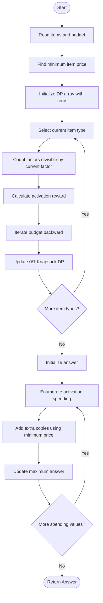
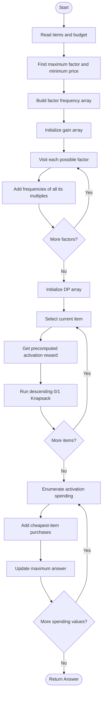

<p align="center">
  <a href="https://github.com/Shailendra0320">
    
  </a>
  <a href="https://leetcode.com/u/Shailu03/">
    
  </a>
  <a href="https://leetcode.com/u/ShailendraLeetcode03/">
    
  </a>
  <a href="https://shailendra0320.github.io/shailendra-portfolio/">
    
  </a>
</p>

# 3946. Maximum Number of Items From Sale I — 0/1 Knapsack DP & Divisibility Counting

<p align="center">
  
  
  
  
  
</p>

## Problem Link

[**3946. Maximum Number of Items From Sale I — LeetCode**](https://leetcode.com/problems/maximum-number-of-items-from-sale-i/)

---

## Table of Contents

1. [Problem Statement](#1-problem-statement)
2. [Understanding the Problem](#2-understanding-the-problem)
3. [Rules and Important Observations](#3-rules-and-important-observations)
4. [Examples](#4-examples)
5. [Constraints](#5-constraints)
6. [Core Intuition](#6-core-intuition)
7. [Approach 1 — Brute Force Divisibility Counting + 0/1 Knapsack](#7-approach-1--brute-force-divisibility-counting--01-knapsack)
8. [Approach 1 — Algorithm](#8-approach-1--algorithm)
9. [Approach 1 — Pseudocode](#9-approach-1--pseudocode)
10. [Approach 1 — Flowchart](#10-approach-1--flowchart)
11. [Approach 1 — Dry Run](#11-approach-1--dry-run)
12. [Approach 1 — Correctness Proof](#12-approach-1--correctness-proof)
13. [Approach 1 — Complexity Analysis](#13-approach-1--complexity-analysis)
14. [Approach 2 — Divisor Frequency Precomputation + 0/1 Knapsack](#14-approach-2--divisor-frequency-precomputation--01-knapsack)
15. [Approach 2 — Algorithm](#15-approach-2--algorithm)
16. [Approach 2 — Pseudocode](#16-approach-2--pseudocode)
17. [Approach 2 — Flowchart](#17-approach-2--flowchart)
18. [Approach 2 — Dry Run](#18-approach-2--dry-run)
19. [Approach 2 — Correctness Proof](#19-approach-2--correctness-proof)
20. [Approach 2 — Complexity Analysis](#20-approach-2--complexity-analysis)
21. [Java Solutions](#21-java-solutions)
22. [C++ Solutions](#22-c-solutions)
23. [Python Solutions](#23-python-solutions)
24. [Approach Comparison](#24-approach-comparison)
25. [Why Descending DP Iteration Is Necessary](#25-why-descending-dp-iteration-is-necessary)
26. [Why the Cheapest Item Fills the Remaining Budget](#26-why-the-cheapest-item-fills-the-remaining-budget)
27. [Edge Cases](#27-edge-cases)
28. [Common Mistakes](#28-common-mistakes)
29. [Interview Explanation](#29-interview-explanation)
30. [Key Takeaways](#30-key-takeaways)

---

## 1. Problem Statement

You are given a 2D integer array `items`, where:

- `items[i][0]` represents the factor of item `i`.
- `items[i][1]` represents the price of item `i`.

You are also given an integer `budget`.

There are unlimited copies of every item type. You may purchase any number of copies of any item types, provided that the total amount spent does not exceed `budget`.

After purchasing items, you can receive free copies according to the following rules:

1. If you purchase at least one copy of item `i`, you receive one free copy of every item `j` such that `j != i` and `factor[i]` divides `factor[j]`.
2. Purchasing multiple copies of the same item type does not trigger additional free copies.
3. The same item type may be received multiple times for free if different purchased item types trigger it.

Return the maximum total number of item copies you can obtain, counting both purchased and free copies.

### Function Signature

```java
public int maximumSaleItems(int[][] items, int budget)
```

```cpp
int maximumSaleItems(vector<vector<int>>& items, int budget)
```

```python
def maximumSaleItems(self, items: List[List[int]], budget: int) -> int:
```

---

## 2. Understanding the Problem

The important detail is that buying the **first copy** of an item type is special.

When an item type is purchased for the first time:

- We spend its price.
- We receive the purchased copy.
- We also receive one free copy of every other item type whose factor is divisible by the purchased item's factor.

When we purchase another copy of an already activated item type:

- We spend its price again.
- We receive exactly one additional purchased copy.
- We do not receive the free-item reward again.

Therefore, every item type has two different roles:

| Purchase | Cost | Reward |
|---|---:|---:|
| First copy of a type | Its price | Purchased copy + all eligible free copies |
| Every additional copy | Its price | One purchased copy |

This naturally suggests combining:

- **0/1 Knapsack DP** for first purchases.
- **Greedy selection** for additional purchases.

---

## 3. Rules and Important Observations

### Observation 1: Free items depend on divisibility

Suppose we purchase item `i`.

It gives one free copy of every item `j` satisfying:

```text
factor[j] % factor[i] == 0
```

The purchased item itself is excluded from the free-copy rule, but its purchased copy must still be counted.

Thus, the total reward associated with activating item `i` is:

```text
gain[i] = number of item types j
          for which factor[j] % factor[i] == 0
```

This count includes item `i` itself.

### Observation 2: Duplicate factors represent different item types

Consider:

```text
items = [
    [2, 5],
    [2, 3],
    [4, 7]
]
```

Purchasing the first item type with factor `2` gives:

- One purchased copy of that item.
- One free copy of the second item because `2` divides `2`.
- One free copy of the third item because `2` divides `4`.

Therefore:

```text
gain = 3
```

Do not count distinct factor values. Count item types.

### Observation 3: Each type can be activated only once

The free-copy reward is available only on the first purchase of a type.

This is why the activation decision is a **0/1 choice**.

### Observation 4: Additional copies have no activation reward

After deciding which item types are activated, every remaining purchase contributes exactly one item.

To maximize the number of these additional copies, always purchase an item with the minimum price.

Let:

```text
minPrice = minimum price among all item types
```

If `remainingBudget` is left, the maximum number of additional copies is:

```text
remainingBudget / minPrice
```

Integer division is used.

### Observation 5: The DP must iterate backward

For each item type, the activation reward must be added at most once.

Therefore, the knapsack transition must iterate from high budget to low budget.

---

## 4. Examples

### Example 1

```text
Input:
items = [[6,2],[2,6],[3,4]]
budget = 9

Output:
4
```

Explanation:

Purchase:

- Two copies of item `0`, costing `2 * 2 = 4`.
- One copy of item `2`, costing `4`.

Total spending:

```text
4 + 4 = 8
```

Item `2` has factor `3`.

Since:

```text
6 % 3 == 0
```

purchasing item `2` gives one free copy of item `0`.

Final collection:

| Item | Purchased | Free | Total |
|---|---:|---:|---:|
| Item 0 | 2 | 1 | 3 |
| Item 1 | 0 | 0 | 0 |
| Item 2 | 1 | 0 | 1 |
| **Total** | **3** | **1** | **4** |

Answer:

```text
4
```

### Example 2

```text
Input:
items = [[2,4],[3,2],[4,1],[6,4],[12,4]]
budget = 8

Output:
10
```

Purchase:

- One copy of item `0`.
- One copy of item `1`.
- Two copies of item `2`.

Total cost:

```text
4 + 2 + 1 + 1 = 8
```

Free copies:

- Factor `2` activates items with factors `2`, `4`, `6`, and `12`.
- Factor `3` activates items with factors `3`, `6`, and `12`.
- Factor `4` activates items with factors `4` and `12`.

The three activations yield:

```text
3 + 2 + 1 = 6 free copies
```

Purchased copies:

```text
4
```

Total:

```text
4 + 6 = 10
```

### Example 3 — One Item Type

```text
Input:
items = [[5,3]]
budget = 10

Output:
3
```

We can purchase three copies at a total cost of `9`.

The first copy activates the type and contributes one item. The remaining two purchases contribute one each.

### Example 4 — Budget Smaller Than Every Price

```text
Input:
items = [[2,5],[3,7]]
budget = 3

Output:
0
```

No item can be purchased.

### Example 5 — Multiple Items With the Same Factor

```text
Input:
items = [[2,3],[2,4],[4,5]]
budget = 3
```

Activating the first item gives:

- One purchased copy of the first item.
- One free copy of the second item.
- One free copy of the third item.

The total reward is `3`.

---

## 5. Constraints

```text
1 <= items.length <= 1000

items[i] = [factor_i, price_i]

1 <= factor_i <= 1500
1 <= price_i <= 1500

1 <= budget <= 1500
```

Let:

- `n` = number of item types.
- `B` = budget.
- `V` = maximum factor value.

Under the given constraints:

```text
n <= 1000
B <= 1500
V <= 1500
```

---

## 6. Core Intuition

We can divide the purchasing process into two independent decisions.

### Part A: Which item types should be activated?

Activating item type `i`:

- Costs `price[i]`.
- Gives `gain[i]` total copies, counting its first purchased copy and all free copies.

We can activate each item type at most once.

This is exactly a 0/1 Knapsack problem.

Define:

```text
dp[b] = maximum activation reward
        obtainable with activation spending at most b
```

For each item:

```text
dp[b] = max(dp[b], dp[b - price] + gain)
```

Process `b` in descending order.

### Part B: How should we spend the remaining budget?

After activation purchases, additional copies do not unlock free items.

Every additional copy gives one item.

The cheapest item is always optimal for this phase.

If the activation phase spends `spent` units, the additional copies are:

```text
(budget - spent) / minPrice
```

Therefore, the answer is:

```text
max(
    dp[spent] + (budget - spent) / minPrice
)
```

for all possible `spent` from `0` through `budget`.

---

# 7. Approach 1 — Brute Force Divisibility Counting + 0/1 Knapsack

## Idea

For every item type, directly inspect all item types to calculate its activation reward.

For item `i`:

```text
gain[i] = 0

for every item j:
    if factor[j] % factor[i] == 0:
        gain[i]++
```

This requires `O(n)` work per item, resulting in `O(n²)` total preprocessing.

Then run the 0/1 Knapsack DP.

### Step 1: Find the minimum price

```text
minPrice = minimum(items[i][1])
```

This will be used for additional purchases.

### Step 2: Calculate activation rewards

For each item `i`, count every item `j` whose factor is divisible by `factor[i]`.

Remember that the count includes the activated item itself.

### Step 3: Initialize the DP array

```text
dp = array of size budget + 1, filled with 0
```

`dp[b]` represents the best activation reward achievable with at most `b` spending.

### Step 4: Apply 0/1 Knapsack

For each item:

```text
for b from budget down to price:
    dp[b] = max(dp[b], dp[b - price] + gain)
```

Backward iteration ensures that the item is activated at most once.

### Step 5: Add the best possible additional purchases

For every possible activation budget:

```text
answer = max(
    answer,
    dp[b] + (budget - b) / minPrice
)
```

---

## 8. Approach 1 — Algorithm

1. Initialize `minPrice` with infinity.
2. Find the minimum price among all item types.
3. Create a DP array of size `budget + 1`.
4. For every item:
   - Read its factor and price.
   - Count all factors divisible by the current factor.
   - Treat this count as the activation reward.
   - Update the DP array in descending budget order.
5. Enumerate all possible activation spending amounts.
6. Add the maximum number of additional copies using the remaining budget.
7. Return the maximum total.

---

## 9. Approach 1 — Pseudocode

```text
function maximumSaleItems(items, budget):

    n = number of items
    minPrice = infinity

    for each item:
        minPrice = min(minPrice, item.price)

    dp = array of size budget + 1 filled with 0

    for i from 0 to n - 1:

        factor = items[i].factor
        price = items[i].price

        gain = 0

        for j from 0 to n - 1:

            if items[j].factor % factor == 0:
                gain++

        for b from budget down to price:

            dp[b] = max(
                dp[b],
                dp[b - price] + gain
            )

    answer = 0

    for spent from 0 to budget:

        additional = (budget - spent) / minPrice

        answer = max(
            answer,
            dp[spent] + additional
        )

    return answer
```

---

## 10. Approach 1 — Flowchart



---

## 11. Approach 1 — Dry Run

Consider:

```text
items = [[2,4],[3,2],[4,1],[6,4],[12,4]]
budget = 8
```

### Step 1: Find the minimum price

Prices:

```text
4, 2, 1, 4, 4
```

Therefore:

```text
minPrice = 1
```

### Step 2: Calculate activation rewards

| Item | Factor | Price | Divisible factors | Gain |
|---|---:|---:|---|---:|
| 0 | 2 | 4 | 2, 4, 6, 12 | 4 |
| 1 | 3 | 2 | 3, 6, 12 | 3 |
| 2 | 4 | 1 | 4, 12 | 2 |
| 3 | 6 | 4 | 6, 12 | 2 |
| 4 | 12 | 4 | 12 | 1 |

The activation rewards are:

```text
[4, 3, 2, 2, 1]
```

### Step 3: Initialize DP

```text
dp = [0,0,0,0,0,0,0,0,0]
```

Indices represent the activation spending budget.

### Step 4: Process item 0

```text
price = 4
gain = 4
```

After the update:

```text
dp = [0,0,0,0,4,4,4,4,4]
```

### Step 5: Process item 1

```text
price = 2
gain = 3
```

After the update:

```text
dp = [0,0,3,3,4,4,7,7,7]
```

### Step 6: Process item 2

```text
price = 1
gain = 2
```

After the update:

```text
dp = [0,2,3,5,5,6,7,9,9]
```

### Step 7: Process item 3

```text
price = 4
gain = 2
```

After the update:

```text
dp = [0,2,3,5,5,6,7,9,9]
```

### Step 8: Process item 4

```text
price = 4
gain = 1
```

After the update:

```text
dp = [0,2,3,5,5,6,7,9,9]
```

### Step 9: Calculate the final answer

For each activation spending amount:

| Activation spending | DP reward | Remaining budget | Extra copies | Total |
|---:|---:|---:|---:|---:|
| 0 | 0 | 8 | 8 | 8 |
| 1 | 2 | 7 | 7 | 9 |
| 2 | 3 | 6 | 6 | 9 |
| 3 | 5 | 5 | 5 | 10 |
| 4 | 5 | 4 | 4 | 9 |
| 5 | 6 | 3 | 3 | 9 |
| 6 | 7 | 2 | 2 | 9 |
| 7 | 9 | 1 | 1 | 10 |
| 8 | 9 | 0 | 0 | 9 |

The maximum is:

```text
10
```

Answer:

```text
10
```

---

## 12. Approach 1 — Correctness Proof

We prove that the algorithm returns the maximum possible number of item copies.

### Lemma 1

For an item type `i`, the total reward from its first purchase equals the number of item types `j` for which `factor[j] % factor[i] == 0`.

**Proof:**

The first purchase gives:

- One purchased copy of item `i`.
- One free copy of every other eligible item `j`.

The item itself is also divisible by its own factor, so counting all eligible factors includes the purchased item exactly once.

Therefore, the total reward is precisely the computed divisibility count.

### Lemma 2

The descending 0/1 Knapsack transition computes the maximum total activation reward for each spending budget.

**Proof:**

Each item type can be activated at most once.

For every item, the DP chooses between:

- Not activating the item.
- Activating the item, paying its price and receiving its reward.

Descending iteration ensures that the current item's reward cannot be reused during the same iteration.

Thus, every item is considered at most once, and the DP explores all valid activation subsets.

### Lemma 3

For any fixed activation spending amount, buying only minimum-price items maximizes the number of additional copies.

**Proof:**

After activation, every additional purchase contributes exactly one item.

No additional free reward is generated.

Therefore, choosing the cheapest item maximizes the number of copies that can be purchased with the remaining budget.

### Theorem

The algorithm returns the maximum obtainable total number of item copies.

**Proof:**

The DP considers every possible subset of activated item types and obtains the maximum activation reward for each spending amount.

For each such spending amount, the algorithm uses the remaining budget optimally by purchasing the cheapest item.

Taking the maximum across all spending amounts therefore considers an optimal activation plan and an optimal additional-purchase plan.

Hence, the returned answer is optimal.

---

## 13. Approach 1 — Complexity Analysis

Let:

- `n` = number of item types.
- `B` = budget.

### Time Complexity

**Divisibility counting:**

For every item, inspect all other items:

```text
O(n * n) = O(n²)
```

**Knapsack DP:**

For each item, iterate through the budget:

```text
O(n * B)
```

**Final answer calculation:**

```text
O(B)
```

Total:

```text
O(n² + n * B + B)
```

Simplified:

```text
O(n² + n * B)
```

### Space Complexity

The DP array stores `B + 1` values.

```text
O(B)
```

---

# 14. Approach 2 — Divisor Frequency Precomputation + 0/1 Knapsack

## Idea

Approach 1 checks every item against every other item to calculate the activation reward.

However, the maximum factor is only `1500`.

We can use this bounded factor range to precompute divisibility counts efficiently.

### Key Observation

Let:

```text
freq[x] = number of item types having factor x
```

For each possible factor `f`, calculate:

```text
gain[f] = freq[f] + freq[2*f] + freq[3*f] + ...
```

Only multiples of `f` are included.

This is a multiple-sieve style preprocessing technique.

Then the activation reward for an item with factor `f` is simply:

```text
gain[f]
```

The knapsack phase remains unchanged.

---

## 15. Approach 2 — Algorithm

### Step 1: Find the maximum factor

```text
maxFactor = maximum factor among all items
```

### Step 2: Find the minimum price

```text
minPrice = minimum price among all items
```

### Step 3: Build the frequency array

For every item:

```text
freq[item.factor]++
```

This correctly counts duplicate factor values as separate item types.

### Step 4: Precompute divisibility rewards

For every possible factor `f`:

```text
gain[f] = 0

for multiple = f; multiple <= maxFactor; multiple += f:
    gain[f] += freq[multiple]
```

### Step 5: Apply 0/1 Knapsack

For every item:

```text
reward = gain[item.factor]
price = item.price
```

Then:

```text
for b from budget down to price:
    dp[b] = max(dp[b], dp[b - price] + reward)
```

### Step 6: Add additional purchases

For every possible activation spending amount:

```text
answer = max(
    answer,
    dp[b] + (budget - b) / minPrice
)
```

Return the answer.

---

## 16. Approach 2 — Pseudocode

```text
function maximumSaleItems(items, budget):

    maxFactor = maximum factor in items
    minPrice = minimum price in items

    freq = array of size maxFactor + 1 filled with 0

    for each item in items:
        freq[item.factor]++

    gain = array of size maxFactor + 1 filled with 0

    for factor from 1 to maxFactor:

        for multiple from factor to maxFactor step factor:

            gain[factor] += freq[multiple]

    dp = array of size budget + 1 filled with 0

    for each item in items:

        factor = item.factor
        price = item.price
        reward = gain[factor]

        for b from budget down to price:

            dp[b] = max(
                dp[b],
                dp[b - price] + reward
            )

    answer = 0

    for spent from 0 to budget:

        additional = (budget - spent) / minPrice

        answer = max(
            answer,
            dp[spent] + additional
        )

    return answer
```

---

## 17. Approach 2 — Flowchart



---

## 18. Approach 2 — Dry Run

Consider:

```text
items = [[2,4],[3,2],[4,1],[6,4],[12,4]]
budget = 8
```

### Step 1: Factor frequency

The factors are:

```text
2, 3, 4, 6, 12
```

Frequency array entries:

| Factor | Frequency |
|---:|---:|
| 2 | 1 |
| 3 | 1 |
| 4 | 1 |
| 6 | 1 |
| 12 | 1 |

All other factor frequencies are zero.

### Step 2: Precompute rewards

For factor `2`, its multiples are:

```text
2, 4, 6, 8, 10, 12, ...
```

Present factors:

```text
2, 4, 6, 12
```

Thus:

```text
gain[2] = 4
```

For factor `3`:

```text
3, 6, 9, 12, ...
```

Present factors:

```text
3, 6, 12
```

Thus:

```text
gain[3] = 3
```

For factor `4`:

```text
4, 8, 12, ...
```

Present factors:

```text
4, 12
```

Thus:

```text
gain[4] = 2
```

For factor `6`:

```text
6, 12, ...
```

Present factors:

```text
6, 12
```

Thus:

```text
gain[6] = 2
```

For factor `12`:

```text
12, ...
```

Present factors:

```text
12
```

Thus:

```text
gain[12] = 1
```

Precomputed rewards:

| Factor | Gain |
|---:|---:|
| 2 | 4 |
| 3 | 3 |
| 4 | 2 |
| 6 | 2 |
| 12 | 1 |

### Step 3: Run the knapsack

The items and their activation values are:

| Item | Price | Reward |
|---|---:|---:|
| 0 | 4 | 4 |
| 1 | 2 | 3 |
| 2 | 1 | 2 |
| 3 | 4 | 2 |
| 4 | 4 | 1 |

After processing all item types:

```text
dp = [0,2,3,5,5,6,7,9,9]
```

### Step 4: Use the remaining budget

The minimum price is:

```text
minPrice = 1
```

The best result is:

```text
dp[3] + (8 - 3) / 1
= 5 + 5
= 10
```

Another optimal split is:

```text
dp[7] + (8 - 7) / 1
= 9 + 1
= 10
```

Final answer:

```text
10
```

---

## 19. Approach 2 — Correctness Proof

### Lemma 1

For every factor `f`, summing the frequencies of all multiples of `f` gives the exact number of item types activated by purchasing a type with factor `f`.

**Proof:**

An item type is eligible precisely when its factor is a multiple of `f`.

The frequency array counts every item type separately, including duplicate factors.

Summing the frequencies of all multiples therefore counts every eligible type exactly once.

### Lemma 2

The precomputed `gain[f]` equals the total reward of the first purchase of any item type with factor `f`.

**Proof:**

The first purchase gives one purchased copy and one free copy of each other eligible type.

The count of all eligible types includes the purchased type itself exactly once.

Therefore, the precomputed value is the correct combined reward.

### Lemma 3

The knapsack DP finds the best activation reward for every spending amount.

**Proof:**

Each item type can be activated only once. Descending iteration makes the transition a 0/1 choice.

The DP compares skipping the item with activating it at its price and adding its reward.

Thus, it considers every valid activation subset.

### Theorem

The second approach returns the maximum possible total number of copies.

**Proof:**

The precomputation provides exact activation rewards. The knapsack selects the best set of first purchases for each budget. The remaining budget is optimally spent on the cheapest item because every subsequent purchase yields one copy.

Taking the maximum across all budget splits therefore returns the global optimum.

---

## 20. Approach 2 — Complexity Analysis

Let:

- `n` = number of item types.
- `B` = budget.
- `V` = maximum factor.

### Time Complexity

**Frequency construction:**

```text
O(n)
```

**Multiple-sieve preprocessing:**

The total number of visits is:

```text
V/1 + V/2 + V/3 + ... + V/V
```

Therefore:

```text
O(V log V)
```

**Knapsack:**

```text
O(n * B)
```

**Final scan:**

```text
O(B)
```

Total:

```text
O(n + V log V + n * B + B)
```

Simplified:

```text
O(V log V + n * B)
```

### Space Complexity

The algorithm stores:

- Frequency array: `O(V)`.
- Gain array: `O(V)`.
- DP array: `O(B)`.

Total:

```text
O(V + B)
```

---

# 21. Java Solutions

Both implementations are provided below.

- `Solution` uses direct pairwise divisibility counting.
- `Solution2` uses divisor frequency precomputation.

For LeetCode submission, submit one class at a time using the required class name `Solution`.

### Approach 1 — Brute Force Divisibility Counting + 0/1 Knapsack

```java
// Approach-1 (Brute Force Divisibility Counting + 0/1 Knapsack)
// T.C: O(n^2 + n * budget)
// S.C: O(budget)

class Solution {
    public int maximumSaleItems(int[][] items, int budget) {
        int n = items.length;
        int minPrice = Integer.MAX_VALUE;

        for (int[] item : items) {
            minPrice = Math.min(minPrice, item[1]);
        }

        int[] dp = new int[budget + 1];

        for (int i = 0; i < n; i++) {
            int factor = items[i][0];
            int price = items[i][1];

            int gain = 0;

            for (int j = 0; j < n; j++) {
                if (items[j][0] % factor == 0) {
                    gain++;
                }
            }

            for (int b = budget; b >= price; b--) {
                dp[b] = Math.max(
                    dp[b],
                    dp[b - price] + gain
                );
            }
        }

        int ans = 0;

        for (int spent = 0; spent <= budget; spent++) {
            int extra = (budget - spent) / minPrice;

            ans = Math.max(
                ans,
                dp[spent] + extra
            );
        }

        return ans;
    }
}
```

### Approach 2 — Divisor Frequency Precomputation + 0/1 Knapsack

```java
// Approach-2 (Divisor Frequency Precomputation + 0/1 Knapsack)
// T.C: O(V log V + n * budget)
// S.C: O(V + budget)

class Solution2 {
    public int maximumSaleItems(int[][] items, int budget) {
        int n = items.length;

        int maxFactor = 0;
        int minPrice = Integer.MAX_VALUE;

        for (int[] item : items) {
            maxFactor = Math.max(maxFactor, item[0]);
            minPrice = Math.min(minPrice, item[1]);
        }

        int[] freq = new int[maxFactor + 1];

        for (int[] item : items) {
            freq[item[0]]++;
        }

        int[] gain = new int[maxFactor + 1];

        for (int factor = 1; factor <= maxFactor; factor++) {
            for (int multiple = factor;
                 multiple <= maxFactor;
                 multiple += factor) {

                gain[factor] += freq[multiple];
            }
        }

        int[] dp = new int[budget + 1];

        for (int[] item : items) {
            int factor = item[0];
            int price = item[1];
            int reward = gain[factor];

            for (int b = budget; b >= price; b--) {
                dp[b] = Math.max(
                    dp[b],
                    dp[b - price] + reward
                );
            }
        }

        int ans = 0;

        for (int spent = 0; spent <= budget; spent++) {
            int extra = (budget - spent) / minPrice;

            ans = Math.max(
                ans,
                dp[spent] + extra
            );
        }

        return ans;
    }
}
```

---

# 22. C++ Solutions

### Approach 1 — Brute Force Divisibility Counting + 0/1 Knapsack

```cpp
// Approach-1 (Brute Force Divisibility Counting + 0/1 Knapsack)
// T.C: O(n^2 + n * budget)
// S.C: O(budget)

class Solution {
public:
    int maximumSaleItems(vector<vector<int>>& items, int budget) {
        int n = items.size();
        int minPrice = INT_MAX;

        for (auto& item : items) {
            minPrice = min(minPrice, item[1]);
        }

        vector<int> dp(budget + 1, 0);

        for (int i = 0; i < n; i++) {
            int factor = items[i][0];
            int price = items[i][1];

            int gain = 0;

            for (int j = 0; j < n; j++) {
                if (items[j][0] % factor == 0) {
                    gain++;
                }
            }

            for (int b = budget; b >= price; b--) {
                dp[b] = max(
                    dp[b],
                    dp[b - price] + gain
                );
            }
        }

        int ans = 0;

        for (int spent = 0; spent <= budget; spent++) {
            int extra = (budget - spent) / minPrice;

            ans = max(
                ans,
                dp[spent] + extra
            );
        }

        return ans;
    }
};
```

### Approach 2 — Divisor Frequency Precomputation + 0/1 Knapsack

```cpp
// Approach-2 (Divisor Frequency Precomputation + 0/1 Knapsack)
// T.C: O(V log V + n * budget)
// S.C: O(V + budget)

class Solution2 {
public:
    int maximumSaleItems(vector<vector<int>>& items, int budget) {
        int n = items.size();

        int maxFactor = 0;
        int minPrice = INT_MAX;

        for (auto& item : items) {
            maxFactor = max(maxFactor, item[0]);
            minPrice = min(minPrice, item[1]);
        }

        vector<int> freq(maxFactor + 1, 0);

        for (auto& item : items) {
            freq[item[0]]++;
        }

        vector<int> gain(maxFactor + 1, 0);

        for (int factor = 1; factor <= maxFactor; factor++) {
            for (int multiple = factor;
                 multiple <= maxFactor;
                 multiple += factor) {

                gain[factor] += freq[multiple];
            }
        }

        vector<int> dp(budget + 1, 0);

        for (auto& item : items) {
            int factor = item[0];
            int price = item[1];
            int reward = gain[factor];

            for (int b = budget; b >= price; b--) {
                dp[b] = max(
                    dp[b],
                    dp[b - price] + reward
                );
            }
        }

        int ans = 0;

        for (int spent = 0; spent <= budget; spent++) {
            int extra = (budget - spent) / minPrice;

            ans = max(
                ans,
                dp[spent] + extra
            );
        }

        return ans;
    }
};
```

---

# 23. Python Solutions

### Approach 1 — Brute Force Divisibility Counting + 0/1 Knapsack

```python
from typing import List


# Approach-1 (Brute Force Divisibility Counting + 0/1 Knapsack)
# T.C: O(n^2 + n * budget)
# S.C: O(budget)

class Solution:
    def maximumSaleItems(
        self,
        items: List[List[int]],
        budget: int
    ) -> int:

        n = len(items)
        min_price = min(price for factor, price in items)

        dp = [0] * (budget + 1)

        for i in range(n):
            factor, price = items[i]

            gain = 0

            for j in range(n):
                if items[j][0] % factor == 0:
                    gain += 1

            for b in range(budget, price - 1, -1):
                dp[b] = max(
                    dp[b],
                    dp[b - price] + gain
                )

        ans = 0

        for spent in range(budget + 1):
            extra = (budget - spent) // min_price

            ans = max(
                ans,
                dp[spent] + extra
            )

        return ans
```

### Approach 2 — Divisor Frequency Precomputation + 0/1 Knapsack

```python
from typing import List


# Approach-2 (Divisor Frequency Precomputation + 0/1 Knapsack)
# T.C: O(V log V + n * budget)
# S.C: O(V + budget)

class Solution2:
    def maximumSaleItems(
        self,
        items: List[List[int]],
        budget: int
    ) -> int:

        n = len(items)

        max_factor = max(factor for factor, price in items)
        min_price = min(price for factor, price in items)

        freq = [0] * (max_factor + 1)

        for factor, price in items:
            freq[factor] += 1

        gain = [0] * (max_factor + 1)

        for factor in range(1, max_factor + 1):
            for multiple in range(
                factor,
                max_factor + 1,
                factor
            ):
                gain[factor] += freq[multiple]

        dp = [0] * (budget + 1)

        for factor, price in items:
            reward = gain[factor]

            for b in range(budget, price - 1, -1):
                dp[b] = max(
                    dp[b],
                    dp[b - price] + reward
                )

        ans = 0

        for spent in range(budget + 1):
            extra = (budget - spent) // min_price

            ans = max(
                ans,
                dp[spent] + extra
            )

        return ans
```

---

## 24. Approach Comparison

| Feature | Approach 1 | Approach 2 |
|---|---|---|
| Divisibility counting | Check all item pairs | Precompute multiples |
| Reward calculation | `O(n²)` | `O(V log V)` |
| Knapsack | 0/1 Knapsack | 0/1 Knapsack |
| DP time | `O(n * B)` | `O(n * B)` |
| Total time | `O(n² + n * B)` | `O(V log V + n * B)` |
| Auxiliary space | `O(B)` | `O(V + B)` |
| Main technique | Pairwise counting | Frequency sieve |

### Which Approach Is Better?

Approach 1 is straightforward and easy to understand.

Approach 2 takes advantage of the small factor range and avoids repeatedly checking every pair of item types.

**Recommended approach:** Approach 2 — Divisor Frequency Precomputation + 0/1 Knapsack.

---

## 25. Why Descending DP Iteration Is Necessary

This is one of the most important details in the solution.

The first purchase of an item type can activate its free-copy reward only once.

Correct transition:

```python
for b in range(budget, price - 1, -1):
    dp[b] = max(dp[b], dp[b - price] + gain)
```

### What happens if we iterate forward?

Incorrect:

```python
for b in range(price, budget + 1):
    dp[b] = max(dp[b], dp[b - price] + gain)
```

Forward iteration allows the current item to be used repeatedly in the same pass.

That would incorrectly grant the activation reward multiple times for the same item type.

### 0/1 Knapsack vs Unbounded Knapsack

| Iteration | Knapsack type | Suitable here? |
|---|---|---|
| Descending | 0/1 Knapsack | Yes |
| Ascending | Unbounded Knapsack | No |

Only the first purchase receives the activation reward, so descending iteration is mandatory.

---

## 26. Why the Cheapest Item Fills the Remaining Budget

After an item type has been activated, buying another copy of it does not generate additional free items.

Every additional purchase therefore gives exactly one copy.

Suppose the available prices are:

```text
4, 2, 1, 4, 4
```

The cheapest price is:

```text
minPrice = 1
```

If the remaining budget is `5`, the maximum additional copies are:

```text
5 / 1 = 5
```

Buying a more expensive item cannot improve this count.

This greedy choice is optimal because all additional copies have equal value.

---

## 27. Edge Cases

### Case 1: Only one item type

```text
items = [[5,2]]
budget = 7
```

There are no other item types to receive for free.

The answer is:

```text
3
```

### Case 2: Every item has the same factor

All item types are divisible by that common factor.

Activating any one type gives one free copy of every other type, plus its purchased copy.

### Case 3: No item can be purchased

If all prices exceed the budget, the answer is zero.

### Case 4: Budget is exactly equal to the cheapest price

At least one item can be purchased.

The first purchase activates the corresponding item type.

### Case 5: Duplicate factors

Duplicate factor values must be counted as separate item types.

### Case 6: A factor divides no other distinct factor

The activation reward still includes the purchased item itself, so the reward is at least one.

### Case 7: All prices are equal

Any item can be used for additional purchases without changing the number of extra copies.

### Case 8: Maximum factor value

The frequency and gain arrays must be sized using `maxFactor + 1` to safely access the maximum factor.

### Case 9: Maximum budget

The DP array must have `budget + 1` entries so that index `budget` is included.

---

## 28. Common Mistakes

### Mistake 1: Excluding the purchased item from the activation reward

Incorrect:

```python
if items[j][0] % factor == 0 and j != i:
    gain += 1
```

This misses the first purchased copy.

Correct:

```python
if items[j][0] % factor == 0:
    gain += 1
```

The divisibility condition includes the item itself.

### Mistake 2: Counting unique factors instead of item types

Different item types can have the same factor.

Each type must be counted separately.

### Mistake 3: Using forward DP iteration

Forward iteration lets one activation reward be reused.

Always iterate backward.

### Mistake 4: Giving free rewards for repeated purchases

Only the first copy activates an item type.

Every later purchase adds one copy and no additional activation reward.

### Mistake 5: Forgetting additional purchases

The DP handles first purchases only.

The remaining budget must still be used to buy additional copies.

### Mistake 6: Using the maximum price for extra purchases

The cheapest price gives the maximum number of additional copies.

### Mistake 7: Incorrect divisibility direction

Correct:

```python
other_factor % current_factor == 0
```

The current factor must divide the other factor.

### Mistake 8: Using a frequency array that is too small

Use:

```python
max_factor = max(factor for factor, price in items)
```

Then allocate:

```python
freq = [0] * (max_factor + 1)
```

### Mistake 9: Confusing free-copy rewards with total activation rewards

The reward is not only the number of free copies.

It includes the first purchased copy as well.

### Mistake 10: Using unbounded knapsack for activation

The activation reward is available once per type, so the activation phase is 0/1 knapsack.

---

## 29. Interview Explanation

A concise way to explain the solution:

> The key observation is that the first purchase of an item type is special. It gives one purchased copy and one free copy of every item type whose factor is divisible by the purchased item's factor. Additional copies of that same type only contribute one item each.
>
> I calculate the activation reward for each type by counting all item factors divisible by its factor. Since each type can be activated only once, I use 0/1 Knapsack DP with descending budget iteration.
>
> After choosing the activated types, the remaining budget should be spent on the cheapest item because every additional purchase gives exactly one copy.
>
> I maximize the sum of the activation DP reward and the number of additional copies over every possible activation spending amount.
>
> To optimize reward calculation, I can precompute factor frequencies and sum the frequencies of all multiples of each factor.

### Important Interview Questions

**Q1. Why is this a 0/1 Knapsack problem?**

Because each item type can generate its free-copy reward only once.

**Q2. Why is the DP iteration descending?**

To prevent the current item type from being activated more than once in the same iteration.

**Q3. Why do we count the item itself in its activation reward?**

The first purchased copy must be counted along with all free copies.

**Q4. Why do we use the minimum price for remaining purchases?**

Every additional purchase contributes exactly one item, so the cheapest price maximizes the number of copies.

**Q5. How does Approach 2 improve the divisibility calculation?**

It uses factor frequencies and visits multiples of each factor instead of checking every pair of items.

**Q6. Can the same item type be received multiple times for free?**

Yes. Different activated types can each grant a free copy of the same target type.

**Q7. What does `dp[b]` represent?**

The maximum total activation reward achievable using at most `b` budget.

---

## 30. Key Takeaways

1. Identify the special first purchase separately from repeated purchases.
2. Convert first purchases into 0/1 Knapsack choices.
3. Count the purchased item itself in its activation reward.
4. Preserve duplicate item types when counting divisibility.
5. Use descending DP iteration to avoid repeated activation.
6. Use the cheapest item to spend the remaining budget.
7. Use frequency precomputation when the factor range is small.
8. Combine DP and greedy reasoning to obtain the maximum total.

### Final Complexity

| Approach | Time Complexity | Space Complexity |
|---|---|---|
| Brute Force Divisibility + 0/1 Knapsack | `O(n² + n * budget)` | `O(budget)` |
| Divisor Frequency + 0/1 Knapsack | `O(V log V + n * budget)` | `O(V + budget)` |

**Recommended:** Divisor Frequency Precomputation + 0/1 Knapsack.

---

## References

- [LeetCode — 3946. Maximum Number of Items From Sale I](https://leetcode.com/problems/maximum-number-of-items-from-sale-i/)
- [LeetCode Wiki — Explanation and Solutions](https://leetcode.doocs.org/en/lc/3946/)
- [GitHub — Doocs LeetCode Solutions](https://github.com/doocs/leetcode)

---

<p align="center">
  <b>Keep Learning • Keep Practicing • Keep Solving</b>
</p>
