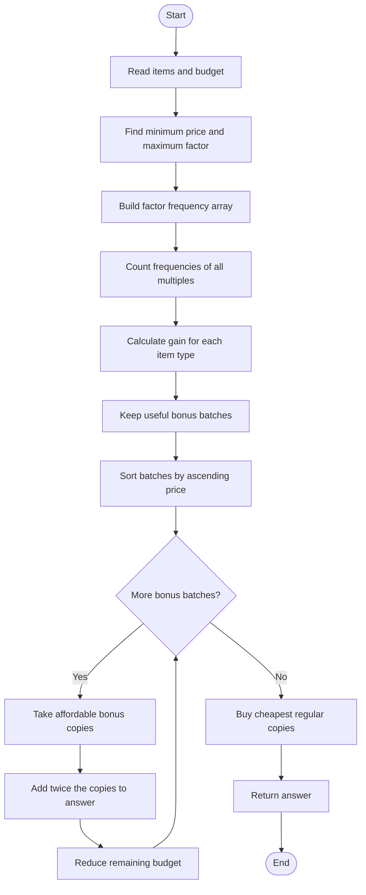
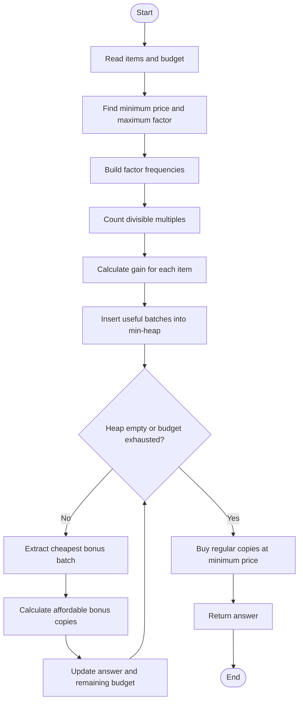

<p align="center">
  <a href="https://github.com/Shailendra0320"></a>
  <a href="https://leetcode.com/u/Shailu03/"></a>
  <a href="https://leetcode.com/u/ShailendraLeetcode03/"></a>
  <a href="https://shailendra0320.github.io/shailendra-portfolio/"></a>
</p>

# 3947. Maximum Number of Items From Sale II — Divisibility Sieve & Greedy Optimization

[](https://leetcode.com/problems/maximum-number-of-items-from-sale-ii/)
[](https://leetcode.com/problems/maximum-number-of-items-from-sale-ii/)
[](https://leetcode.com/problems/maximum-number-of-items-from-sale-ii/)

## Table of Contents
1. [Problem Statement](#1-problem-statement)
2. [Problem Link](#2-problem-link)
3. [Understanding the Problem](#3-understanding-the-problem)
4. [Examples](#4-examples)
5. [Constraints](#5-constraints)
6. [Observations](#6-observations)
7. [Mathematical Insight](#7-mathematical-insight)
8. [Why DP Is Not Suitable](#8-why-dp-is-not-suitable)
9. [Approach 1 — Divisibility Sieve + Sorting + Greedy](#9-approach-1--divisibility-sieve--sorting--greedy)
10. [Approach 1 — Algorithm and Pseudocode](#10-approach-1--algorithm-and-pseudocode)
11. [Approach 1 — Flowchart](#11-approach-1--flowchart)
12. [Approach 1 — Dry Run](#12-approach-1--dry-run)
13. [Approach 1 — Correctness Proof](#13-approach-1--correctness-proof)
14. [Approach 2 — Divisibility Sieve + Min-Heap Greedy](#14-approach-2--divisibility-sieve--min-heap-greedy)
15. [Approach 2 — Algorithm and Pseudocode](#15-approach-2--algorithm-and-pseudocode)
16. [Approach 2 — Flowchart](#16-approach-2--flowchart)
17. [Approach 2 — Correctness Proof](#17-approach-2--correctness-proof)
18. [Java Solutions](#18-java-solutions)
19. [C++ Solutions](#19-c-solutions)
20. [Python Solutions](#20-python-solutions)
21. [Approach Comparison](#21-approach-comparison)
22. [Complexity Analysis](#22-complexity-analysis)
23. [Edge Cases](#23-edge-cases)
24. [Common Mistakes](#24-common-mistakes)
25. [Why the Greedy Strategy Works](#25-why-the-greedy-strategy-works)
26. [Interview Explanation](#26-interview-explanation)
27. [Key Takeaways](#27-key-takeaways)

---

## 1. Problem Statement

You are given a 2D integer array `items`, where `items[i] = [factor_i, price_i]` represents the factor and price of item type `i`. You are also given an integer `budget`.

There are unlimited copies of every item type. You may purchase any number of copies as long as the total purchase cost does not exceed `budget`.

After purchasing items, free copies can be received under these rules:

1. Each purchased copy of item `i` can give at most one free copy of another item `j`.
2. The free item must be different from the purchased item (`i != j`).
3. `factor_i` must divide `factor_j`.
4. For every ordered pair `(i, j)`, item `j` can be received free from purchases of item `i` at most once, regardless of how many copies of item `i` are purchased.
5. The same item type may be received multiple times for free when different purchased item types unlock it.

Return the maximum total number of item copies you can obtain, including purchased and free copies, while spending at most `budget`.

## 2. Problem Link

[3947. Maximum Number of Items From Sale II — LeetCode](https://leetcode.com/problems/maximum-number-of-items-from-sale-ii/)

- **Difficulty:** Medium
- **Topics:** Array, Greedy, Sorting, Number Theory, Divisibility, Frequency Counting
- **Pattern:** Marginal Gain Optimization

## 3. Understanding the Problem

Consider:

```text
items = [[1,6],[2,4],[3,5]]
budget = 19
```

There are three item types:

| Item | Factor | Price |
|---|---:|---:|
| 0 | 1 | 6 |
| 1 | 2 | 4 |
| 2 | 3 | 5 |

Since `1` divides both `2` and `3`, purchasing item 0 can unlock one free copy of item 1 and one free copy of item 2.

However, each ordered pair can unlock a free copy only once. Therefore, after all eligible item types have been unlocked by purchases of item 0, further copies of item 0 provide no additional free items.

The challenge is to decide which purchases should be used to unlock free items and how to spend the remaining budget.

## 4. Examples

### Example 1

**Input:**
```text
items = [[1,6],[2,4],[3,5]]
budget = 19
```

**Output:**
```text
5
```

**Explanation:**

Purchase:
- 2 copies of item 0: cost `2 * 6 = 12`.
- 1 copy of item 1: cost `4`.

Total cost:
```text
12 + 4 = 16
```

Free copies:
- One purchased copy of item 0 unlocks item 1.
- The other purchased copy of item 0 unlocks item 2.

Therefore:
```text
Purchased copies = 3
Free copies      = 2
Total            = 5
```

### Example 2

**Input:**
```text
items = [[2,8],[1,10],[6,6],[4,12],[5,20],[5,17]]
budget = 35
```

**Output:**
```text
7
```

**Explanation:**

One optimal purchase plan is:
- 2 copies of item 0: cost `16`.
- 1 copy of item 1: cost `10`.
- 1 copy of item 2: cost `6`.

Total cost:
```text
16 + 10 + 6 = 32
```

Free copies:
- One copy of item 0 unlocks item 2 because `2` divides `6`.
- The other copy of item 0 unlocks item 3 because `2` divides `4`.
- The purchased copy of item 1 unlocks item 2 because `1` divides `6`.

Thus:
```text
Purchased copies = 4
Free copies      = 3
Total            = 7
```

### Example 3 — No Useful Free Items

**Input:**
```text
items = [[2,3],[3,5],[5,7]]
budget = 10
```

**Output:**
```text
3
```

No factor divides another distinct factor in this collection. The cheapest item costs `3`, so we can buy `10 / 3 = 3` copies.

## 5. Constraints

```text
1 <= items.length <= 10^5
1 <= factor_i <= items.length
1 <= price_i <= 10^9
1 <= budget <= 10^9
```

| Constraint | Implication |
|---|---|
| `n <= 10^5` | `O(n^2)` pairwise checking is too slow. |
| `factor_i <= n` | A frequency array and multiples sieve are suitable. |
| `price_i <= 10^9` | Use 64-bit intermediate arithmetic in Java/C++. |
| `budget <= 10^9` | Budget-indexed DP is not feasible. |

## 6. Observations

### Observation 1 — Free Items Depend on Divisibility

Item type `i` can unlock item type `j` if:

```text
factor[j] % factor[i] == 0
```

### Observation 2 — Calculate the Number of Free Targets

Define:

```text
gain[i] = number of distinct item types j such that:
          i != j
          factor[j] % factor[i] == 0
```

If we buy `c` copies of item type `i`, the number of free copies it can unlock is:

```text
min(c, gain[i])
```

Its total contribution is:

```text
c + min(c, gain[i])
```

### Observation 3 — The First `gain[i]` Copies Are Worth Two

For an item with price `p` and gain `g`:

| Purchase | Contribution |
|---|---:|
| First copy, while a free target remains | 2 |
| Second copy, while a free target remains | 2 |
| ... | ... |
| `g`-th copy | 2 |
| Copies after the `g`-th | 1 |

So we can view purchases as:
- **Bonus purchase:** costs `p`, contributes 2 copies; at most `g` are available.
- **Regular purchase:** costs `p`, contributes 1 copy; unlimited copies are available.

### Observation 4 — Regular Purchases Should Use the Cheapest Item

Let:

```text
minPrice = minimum price among all item types
```

Every regular purchase contributes exactly one item. Therefore, all regular purchases in an optimal solution can be made using the globally cheapest item.

### Observation 5 — Ignore Uncompetitive Bonus Purchases

A bonus purchase costs `p` and gives two copies.

Two regular purchases of the cheapest item cost:

```text
2 * minPrice
```

If:

```text
p >= 2 * minPrice
```

the bonus purchase is no better than two cheapest regular purchases.

Therefore, only bonus batches satisfying:

```text
gain > 0
price < 2 * minPrice
```

need to be considered.

## 7. Mathematical Insight

For item type `i`:

\[
\text{contribution}(i,c)=c+\min(c,\text{gain}[i])
\]

Equivalently:

\[
\text{contribution}(i,c)=
\begin{cases}
2c & c\leq \text{gain}[i]\\
c+\text{gain}[i] & c>\text{gain}[i]
\end{cases}
\]

The first `gain[i]` purchases have marginal value 2. All subsequent purchases have marginal value 1.

Since all marginal-value-1 purchases should use the cheapest item, the problem becomes:

1. Calculate each item's bonus capacity.
2. Keep only bonus purchases cheaper than `2 * minPrice`.
3. Select those bonus purchases in ascending price order.
4. Spend the leftover budget on the cheapest regular item.

## 8. Why DP Is Not Suitable

Part I permits a budget-indexed knapsack because its budget is small. Here:

```text
budget <= 10^9
```

A DP array of size `budget + 1` is impractical. A conventional knapsack would require `O(n * budget)` time and `O(budget)` space.

The special marginal-value structure lets us solve the problem greedily without iterating over every budget value.

---

## 9. Approach 1 — Divisibility Sieve + Sorting + Greedy

<badge color="success">Recommended</badge>

### Intuition

First count how many item types have each factor:

```text
freq[f] = number of item types whose factor is f
```

For a factor `f`, all factors divisible by it are its multiples:

```text
f, 2f, 3f, 4f, ...
```

Thus:

\[
total[f]=\sum_{m=f,2f,3f,\ldots}freq[m]
\]

This count includes the item itself, so:

```text
gain[i] = total[factor[i]] - 1
```

Create a batch `(price, gain)` for each item type with positive gain and price less than `2 * minPrice`.

Sort these batches by price and buy the cheapest bonus copies first.

### Step 1 — Find Minimum Price and Maximum Factor

```text
minPrice = minimum items[i][1]
maxFactor = maximum items[i][0]
```

### Step 2 — Build Factor Frequencies

```text
freq = array of zeros

for each item:
    freq[item.factor]++
```

### Step 3 — Count Multiples

```text
for f from 1 to maxFactor:
    for multiple from f to maxFactor step f:
        total[f] += freq[multiple]
```

### Step 4 — Calculate Bonus Capacity

```text
gain = total[factor] - 1
```

Keep a batch only if:

```text
gain > 0 and price < 2 * minPrice
```

### Step 5 — Sort Bonus Batches

Sort by ascending price.

### Step 6 — Purchase Bonus Copies

For every `(price, gain)`:

```text
take = min(gain, budget / price)

answer += 2 * take
budget -= take * price
```

### Step 7 — Purchase Regular Copies

```text
answer += budget / minPrice
```

### Approach 1 — Pseudocode

```text
function maximumSaleItems(items, budget):

    minPrice = minimum price in items
    maxFactor = maximum factor in items

    freq = zero array of size maxFactor + 1

    for each item:
        freq[item.factor]++

    total = zero array of size maxFactor + 1

    for f from 1 to maxFactor:
        for multiple from f to maxFactor step f:
            total[f] += freq[multiple]

    bonusBatches = empty list

    for each item:
        gain = total[item.factor] - 1

        if gain > 0 and item.price < 2 * minPrice:
            append (item.price, gain)

    sort bonusBatches by price ascending

    answer = 0

    for each (price, gain):
        take = min(gain, budget / price)
        answer += 2 * take
        budget -= take * price

    answer += budget / minPrice

    return answer
```

## 10. Approach 1 — Flowchart



## 11. Approach 1 — Dry Run

Consider:

```text
items = [[1,6],[2,4],[3,5]]
budget = 19
```

### Step 1 — Frequency Array

```text
freq[1] = 1
freq[2] = 1
freq[3] = 1
```

### Step 2 — Count Multiples

For factor `1`:

```text
total[1] = freq[1] + freq[2] + freq[3]
         = 1 + 1 + 1
         = 3
```

For factor `2`:

```text
total[2] = freq[2] = 1
```

For factor `3`:

```text
total[3] = freq[3] = 1
```

### Step 3 — Calculate Gains

```text
gain[1] = total[1] - 1 = 2
gain[2] = total[2] - 1 = 0
gain[3] = total[3] - 1 = 0
```

| Item | Factor | Price | Gain |
|---|---:|---:|---:|
| 0 | 1 | 6 | 2 |
| 1 | 2 | 4 | 0 |
| 2 | 3 | 5 | 0 |

### Step 4 — Find Useful Bonus Batches

```text
minPrice = 4
limit = 2 * minPrice = 8
```

Only item 0 has a positive gain and price below 8.

```text
Bonus batch = (price = 6, gain = 2)
```

### Step 5 — Buy Bonus Copies

```text
take = min(2, 19 / 6)
     = 2

answer = 2 * 2 = 4
budget = 19 - (2 * 6)
       = 7
```

### Step 6 — Buy Regular Copies

```text
regularCopies = 7 / 4 = 1
answer = 4 + 1 = 5
```

<badge color="success">Output: 5</badge>

## 12. Approach 1 — Correctness Proof

**Lemma 1:** The first `gain[i]` purchased copies of item type `i` can each provide one free copy.

By definition, `gain[i]` counts all distinct eligible item types other than `i`. Each ordered pair can be used once, so each of the first `gain[i]` purchases can be matched to a different eligible target.

**Lemma 2:** Every purchase after the first `gain[i]` copies contributes only one item.

All eligible target types for that source item have already been unlocked. Further copies cannot reuse an ordered pair, so they provide no additional free item.

**Lemma 3:** Every regular purchase can be made using the globally cheapest item without decreasing the answer.

A regular purchase contributes one item. Replacing it with the cheapest item costs no more and still contributes one purchased copy. Therefore, regular purchases should use `minPrice`.

**Lemma 4:** A bonus purchase costing at least `2 * minPrice` is unnecessary.

It provides two copies, but two regular purchases of the cheapest item provide the same number of copies at no greater cost.

**Lemma 5:** Useful bonus purchases should be selected in ascending order of price.

Every bonus purchase contributes exactly two copies. If a selected bonus purchase is more expensive than an available unselected one, swapping them does not reduce the number of copies and cannot increase the cost.

**Theorem:** The algorithm is optimal.

The algorithm calculates the exact bonus capacity of every item type, discards dominated bonus purchases, chooses the remaining bonus purchases in ascending price order, and spends the remaining budget on the cheapest regular item. By the lemmas above, these are precisely the choices an optimal solution makes. Hence, the algorithm returns the maximum possible number of item copies.

---

## 13. Approach 2 — Divisibility Sieve + Min-Heap Greedy

### Intuition

Approach 2 uses the same frequency array and multiples sieve. The difference is only how bonus batches are selected.

Instead of sorting a list, insert each useful `(price, gain)` batch into a min-heap ordered by price.

The heap always returns the cheapest available bonus batch.

### Algorithm

1. Find `minPrice` and `maxFactor`.
2. Count the frequency of each factor.
3. Use the multiples sieve to calculate `total[f]`.
4. For every item, calculate `gain = total[factor] - 1`.
5. If `gain > 0` and `price < 2 * minPrice`, insert `(price, gain)` into a min-heap.
6. Repeatedly extract the cheapest batch and buy as many bonus copies as possible.
7. Spend the remaining budget on the cheapest regular item.

### Approach 2 — Pseudocode

```text
function maximumSaleItems(items, budget):

    calculate minPrice and maxFactor

    build factor frequency array

    calculate total[f] by iterating over multiples

    minHeap = empty priority queue

    for each item:
        gain = total[item.factor] - 1

        if gain > 0 and item.price < 2 * minPrice:
            push (item.price, gain) into minHeap

    answer = 0

    while minHeap is not empty and budget > 0:
        (price, gain) = pop minimum batch

        take = min(gain, budget / price)

        answer += 2 * take
        budget -= take * price

    answer += budget / minPrice

    return answer
```

## 14. Approach 2 — Flowchart



## 15. Approach 2 — Correctness Proof

The multiples sieve computes the same `gain` values as Approach 1. Therefore, both approaches generate the same available bonus batches.

A min-heap extracts batches in ascending price order. This is equivalent to sorting the batches and processing them from cheapest to most expensive.

Every bonus purchase has the same value of two copies, so choosing the cheapest available bonus purchase first is optimal by the exchange argument.

Once useful bonus batches have been processed, the remaining budget is spent on the globally cheapest regular item. Therefore, Approach 2 also returns the optimal answer.

---

## 16. Java Solutions

### Approach 1 — Divisibility Sieve + Sorting + Greedy

**T.C:** `O(n log n)`  
**S.C:** `O(n)`

```java
import java.util.*;

class Solution {
    public int maximumSaleItems(int[][] items, int budget) {
        int maxFactor = 0;
        long minPrice = Long.MAX_VALUE;

        for (int[] item : items) {
            maxFactor = Math.max(maxFactor, item[0]);
            minPrice = Math.min(minPrice, item[1]);
        }

        // Count frequencies of factors.
        int[] freq = new int[maxFactor + 1];

        for (int[] item : items) {
            freq[item[0]]++;
        }

        // Count item types whose factors are multiples of f.
        int[] total = new int[maxFactor + 1];

        for (int f = 1; f <= maxFactor; f++) {
            for (int multiple = f; multiple <= maxFactor; multiple += f) {
                total[f] += freq[multiple];
            }
        }

        // Store useful bonus batches: [price, gain].
        List<long[]> batches = new ArrayList<>();
        long limit = 2L * minPrice;

        for (int[] item : items) {
            int price = item[1];
            int gain = total[item[0]] - 1;

            if (gain > 0 && price < limit) {
                batches.add(new long[]{price, gain});
            }
        }

        // Cheapest bonus batches first.
        batches.sort((a, b) -> Long.compare(a[0], b[0]));

        long answer = 0;
        long remainingBudget = budget;

        for (long[] batch : batches) {
            long price = batch[0];
            long gain = batch[1];

            long take = Math.min(gain, remainingBudget / price);

            answer += 2L * take;
            remainingBudget -= take * price;
        }

        // Use the remaining budget for regular copies.
        answer += remainingBudget / minPrice;

        return (int) answer;
    }
}
```

### Approach 2 — Divisibility Sieve + Min-Heap Greedy

**T.C:** `O(n log n)`  
**S.C:** `O(n)`

```java
import java.util.*;

class Solution2 {
    public int maximumSaleItems(int[][] items, int budget) {
        int maxFactor = 0;
        long minPrice = Long.MAX_VALUE;

        for (int[] item : items) {
            maxFactor = Math.max(maxFactor, item[0]);
            minPrice = Math.min(minPrice, item[1]);
        }

        int[] freq = new int[maxFactor + 1];

        for (int[] item : items) {
            freq[item[0]]++;
        }

        int[] total = new int[maxFactor + 1];

        for (int f = 1; f <= maxFactor; f++) {
            for (int multiple = f; multiple <= maxFactor; multiple += f) {
                total[f] += freq[multiple];
            }
        }

        // Min-heap ordered by price.
        PriorityQueue<long[]> minHeap = new PriorityQueue<>(
            (a, b) -> Long.compare(a[0], b[0])
        );

        long limit = 2L * minPrice;

        for (int[] item : items) {
            int price = item[1];
            int gain = total[item[0]] - 1;

            if (gain > 0 && price < limit) {
                minHeap.offer(new long[]{price, gain});
            }
        }

        long answer = 0;
        long remainingBudget = budget;

        while (!minHeap.isEmpty() && remainingBudget > 0) {
            long[] batch = minHeap.poll();

            long price = batch[0];
            long gain = batch[1];

            long take = Math.min(gain, remainingBudget / price);

            answer += 2L * take;
            remainingBudget -= take * price;
        }

        answer += remainingBudget / minPrice;

        return (int) answer;
    }
}
```

---

## 17. C++ Solutions

### Approach 1 — Divisibility Sieve + Sorting + Greedy

**T.C:** `O(n log n)`  
**S.C:** `O(n)`

```cpp
#include <bits/stdc++.h>
using namespace std;

class Solution {
public:
    int maximumSaleItems(vector<vector<int>>& items, int budget) {
        int maxFactor = 0;
        long long minPrice = LLONG_MAX;

        for (auto& item : items) {
            maxFactor = max(maxFactor, item[0]);
            minPrice = min(minPrice, (long long)item[1]);
        }

        // Count factor frequencies.
        vector<int> freq(maxFactor + 1, 0);

        for (auto& item : items) {
            freq[item[0]]++;
        }

        // Count all item types whose factors are multiples of f.
        vector<int> total(maxFactor + 1, 0);

        for (int f = 1; f <= maxFactor; f++) {
            for (int multiple = f;
                 multiple <= maxFactor;
                 multiple += f) {
                total[f] += freq[multiple];
            }
        }

        // Store useful batches as {price, gain}.
        vector<pair<long long, long long>> batches;
        long long limit = 2LL * minPrice;

        for (auto& item : items) {
            int price = item[1];
            int gain = total[item[0]] - 1;

            if (gain > 0 && price < limit) {
                batches.push_back({price, gain});
            }
        }

        sort(batches.begin(), batches.end());

        long long answer = 0;
        long long remainingBudget = budget;

        for (auto& [price, gain] : batches) {
            long long take = min(gain, remainingBudget / price);

            answer += 2LL * take;
            remainingBudget -= take * price;
        }

        answer += remainingBudget / minPrice;

        return (int)answer;
    }
};
```

### Approach 2 — Divisibility Sieve + Min-Heap Greedy

**T.C:** `O(n log n)`  
**S.C:** `O(n)`

```cpp
#include <bits/stdc++.h>
using namespace std;

class Solution2 {
public:
    int maximumSaleItems(vector<vector<int>>& items, int budget) {
        int maxFactor = 0;
        long long minPrice = LLONG_MAX;

        for (auto& item : items) {
            maxFactor = max(maxFactor, item[0]);
            minPrice = min(minPrice, (long long)item[1]);
        }

        vector<int> freq(maxFactor + 1, 0);

        for (auto& item : items) {
            freq[item[0]]++;
        }

        vector<int> total(maxFactor + 1, 0);

        for (int f = 1; f <= maxFactor; f++) {
            for (int multiple = f;
                 multiple <= maxFactor;
                 multiple += f) {
                total[f] += freq[multiple];
            }
        }

        // Min-heap: {price, gain}.
        priority_queue<
            pair<long long, long long>,
            vector<pair<long long, long long>>,
            greater<pair<long long, long long>>
        > minHeap;

        long long limit = 2LL * minPrice;

        for (auto& item : items) {
            int price = item[1];
            int gain = total[item[0]] - 1;

            if (gain > 0 && price < limit) {
                minHeap.push({price, gain});
            }
        }

        long long answer = 0;
        long long remainingBudget = budget;

        while (!minHeap.empty() && remainingBudget > 0) {
            auto [price, gain] = minHeap.top();
            minHeap.pop();

            long long take = min(gain, remainingBudget / price);

            answer += 2LL * take;
            remainingBudget -= take * price;
        }

        answer += remainingBudget / minPrice;

        return (int)answer;
    }
};
```

---

## 18. Python Solutions

### Approach 1 — Divisibility Sieve + Sorting + Greedy

**T.C:** `O(n log n)`  
**S.C:** `O(n)`

```python
from typing import List

class Solution:
    def maximumSaleItems(self, items: List[List[int]], budget: int) -> int:
        max_factor = max(factor for factor, price in items)
        min_price = min(price for factor, price in items)

        # Count factor frequencies.
        freq = [0] * (max_factor + 1)

        for factor, price in items:
            freq[factor] += 1

        # Count item types whose factors are multiples of f.
        total = [0] * (max_factor + 1)

        for f in range(1, max_factor + 1):
            for multiple in range(f, max_factor + 1, f):
                total[f] += freq[multiple]

        # Store useful bonus batches: (price, gain).
        batches = []
        limit = 2 * min_price

        for factor, price in items:
            gain = total[factor] - 1

            if gain > 0 and price < limit:
                batches.append((price, gain))

        batches.sort()

        answer = 0
        remaining_budget = budget

        for price, gain in batches:
            take = min(gain, remaining_budget // price)

            answer += 2 * take
            remaining_budget -= take * price

        answer += remaining_budget // min_price

        return answer
```

### Approach 2 — Divisibility Sieve + Min-Heap Greedy

**T.C:** `O(n log n)`  
**S.C:** `O(n)`

```python
from typing import List
import heapq

class Solution2:
    def maximumSaleItems(self, items: List[List[int]], budget: int) -> int:
        max_factor = max(factor for factor, price in items)
        min_price = min(price for factor, price in items)

        # Count factor frequencies.
        freq = [0] * (max_factor + 1)

        for factor, price in items:
            freq[factor] += 1

        # Count divisible item types.
        total = [0] * (max_factor + 1)

        for f in range(1, max_factor + 1):
            for multiple in range(f, max_factor + 1, f):
                total[f] += freq[multiple]

        # Min-heap of (price, gain).
        min_heap = []
        limit = 2 * min_price

        for factor, price in items:
            gain = total[factor] - 1

            if gain > 0 and price < limit:
                heapq.heappush(min_heap, (price, gain))

        answer = 0
        remaining_budget = budget

        while min_heap and remaining_budget > 0:
            price, gain = heapq.heappop(min_heap)

            take = min(gain, remaining_budget // price)

            answer += 2 * take
            remaining_budget -= take * price

        answer += remaining_budget // min_price

        return answer
```

---

## 19. Approach Comparison

| Feature | Approach 1 | Approach 2 |
|---|---|---|
| Gain calculation | Frequency + multiples sieve | Frequency + multiples sieve |
| Bonus selection | Sorting | Min-heap |
| Selection order | Ascending price | Cheapest available price |
| Time | `O(n log n)` | `O(n log n)` |
| Space | `O(n)` | `O(n)` |
| Main structure | Array + sorted list | Array + priority queue |

**Recommendation:** Approach 1 is preferred for interviews and submissions because sorting makes the greedy order explicit and the implementation is simpler.

## 20. Complexity Analysis

Let:
- `n` = number of item types.
- `M` = maximum factor, where `M <= n`.

| Operation | Complexity |
|---|---|
| Find minimum price and maximum factor | `O(n)` |
| Build frequency array | `O(n)` |
| Count multiples | `O(M log M)` |
| Create bonus batches | `O(n)` |
| Sort bonus batches | `O(n log n)` |
| Process batches | `O(n)` |

The multiples loop visits:

\[
\sum_{f=1}^{M}\left\lfloor\frac{M}{f}\right\rfloor=O(M\log M)
\]

Since `M <= n`:

**Overall Time Complexity:**

\[
O(n\log n)
\]

**Overall Space Complexity:**

\[
O(n)
\]

The factor arrays and the bonus batch collection each use linear space.

## 21. Edge Cases

### Case 1 — Only One Item Type

```text
items = [[1,5]]
budget = 12
```

There is no other item type to unlock.

```text
gain = 0
answer = 12 / 5 = 2
```

### Case 2 — No Divisible Factors Between Distinct Types

```text
items = [[2,3],[3,5],[5,7]]
budget = 10
```

All gains are zero. Buy the cheapest item:

```text
answer = 10 / 3 = 3
```

### Case 3 — Factor 1

An item with factor `1` divides every positive factor. Its gain is the number of other item types.

### Case 4 — Bonus Price Equals Twice the Minimum Price

```text
minPrice = 4
bonusPrice = 8
```

The bonus purchase costs 8 and provides two copies. Two regular purchases of the cheapest item also cost 8 and provide two copies. The bonus purchase is not better, so it can be skipped.

### Case 5 — Duplicate Factors

```text
items = [[2,5],[2,7],[4,9]]
```

Both factor-2 item types can independently unlock the factor-4 item type. The same target type may be received from different source types.

### Case 6 — Duplicate Prices

If bonus batches have equal prices, their relative order does not matter.

### Case 7 — Large Budget and Prices

Use 64-bit values for intermediate calculations in Java and C++:

```java
long limit = 2L * minPrice;
```

```cpp
long long limit = 2LL * minPrice;
```

Python integers handle large values automatically.

## 22. Common Mistakes

1. **Using `O(n^2)` to calculate gains:** use factor frequencies and multiples instead.
2. **Forgetting to subtract one:** the multiples count includes the current item, so use `total[factor] - 1`.
3. **Giving every purchased copy a free item:** only the first `gain` copies can unlock free targets.
4. **Using knapsack DP:** the budget can reach `10^9`.
5. **Keeping every bonus batch:** discard batches with `price >= 2 * minPrice`.
6. **Using an arbitrary item for regular purchases:** always use the globally cheapest item.
7. **Expanding every bonus copy:** store `(price, gain)` batches instead.
8. **Integer overflow:** use `long`/`long long` for intermediate arithmetic.
9. **Globally marking a free target as used:** the restriction is per ordered pair, so different source item types can each unlock the same target type.

## 23. Why the Greedy Strategy Works

Think of each purchase as a marginal contribution.

For an item with price `p` and gain `g`:

```text
First g purchases:
    cost p each
    contribution 2 copies each

Further purchases:
    cost p each
    contribution 1 copy each
```

All one-copy purchases should use the cheapest item.

A two-copy purchase costing at least twice the minimum price is dominated by two cheapest one-copy purchases.

Every remaining bonus purchase has the same contribution of two copies. Therefore, buying them in ascending price order minimizes the amount spent for any chosen number of bonus purchases.

Once those purchases are processed, the leftover budget is optimally spent on the cheapest item.

## 24. Interview Explanation

> For each item type, I calculate how many distinct item types have a factor divisible by its factor. This is the number of free copies that can be unlocked by purchasing that item type.
>
> I calculate these values efficiently using a frequency array and a multiples sieve rather than checking all pairs.
>
> The first `gain` purchases of an item each provide two total copies, while later purchases provide only one. Since all one-copy purchases should use the globally cheapest item, I only need to optimize the two-copy purchases.
>
> A two-copy purchase costing at least twice the minimum price is never better than buying two cheapest regular copies. I discard those batches, sort the remaining batches by price, purchase as many as possible in ascending order, and spend the remaining budget on the cheapest item.
>
> The multiples sieve and sorting take `O(n log n)` time, and the algorithm uses `O(n)` extra space.

## 25. Key Takeaways

1. Use divisibility properties to avoid pairwise comparisons.
2. A frequency array is effective when factor values are bounded by `n`.
3. Iterate over multiples to calculate divisibility counts efficiently.
4. Convert the contribution function into marginal values.
5. Separate bonus purchases from regular purchases.
6. Use the globally cheapest item for all regular purchases.
7. Ignore bonus purchases costing at least twice the minimum price.
8. Sort bonus batches by price and process them greedily.
9. Store bonus capacity as batches instead of expanding individual copies.
10. Use 64-bit arithmetic for large intermediate values.

---

<p align="center"><b>Keep Learning. Keep Solving. Keep Growing.</b></p>

<p align="center">
  <a href="https://leetcode.com/problems/maximum-number-of-items-from-sale-ii/"></a>
  <a href="https://github.com/Shailendra0320"></a>
</p>
