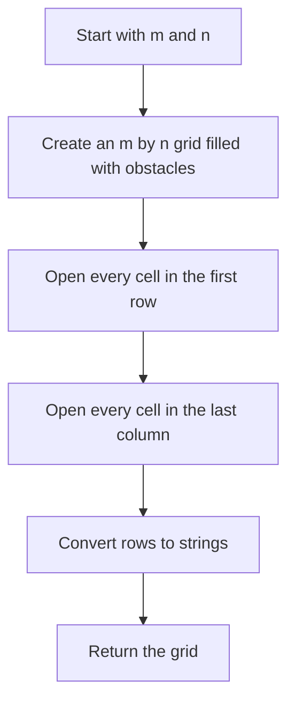
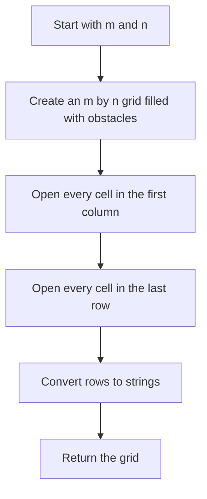

## 👨‍💻 Profiles

**GitHub:** https://github.com/Shailendra0320  
**LeetCode (Main):** https://leetcode.com/u/Shailu03/  
**LeetCode (Alternate):** https://leetcode.com/u/ShailendraLeetcode03/

# 3963. Create Grid With Exactly One Path

**Difficulty:** Easy  
**Topics:** Array, Matrix, Construction, Grid, Greedy  
**Main pattern:** Keep one simple path open and block every other cell.

**Official problem:** [LeetCode 3963 — Create Grid With Exactly One Path](https://leetcode.com/problems/create-grid-with-exactly-one-path/)

---

## Table of Contents

- [1. Understand the Problem](#1-understand-the-problem)
- [2. Official Examples](#2-official-examples)
- [3. The Main Insight](#3-the-main-insight)
- [4. Approach 1 — Open the Top Row and Last Column](#4-approach-1--open-the-top-row-and-last-column)
- [5. Approach 2 — Open the First Column and Last Row](#5-approach-2--open-the-first-column-and-last-row)
- [6. Compare the Approaches](#6-compare-the-approaches)
- [7. Edge Cases](#7-edge-cases)
- [8. Common Mistakes](#8-common-mistakes)
- [9. Interview Explanation](#9-interview-explanation)
- [10. Quick Revision](#10-quick-revision)

---

## 1. Understand the Problem

You are given two numbers:

- `m`: the number of rows.
- `n`: the number of columns.

Create an `m x n` grid that contains only these two characters:

| Character | Meaning |
|---|---|
| `.` | Free cell — you may walk through it |
| `#` | Obstacle — you cannot walk through it |

A valid path must start at the **top-left cell** `(0, 0)` and finish at the **bottom-right cell** `(m - 1, n - 1)`. You may move only **right** or **down**.

Your task is to return any grid with **exactly one valid path** between those two cells. The grid does not have to match the examples character for character. Many different grids are accepted as long as there is exactly one valid path.

### Constraints

- `1 <= m, n <= 25`
- The grid must contain exactly `m` rows and `n` columns.
- Every cell must be either `.` or `#`.
- The movement rules allow only right and down.

### Why can’t we simply make every cell free?

If every cell is `.` and both dimensions are greater than one, the path can choose different points at which to move down. That creates multiple valid routes. We must prevent those alternative routes.

---

## 2. Official Examples

### Example 1

```text
Input: m = 2, n = 3
Output: ["..#", "#.."]
```

One valid path is:

```text
Start -> right -> down -> right -> destination
```

The grid returned by our construction does not need to match the sample exactly. It only needs to contain exactly one valid path.

### Example 2

```text
Input: m = 3, n = 3
Output: ["..#", "#..", "##."]
```

The sample leaves one route open and blocks every alternative route.

### Example 3

```text
Input: m = 1, n = 4
Output: ["...."]
```

There is only one row. Because movement is only right or down, the only way to reach the last cell is to move right through the row.

> **Important:** This is a construction problem. You do not need to count paths or run DFS/BFS. Build the answer so that only one route is possible.

---

## 3. The Main Insight

The simplest plan is to choose one easy route from the start to the destination and make only the cells on that route free. Every other cell remains an obstacle.

One possible route is:

1. Move right across the **top row**.
2. Then move down the **last column** until reaching the destination.

The grid for this route is made by:

1. Filling the entire grid with `#`.
2. Changing every cell in the first row to `.`.
3. Changing every cell in the last column to `.`.

A mirrored version works too:

1. Fill the grid with `#`.
2. Open the first column.
3. Open the last row.

These two designs look different, but each leaves exactly one route.

### Visual idea

For `m = 3`, `n = 4`, the top-row-then-last-column grid is:

```text
S  .  .  .
#  #  #  .
#  #  #  E
```

The only route is:

```text
S -> right -> right -> right -> down -> down -> E
```

The cells directly below the top row are blocked until the last column, so the path cannot turn downward early.

---

## 4. Approach 1 — Open the Top Row and Last Column

**Idea:** Keep a route across the top, then down the right edge. Put obstacles everywhere else.

### Steps

1. Create `m` rows and `n` columns, filling every cell with `#`.
2. Change every cell in row `0` to `.`.
3. Change the cell at column `n - 1` in every row to `.`.
4. Convert each row to a string and return the grid.

### Flowchart



### Grid diagram

For `m = 3`, `n = 4`:

```text
      c0  c1  c2  c3
r0    S   .   .   .
r1    #   #   #   .
r2    #   #   #   E
```

`S` is the start `(0, 0)` and `E` is the destination `(m - 1, n - 1)`. They stand for free cells in the returned grid.

### Dry run

Suppose `m = 3`, `n = 4`.

| Step | Action | Grid after the step |
|---|---|---|
| 1 | Fill every cell with `#` | `#### / #### / ####` |
| 2 | Open row `0` | `.... / #### / ####` |
| 3 | Open column `3` | `... . / ###. / ###.` |

Written as actual strings, the final grid is:

```text
["....", "###.", "###."]
```

The only route is:

```text
(0,0) -> (0,1) -> (0,2) -> (0,3) -> (1,3) -> (2,3)
```

Why can’t the route go down earlier? Every cell below the first row is blocked in columns `0` through `n - 2`. The path can turn down only when it reaches the last column.

### Why this creates exactly one path

- The start cell is free because the first row is open.
- Every cell of the first row is free, so the path can move right across it.
- Before the final column, the cells directly below the top row are `#`. Therefore, a path cannot move down early.
- The last column is free from the top to the bottom, so the path can move down to the destination.
- There are no other free cells that could form an alternative route.

Thus, every valid path is forced to follow the same sequence: **right across the top, then down the last column**.

### Java — Approach 1

```java
//Approach-1 (Open Top Row and Last Column)
//T.C : O(m * n)
//S.C : O(m * n) for the returned grid

import java.util.Arrays;

class Solution {
    public String[] createGrid(int m, int n) {
        char[][] grid = new char[m][n];

        for (int r = 0; r < m; r++) {
            Arrays.fill(grid[r], '#');
        }

        Arrays.fill(grid[0], '.');

        for (int r = 0; r < m; r++) {
            grid[r][n - 1] = '.';
        }

        String[] answer = new String[m];
        for (int r = 0; r < m; r++) {
            answer[r] = new String(grid[r]);
        }

        return answer;
    }
}
```

### C++ — Approach 1

```cpp
//Approach-1 (Open Top Row and Last Column)
//T.C : O(m * n)
//S.C : O(m * n) for the returned grid

#include <bits/stdc++.h>
using namespace std;

class Solution {
public:
    vector<string> createGrid(int m, int n) {
        vector<string> grid(m, string(n, '#'));

        for (int c = 0; c < n; c++) {
            grid[0][c] = '.';
        }

        for (int r = 0; r < m; r++) {
            grid[r][n - 1] = '.';
        }

        return grid;
    }
};
```

### Python — Approach 1

```python
#Approach-1 (Open Top Row and Last Column)
#T.C : O(m * n)
#S.C : O(m * n) for the returned grid

from typing import List

class Solution:
    def createGrid(self, m: int, n: int) -> List[str]:
        grid = [['#'] * n for _ in range(m)]

        for c in range(n):
            grid[0][c] = '.'

        for r in range(m):
            grid[r][n - 1] = '.'

        return [''.join(row) for row in grid]
```

### Complexity — Approach 1

- **Time:** `O(m * n)` because we initialize every grid cell and then open the required cells.
- **Space:** `O(m * n)` for storing and returning the grid. Apart from the output itself, the construction uses only a small amount of extra working space.

---

## 5. Approach 2 — Open the First Column and Last Row

**Idea:** Use the mirrored route: move down the left edge first, then move right along the bottom row.

### Steps

1. Create an `m x n` grid filled with `#`.
2. Change every cell in column `0` to `.`.
3. Change every cell in the last row to `.`.
4. Convert the rows into strings and return them.

### Flowchart



### Grid diagram

For `m = 3`, `n = 4`:

```text
      c0  c1  c2  c3
r0    S   #   #   #
r1    .   #   #   #
r2    .   .   .   E
```

The unique route is:

```text
S -> down -> down -> right -> right -> right -> E
```

### Dry run

Input: `m = 3`, `n = 4`.

| Step | Action | Grid after the step |
|---|---|---|
| 1 | Fill all cells with `#` | `#### / #### / ####` |
| 2 | Open column `0` | `.### / .### / .###` |
| 3 | Open the last row | `.### / .### / ....` |

Final result:

```text
[".###", ".###", "...."]
```

The route is forced down the first column because every cell to the right of the start is blocked. Once the path reaches the bottom row, it moves right to the destination.

### Why this creates exactly one path

- The first column is open, so it connects the start to the bottom-left cell.
- In rows above the last row, all cells to the right of column `0` remain blocked. The path cannot turn right early.
- The last row is fully open and ends at the destination.
- Since every other cell remains blocked, no alternative route exists.

So the only possible route is **down the first column, then right across the bottom row**.

### Java — Approach 2

```java
//Approach-2 (Open First Column and Last Row)
//T.C : O(m * n)
//S.C : O(m * n) for the returned grid

import java.util.Arrays;

class Solution2 {
    public String[] createGrid(int m, int n) {
        char[][] grid = new char[m][n];

        for (int r = 0; r < m; r++) {
            Arrays.fill(grid[r], '#');
            grid[r][0] = '.';
        }

        Arrays.fill(grid[m - 1], '.');

        String[] answer = new String[m];
        for (int r = 0; r < m; r++) {
            answer[r] = new String(grid[r]);
        }

        return answer;
    }
}
```

### C++ — Approach 2

```cpp
//Approach-2 (Open First Column and Last Row)
//T.C : O(m * n)
//S.C : O(m * n) for the returned grid

#include <bits/stdc++.h>
using namespace std;

class Solution2 {
public:
    vector<string> createGrid(int m, int n) {
        vector<string> grid(m, string(n, '#'));

        for (int r = 0; r < m; r++) {
            grid[r][0] = '.';
        }

        for (int c = 0; c < n; c++) {
            grid[m - 1][c] = '.';
        }

        return grid;
    }
};
```

### Python — Approach 2

```python
#Approach-2 (Open First Column and Last Row)
#T.C : O(m * n)
#S.C : O(m * n) for the returned grid

from typing import List

class Solution2:
    def createGrid(self, m: int, n: int) -> List[str]:
        grid = [['#'] * n for _ in range(m)]

        for r in range(m):
            grid[r][0] = '.'

        for c in range(n):
            grid[m - 1][c] = '.'

        return [''.join(row) for row in grid]
```

### Complexity — Approach 2

- **Time:** `O(m * n)` to create and return the grid.
- **Space:** `O(m * n)` for the returned grid.

---

## 6. Compare the Approaches

| Detail | Approach 1 | Approach 2 |
|---|---|---|
| Route | Across the top, then down the right edge | Down the left edge, then across the bottom |
| Cells opened | First row and last column | First column and last row |
| Main loop | Open top row, then last column | Open first column, then bottom row |
| Time complexity | `O(m * n)` | `O(m * n)` |
| Output space | `O(m * n)` | `O(m * n)` |
| Best reason to use it | Natural right-then-down route | Natural down-then-right route |

Both approaches are correct. The problem accepts **any** grid with exactly one valid path, so there is no need to search for an optimal grid or produce the same grid as the sample output.

**Recommendation:** Use Approach 1. Its construction is direct: open the first row and the last column, and leave everything else blocked.

---

## 7. Edge Cases

### A single row: `m = 1`

Approach 1 opens the only row. The result is a row of dots, such as:

```text
Input:  m = 1, n = 4
Output: ["...."]
```

There is only one way to move from the first cell to the last: keep moving right.

### A single column: `n = 1`

Approach 1 opens the last column, which is also the only column:

```text
Input:  m = 4, n = 1
Output: [".", ".", ".", "."]
```

The only path is straight down.

### A single cell: `m = 1, n = 1`

The output is:

```text
["."]
```

The start and destination are the same cell, so the empty-move path is the only path.

### A rectangular grid

The same rule works whether `m` is greater than `n`, `n` is greater than `m`, or both values are equal. No special case is needed.

---

## 8. Common Mistakes

1. **Leaving all cells open.** That usually creates multiple routes.
2. **Blocking the start or destination.** Both must be free cells.
3. **Opening a row or column that does not connect to the destination.** The path must reach `(m - 1, n - 1)`.
4. **Thinking the output must match the sample.** The problem accepts any valid construction.
5. **Using DFS or BFS unnecessarily.** We can guarantee one path by constructing the grid directly.
6. **Forgetting single-row or single-column grids.** The same construction already handles them.
7. **Returning a character matrix instead of the required row strings.** The answer must be returned in the format expected by the language signature.

---

## 9. Interview Explanation

> “I only need to construct one route and prevent every alternative route. I fill the grid with obstacles, open the first row, and open the last column. The path must move right across the first row because all earlier downward moves lead to obstacles. Once it reaches the last column, it can move down to the destination. No other cells are open, so this is the only valid path. The construction takes `O(m * n)` time, which is also the size of the output.”

---

## 10. Quick Revision

- `.` means free cell; `#` means obstacle.
- Start: `(0, 0)`.
- Destination: `(m - 1, n - 1)`.
- Moves: right or down only.
- **Approach 1:** Start with all `#`; open the first row and last column.
- **Approach 2:** Start with all `#`; open the first column and last row.
- Each approach leaves exactly one route.
- Time complexity: `O(m * n)`.
- Output space: `O(m * n)`.
- No traversal or path counting is necessary.

---

## Final Takeaway

The key is **construction, not search**. Pick one simple route from the top-left to the bottom-right, make its cells free, and block every other cell. The route across the top and down the last column is an easy, reliable choice.

**Reference:** [LeetCode 3963 — Create Grid With Exactly One Path](https://leetcode.com/problems/create-grid-with-exactly-one-path/)
