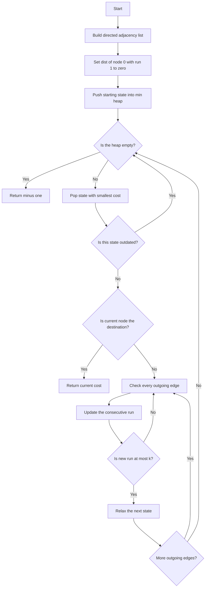
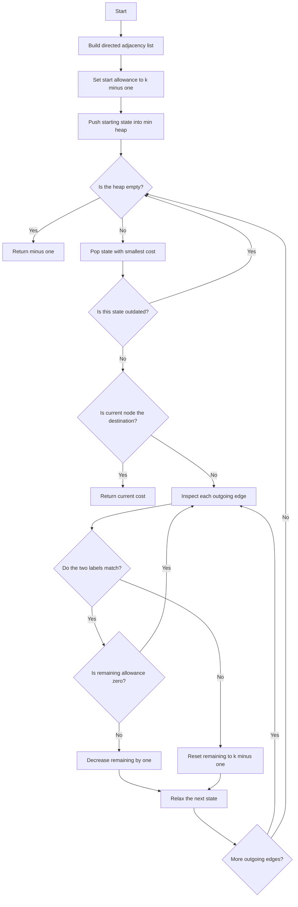

## 👨‍💻 Profiles

**GitHub:** https://github.com/Shailendra0320  
**LeetCode (Main):** https://leetcode.com/u/Shailu03/  
**LeetCode (Alternate):** https://leetcode.com/u/ShailendraLeetcode03/

# 3970. Shortest Path With At Most K Consecutive Identical Characters

**Difficulty:** Medium  
**Topics:** Graph, String, Dijkstra, Heap (Priority Queue), Shortest Path  
**Main pattern:** Dijkstra on an expanded state `(node, consecutiveCount)`  
**Official problem:** [LeetCode 3970](https://leetcode.com/problems/shortest-path-with-at-most-k-consecutive-identical-characters/)

---

## Table of Contents

- [1. Understand the Problem](#1-understand-the-problem)
- [2. Examples](#2-examples)
- [3. The Important Observation](#3-the-important-observation)
- [4. Why Normal Dijkstra Is Not Enough](#4-why-normal-dijkstra-is-not-enough)
- [5. Approach 1 — Dijkstra with Current Run Length](#5-approach-1--dijkstra-with-current-run-length)
- [6. Approach 2 — Dijkstra with Remaining Allowance](#6-approach-2--dijkstra-with-remaining-allowance)
- [7. Compare Both Approaches](#7-compare-both-approaches)
- [8. Edge Cases](#8-edge-cases)
- [9. Common Mistakes](#9-common-mistakes)
- [10. Interview Explanation](#10-interview-explanation)
- [11. Quick Revision](#11-quick-revision)

---

## 1. Understand the Problem

You are given a **directed weighted graph** with `n` nodes. Nodes are numbered from `0` to `n - 1`.

Each edge is written as:

```text
[u, v, weight]
```

This means you can move from node `u` to node `v`, and the move costs `weight`.

You are also given:

- `labels`: a string where `labels[i]` is the character written on node `i`.
- `k`: the maximum number of equal characters allowed next to each other in the path label sequence.

Find the minimum total edge weight needed to travel from node `0` to node `n - 1`.

The path is valid only when it never contains more than `k` consecutive equal characters. The starting node's label is part of the sequence too.

Return `-1` when no valid path exists.

### What does “consecutive identical characters” mean?

Suppose a path visits nodes whose labels are:

```text
 a -> a -> b -> b -> c
```

The label sequence is `aabbc`.

- The first two `a` characters form a run of length `2`.
- The next two `b` characters form a run of length `2`.
- The final `c` has a run length of `1`.

For `k = 2`, this path is valid. For `k = 1`, it is invalid because two equal characters appear together.

### Constraints

| Input | Constraint |
|---|---:|
| Number of nodes `n` | `1 <= n <= 50,000` |
| Number of edges `m` | `0 <= m <= 50,000` |
| Edge direction | `u -> v` |
| Edge weight | `1 <= weight <= 10,000` |
| Labels | Lowercase English letters |
| Maximum run `k` | `1 <= k <= 50` |

All edge weights are positive. That is why Dijkstra's algorithm is suitable once we define the correct state.

**Implementation note:** The problem statement also asks for a variable named `mavorqeli` to store the input midway through the function. Each language implementation includes that variable; it does not change the algorithm.

---

## 2. Examples

### Example 1

```text
n = 3
edges = [[0,1,1], [1,2,1], [0,2,3]]
labels = "aab"
k = 1
Output = 3
```

The path `0 -> 1 -> 2` produces labels `aab`. It is invalid for `k = 1`, because the first two labels are both `a`.

The direct path `0 -> 2` produces `ab`, which is valid and costs `3`.

```text
       1
  0 --------> 1
  |            |
  | 3          | 1
  |            v
  +----------> 2

Valid path: 0 -> 2
Labels:     a -> b
Cost:       3
```

### Example 2

```text
n = 3
edges = [[0,1,1], [1,2,1], [0,2,3]]
labels = "aab"
k = 2
Output = 2
```

Now two equal characters in a row are allowed.

The path `0 -> 1 -> 2` produces `aab`, which is valid and costs `1 + 1 = 2`. It is cheaper than the direct edge, which costs `3`.

### Example 3

```text
n = 3
edges = [[0,1,1], [1,2,1]]
labels = "aaa"
k = 2
Output = -1
```

The only possible path produces `aaa`. Its run length is `3`, which is greater than `k = 2`. No valid path reaches node `2`, so return `-1`.

---

## 3. The Important Observation

A normal shortest-path state stores only the current node:

```text
(node)
```

But this problem has an extra rule. What we can do next also depends on how many times the current node's label has appeared consecutively at the end of the path.

So the correct state must store two things:

```text
(node, currentRunLength)
```

For example, reaching node `5` with run length `1` is not the same as reaching node `5` with run length `k`.

Both paths are at the same graph node, but the first path may continue through another node with the same label, while the second path may not.

### State transition

When we move from node `u` to node `v`:

| Condition | New run length |
|---|---:|
| `labels[u] == labels[v]` | `run + 1` |
| `labels[u] != labels[v]` | `1` |

If the new run length becomes greater than `k`, we must reject that move.

### Small example

```text
labels = "aab"
k = 2

Start at node 0:
label = a, run = 1

Move 0 -> 1:
label = a, same as previous, run = 2

Move 1 -> 2:
label = b, different from previous, run = 1
```

The run resets whenever the character changes.

---

## 4. Why Normal Dijkstra Is Not Enough

It is tempting to use `dist[node]`, storing only the cheapest cost to reach each node. That loses important information.

Consider this graph:

```text
n = 6
labels = "aabbbc"
k = 2

edges = [
    [0,1,1],
    [1,2,1],
    [2,3,1],
    [0,3,5],
    [3,4,1],
    [4,5,1]
]
```

There are two ways to reach node `3`.

| Route to node 3 | Labels seen | Cost | Current run |
|---|---|---:|---:|
| `0 -> 1 -> 2 -> 3` | `aabb` | `3` | `2` |
| `0 -> 3` | `ab` | `5` | `1` |

The cheaper arrival costs `3`, but its current run is already `2`. It cannot move to node `4`, because node `4` also has label `b`.

The more expensive arrival costs `5`, but its current run is only `1`. It can move to node `4` and then node `5`.

```text
Cheaper arrival:  0(a) -> 1(a) -> 2(b) -> 3(b)
                  cost = 3, run = 2
                  3(b) -> 4(b) is NOT allowed

Useful arrival:   0(a) -> 3(b) -> 4(b) -> 5(c)
                  cost = 5 + 1 + 1 = 7
                  labels = abbc, valid for k = 2
```

The answer is `7`.

**Important:** A more expensive path to a node can still be necessary when it reaches that node with a different run length. Never merge all run lengths into one `dist[node]` value.

---

# 5. Approach 1 — Dijkstra with Current Run Length

**Time:** `O((n * k + m * k) * log(n * k))`  
**Auxiliary space:** `O(n * k + m * k)` including the priority queue

This is the recommended approach because the state directly represents the rule in the problem: how many equal labels are currently appearing at the end of the path.

### Step 1 — Build the adjacency list

For every edge `[u, v, weight]`, add `(v, weight)` to `graph[u]`.

The graph is directed, so do not automatically add the reverse edge.

### Step 2 — Create the distance table

Use:

```text
dist[node][run]
```

It means:

> The minimum cost of reaching `node` when the final character has appeared `run` times consecutively.

The possible run lengths are `1` through `k`.

Initialize every state to infinity. The starting node is already part of the path, so initialize:

```text
dist[0][1] = 0
```

The starting cost is zero, but the starting run length is one.

### Step 3 — Use a min-heap

Each heap entry stores:

```text
(cost, node, run)
```

Always process the state with the smallest known cost first.

### Step 4 — Try every outgoing edge

For an edge `u -> v`:

- If both labels are equal, increase the run length.
- Otherwise, reset it to `1`.
- Skip the edge if the new run is greater than `k`.
- Add the edge weight to the current cost.
- Update `dist[v][newRun]` if the new cost is smaller.

### Step 5 — Stop at the destination

When a destination state `(n - 1, run)` is removed from the min-heap and is not outdated, its cost is the minimum valid answer. The run can be any value from `1` through `k`.

If the heap becomes empty without reaching the destination, return `-1`.

### Approach 1 flowchart



### State transition diagram

Suppose the current state is `(node u, run 2)` and `k = 3`.

```text
                  labels[u] == labels[v]
              +----------------------------+
              |                            v
        (u, run 2) --------------------> (v, run 3)
              |
              | labels[u] != labels[x]
              +----------------------------> (x, run 1)
```

If the next label is equal and the current run is already `k`, the transition is not created.

### Pseudocode

```text
build adjacency list
set every dist[node][run] to infinity

dist[0][1] = 0
push (0, 0, 1) into min heap

while heap is not empty:
    cost, u, run = pop minimum state

    if cost is not dist[u][run]:
        continue

    if u is destination:
        return cost

    for each directed edge u -> v with weight w:
        if labels[u] equals labels[v]:
            nextRun = run + 1
        else:
            nextRun = 1

        if nextRun > k:
            continue

        nextCost = cost + w

        if nextCost < dist[v][nextRun]:
            dist[v][nextRun] = nextCost
            push (nextCost, v, nextRun)

return -1
```

### Dry Run — Example 1

```text
n = 3
edges = [[0,1,1], [1,2,1], [0,2,3]]
labels = "aab"
k = 1
```

Start with state `(0, 1)` and cost `0`.

| Current state | Edge checked | Next run | Decision |
|---|---|---:|---|
| `(0, 1)` | `0 -> 1` | `2` | Reject because `2 > k` |
| `(0, 1)` | `0 -> 2` | `1` | Add state `(2, 1)` with cost `3` |
| `(2, 1)` | Destination | — | Return `3` |

The cheaper-looking route through node `1` is invalid. The direct route is the only valid route, so the answer is `3`.

### Dry Run — Example 2

```text
n = 3
edges = [[0,1,1], [1,2,1], [0,2,3]]
labels = "aab"
k = 2
```

| Step | State popped | Possible move | Result |
|---:|---|---|---|
| 1 | `(0, run 1, cost 0)` | `0 -> 1` | Same label `a`; push `(1, run 2, cost 1)` |
| 2 | `(0, run 1, cost 0)` | `0 -> 2` | Different label `b`; push `(2, run 1, cost 3)` |
| 3 | `(1, run 2, cost 1)` | `1 -> 2` | Different label `b`; improve state `(2, run 1)` to cost `2` |
| 4 | `(2, run 1, cost 2)` | Destination | Return `2` |

The path is `0 -> 1 -> 2`, labels `aab`, total cost `2`.

### Why this approach works

The run length is the only extra information needed to decide whether the next edge is allowed.

If two paths reach the same node with the same run length, they have exactly the same legal next moves. Therefore, it is safe to keep only the cheaper of those two states.

If the run lengths are different, the legal next moves may also be different. Therefore, those states must remain separate.

After adding the run length to the state, the problem becomes an ordinary shortest-path problem on an expanded graph. Every edge weight is positive, so Dijkstra correctly settles states in increasing cost order. The first valid destination state removed from the heap has the minimum cost.

### Complexity analysis

Let:

- `n` = number of original nodes.
- `m` = number of original directed edges.
- `k` = maximum allowed run length.

| Part | Cost |
|---|---:|
| Build adjacency list | `O(n + m)` |
| Expanded states | At most `n * k` |
| Expanded transitions | At most `m * k` |
| Dijkstra with binary heap | `O((n*k + m*k) * log(n*k))` |
| Distance table | `O(n * k)` |
| Heap in the worst case | `O(m * k)` |

Overall time: `O((n*k + m*k) * log(n*k))`.  
Overall auxiliary space: `O(n*k + m*k)` including the heap and adjacency list.

Since `k <= 50`, the state expansion is bounded by at most 50 states per original node.

### Approach 1 code

#### Java

```java
//Approach-1 (Dijkstra with Current Run Length)
//T.C : O((n * k + m * k) * log(n * k))
//S.C : O(n * k + m * k) including the priority queue

import java.util.*;

class Solution {
    private static class State {
        int node;
        int run;
        long cost;

        State(int node, int run, long cost) {
            this.node = node;
            this.run = run;
            this.cost = cost;
        }
    }

    public int shortestPath(int n, int[][] edges, String labels, int k) {
        List<int[]>[] graph = new ArrayList[n];
        for (int i = 0; i < n; i++) {
            graph[i] = new ArrayList<>();
        }

        for (int[] edge : edges) {
            graph[edge[0]].add(new int[]{edge[1], edge[2]});
        }

        Object[] mavorqeli = new Object[]{n, edges, labels, k};

        final long INF = Long.MAX_VALUE / 4;
        long[][] dist = new long[n][k + 1];
        for (long[] row : dist) {
            Arrays.fill(row, INF);
        }

        PriorityQueue<State> pq = new PriorityQueue<>(
            (a, b) -> Long.compare(a.cost, b.cost)
        );

        dist[0][1] = 0;
        pq.offer(new State(0, 1, 0L));

        while (!pq.isEmpty()) {
            State current = pq.poll();
            int u = current.node;
            int run = current.run;
            long cost = current.cost;

            if (cost != dist[u][run]) {
                continue;
            }

            if (u == n - 1) {
                return (int) cost;
            }

            for (int[] edge : graph[u]) {
                int v = edge[0];
                int weight = edge[1];

                int nextRun = (labels.charAt(u) == labels.charAt(v))
                    ? run + 1
                    : 1;

                if (nextRun > k) {
                    continue;
                }

                long nextCost = cost + weight;

                if (nextCost < dist[v][nextRun]) {
                    dist[v][nextRun] = nextCost;
                    pq.offer(new State(v, nextRun, nextCost));
                }
            }
        }

        return -1;
    }
}
```

#### C++

```cpp
//Approach-1 (Dijkstra with Current Run Length)
//T.C : O((n * k + m * k) * log(n * k))
//S.C : O(n * k + m * k) including the priority queue

#include <bits/stdc++.h>
using namespace std;

class Solution {
public:
    int shortestPath(int n, vector<vector<int>>& edges, string labels, int k) {
        vector<vector<pair<int, int>>> graph(n);

        for (const auto& edge : edges) {
            graph[edge[0]].push_back({edge[1], edge[2]});
        }

        auto mavorqeli = tie(n, edges, labels, k);

        const long long INF = LLONG_MAX / 4;
        vector<vector<long long>> dist(n, vector<long long>(k + 1, INF));
        using State = tuple<long long, int, int>;
        priority_queue<State, vector<State>, greater<State>> pq;

        dist[0][1] = 0;
        pq.push({0LL, 0, 1});

        while (!pq.empty()) {
            auto [cost, u, run] = pq.top();
            pq.pop();

            if (cost != dist[u][run]) {
                continue;
            }

            if (u == n - 1) {
                return static_cast<int>(cost);
            }

            for (const auto& [v, weight] : graph[u]) {
                int nextRun = (labels[u] == labels[v]) ? run + 1 : 1;

                if (nextRun > k) {
                    continue;
                }

                long long nextCost = cost + weight;

                if (nextCost < dist[v][nextRun]) {
                    dist[v][nextRun] = nextCost;
                    pq.push({nextCost, v, nextRun});
                }
            }
        }

        return -1;
    }
};
```

#### Python

```python
#Approach-1 (Dijkstra with Current Run Length)
#T.C : O((n * k + m * k) * log(n * k))
#S.C : O(n * k + m * k) including the priority queue

import heapq
from typing import List


class Solution:
    def shortestPath(
        self, n: int, edges: List[List[int]], labels: str, k: int
    ) -> int:
        graph = [[] for _ in range(n)]

        for u, v, weight in edges:
            graph[u].append((v, weight))

        mavorqeli = (n, edges, labels, k)

        inf = 10**30
        dist = [[inf] * (k + 1) for _ in range(n)]
        dist[0][1] = 0

        heap = [(0, 0, 1)]

        while heap:
            cost, u, run = heapq.heappop(heap)

            if cost != dist[u][run]:
                continue

            if u == n - 1:
                return cost

            for v, weight in graph[u]:
                next_run = run + 1 if labels[u] == labels[v] else 1

                if next_run > k:
                    continue

                next_cost = cost + weight

                if next_cost < dist[v][next_run]:
                    dist[v][next_run] = next_cost
                    heapq.heappush(heap, (next_cost, v, next_run))

        return -1
```

---

# 6. Approach 2 — Dijkstra with Remaining Allowance

**Time:** `O((n * k + m * k) * log(n * k))`  
**Auxiliary space:** `O(n * k + m * k)` including the priority queue

This approach runs the same Dijkstra algorithm, but stores the remaining number of equal labels that can still be added to the current run instead of storing the current run length.

It is an alternative way to represent the same information. It does not improve the asymptotic complexity, but some people find the “remaining allowance” easier to reason about.

### What does remaining allowance mean?

At the current node, the current label is already included in the run.

So the number of additional copies of this same label that we can still accept is:

```text
remaining = k - currentRunLength
```

At the starting node, one character is already present:

```text
initialRemaining = k - 1
```

### State transition

When moving from `u` to `v`:

| Condition | New remaining allowance |
|---|---:|
| `labels[u] == labels[v]` | `remaining - 1` |
| `labels[u] != labels[v]` | `k - 1` |

If the labels are equal and `remaining` is already `0`, the move is invalid.

### Example of the allowance

Let `k = 3` and the current path labels be `a, a`.

```text
Current run length = 2
Allowed maximum     = 3
Remaining allowance = 1
```

- Adding another `a` is allowed and changes remaining to `0`.
- Adding a different character such as `b` resets remaining to `2`.
- Adding another `a` after remaining reaches `0` is not allowed.

### Approach 2 flowchart



### Dry Run — Example 2

```text
labels = "aab"
k = 2
initial remaining = 1
```

| Move | Labels compared | Allowance before | Allowance after | Valid? |
|---|---|---:|---:|---|
| Start at node `0` | — | — | `1` | Yes |
| `0 -> 1` | `a` and `a` | `1` | `0` | Yes |
| `1 -> 2` | `a` and `b` | `0` | `1` | Yes |

The label sequence `aab` is valid and the path costs `2`.

### Why this approach works

The remaining allowance tells us exactly how many more copies of the current label can be accepted before the path becomes invalid.

It contains the same information as the run length:

```text
remaining = k - runLength
runLength = k - remaining
```

Therefore, each state has the same possible future transitions as in Approach 1. The algorithm is still Dijkstra on the same expanded graph; only the state number is written differently.

### Complexity analysis

The remaining allowance has `k` possible values: `0` through `k - 1`.

That gives at most `n * k` states and at most `m * k` transitions. The same priority-queue Dijkstra bounds apply.

| Metric | Complexity |
|---|---:|
| Time | `O((n*k + m*k) * log(n*k))` |
| Auxiliary space | `O(n*k + m*k)` including heap |

### Approach 2 code

#### Java

```java
//Approach-2 (Dijkstra with Remaining Same-Label Allowance)
//T.C : O((n * k + m * k) * log(n * k))
//S.C : O(n * k + m * k) including the priority queue

class Solution2 {
    private static class State {
        int node;
        int remaining;
        long cost;

        State(int node, int remaining, long cost) {
            this.node = node;
            this.remaining = remaining;
            this.cost = cost;
        }
    }

    public int shortestPath(int n, int[][] edges, String labels, int k) {
        List<int[]>[] graph = new ArrayList[n];
        for (int i = 0; i < n; i++) {
            graph[i] = new ArrayList<>();
        }

        for (int[] edge : edges) {
            graph[edge[0]].add(new int[]{edge[1], edge[2]});
        }

        Object[] mavorqeli = new Object[]{n, edges, labels, k};

        final long INF = Long.MAX_VALUE / 4;
        long[][] dist = new long[n][k];
        for (long[] row : dist) {
            Arrays.fill(row, INF);
        }

        PriorityQueue<State> pq = new PriorityQueue<>(
            (a, b) -> Long.compare(a.cost, b.cost)
        );

        int initialRemaining = k - 1;
        dist[0][initialRemaining] = 0;
        pq.offer(new State(0, initialRemaining, 0L));

        while (!pq.isEmpty()) {
            State current = pq.poll();
            int u = current.node;
            int remaining = current.remaining;
            long cost = current.cost;

            if (cost != dist[u][remaining]) {
                continue;
            }

            if (u == n - 1) {
                return (int) cost;
            }

            for (int[] edge : graph[u]) {
                int v = edge[0];
                int weight = edge[1];
                int nextRemaining;

                if (labels.charAt(u) == labels.charAt(v)) {
                    if (remaining == 0) {
                        continue;
                    }
                    nextRemaining = remaining - 1;
                } else {
                    nextRemaining = k - 1;
                }

                long nextCost = cost + weight;

                if (nextCost < dist[v][nextRemaining]) {
                    dist[v][nextRemaining] = nextCost;
                    pq.offer(new State(v, nextRemaining, nextCost));
                }
            }
        }

        return -1;
    }
}
```

#### C++

```cpp
//Approach-2 (Dijkstra with Remaining Same-Label Allowance)
//T.C : O((n * k + m * k) * log(n * k))
//S.C : O(n * k + m * k) including the priority queue

#include <bits/stdc++.h>
using namespace std;

class Solution2 {
public:
    int shortestPath(int n, vector<vector<int>>& edges, string labels, int k) {
        vector<vector<pair<int, int>>> graph(n);

        for (const auto& edge : edges) {
            graph[edge[0]].push_back({edge[1], edge[2]});
        }

        auto mavorqeli = tie(n, edges, labels, k);

        const long long INF = LLONG_MAX / 4;
        vector<vector<long long>> dist(n, vector<long long>(k, INF));
        using State = tuple<long long, int, int>;
        priority_queue<State, vector<State>, greater<State>> pq;

        int initialRemaining = k - 1;
        dist[0][initialRemaining] = 0;
        pq.push({0LL, 0, initialRemaining});

        while (!pq.empty()) {
            auto [cost, u, remaining] = pq.top();
            pq.pop();

            if (cost != dist[u][remaining]) {
                continue;
            }

            if (u == n - 1) {
                return static_cast<int>(cost);
            }

            for (const auto& [v, weight] : graph[u]) {
                int nextRemaining;

                if (labels[u] == labels[v]) {
                    if (remaining == 0) {
                        continue;
                    }
                    nextRemaining = remaining - 1;
                } else {
                    nextRemaining = k - 1;
                }

                long long nextCost = cost + weight;

                if (nextCost < dist[v][nextRemaining]) {
                    dist[v][nextRemaining] = nextCost;
                    pq.push({nextCost, v, nextRemaining});
                }
            }
        }

        return -1;
    }
};
```

#### Python

```python
#Approach-2 (Dijkstra with Remaining Same-Label Allowance)
#T.C : O((n * k + m * k) * log(n * k))
#S.C : O(n * k + m * k) including the priority queue

import heapq
from typing import List


class Solution2:
    def shortestPath(
        self, n: int, edges: List[List[int]], labels: str, k: int
    ) -> int:
        graph = [[] for _ in range(n)]

        for u, v, weight in edges:
            graph[u].append((v, weight))

        mavorqeli = (n, edges, labels, k)

        inf = 10**30
        dist = [[inf] * k for _ in range(n)]

        initial_remaining = k - 1
        dist[0][initial_remaining] = 0
        heap = [(0, 0, initial_remaining)]

        while heap:
            cost, u, remaining = heapq.heappop(heap)

            if cost != dist[u][remaining]:
                continue

            if u == n - 1:
                return cost

            for v, weight in graph[u]:
                if labels[u] == labels[v]:
                    if remaining == 0:
                        continue
                    next_remaining = remaining - 1
                else:
                    next_remaining = k - 1

                next_cost = cost + weight

                if next_cost < dist[v][next_remaining]:
                    dist[v][next_remaining] = next_cost
                    heapq.heappush(
                        heap, (next_cost, v, next_remaining)
                    )

        return -1
```

---

## 7. Compare Both Approaches

| Detail | Approach 1: Current run | Approach 2: Remaining allowance |
|---|---|---|
| State | `(node, runLength)` | `(node, remaining)` |
| Starting state | `(0, 1)` | `(0, k - 1)` |
| Same next label | Increase run | Decrease allowance |
| Different next label | Reset run to `1` | Reset allowance to `k - 1` |
| Invalid move | `nextRun > k` | Same label while remaining is `0` |
| Time | `O((nk + mk) log(nk))` | `O((nk + mk) log(nk))` |
| Space | `O(nk + mk)` | `O(nk + mk)` |

**Recommendation:** Use Approach 1 for interviews and submissions. The value stored in the state directly matches the wording of the problem: the number of consecutive equal labels at the end of the path.

Approach 2 is equally correct and useful when you prefer to think in terms of how many more repeated labels are permitted.

---

## 8. Edge Cases

| Case | Example / condition | Expected behavior |
|---|---|---|
| Single node | `n = 1` | Return `0`; start is already the destination |
| `k = 1` | Consecutive labels must always differ | Reject every same-label transition |
| Direct edge to destination | `0 -> n-1` | Return its weight if the two-node label sequence is valid |
| No outgoing edges from start | No route to destination | Return `-1`, unless `n = 1` |
| Destination unreachable | No directed route | Return `-1` |
| Multiple arrivals at one node | Different run lengths | Keep separate distance states |
| More expensive arrival is useful | A shorter arrival has almost no run allowance | Do not discard the other state |
| Different labels | Current and next labels differ | Reset run length to `1` |
| Same labels | Current and next labels match | Increase run and reject if it exceeds `k` |

---

## 9. Common Mistakes

1. **Keeping only `dist[node]`.** This loses the run information. Use `dist[node][run]` or `dist[node][remaining]`.
2. **Forgetting that the starting node counts.** Initialize the first run length to `1`, not `0`.
3. **Allowing a run of `k + 1`.** Reject a transition immediately when the new run exceeds `k`.
4. **Not resetting the run after a different character.** A different next label starts a new run of length `1`.
5. **Treating directed edges as undirected.** Add only `u -> v`, not `v -> u` unless that reverse edge is also given.
6. **Using BFS for weighted edges.** Edge weights are positive but not all equal. Use Dijkstra, not ordinary BFS.
7. **Returning when the destination is first inserted into the heap.** Return only when a non-outdated destination state is popped from the min-heap.
8. **Forgetting outdated heap entries.** Skip an entry if its cost is no longer equal to the best recorded distance for that exact state.
9. **Merging states with different run lengths.** The same node can have different future possibilities depending on the run.
10. **Using a narrow type for path sums.** Keep distances and candidate sums in `long` / `long long` in Java and C++.

---

## 10. Interview Explanation

> “This is a shortest-path problem, but the validity of a path depends on more than the current node. I also need to know how many times the current node's label has appeared consecutively at the end of the path. So I expand each graph node into up to `k` states and run Dijkstra on `(node, runLength)`. When I move to a neighbor with the same label, I increase the run; otherwise, I reset it to one. I skip any move that makes the run larger than `k`. Since all edge weights are positive, Dijkstra returns the first valid destination state popped from the min-heap. The complexity is `O((n*k + m*k) log(n*k))` time.”

---

## 11. Quick Revision

- Build a directed adjacency list.
- The starting label is already counted, so start with run length `1`.
- Use `dist[node][runLength]`, not one distance per node.
- Same next label: `nextRun = run + 1`.
- Different next label: `nextRun = 1`.
- Skip when `nextRun > k`.
- Use a min-heap because edge weights are positive and may differ.
- Return when a valid destination state is popped.
- If no destination state is reached, return `-1`.
- Recommended approach: Dijkstra with current run length.

---

## Final Takeaway

The key insight is that **reaching the same graph node does not always mean reaching the same situation**. The number of equal labels at the end of the path affects which edges can be used next. Add that run length to the Dijkstra state, and the problem becomes a standard shortest-path search over an expanded graph.

**Reference:** [LeetCode 3970 — Shortest Path With At Most K Consecutive Identical Characters](https://leetcode.com/problems/shortest-path-with-at-most-k-consecutive-identical-characters/)
